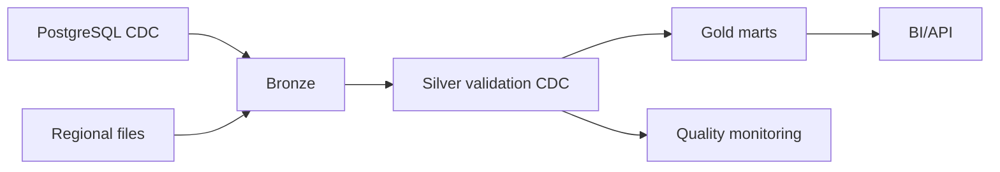
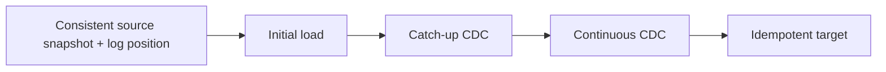
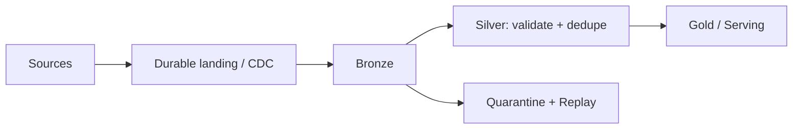

# 30-Day Data Engineering Interview Prep

**SQL · Python · PySpark · Databricks · System design**

Senior Data Engineer study notes and interview workbook

30 daily chapters · 30 worked labs · 4 timed mocks

Built around a multi-region orders pipeline using India and US CSV feeds and Europe JSON.

## How to use this book

This book targets senior data engineering interviews for roughly seven years of experience. Set aside 90 minutes for each active study session. Begin with 15 minutes of recall, spend 55 minutes implementing or reasoning through the core example, and use the final 20 minutes to check output and answer a follow-up aloud. On mock days use the listed timer. Read the longer interview notes in additional sessions or use them to revisit weak areas.

Read the day opening and mark what you already know. Each chapter then covers seven specific topics with explanations and practice answers. Stop at the design or lab prompt and predict the result before looking at the worked solution. Record one implementation decision and one observation that supports it.

### An answer you can defend

For SQL, state output grain and give a three-row edge case. For PySpark, describe the plan and name the first stage or metric you would inspect. For Databricks, connect each guarantee to the source, engine, target, and replay procedure. For design, explain trade-offs against freshness, recoverability, correctness, and cost. For experience questions, own your actions and share evidence you can substantiate.

Use the sample data and runnable patterns where a local engine is available. Some labs are paper or verbal scenarios. Spark and Databricks experiments require a compatible runtime and a lab workspace. Unless specified, sample metrics are hypothetical.

## Contents · Days 01–07

**SQL and PostgreSQL**

- [Day 01 · Joins, cardinality, and existence](#day-01--joins-cardinality-and-existence)

- [Day 02 · Aggregation, NULLs, and metric contracts](#day-02--aggregation-nulls-and-metric-contracts)

- [Day 03 · Windows, ranking, and deterministic ties](#day-03--windows-ranking-and-deterministic-ties)

- [Day 04 · Date spines and rolling metrics](#day-04--date-spines-and-rolling-metrics)

- [Day 05 · CTEs, deduplication, and retention](#day-05--ctes-deduplication-and-retention)

- [Day 06 · Query plans, indexes, and measurement](#day-06--query-plans-indexes-and-measurement)

- [Day 07 · Mock 1 · SQL](#day-07--mock-1--sql)

Start with cardinality and grain. After this block you should be able to prove a result on a tiny fixture, explain a window with missing dates or ties, and read a PostgreSQL plan with actual evidence.

## Contents · Days 08–14

**Python and PySpark**

- [Day 08 · Python for reliable ETL](#day-08--python-for-reliable-etl)

- [Day 09 · DataFrames, schemas, and validation](#day-09--dataframes-schemas-and-validation)

- [Day 10 · Execution plans, joins, and shuffle](#day-10--execution-plans-joins-and-shuffle)

- [Day 11 · Skew and partitioning](#day-11--skew-and-partitioning)

- [Day 12 · Deduplication and latest-state logic](#day-12--deduplication-and-latest-state-logic)

- [Day 13 · Spark UI troubleshooting](#day-13--spark-ui-troubleshooting)

- [Day 14 · Mock 2 · PySpark](#day-14--mock-2--pyspark)

Use Python for source validation and PySpark for parallel transformation. Track the cost of shuffle and state, then practice diagnosis under time pressure.

## Contents · Days 15–21

**Databricks and Lakeflow**

- [Day 15 · Medallion architecture and data modeling](#day-15--medallion-architecture-and-data-modeling)

- [Day 16 · Auto Loader, schema evolution, and rescued data](#day-16--auto-loader-schema-evolution-and-rescued-data)

- [Day 17 · Lakeflow streaming tables, append flows, and BY NAME](#day-17--lakeflow-streaming-tables-append-flows-and-by-name)

- [Day 18 · Delta MERGE and idempotent writes](#day-18--delta-merge-and-idempotent-writes)

- [Day 19 · CDC and Slowly Changing Dimensions](#day-19--cdc-and-slowly-changing-dimensions)

- [Day 20 · Structured Streaming, watermarks, and recovery](#day-20--structured-streaming-watermarks-and-recovery)

- [Day 21 · Liquid clustering, Delta storage, and Unity Catalog](#day-21--liquid-clustering-delta-storage-and-unity-catalog)

Use the three region feeds as a lab. Start with schema and table design, then follow incremental updates, replay, CDC, and data publication through the pipeline.

## Contents · Days 22–30

**System design and interview rehearsal**

- [Day 22 · System design · from requirements to operations](#day-22--system-design--from-requirements-to-operations)

- [Day 23 · Orchestration, data quality, and incident response](#day-23--orchestration-data-quality-and-incident-response)

- [Day 24 · Mock 3 · Senior system design](#day-24--mock-3--senior-system-design)

- [Day 25 · Advanced SQL retest](#day-25--advanced-sql-retest)

- [Day 26 · Troubleshooting retest](#day-26--troubleshooting-retest)

- [Day 27 · Project walkthrough and senior trade-offs](#day-27--project-walkthrough-and-senior-trade-offs)

- [Day 28 · Behavioral interview and ownership](#day-28--behavioral-interview-and-ownership)

- [Day 29 · Mock 4 · Full interview loop](#day-29--mock-4--full-interview-loop)

- [Day 30 · Final retest and interview-day notes](#day-30--final-retest-and-interview-day-notes)

Move from implementation detail to architecture, operations, and ownership stories. Use all four mock scores to pick the final retests. The appendices include PostgreSQL data, verification cases, and rapid revision.

[Practice data and answer keys](#postgresql-practice-data) · [Mock scoring](#mock-scoring-and-error-log) · [Rapid revision](#rapid-revision--part-1)

## Running project · Multi-Region Orders

Use your existing **India CSV, US CSV, and Europe JSON** feeds. Start with small records that you can check by hand. Treat the report requirements and SLAs in this guide as lab assumptions.

| Layer | Dataset | Grain and responsibility |
| --- | --- | --- |
| Landing | Regional files | Immutable deliveries. Preserve source, arrival time, and replayable history. |
| Bronze | `raw_india_orders`, `raw_us_orders`, `raw_europe_orders`, `raw_orders` | One row per ingested record. Keep enough metadata to trace repeated or malformed deliveries. |
| Silver | `silver_orders` | One current row per `(region, order_id)`. Validate types and apply valid corrections using an authoritative source sequence. |
| Silver | `customer_history` | One row per customer version. Track the sequence or effective time span explicitly. |
| Gold | `daily_region_sales` | One row per UTC sales date, region, and currency. Add a separate regional business-date view if required. |

For the lab, each order has one product and `amount` is an order total. If the real feed carries multiple line items, change the transaction grain to include `line_id` or aggregate lines before joining to order-level facts. Use decimals for monetary values. Keep amounts separate by currency unless a conversion rate and effective date are part of the metric contract.

## Day 01 · Joins, cardinality, and existence

**Notes.** A join produces a row for each matching pair. Two matching rows on the left and three on the right create six rows. For an equality join, a NULL key does not match another NULL key. A left join preserves unmatched left rows by extending right-side columns with NULLs. A right-side predicate in `WHERE` can remove those rows, so place it in `ON` when the requirement is to retain unmatched left rows.

**Drill.** Count customers with at least one order without inflating the result. Then change the condition to find customers with zero orders.

```sql
SELECT c.region, c.customer_id
FROM interview_customers c
WHERE EXISTS (
    SELECT 1
    FROM interview_orders o
    WHERE o.region = c.region
      AND o.customer_id = c.customer_id
)
ORDER BY c.region, c.customer_id;
```

**Interview trick.** State the keys and expected relationship first. “This is one customer to many orders, so I use `EXISTS` to preserve customer grain.” For the anti-join, `NOT EXISTS` makes the matching logic explicit. Ask whether unknown customer IDs should count as unmatched.

**Checkpoint.** The fixture returns four customers with orders, and `NOT EXISTS` returns `INDIA/C3` and `US/C2`.

### Grain and cardinality

Say what a row represents on each side and in the result. If one order has two lines and three payment attempts, joining both details on order creates six rows. Inventory needs lines and settlement needs attempts. An order summary needs one row per order from each detail before the summaries meet. The quick defense is to compute match counts by key and predict where the result will expand.

#### Interview practice

**Can an INNER JOIN return more rows than either input?**

Yes. Each matching row pair appears. If one key occurs four times in table A and five times in table B, that key alone creates twenty joined rows. Pre-aggregate or deduplicate at the correct business grain before joining measures.

**Example.**

```sql
SELECT a.id, b.id
FROM a JOIN b ON a.customer_id = b.customer_id;
-- 4 matching left rows x 5 right rows = 20 rows
```

**How would you explain join cardinality in an interview?**

Every matching pair contributes a row; one-to-many and many-to-many relationships can multiply results. Decide output grain before joining facts.

**Two detail tables each contain several rows per order; how do you prevent revenue inflation?**

Pre-aggregate each detail table to order_id, or join on a genuinely unique key, before summing order-level amounts. Compare totals before and after the join.

**Which edge cases matter for join cardinality?**

Test duplicated keys on both sides; SUM(DISTINCT amount) is not a valid general repair because legitimate equal amounts exist.

### Preserving unmatched rows

A left join first decides what matches, then supplies an unmatched left row when there is no eligible match. A filter written in WHERE is evaluated afterward. Given a customer with a cancelled order and no paid order, a paid predicate in ON produces that customer with NULL order fields. Adding OR order_id IS NULL to a WHERE filter still loses that customer if the cancelled row matched the join.

#### Interview practice

**How does LEFT JOIN filtering differ between ON and WHERE?**

A right-table filter inside `ON` controls which rows match and preserves all left-side rows. The same filter in `WHERE` removes NULL-extended unmatched rows, potentially converting the outcome into an inner-match result.

**Example.**

```sql
SELECT c.id, o.id FROM customers c
LEFT JOIN orders o ON c.id=o.customer_id AND o.status='paid';
-- Keeps customers with no paid orders
```

**How would you explain outer join predicate placement in an interview?**

Predicates in ON control matches while preserving the outer side; right-side predicates in WHERE may remove null-extended rows.

**Practical illustration**

```sql
SELECT c.id, COUNT(o.id) paid_orders FROM customers c
LEFT JOIN orders o ON o.customer_id=c.id AND o.status='paid'
GROUP BY c.id;
```

**A report must show every customer including those with no paid orders; how do you write it?**

LEFT JOIN orders ON matching customer AND status='paid', then count orders.order_id. A WHERE status='paid' would remove customers with zero paid orders.

### Semi joins and membership

Existence is a Boolean property at the left row's grain. Duplicate eligible events on the right do not multiply a left row with EXISTS. A join followed by DISTINCT can accidentally collapse legitimate duplicates on the left. In an interview, separate two questions: whether the result is correct and which physical strategy the optimizer chooses for the current data.

#### Interview practice

**How would you explain semi joins and EXISTS in an interview?**

EXISTS returns a boolean per outer row and avoids row multiplication when only presence matters.

**Return customers who bought at least one item in the last 90 days, one row per customer.**

Use WHERE EXISTS with a correlated customer ID and bounded order_date predicate; avoid unnecessary DISTINCT over a fanout join.

**Which edge cases matter for semi joins and EXISTS?**

Test customers with multiple orders and orders outside the date window; ensure they appear at most once.

**How would you explain IN versus EXISTS in an interview?**

IN is membership testing and EXISTS checks row existence; planner rewrites depend on data and NULL semantics.

### Anti joins and three-valued logic

For a nonmatching value tested against (7, NULL), NOT IN must account for the unknown comparison and does not evaluate true. A correlated NOT EXISTS lists rows for which the predicate found no true match. Decide what to do with NULL on the left. Under equality it has no match, which may be correct for one report and a data-quality error for another.

#### Interview practice

**How do you find customers without any orders safely when NULL keys exist?**

Use `NOT EXISTS` with a correlated equality predicate. `NOT IN (subquery)` can return UNKNOWN if the subquery contains NULL; this may produce no rows despite genuine nonmatches.

**Example.**

```sql
SELECT c.customer_id FROM customers c
WHERE NOT EXISTS (SELECT 1 FROM orders o
                  WHERE o.customer_id = c.customer_id);
```

**How would you explain anti joins and NOT EXISTS in an interview?**

NOT EXISTS expresses absence of a correlated match and handles nullable subquery columns more predictably than NOT IN.

**Practical illustration**

```sql
SELECT p.product_id FROM products p
WHERE NOT EXISTS (SELECT 1 FROM order_items i WHERE i.product_id = p.product_id);
```

**Find products that have never appeared in order_items even when order_items.product_id contains NULL.**

SELECT p.product_id FROM products p WHERE NOT EXISTS (SELECT 1 FROM order_items i WHERE i.product_id=p.product_id). Index the inner lookup key for scale.

**Which edge cases matter for anti joins and NOT EXISTS?**

A NULL in NOT IN's list can make a nonmatch UNKNOWN; test nullable keys and repeated child rows.

### Safe enrichment and relationship tests

A dimension table promised to have one row per product can violate that promise after a history migration. Group it by the full join key and investigate any count above one. If it's meant to be historical, include the effective-range condition. Compare the count and sum of the same fact keys before and after enrichment. Checking only grand totals can hide one duplicate and one missing record.

#### Interview practice

**How would you explain GROUP BY and grain in an interview?**

GROUP BY collapses input rows to one row per distinct grouping key; granularity determines whether metrics are accurate.

**You need daily orders by region but raw data includes each line item; how do you count orders?**

Group by region and date while COUNT(DISTINCT order_id) counts orders, or pre-aggregate at order grain before joining dimensions.

**Which edge cases matter for GROUP BY and grain?**

Grouping by unneeded line-item attributes changes grain; test orders with several items and partial cancellations.

**How would you explain fact grain and dimensional modeling in an interview?**

A fact table's declared grain determines one row's meaning, keys and valid measures; dimensions provide context.

**Practical illustration**

```sql
-- Aggregate payments to order grain before joining order headers:
WITH p AS (SELECT order_id,SUM(amount) payment_total FROM payments GROUP BY order_id)
SELECT o.order_id,p.payment_total FROM orders o LEFT JOIN p USING(order_id);
```

### Set operations and source identity

UNION ALL retains both inputs' multiplicities, which is valuable in raw ingestion and reconciliation. UNION applies duplicate elimination across the projected columns. INTERSECT and EXCEPT answer set questions and have different multiplicity semantics with ALL. Preserve source provenance explicitly. Two equal amounts after projection can belong to independent orders and should remain separate.

#### Interview practice

**How would you explain set operations in an interview?**

UNION removes duplicates; UNION ALL retains them; INTERSECT returns shared rows and EXCEPT returns left-only rows.

**Consolidate two region feeds while retaining source duplicates for quality auditing.**

UNION ALL with an added source_system column preserves evidence; deduplicate in a separate controlled stage.

**Which edge cases matter for set operations?**

UNION can conceal duplicate upstream events and incurs deduplication costs; verify desired bag/set semantics.

### Reconciliation joins

Aggregate at identical region, currency, and date grain on both sides, then full-join the controls. Report one-sided keys and differences separately. Capture NULL-key counts before matching and agree whether those keys are invalid or should compare null-safely. A consistent extraction cutoff is as important as SQL syntax because changes between snapshots can look like drops.

#### Interview practice

**How would you compare rows in stage and target and find mismatches?**

Use a FULL OUTER JOIN on unique business keys (or compare preaggregated hashes at matching grain). Classify stage-only, target-only and changed rows. `IS DISTINCT FROM` handles NULL attribute comparisons; store run IDs, counts and issue categories for observability.

**Example.**

```sql
SELECT COALESCE(s.id,t.id) AS id,
 CASE WHEN s.id IS NULL THEN 'TARGET_ONLY'
      WHEN t.id IS NULL THEN 'STAGE_ONLY'
      WHEN s.amount IS DISTINCT FROM t.amount THEN 'CHANGED'
      ELSE 'MATCHED' END AS status
FROM stage s FULL JOIN target t ON s.id=t.id;
```

**How would you explain reconciliation with FULL OUTER JOIN in an interview?**

FULL JOIN and NULL-safe comparisons expose missing, unexpected and changed records across source and target.

**Practical illustration**

```sql
SELECT COALESCE(s.id,t.id) id,
 CASE WHEN s.id IS NULL THEN 'TARGET_ONLY' WHEN t.id IS NULL THEN 'SOURCE_ONLY'
 WHEN s.amount IS DISTINCT FROM t.amount THEN 'MISMATCH' ELSE 'MATCH' END status
FROM source_orders s FULL JOIN target_orders t USING (id);
```

### Lab · Payments and order-line fan-out

Two orders each contain multiple records. Finance wants one row per order, showing merchandise total, settled amount, and payment-attempt count. Treat merchandise and payments as INR for this fixture.

| Order | Line amounts | Payment attempts |
| --- | --- | --- |
| O1 | 60, 40 | settled 100, failed 100, failed 100 |
| O2 | 50, 50 | none |
| O3 | none | settled 20 |

1. Predict raw matches for O1 when both details join to the header.
2. Show why SUM(DISTINCT line_amount) fails for O2.
3. Write a solution that retains all orders. State how you will flag a payment without merchandise.
4. Add a paid and a failed attempt to O2 and predict the changed columns.

### Worked solution · Payments and order-line fan-out

O1 has two lines and three attempts, which create six joined rows. A plain merchandise SUM would report 300 and a settled-payment SUM would report 200 for O1. O2 illustrates why equal line amounts remain separate facts.

```sql
WITH lines AS (
    SELECT order_id, SUM(line_amount) AS merchandise
    FROM order_lines GROUP BY order_id
), paid AS (
    SELECT order_id, COUNT(*) AS attempts,
           SUM(amount) FILTER (WHERE status = 'settled') AS settled
    FROM payment_attempts GROUP BY order_id
)
SELECT o.order_id, COALESCE(l.merchandise, 0) AS merchandise,
       COALESCE(p.settled, 0) AS settled,
       COALESCE(p.attempts, 0) AS attempts,
       l.order_id IS NULL AND COALESCE(p.settled, 0) <> 0 AS needs_review
FROM orders o
LEFT JOIN lines l USING (order_id)
LEFT JOIN paid p USING (order_id);
```

Expected tuples for O1, O2, and O3 are (100, 100, 3), (100, 0, 0), and (0, 20, 1). O3 needs review. Verify header retention, unique result keys, and each summary against its raw detail.

## Day 02 · Aggregation, NULLs, and metric contracts

**Notes.** `COUNT(*)` counts rows. `COUNT(column)` counts non-NULL values. `COUNT(DISTINCT column)` counts distinct non-NULL values. When joining customers to orders, `COUNT(*)` gives an unmatched customer one row, while `COUNT(o.order_id)` gives that customer zero orders. `SUM` over no non-NULL inputs returns NULL. Convert it to zero when that is the intended reporting meaning.

**Drill.** Write a regional rollup with order count, unique known customers who ordered, and revenue in local currency. Use `interview_orders` for current records. Join to the customer table separately and report a zero-order customer without dropping them.

**Interview trick.** Ask whether revenue includes returns, tax, discounts, and cancellations. Clarify currency and grain before discussing query syntax. If asked why revenue doubled after a join, compare row counts and revenue before and after, then inspect duplicates in the dimension's join key.

**Checkpoint.** Expected current sales totals are INR 600.00, USD 120.00, and EUR 70.00. The US has two orders and one known customer who ordered.

### Row filters and group filters

Rows that fail WHERE do not participate in any aggregate. HAVING filters the completed groups. An analyst might want customers with five total purchases and a count of paid ones, which differs from counting five paid purchases after filtering. Read the English carefully and write the two rules independently before choosing a clause.

#### Interview practice

**Where and HAVING: what changes when paid orders are filtered?**

`WHERE` filters source rows before grouping; `HAVING` filters groups after aggregation. For “customers with two paid orders,” put the paid status filter in `WHERE`, group by customer, and apply `HAVING COUNT(*) >= 2`.

**Example.**

```sql
SELECT customer_id FROM orders
WHERE status='paid' GROUP BY customer_id HAVING COUNT(*) >= 2;
```

**How would you explain WHERE versus HAVING in an interview?**

WHERE filters source rows before aggregation, while HAVING filters aggregated groups afterward.

**Find customers with at least five completed orders in November.**

WHERE status='completed' and date bounds, GROUP BY customer_id, HAVING COUNT(*)>=5.

**Which edge cases matter for WHERE versus HAVING?**

Do not put aggregate predicates in WHERE; test customers with five orders only when cancelled rows are included.

### What COUNT actually counts

COUNT(*) counts the NULL-extended row produced by a left join. COUNT of a right-side non-nullable order identifier counts actual orders. COUNT of a nullable attribute measures data completeness for that attribute. For anonymous events, COUNT(DISTINCT customer_id) measures known customers, while COUNT(*) measures all rows. Report both when the business needs to understand the anonymous share.

#### Interview practice

**What is the COUNT(*) versus COUNT(column) trap on LEFT JOIN?**

`COUNT(*)` counts every joined result row, including the synthetic row for a left-side record with no matches. `COUNT(right_table.id)` counts only non-NULL matching IDs, so it correctly returns zero for unmatched rows.

**Example.**

```sql
SELECT c.customer_id, COUNT(o.order_id) AS n
FROM customers c LEFT JOIN orders o ON o.customer_id=c.customer_id
GROUP BY c.customer_id;
```

**How would you explain COUNT variants in an interview?**

COUNT(*) counts rows, COUNT(col) ignores NULL, and COUNT(DISTINCT col) counts distinct non-NULL values.

**A LEFT JOIN shows a customer with zero orders as one order; identify the bug.**

Replace COUNT(*) with COUNT(orders.order_id), assuming order_id is non-NULL for real orders; confirm the join grain.

**Which edge cases matter for COUNT variants?**

Test NULL-extended rows, nullable count columns and duplicated matches; COUNT(*) is not 'matched rows' after outer joins.

### Conditional aggregation and pivots

Put each metric's eligibility predicate close to its aggregate with FILTER in PostgreSQL. If using CASE, decide whether excluded records contribute NULL or zero, especially for AVG. Keep grouping stable so all measures are comparable. An aggregate that returns zero can mean either a measured zero or a missing population. Use a count column when those states matter.

#### Interview practice

**How would you explain conditional aggregation in an interview?**

CASE expressions or SQL FILTER clauses calculate multiple conditional metrics in one grouped scan.

**Practical illustration**

```sql
SELECT region, COUNT(*) FILTER (WHERE status = 'paid') AS paid_orders,
 COALESCE(SUM(amount) FILTER (WHERE status = 'paid'), 0) AS paid_revenue
FROM orders GROUP BY region;
```

**Compute paid revenue, cancelled count and distinct buyers by region in one query.**

Group by region and use SUM(amount) FILTER(WHERE status='paid'), COUNT(*) FILTER(WHERE status='cancelled') and COUNT(DISTINCT customer_id).

**Which edge cases matter for conditional aggregation?**

SUM over an empty qualifying subset returns NULL; use COALESCE when the business metric requires zero.

**How would you explain pivot via FILTER in an interview?**

Conditional aggregates can transform category rows into columns without relying on vendor-specific pivot syntax.

### NULL propagation and exceptional cases

A NULL amount may mean the partner has yet to price the order. Treating it as zero can understate revenue without surfacing the incompleteness. Use NULLIF for a zero denominator and decide how reporting displays the undefined rate. Cast numerator or denominator appropriately to avoid integer truncation. Track the numerator, denominator, and missing-data count alongside percentages.

#### Interview practice

**How would you explain NULL three-valued logic in an interview?**

Comparisons to NULL evaluate UNKNOWN; WHERE keeps only TRUE, not FALSE or UNKNOWN.

**An anti-filter with NOT IN unexpectedly returns no records; what happened?**

Check the subquery for NULL and rewrite to NOT EXISTS with correlated equality when you mean absence of a match.

**Which edge cases matter for NULL three-valued logic?**

Include NULL on each side of comparisons; <> NULL and = NULL are not valid null tests.

**How would you explain COALESCE versus NULLIF in an interview?**

COALESCE picks the first non-NULL value; NULLIF returns NULL if expressions compare equal and helps prevent division-by-zero.

### Fact grain, currency, and measure scope

Order header values should appear once per order even when joining several lines. Line revenue is additive when each line is unique and consistent with its currency and status rules. Average order value should derive from total order value and order count. Averaging precomputed averages weights groups equally even when their populations differ.

#### Interview practice

**A revenue report doubles after joining payments to order items.**

Keep payment fact and item fact at their own grain or aggregate to a compatible order grain before joining.

**Which edge cases matter for fact grain and dimensional modeling?**

A many-to-many bridge may require allocation logic; test count and sum invariants.

### Percent of total and visibility

Window aggregates can retain details while computing a denominator over a partition. Decide whether the denominator is the whole population or the filtered result shown. A WHERE filter applied before the window changes who contributes. If the total must include hidden rows, compute the denominator earlier and filter the presentation later. Add NULLIF if a valid denominator can be zero.

#### Interview practice

**How would you calculate percent of department total without collapsing rows?**

Use a window aggregate that keeps detail rows: `salary / NULLIF(SUM(salary) OVER (PARTITION BY department),0)`. Use decimal numeric math and decide how to handle empty/zero groups.

**Example.**

```sql
SELECT emp_id, department,
 ROUND(100.0*salary / NULLIF(
 SUM(salary) OVER (PARTITION BY department),0), 2) AS pct
FROM employees;
```

**How would you explain window frame ROWS versus RANGE in an interview?**

ROWS measures physical row positions, whereas RANGE groups peers and applies value-based frame boundaries; defaults may surprise when order keys tie.

**Practical illustration**

```sql
SUM(amount) OVER (PARTITION BY customer_id ORDER BY event_ts, event_id
 ROWS BETWEEN UNBOUNDED PRECEDING AND CURRENT ROW)
```

**A running revenue report jumps by two same-timestamp transactions simultaneously; how do you control it?**

Use ROWS BETWEEN UNBOUNDED PRECEDING AND CURRENT ROW with a deterministic event_id tie-breaker if row-by-row progression is intended.

**Which edge cases matter for window frame ROWS versus RANGE?**

Compare same-date peers: default RANGE may include all peers in the current frame; document the intended event order.

### Controls for aggregate pipelines

Reconcile grouped counts and sums by stable keys and cutoff. If same-currency totals match but records differ, use key-level or partition-level comparisons to isolate compensating errors. Record the comparison scope and late-arrival policy. A green aggregate check is evidence for those measures at that grain and window.

#### Interview practice

**Daily source and target counts match, but amounts differ; design a reconciliation query.**

FULL JOIN on stable keys; classify source-only, target-only and mismatched metrics using IS DISTINCT FROM, then report count and sum deltas.

**Which edge cases matter for reconciliation with FULL OUTER JOIN?**

Matching counts do not guarantee matching data; test duplicated keys and numeric precision.

**How would you explain data quality and reconciliation in an interview?**

Quality checks validate completeness, accuracy, uniqueness, timeliness and referential integrity; reconciliation compares source/target measures.

**Practical illustration**

```sql
SELECT business_date,COUNT(*) rows,COUNT(DISTINCT order_id) orders,SUM(amount) revenue
FROM silver_orders GROUP BY business_date;
```

**Source and target both show 1M rows but revenue differs.**

Reconcile per business key/date and sum, detect duplication and currency conversion errors, and preserve audit evidence.

### Lab · Anonymous orders and denominator choice

Analysts want paid revenue, paid-order count, unique known paid buyers, and checkout conversion. Report per region. The order feed contains only submitted orders. The sessions feed supplies eligible visits.

| Order | Region | Buyer | State | Local amount |
| --- | --- | --- | --- | --- |
| 1 | INDIA | A | paid | 100 |
| 2 | INDIA | A | cancelled | 100 |
| 3 | INDIA | NULL | paid | 40 |
| 4 | US | B | paid | NULL |
| 5 | US | C | refunded | 25 |

Visit counts are INDIA 10, US 4, and EUROPE 0. Ask whether conversion is orders per session or visits with a qualifying order per eligible session. One visit can produce multiple orders.

Write separate definitions before touching SQL. Include missing prices, anonymous events, zeros, and currencies. Explain how you will distinguish a zero from an undefined rate.

### Worked solution · Anonymous orders and denominator choice

INDIA has two paid orders, one known paid buyer, and 140 of known paid revenue in INR. US has one paid order, one known paid buyer, and a missing paid amount. Show a missing-amount count and mark its revenue incomplete under the lab policy. A refunded order contributes only to the refund measure unless Finance requests net revenue.

A visit conversion numerator requires a session-to-order association or event. With only visit totals you can calculate paid orders per eligible visit, which is 0.2 for INDIA and 0.25 for US. It may exceed 1 when visits contain multiple orders. For true visit conversion, count distinct eligible visits with at least one paid order and divide by all eligible visits.

Preserve EUROPE with a regional reporting spine. Use a decimal division with a NULLIF zero denominator. For the three existing aggregates, count valid measures independently and reconcile them to the same status and date window.

## Day 03 · Windows, ranking, and deterministic ties

**Notes.** `GROUP BY` collapses rows. Window functions retain rows and calculate over a partition. `ROW_NUMBER` picks one row for each position, `RANK` leaves gaps after ties, and `DENSE_RANK` does not. Define a stable tie-breaker whenever an interviewer asks for **the** latest row. For a row-by-row running total, use an explicit `ROWS` frame and a stable order. PostgreSQL's default ordered frame can include peers with the same ordering value.

```sql
WITH ranked AS (
    SELECT o.*,
           ROW_NUMBER() OVER (
               PARTITION BY region, customer_id
               ORDER BY order_ts DESC, order_id DESC
           ) AS rn
    FROM interview_orders o
    WHERE customer_id IS NOT NULL
)
SELECT region, customer_id, order_id, amount
FROM ranked
WHERE rn = 1
ORDER BY region, customer_id;
```

**Drill.** Solve latest purchase per customer, top three distinct revenue ranks per region, and previous purchase amount using `LAG`. For product rankings, aggregate to product grain before ranking.

**Interview trick.** Clarify whether “top three” means exactly three products when available or all products tied at one of the top three distinct ranks.

**Checkpoint.** The latest records include `INDIA/C1/O101` and `US/C1/O201`. The result has four rows.

### Selecting a stable winning row

ROW_NUMBER guarantees unique ranks but requires a total order for reproducible winners. A timestamp can tie. Choose an authoritative change sequence or a unique immutable tie-breaker. If records at one version disagree, first surface a contract conflict. Picking a row deterministically from a real conflict only makes the incorrect decision repeatable.

#### Interview practice

**What is the practical difference between ROW_NUMBER, RANK and DENSE_RANK?**

`ROW_NUMBER()` produces a unique sequence (add a stable tiebreaker); `RANK()` assigns ties the same rank with gaps; `DENSE_RANK()` assigns ties the same rank without gaps. Pick according to business requirements, not habit.

**Example.**

Salaries 100, 90, 90, 80 yield `RANK`: 1,2,2,4 and `DENSE_RANK`: 1,2,2,3.

**How would you explain ROW_NUMBER determinism in an interview?**

ROW_NUMBER selects one positional row per partition; a stable complete ORDER BY is essential for repeatability.

**Practical illustration**

```sql
WITH r AS (
 SELECT *, ROW_NUMBER() OVER (PARTITION BY order_id ORDER BY source_version DESC, ingestion_id DESC) rn
 FROM staging_orders
) SELECT * FROM r WHERE rn = 1;
```

**Choose the newest CDC event for each business key when timestamps can tie.**

Partition by business_key and order by source_sequence DESC, ingestion_id DESC; keep rn=1, provided that ordering matches true source precedence.

**Which edge cases matter for ROW_NUMBER determinism?**

Test tied timestamps and out-of-order arrivals; without deterministic ordering the selected row can vary across runs.

### Rankings and ties

Use ROW_NUMBER when you need exactly N records per partition if available. Use DENSE_RANK when you need the first N distinct levels including peers. Preserve the intended peer key in the ranking ORDER BY. A display-only sort on order_id belongs in the outer query when equal revenue should continue to share rank.

#### Interview practice

**How do you return the third-highest distinct salary within each department?**

Use `DENSE_RANK()` ordered by salary descending within each department, then retain rank 3. `ROW_NUMBER()` is incorrect if identical salaries should share the same position. Departments with fewer than three distinct salaries do not appear.

**Example.**

```sql
WITH r AS (
 SELECT department, emp_id, salary,
        DENSE_RANK() OVER (PARTITION BY department ORDER BY salary DESC) AS dr
 FROM employees
)
SELECT department, emp_id, salary FROM r WHERE dr = 3;
```

**How would you explain RANK versus DENSE_RANK in an interview?**

RANK leaves gaps after ties, while DENSE_RANK numbers distinct ordered values consecutively; ROW_NUMBER never ties.

**Practical illustration**

```sql
SELECT department, emp_id, salary,
 DENSE_RANK() OVER (PARTITION BY department ORDER BY salary DESC) AS dr
FROM employees;
```

**The requirement is third-highest DISTINCT salary including everyone tied at that salary; which function do you choose?**

Use DENSE_RANK OVER(PARTITION BY department ORDER BY salary DESC), then filter rank=3 in an outer query.

### Window frames and peer groups

A window partition selects related rows. Ordering arranges them. The frame identifies the subset seen by a frame-sensitive function. For timestamps that tie, a peer-inclusive frame can jump by the combined amount of several rows. For a row-by-row total use ROWS and stable ordering, then test the output with two events sharing a timestamp.

#### Interview practice

**How would you explain window frame ROWS versus RANGE in an interview?**

ROWS measures physical row positions, whereas RANGE groups peers and applies value-based frame boundaries; defaults may surprise when order keys tie.

**Practical illustration**

```sql
SUM(amount) OVER (PARTITION BY customer_id ORDER BY event_ts, event_id
 ROWS BETWEEN UNBOUNDED PRECEDING AND CURRENT ROW)
```

**A running revenue report jumps by two same-timestamp transactions simultaneously; how do you control it?**

Use ROWS BETWEEN UNBOUNDED PRECEDING AND CURRENT ROW with a deterministic event_id tie-breaker if row-by-row progression is intended.

### Previous and next events

LAG returns the prior row in partition order. Establish that order before comparing statuses. Compare with IS DISTINCT FROM where NULL is a meaningful state. Keep an independent first-row marker if the first row and a prior row with NULL must behave differently. For gaps, compute the interval between adjacent events and apply the documented boundary rule.

#### Interview practice

**How would you explain LAG LEAD and gaps in an interview?**

LAG/LEAD access values from prior/following ordered rows without self-joining the dataset.

**Detect customers whose new status differs from their immediately previous status.**

Partition by customer_id, order by source_event_time and event_id, then compare status to LAG(status) using NULL-safe logic.

**Which edge cases matter for LAG LEAD and gaps?**

The first row has no predecessor and tied timestamps can be ambiguous; test both and ensure no false change detection.

### First and last value

LAST_VALUE often surprises people because the default ordered frame can stop around the current peer group. There are two clear ways to show the newest total for all customer rows: frame LAST_VALUE over the full partition, or order newest first and use FIRST_VALUE. Add tie-breakers and specify what a row with a NULL amount represents.

#### Interview practice

**How would you explain FIRST_VALUE LAST_VALUE in an interview?**

FIRST_VALUE and LAST_VALUE read an ordered window's first/last values; LAST_VALUE often requires an explicit full-partition frame.

**Show each order alongside that customer's most recent order amount.**

Use FIRST_VALUE(amount) with ORDER BY order_time DESC, order_id DESC, or LAST_VALUE with an explicit UNBOUNDED FOLLOWING frame.

**Which edge cases matter for FIRST_VALUE LAST_VALUE?**

LAST_VALUE over the default frame commonly returns the current row's value; test three rows and ties.

### Ranking at the right level

To rank products by regional revenue, aggregate order-line measures to product and region before the window. Rank the resulting product rows. If currency varies within a region, split by currency or apply a verified FX rule. Ranking rows from the original detail table tests transaction size, which answers a different business question.

#### Interview practice

**How do you calculate top three products by revenue without double-counting?**

Calculate line revenue at `order_items` grain (`quantity * unit_price`), aggregate per product, and apply ranking. Avoid joining the order header to payment rows before aggregation; multiple payments per order could duplicate item measures.

**Example.**

```sql
WITH totals AS (
 SELECT product_id, SUM(quantity*unit_price) AS revenue
 FROM order_items GROUP BY product_id
), ranked AS (
 SELECT *, DENSE_RANK() OVER (ORDER BY revenue DESC) AS pos FROM totals
)
SELECT * FROM ranked WHERE pos <= 3;
```

**How would you explain top N with ties in an interview?**

Window ranking expresses ranking within partitions; 'top 3 rows' and 'top 3 distinct scores with ties' are different requirements.

**Show top three products per region including all products tied at third distinct revenue rank.**

Aggregate product revenue then DENSE_RANK() OVER(PARTITION BY region ORDER BY revenue DESC) and filter <=3.

**Which edge cases matter for top N with ties?**

If business wants at most 3 products, use ROW_NUMBER and deterministic tie-breakers instead.

### Version ordering beyond SQL

Treat version order as a source property. A CDC log sequence can order updates that arrive out of order. A retry ID identifies one delivery and may say nothing about source order. In a multi-producer feed, establish comparable ordering per key or reject ambiguities. Keep one test with an identical retry and one with an equal-version conflicting payload.

#### Interview practice

**How do you deduplicate incoming CDC rows and choose the latest version?**

Partition by the stable business key and order by source sequence or event version descending. Add a reliable deterministic tiebreaker. Ingest order may not equal event order, so distinguish late arrivals from newer changes. Combine with idempotent writes and handling of delete events.

**Example.**

```sql
WITH x AS (
 SELECT *, ROW_NUMBER() OVER (
  PARTITION BY order_id ORDER BY source_seq DESC, ingestion_id DESC
 ) rn FROM staging_orders
)
SELECT * FROM x WHERE rn=1;
```

**How do you deduplicate CDC rows in PySpark?**

Use a window partitioned by business key ordered by source sequence or version descending with a stable tie-breaker, retain row_number 1, then MERGE into a target. Do not treat arrival time as necessarily authoritative; include operation type so deletes are handled.

**Example.**

```python
from pyspark.sql import functions as F, Window
w = Window.partitionBy('order_id').orderBy(F.col('source_seq').desc(), F.col('ingest_id').desc())
latest = df.withColumn('rn', F.row_number().over(w)).filter('rn=1').drop('rn')
```

### Lab · Tied rankings and history corrections

For one US customer, three order events share a timestamp. The event sequence is authoritative. For a separate revenue report, three products are tied at two distinct totals.

| Event | Order | Sequence | Amount | Arrival order |
| --- | --- | --- | --- | --- |
| E1 | O8 | 4 | 90 | 3 |
| E2 | O8 | 5 | 95 | 1 |
| E3 | O9 | 1 | 80 | 2 |
| E4 | O8 | 5 | 97 | 4 |

| Product | Revenue |
| --- | --- |
| P1 | 200 |
| P2 | 150 |
| P3 | 150 |
| P4 | 100 |

1. Derive the state of O8 before the fourth arrival.
2. Decide whether E4 can be resolved with an arrival-time tie-breaker.
3. Give all rank values for RANK and DENSE_RANK, then choose a function for top two distinct revenue levels.
4. Explain where to put an outer ordering by product ID.

### Worked solution · Tied rankings and history corrections

Before E4, O8's version 5 amount 95 wins despite version 4 arriving later. E4 is a real contract conflict because the authoritative position repeats with a different payload. Surface it and preserve the prior accepted state or suspend the affected key according to the source policy. Lexical delivery ID or arrival time cannot establish what happened at the source.

Rank values are 1, 2, 2, 4 for RANK and 1, 2, 2, 3 for DENSE_RANK. Top two distinct amounts therefore retain P1, P2, and P3. Put product ID in the outer ORDER BY if it is purely for display. If the requirement changes to exactly two products, choose ROW_NUMBER with revenue descending and a stable product tie-breaker.

Verify by shuffling input order and repeating. Correct ranks and accepted current values remain stable.

## Day 04 · Date spines and rolling metrics

**Notes.** A frame of seven rows means seven calendar days only after the data has one row per calendar day in the relevant partition. Convert the timestamp to the agreed business time zone before extracting a date. A report starting on Jan 1 needs the prior six dates as input if it promises a complete trailing seven-day value from Jan 1 onward.

```sql
WITH days AS (
    SELECT DATE '2026-01-01' + n AS sales_day
    FROM generate_series(-6, 6) AS g(n)
), daily AS (
    SELECT (order_ts AT TIME ZONE 'UTC')::date AS sales_day,
           SUM(amount) AS revenue
    FROM interview_orders
    WHERE region = 'INDIA'
    GROUP BY 1
), rolling AS (
    SELECT d.sales_day, COALESCE(s.revenue, 0) AS revenue,
           SUM(COALESCE(s.revenue, 0)) OVER (
               ORDER BY d.sales_day ROWS BETWEEN 6 PRECEDING AND CURRENT ROW
           ) AS revenue_7d
    FROM days d
    LEFT JOIN daily s USING (sales_day)
)
SELECT *
FROM rolling
WHERE sales_day >= DATE '2026-01-01'
ORDER BY sales_day;
```

**Drill.** Generalize to region and currency. State whether a missing region-day means zero sales or an incomplete delivery. A freshness check should distinguish those cases.

**Interview trick.** Draw a date with no orders and ask where it appears in the query. This catches an accidental seven-active-days rolling calculation.

**Checkpoint.** For India, Jan 2 has 0.00 daily revenue and 100.00 trailing revenue. Jan 7 has 600.00 trailing revenue.

### Calendar spines and full lookback

Create one calendar row per reporting period and dimension key before using a row frame. If a report starts on February 1, a seven-day value needs January 26 onward as calculation input. Apply the display filter after the rolling calculation. A sparse source needs a completeness rule so an absent file does not look like a true zero-sale day.

#### Interview practice

**How do you compute a 30-day rolling revenue sum?**

First aggregate sales to one row per date. For a true calendar-based trailing 30 days, use a date/timestamp `RANGE` interval frame where supported and ensure days with no sales are handled according to requirements. `ROWS 29 PRECEDING` is 30 input rows, not necessarily 30 calendar days.

**Example.**

```sql
WITH daily AS (
 SELECT order_ts::date AS d, SUM(amount) AS revenue
 FROM orders WHERE status='paid' GROUP BY 1
)
SELECT d, revenue,
 SUM(revenue) OVER (ORDER BY d
  RANGE BETWEEN INTERVAL '29 days' PRECEDING AND CURRENT ROW) AS rev_30d
FROM daily;
```

**How would you explain date bucketing and time zones in an interview?**

DATE_TRUNC groups timestamps by a temporal boundary, but timezone treatment determines business-day correctness.

**Sales reports disagree between India local day and UTC day; how do you fix it?**

Convert instants into the agreed business timezone before bucketing and store clear timezone/UTC conventions.

### Local time and UTC intervals

Make the reporting time zone part of the metric definition. Convert local midnight and the next local midnight to instants for a range scan. A daylight-saving day can be shorter or longer than 24 hours. PostgreSQL timestamptz stores an instant and uses the session zone for display. Keep the source timezone when a human audit requires it.

#### Interview practice

**Which edge cases matter for date bucketing and time zones?**

Daylight saving and midnight boundaries can shift dates; never assume server timezone equals reporting timezone.

**How would you explain index-aware predicates in an interview?**

Predicates on indexed base columns can be more searchable than applying nonmatching functions to those columns.

**DATE(order_timestamp) prevents a plain timestamp index from being efficient; fix it.**

Use timestamp >= day_start AND timestamp < next_day; consider an expression index only if needed by many workloads.

**An API emits local timestamps during daylight saving transitions.**

Parse timezone information, normalize to UTC and apply explicit ambiguity rules for local times.

### Gaps and islands

For consecutive calendar days, first collapse repeated events per key and date. A constant date-minus-row-number can identify consecutive sequences at daily grain. Alternatively mark each break with LAG and accumulate a group number. Select the second technique if the gap rule depends on event type or a threshold other than one day.

#### Interview practice

**How would you explain gaps and islands in an interview?**

Compare ordered values with row numbers or LAG to identify contiguous runs of dates or sequence numbers.

**Practical illustration**

```sql
WITH d AS (SELECT DISTINCT customer_id, event_date FROM events),
r AS (SELECT *, ROW_NUMBER() OVER (PARTITION BY customer_id ORDER BY event_date) rn FROM d)
SELECT customer_id, MIN(event_date), MAX(event_date) FROM r
GROUP BY customer_id, event_date - rn::int;
```

**Find consecutive days when a service had at least one failed batch.**

Deduplicate service/date first; group date minus ROW_NUMBER day offset into islands and aggregate each island's start/end.

**Which edge cases matter for gaps and islands?**

Duplicate dates and missing timezone normalization can create false islands; test both.

### Session boundaries

Sort by timestamp and an immutable tie-breaker. Mark a new session when the previous event is absent or the gap exceeds the contract. Accumulate the markers per user. Decide whether exactly 30 minutes splits a session and how late events can join previously separate sessions. Session IDs derived from row number can shift after corrections.

#### Interview practice

**How would you explain sessionization in an interview?**

Use LAG(event_time) to detect inactivity gaps, then a cumulative sum of session starts to assign session identifiers.

**Create user sessions when successive events are more than 30 minutes apart.**

Partition by user, order by event timestamp and event ID, flag gaps > INTERVAL '30 minutes', then SUM(flag) OVER ordered window.

**Which edge cases matter for sessionization?**

Define boundary exactly: 30 minutes equal versus greater; test tied timestamps and late events.

### Cohort windows and partial observation

Cohort retention uses customers as the denominator, eligibility dates as the observation contract, and activity events as the numerator. A recent cohort whose day seven is in the future is censored. Exclude or mark it distinctly. Deduplicate customer-day events so one active customer counts once in a cohort's day-seven return.

#### Interview practice

**How would you explain watermarking and late data policy in an interview?**

Watermarks bound state and define how late events are treated; business policy must decide corrections after lateness cutoff.

**A payment arrives 72 hours after event-time window closes.**

Set allowed lateness from observed distribution and route very late events to correction/reconciliation flow.

**Which edge cases matter for watermarking and late data policy?**

A strict watermark may silently undercount revenue; monitor late-event percentage.

### Time predicate and performance

A range on a stored timestamp can make a plain B-tree a useful option. Wrapping the column in a date expression changes the predicate form and calendar semantics. Consider a matching expression index when the business expression is fixed and indexable. Compare actual plan and selectivity for the date range, including high-volume days.

#### Interview practice

**Which edge cases matter for index-aware predicates?**

Test timezone boundaries and equality of returned rows before changing date filters.

**How would you explain b-tree indexes in an interview?**

B-tree handles most equality and ordered range predicates; scan usefulness depends on selectivity and heap locality.

**A query filters customer_id then sorts recent orders by created_at; design an index.**

Consider (customer_id, created_at DESC), test with LIMIT and EXPLAIN (ANALYZE,BUFFERS), and account for write overhead.

**Which edge cases matter for b-tree indexes?**

Column order matters; check plans for leading-key absence and heavy insert rate.

### Watermarks across scheduling and streaming

A saved maximum timestamp for incremental extraction has different semantics from an event-time watermark in Spark. Extraction needs a source cursor that cannot skip ties or late writes. Streaming watermarks help bound supported state and lateness behavior. Name exactly which clock moves the boundary and what happens to a record that arrives behind it.

#### Interview practice

**How would you explain incremental watermarks in an interview?**

A high-watermark identifies processed source progress, commonly with overlap/replay handling to capture late rows.

**An incremental ETL uses updated_at > last_max and misses same-timestamp updates.**

Use a compound (updated_at, stable_id) cursor or bounded overlap with idempotent merge and persisted checkpoint.

**Which edge cases matter for incremental watermarks?**

Clock skew and backdated updates defeat simple timestamps; test equality and late arrival.

**How would you explain event time watermarks in an interview?**

Watermarks bound state for certain stateful streaming operations based on observed event-time progress and allowed lateness.

**Practical illustration**

```python
events.withWatermark('event_ts','2 hours').groupBy(
    F.window('event_ts','15 minutes'), 'customer_id'
).count()
```

### Lab · Seven calendar days and late records

A dashboard begins February 1 and requires trailing seven-day revenue by local business date. A source control confirms which days were received and complete.

| Business date | INR revenue | Delivery |
| --- | --- | --- |
| Jan 26 | 100 | complete |
| Jan 27 | 0 | complete |
| Jan 28 | unknown | missing |
| Jan 29 | 70 | complete |
| Jan 30 | 0 | complete |
| Jan 31 | 30 | complete |
| Feb 01 | 50 | complete |
| Feb 02 | 20 | complete |

1. Which dates contribute to Feb 1 and Feb 2?
2. Show the known subtotal and missing-day count for each.
3. Jan 28 is later delivered with INR 15. State which output dates to recompute if the whole calendar is materialized.
4. Explain what changes if timestamps are UTC and the business calendar is IST.

### Worked solution · Seven calendar days and late records

Feb 1 covers Jan 26 through Feb 1 and has known subtotal 250 with one missing day. Feb 2 covers Jan 27 through Feb 2 and has known subtotal 170 with one missing day. Publish subtotal and completeness separately or hold final values under the agreed contract. After Jan 28 arrives, the amounts become 265 and 185. A Jan 28 correction can change trailing outputs from Jan 28 through Feb 3 inclusive, limited to the published range.

Use a shared date spine with business dates. Convert each event to the regional business date before daily aggregation. A local business day starts at local midnight, which for IST occurs at 18:30 UTC on the preceding UTC date. Filter scans with the corresponding half-open instant bounds. Test events one second before and exactly at local midnight.

## Day 05 · CTEs, deduplication, and retention

**Notes.** A CTE names a query step for use within a statement. A regular view stores a query definition for reuse. A temporary table materializes rows for a session, subject to its lifecycle settings. A derived table scopes a subquery inside the surrounding statement. PostgreSQL can inline eligible CTEs. Verify the plan when performance depends on whether an intermediate result is materialized.

```sql
WITH latest AS (
    SELECT e.*,
           ROW_NUMBER() OVER (
               PARTITION BY region, order_id
               ORDER BY source_seq DESC, delivery_id DESC
           ) AS rn
    FROM interview_order_events e
)
SELECT region, order_id, source_seq, amount
FROM latest
WHERE rn = 1
ORDER BY region, order_id;
```

**Drill.** Next, compute exact-day-7 retention. Use each customer's first purchase date as cohort start. The denominator is all eligible customers in that cohort, including customers with no repeat order. Exclude cohorts for which day 7 lies after the observation cutoff.

**Interview trick.** Clarify whether retention means an event exactly on day 7, any event within seven days, or any event on day 7 or later. For deduplication, separate repeated identical events from conflicting events that claim the same sequence.

**Checkpoint.** The deduplication returns three current rows. India `O100` is sequence 2 with amount 100.00. If two records at the same sequence carry different payloads, surface the conflict under the source contract.

### CTE, subquery, view, and temporary table

A CTE scopes a reusable name to one SQL statement. A view can present a reusable query contract, and a temporary table gives you a session-local intermediate relation that can be indexed and analyzed. In PostgreSQL, eligible CTEs may be folded into the parent. Test plans when materialization or pushdown affects performance.

#### Interview practice

**When should you use a CTE instead of a subquery?**

Use a CTE for named stages, reuse within a statement and readable transformations; use a subquery for a compact localized operation. PostgreSQL may inline eligible single-use CTEs, while multiply referenced CTEs commonly materialize by default. Validate real plans instead of assuming a CTE is automatically faster.

**Example.**

Example: calculate paid totals in one CTE; rank customers in the next CTE.

**How would you explain CTE materialization behavior in an interview?**

In PostgreSQL, some nonrecursive CTEs may be inlined; multiply referenced ones are often materialized unless hinted otherwise.

**A CTE queried twice causes a large temp result; how would you investigate?**

Compare EXPLAIN plans and test MATERIALIZED or NOT MATERIALIZED where legal; benchmark because repeated computation can beat or lose to materialization.

**Which edge cases matter for CTE materialization behavior?**

Never assume WITH is inherently faster; verify memory, repeated scans and predicate pushdown.

### Recursive traversal

Define the anchor exactly once and the recursive step as one edge traversal. Set a cycle policy with a visited path or PostgreSQL CYCLE where appropriate. Add depth, and decide how repeated paths to one node should be represented. A DAG can produce many paths even with no cycle. Match the output grain to whether you need nodes, edges, or paths.

#### Interview practice

**How would you explain recursive CTE in an interview?**

A recursive CTE combines an anchor with recursive iterations to traverse hierarchies or graphs.

**Produce all reporting employees under a manager with depth and loop protection.**

Start from manager_id, UNION ALL children by parent_id; track visited IDs or use CYCLE support to avoid infinite loops.

**Which edge cases matter for recursive CTE?**

Cycle and duplicate-parent data can explode recursion; test termination, duplicates and depth limits.

### Correlated subqueries and rewrites

A correlated predicate refers to the outer row. Optimizers may decorrelate supported cases, so verify the plan. Compare with a grouped join or a window when repeated inner scans dominate. Preserve aggregate scope and NULL behavior during rewrites. For a department with all NULL salaries, the average remains NULL and comparisons require a deliberate policy.

#### Interview practice

**How would you explain correlated subquery optimization in an interview?**

A correlated subquery references an outer row, but the planner may decorrelate it into a join or aggregate.

**Find employees earning above their own department average on a huge table.**

Either use AVG(salary) OVER(PARTITION BY dept) in a CTE or pre-aggregate department averages and join, then compare measured plans.

**Which edge cases matter for correlated subquery optimization?**

Check departments with NULL salary and one employee; avoid assuming an inner query physically executes for every row.

**A membership query is slow because the inner list contains millions of keys.**

Compare a semijoin via EXISTS with the IN plan, index key columns, and verify cardinality/statistics before choosing.

### Deduplication under source contracts

Three keys solve different problems: delivery ID for repeated ingestion, business key for entity identity, and source sequence for change precedence. Detect duplicate-key and equal-sequence conflicts before deterministic selection. For a CDC batch, keep full histories when downstream consumers need historical versions. Collapsing to latest state is suitable for current snapshots.

#### Interview practice

**How do you deduplicate incoming CDC rows and choose the latest version?**

Partition by the stable business key and order by source sequence or event version descending. Add a reliable deterministic tiebreaker. Ingest order may not equal event order, so distinguish late arrivals from newer changes. Combine with idempotent writes and handling of delete events.

**Example.**

```sql
WITH x AS (
 SELECT *, ROW_NUMBER() OVER (
  PARTITION BY order_id ORDER BY source_seq DESC, ingestion_id DESC
 ) rn FROM staging_orders
)
SELECT * FROM x WHERE rn=1;
```

**How would you explain ROW_NUMBER determinism in an interview?**

ROW_NUMBER selects one positional row per partition; a stable complete ORDER BY is essential for repeatability.

**Practical illustration**

```sql
WITH r AS (
 SELECT *, ROW_NUMBER() OVER (PARTITION BY order_id ORDER BY source_version DESC, ingestion_id DESC) rn
 FROM staging_orders
) SELECT * FROM r WHERE rn = 1;
```

### UPSERT and two concurrent writers

Back logical uniqueness with a database constraint where supported. A select-then-insert check can race. An atomic upsert can enforce the write contract when it compares an authoritative sequence and respects expected isolation. Treat an equal-sequence conflict as a quality decision. Test repeated attempts, lock waits, and conflicting updates with two sessions.

#### Interview practice

**How would you explain MERGE and UPSERT safety in an interview?**

MERGE matches source to target for controlled changes; PostgreSQL ON CONFLICT supports unique-key upserts with different semantics.

**Two retries ingest the same order, but you must never create two target rows.**

Enforce a unique business key, deduplicate the source, then use INSERT...ON CONFLICT DO UPDATE with event-order guard.

**Which edge cases matter for MERGE and UPSERT safety?**

Without a constraint or ordering guard, concurrent runs can duplicate data or overwrite newer values with stale records.

**How would you explain serializable isolation in an interview?**

Serializable aims for outcomes equivalent to some serial order and may abort transactions with serialization failures.

### Set operations for staging and comparison

Use UNION ALL for raw consolidation and keep source identity. For comparison, EXCEPT can reveal distinct value differences and EXCEPT ALL can reveal multiplicity differences. Normalize column order, types, and comparison grain before set operations. Use key-level inspection to explain differences and avoid compressing separate errors into one unexplained count.

#### Interview practice

**How would you compare rows in stage and target and find mismatches?**

Use a FULL OUTER JOIN on unique business keys (or compare preaggregated hashes at matching grain). Classify stage-only, target-only and changed rows. `IS DISTINCT FROM` handles NULL attribute comparisons; store run IDs, counts and issue categories for observability.

**Example.**

```sql
SELECT COALESCE(s.id,t.id) AS id,
 CASE WHEN s.id IS NULL THEN 'TARGET_ONLY'
      WHEN t.id IS NULL THEN 'STAGE_ONLY'
      WHEN s.amount IS DISTINCT FROM t.amount THEN 'CHANGED'
      ELSE 'MATCHED' END AS status
FROM stage s FULL JOIN target t ON s.id=t.id;
```

**How would you explain set operations in an interview?**

UNION removes duplicates; UNION ALL retains them; INTERSECT returns shared rows and EXCEPT returns left-only rows.

### Historical SQL and interval integrity

SCD Type 2 intervals should admit at most one matching version for a point in time under the chosen key and clock. When a newer event describes a change effective in the past, it may split existing history. A single close-and-insert upsert may be insufficient. Validate overlaps, gaps according to policy, and exactly one current version for active keys.

#### Interview practice

**How would you implement SCD Type 2 in SQL?**

Maintain surrogate version keys, business key, tracked attributes and nonoverlapping validity intervals `[valid_from, valid_to)`. Compare changed attributes NULL-safely, expire the prior current version, insert the new version in one transaction, and enforce one current row per business key. Handle late changes by restitching the timeline when necessary.

**Example.**

Customer city Pune before Nov 7; Mumbai from Nov 7: two rows with exclusive end bound and only Mumbai current.

**How would you explain SCD Type 2 SQL logic in an interview?**

SCD2 expires the previous dimension version and inserts a new version with effective dates to preserve history.

**Practical illustration**

```sql
-- Conceptual validity test (end exclusive):
SELECT * FROM dim_customer
WHERE customer_id = 42 AND effective_from <= :as_of
  AND (effective_to > :as_of OR effective_to IS NULL);
```

**A customer changes city twice in a single batch, and one event arrives late; what is safe?**

Sequence changes by source event position, apply each transition transactionally or via ordered CDC, and split intervals so histories do not overlap.

### Lab · Recursion and conflicting event versions

A business hierarchy has edges A → B, A → C, B → D, C → D, D → B. Management wants everyone reachable from A and one representative depth per person. An auditor additionally wants to know all non-cyclic paths.

1. Decide whether one query result can satisfy both grains without ambiguity.
2. Write a cycle-aware recursive traversal and explain its stopping rule.
3. Explain how to select the smallest depth per person.
4. Compare a CTE evaluated in one statement with a temporary result reused by a later reconciliation job.

### Worked solution · Recursion and conflicting event versions

Use one row per discovered path while traversing. Multiple paths to D must remain if you are auditing paths. Compute one row per node and minimum depth only in the consumer query.

```sql
WITH RECURSIVE walk(person, path, depth) AS (
    SELECT 'A'::text, ARRAY['A']::text[], 0
    UNION ALL
    SELECT e.child, w.path || e.child, w.depth + 1
    FROM walk w
    JOIN manager_edges e ON e.parent = w.person
    WHERE NOT (e.child = ANY(w.path))
)
SELECT person, MIN(depth) AS minimum_depth
FROM walk
WHERE depth > 0
GROUP BY person
ORDER BY person;
```

B and C each have depth 1 and D has depth 2. The paths A–B–D and A–C–D are both valid. A–C–D–B is also valid, but it cannot revisit D. For path audit return path rather than aggregating. For a dense graph, path count may grow much faster than node count. Measure input edge constraints, cycle checks, and maximum useful depth.

## Day 06 · Query plans, indexes, and measurement

**Notes.** `EXPLAIN` shows the plan. `EXPLAIN (ANALYZE, BUFFERS)` executes the statement and reports actual work. Compare estimated versus actual row counts, loops, buffers, sort behavior, and end-to-end time. A large estimation error can point to stale statistics or correlated filters. A sequential scan can be sensible when a query reads most of a table.

```sql
CREATE TEMP TABLE interview_orders_bench AS
SELECT n AS order_id, 'R' || (n % 100)::text AS region,
       TIMESTAMP '2026-01-01' + n * INTERVAL '1 minute' AS order_ts
FROM generate_series(1, 200000) AS g(n);

ANALYZE interview_orders_bench;

EXPLAIN (ANALYZE, BUFFERS)
SELECT *
FROM interview_orders_bench
WHERE region = 'R7' AND order_ts >= TIMESTAMP '2026-04-01';

CREATE INDEX interview_orders_bench_region_ts_idx
ON interview_orders_bench (region, order_ts);

EXPLAIN (ANALYZE, BUFFERS)
SELECT *
FROM interview_orders_bench
WHERE region = 'R7' AND order_ts >= TIMESTAMP '2026-04-01';
```

**Interview trick.** Explain the access pattern. “The query has an equality filter on region and a range on timestamp. I would compare matching rows, buffers, and latency with a composite index and also measure the write overhead.”

**Checkpoint.** Both runs return the same result set. Record the observed scan type and timings. Repeat to reduce noise from caching or other work and compare a low-selectivity case as well.

### Reading actual PostgreSQL plans

Read from expensive leaves and measure work with actual rows and loops. Text plan row and time averages for a repeatedly executed node need the loop count for context. Compare estimates where divergence first appears. Use BUFFERS to distinguish logical activity from reads. Keep the query shape and data snapshot comparable during before-and-after tests.

#### Interview practice

**How would you tune a PostgreSQL query against a billion-row orders table?**

Capture SQL, parameters, baseline runtime and workload. Use `EXPLAIN (ANALYZE, BUFFERS)` in a safe context, compare estimated and actual rows, inspect scan and join nodes, spills, cache versus reads, partition pruning, stale stats and contention. Apply one targeted change at a time; validate output parity and regression metrics.

**Example.**

```sql
EXPLAIN (ANALYZE, BUFFERS, VERBOSE)
SELECT customer_id, SUM(amount)
FROM orders WHERE order_date >= DATE '2026-10-01'
GROUP BY customer_id;
```

**How do you read EXPLAIN ANALYZE accurately?**

Focus on node timings, loops, row estimate errors, buffers, filter counts, join types and sort spill. `actual rows` are per execution for looping nodes; multiply conceptually by loops to understand total output. Costs are arbitrary planner units, not milliseconds. Running EXPLAIN ANALYZE executes the statement.

**Example.**

Look for underestimated joins that produce far more rows than predicted, causing a poor physical strategy.

**Hash Join expected 100 rows but produces 30 million rows.**

Refresh ANALYZE, examine key distribution, cross-column correlation and extended statistics, then rerun.

### Index choices and access patterns

Start with predicates, sort order, and expected selectivity. B-tree handles common equality and range needs. A BRIN can suit physically correlated data at large scale. GIN and GiST address operator-specific use cases. Explain what the index accelerates, its maintenance cost, and how often that workload occurs. Verify the operator class for search predicates.

#### Interview practice

**What are B-tree, BRIN, GIN and GiST indexes good for?**

B-tree is the general default for equality, ranges and ordering; BRIN summarizes page ranges and works well for huge physically correlated columns; GIN is useful for JSONB containment, arrays and full-text; GiST supports specialized geometries, ranges and extensible operators. Storage/write overhead and operator-class support matter.

**Example.**

For append-heavy timestamp data ordered on disk, consider BRIN; for `jsonb @>` predicates consider GIN.

**How does composite index column order affect planning?**

For `(customer_id, order_date DESC)`, equality on `customer_id` and range/order on `order_date` often fit well. The planner may choose different scans depending on selectivity, clustering and visibility; skip scan can sometimes help even without leading-key predicates. Test actual plans.

**Example.**

```sql
CREATE INDEX orders_customer_date_idx
ON orders (customer_id, order_date DESC);
```

### Composite, partial, and covering indexes

An equality filter on a leading column followed by a range often fits a composite B-tree. A partial index must be provably applicable to the query predicate. A covering index can enable an index-only plan, though PostgreSQL may still visit the heap for visibility. Changed write patterns can change the result, so benchmark on representative data.

#### Interview practice

**When do partial and covering indexes help?**

A partial index stores only rows meeting its predicate; a covering index uses INCLUDE columns to potentially avoid heap fetches for read-only or visible pages. Keep predicates aligned with workload and consider increased write amplification, bloat and storage cost.

**Example.**

```sql
CREATE INDEX paid_customer_idx ON orders(customer_id)
INCLUDE (amount) WHERE status='paid';
```

**How would you explain composite index column order in an interview?**

Multicolumn indexes are most effective when their layout matches equality, range and ordering patterns, though skip scan can help certain cases.

**Practical illustration**

```sql
CREATE INDEX idx_orders_customer_date ON orders(customer_id, order_date DESC);
```

**There are indexes on (date,customer) but the workload mostly filters customer; what would you consider?**

Compare plans and consider (customer_id,order_date) or another workload-driven design, rather than blindly creating both.

**Which edge cases matter for composite index column order?**

Many overlapping indexes slow writes; check actual index usage and plan stability.

### Statistics, joins, and estimation error

A plan with 100 estimated outer rows and millions actual may choose a loop that repeats expensive work. Check whether recent data, skew, or correlated predicates explain the estimate. Refresh statistics where appropriate and test extended statistics for supported correlations. Inspect indexes and rewrites only after establishing the mismatch.

#### Interview practice

**How would you explain nested loop, hash and merge joins in an interview?**

Nested loops are efficient with cheap inner lookups, hash joins suit equality joins and merge joins leverage sorted inputs.

**The planner uses nested loops with 2 million outer rows and expensive inner scans.**

Check loops, row estimates and inner access paths; add suitable indexes or repair statistics/shape.

**Which edge cases matter for nested loop, hash and merge joins?**

Disabling a join strategy globally hides problems and risks other queries; benchmark locally.

**How would you explain statistics and ANALYZE in an interview?**

ANALYZE samples column distributions to inform row estimates, selectivity and join ordering.

### Partitioning and pruning

Partition when management or pruning benefits justify added complexity. Partitioning by date can support time-based retention and analytics. Verify pruning on the exact query and reasonably sized partitions; partitioning has overhead. PostgreSQL uniqueness constraints on a partitioned table have key restrictions. Design global business identity with those limits in mind.

#### Interview practice

**How would you use partitioning for a very large orders table?**

Partition by a stable, commonly filtered field such as order date if it materially improves pruning and retention management. Avoid thousands of tiny partitions; validate date bounds, indexing on partitions, uniqueness constraints and archiving operations. Partitioning is not a substitute for correct query design.

**Example.**

Monthly range partitions often serve retention and pruning well, but daily partitions may be appropriate for much larger ingestion rates.

**How would you explain table partitioning and pruning in an interview?**

Partitioning divides one logical table into child tables by key; pruning skips partitions that cannot match predicates.

**A billion-row orders table is queried almost always by order_date ranges.**

Use date-range partitioning with suitable partition sizes and filters; inspect pruning in EXPLAIN.

**Which edge cases matter for table partitioning and pruning?**

Too many partitions increase planning and maintenance overhead; avoid partitioning tiny datasets.

### MVCC, locks, and vacuum

MVCC permits overlapping reads and writes under snapshot rules. Old versions remain while snapshots may need them. Long transactions can hold back cleanup. Separate a lack-of-vacuum symptom from blocking and deadlock symptoms. Use wait and age evidence, and assess lock requirements before maintenance that rewrites a table.

#### Interview practice

**What is MVCC and why does PostgreSQL need VACUUM?**

Multi-Version Concurrency Control allows transactions to see consistent row versions based on snapshots. Updates create new tuple versions rather than overwriting visible history. VACUUM reclaims reusable space and maintains visibility metadata; autovacuum is essential to avoid bloat and transaction-ID wraparound. Plain VACUUM does not always shrink the table file.

**Example.**

A long-running transaction can prevent reclaiming otherwise dead tuples.

**How do you troubleshoot a PostgreSQL deadlock or lock wait?**

Check `pg_stat_activity`, `pg_locks`, blocked queries and `pg_blocking_pids(pid)`. Minimize transaction duration, index update predicates, access tables in consistent order and add proper retries for deadlock victims. Avoid killing sessions indiscriminately; first confirm the blocker and impact.

**Example.**

```sql
SELECT pid, state, wait_event_type, wait_event,
       pg_blocking_pids(pid) AS blockers, query
FROM pg_stat_activity WHERE wait_event_type='Lock';
```

**How would you explain row and table locks in an interview?**

Row locks coordinate concurrent mutations; table lock modes protect schema and other operations, with different conflict matrices.

**Which edge cases matter for row and table locks?**

Do not kill sessions blindly; simulate blocking and observe lock mode, timeout and transaction rollback.

### Operational recovery and replication

A replica can reproduce a bad logical delete. Use tested backups and retained WAL for point-in-time recovery, typically on an isolated instance during diagnosis. Reconcile restored rows with valid transactions after the incident. Record recovery time and achievable recovery point, and verify how clients resume without writing to conflicting primaries.

#### Interview practice

**How do you recover from bad data changes and plan for PostgreSQL backup?**

Choose backup and recovery procedures against RPO/RTO targets: physical base backups plus WAL archiving support PITR. Verify backups via restore drills; document transaction consistency and dependency order. For logical corruption, restore to an isolated database, reconcile good rows and avoid blindly restoring over current state.

**Example.**

If a batch overwrites yesterday’s values, an isolated PITR restore can help reconstruct correct versions.

**How would you explain WAL and durability in an interview?**

Write-Ahead Logging records changes before corresponding data pages are made durable, enabling crash recovery and replication.

**A primary crashes during a large transaction; how is consistency restored?**

PostgreSQL replays WAL from a checkpoint, following commit records so committed operations persist and incomplete ones remain uncommitted.

**Which edge cases matter for WAL and durability?**

Never manually delete WAL to fix disk pressure; test disk alerts and replication-slot retention.

### Lab · Planner estimates and competing indexes

A high-volume table is queried by region and order time. A plan for the last three days shows a sequential scan returning 2.8 million rows where only 20 thousand were estimated. A second query for a small region and one hour returns 120 rows. Some consumers require most columns.

1. Explain why a single index test cannot represent both patterns.
2. List measurements that distinguish row-estimation failure from slow I/O.
3. Propose two competing access layouts and conditions where each fits.
4. Describe how to test actual latency and the operational cost of the change.

### Worked solution · Planner estimates and competing indexes

First capture both plans under the same data snapshot and settings. Compare where estimates diverge, loops, shared and read buffers, and timing. Investigate recent distribution changes and correlations between region and time; refresh or improve statistics where the evidence supports it. Buffers and selectivity are more informative than whether an index is printed in a plan.

A B-tree on (region, order_ts) can help the selective region-time pattern. A BRIN on order_ts can be smaller and suitable where physical order correlates with date and broad range queries dominate. A sequential or parallel scan may remain appropriate for the high-volume case. Compare file and table growth, write cost, plan, and runtime across both workloads. Run tests on a lab copy covering real selectivity.

## Day 07 · Mock 1 · SQL

Set a timer for **60 minutes**. Use the final 30 minutes to test and score. Read the hints only after you submit your first attempt.

1. Return every customer with current order count and local-currency order value, including zero-order customers.
2. Return the top two products by revenue per region. Include ties at either of the top two distinct revenue levels.
3. Keep one row per regional order from the event feed. Also write a separate query to identify conflicting payloads at one sequence.
4. Return regional trailing seven-day sales including missing dates and the full lookback before the report start.

**Review.** Look for left-join count inflation, ranking at the wrong grain, non-deterministic ties, and filtering the output date range before computing the window. Retest the case that took the longest to debug.

### Mock warm-up for SQL

Read each question twice. On the first pass, identify the output row. On the second, identify which input rows must survive and which counts or sums need a pre-aggregation. Give yourself a short fixture before writing SQL. If the interviewer adds a one-to-many table, show where that table changes cardinality.

#### Interview practice

**Can an INNER JOIN return more rows than either input?**

Yes. Each matching row pair appears. If one key occurs four times in table A and five times in table B, that key alone creates twenty joined rows. Pre-aggregate or deduplicate at the correct business grain before joining measures.

**Example.**

```sql
SELECT a.id, b.id
FROM a JOIN b ON a.customer_id = b.customer_id;
-- 4 matching left rows x 5 right rows = 20 rows
```

**What is the COUNT(*) versus COUNT(column) trap on LEFT JOIN?**

`COUNT(*)` counts every joined result row, including the synthetic row for a left-side record with no matches. `COUNT(right_table.id)` counts only non-NULL matching IDs, so it correctly returns zero for unmatched rows.

**Example.**

```sql
SELECT c.customer_id, COUNT(o.order_id) AS n
FROM customers c LEFT JOIN orders o ON o.customer_id=c.customer_id
GROUP BY c.customer_id;
```

**Two detail tables each contain several rows per order; how do you prevent revenue inflation?**

Pre-aggregate each detail table to order_id, or join on a genuinely unique key, before summing order-level amounts. Compare totals before and after the join.

### Query review under time pressure

When the question is about inclusion or absence, test a match, a nonmatch, and a NULL key. Use a correlated predicate to make the intended key explicit. Explain differences in NULL behavior rather than relying on syntax preferences. A calm, hand-traced three-row case shows you can verify your own query.

#### Interview practice

**How do you find customers without any orders safely when NULL keys exist?**

Use `NOT EXISTS` with a correlated equality predicate. `NOT IN (subquery)` can return UNKNOWN if the subquery contains NULL; this may produce no rows despite genuine nonmatches.

**Example.**

```sql
SELECT c.customer_id FROM customers c
WHERE NOT EXISTS (SELECT 1 FROM orders o
                  WHERE o.customer_id = c.customer_id);
```

**Find products that have never appeared in order_items even when order_items.product_id contains NULL.**

SELECT p.product_id FROM products p WHERE NOT EXISTS (SELECT 1 FROM order_items i WHERE i.product_id=p.product_id). Index the inner lookup key for scale.

**Return customers who bought at least one item in the last 90 days, one row per customer.**

Use WHERE EXISTS with a correlated customer ID and bounded order_date predicate; avoid unnecessary DISTINCT over a fanout join.

### Window round grading

Test a tie, a group with fewer than N records, and an event that shares a timestamp. Add a single sample with a repeated customer across regions. Say the frame and ranking choice before typing, then verify the ordering in the displayed output separately from the business rank.

#### Interview practice

**How do you return the third-highest distinct salary within each department?**

Use `DENSE_RANK()` ordered by salary descending within each department, then retain rank 3. `ROW_NUMBER()` is incorrect if identical salaries should share the same position. Departments with fewer than three distinct salaries do not appear.

**Example.**

```sql
WITH r AS (
 SELECT department, emp_id, salary,
        DENSE_RANK() OVER (PARTITION BY department ORDER BY salary DESC) AS dr
 FROM employees
)
SELECT department, emp_id, salary FROM r WHERE dr = 3;
```

**What is the practical difference between ROW_NUMBER, RANK and DENSE_RANK?**

`ROW_NUMBER()` produces a unique sequence (add a stable tiebreaker); `RANK()` assigns ties the same rank with gaps; `DENSE_RANK()` assigns ties the same rank without gaps. Pick according to business requirements, not habit.

**Example.**

Salaries 100, 90, 90, 80 yield `RANK`: 1,2,2,4 and `DENSE_RANK`: 1,2,2,3.

**Show each order alongside that customer's most recent order amount.**

Use FIRST_VALUE(amount) with ORDER BY order_time DESC, order_id DESC, or LAST_VALUE with an explicit UNBOUNDED FOLLOWING frame.

### Join and aggregation challenge

For a joined report, articulate the expected grain after each CTE. Revenue by regional customer excludes an anonymous customer's value or assigns it to an explicit bucket. Revenue by region normally still includes that transaction if its status qualifies. Multiple reports can therefore reconcile only when their population rules agree.

#### Interview practice

**How do you calculate top three products by revenue without double-counting?**

Calculate line revenue at `order_items` grain (`quantity * unit_price`), aggregate per product, and apply ranking. Avoid joining the order header to payment rows before aggregation; multiple payments per order could duplicate item measures.

**Example.**

```sql
WITH totals AS (
 SELECT product_id, SUM(quantity*unit_price) AS revenue
 FROM order_items GROUP BY product_id
), ranked AS (
 SELECT *, DENSE_RANK() OVER (ORDER BY revenue DESC) AS pos FROM totals
)
SELECT * FROM ranked WHERE pos <= 3;
```

**You need daily orders by region but raw data includes each line item; how do you count orders?**

Group by region and date while COUNT(DISTINCT order_id) counts orders, or pre-aggregate at order grain before joining dimensions.

**Compute paid revenue, cancelled count and distinct buyers by region in one query.**

Group by region and use SUM(amount) FILTER(WHERE status='paid'), COUNT(*) FILTER(WHERE status='cancelled') and COUNT(DISTINCT customer_id).

### Performance follow-up

After correctness, ask what makes the query expensive. Discuss data volume, filter selectivity, plan shape, and estimated versus actual work. An index prescription with no workload is weak. A senior answer explains which measurement would justify building an index, changing the query, or retaining the current plan.

#### Interview practice

**How does composite index column order affect planning?**

For `(customer_id, order_date DESC)`, equality on `customer_id` and range/order on `order_date` often fit well. The planner may choose different scans depending on selectivity, clustering and visibility; skip scan can sometimes help even without leading-key predicates. Test actual plans.

**Example.**

```sql
CREATE INDEX orders_customer_date_idx
ON orders (customer_id, order_date DESC);
```

**Why can PostgreSQL ignore a newly created index?**

Possible reasons: a large fraction of rows is needed, the table is small, columns are poorly selective, statistics are stale, index expressions do not match predicates, collation/type casts differ, or heap access would be expensive. Use ANALYZE and actual plans before creating another index.

**Example.**

A scan returning 80% of a table may legitimately prefer Seq Scan.

**Hash Join expected 100 rows but produces 30 million rows.**

Refresh ANALYZE, examine key distribution, cross-column correlation and extended statistics, then rerun.

### Snapshot and consistency questions

A multistep reconciliation can see changes between separate statements under Read Committed. Use a consistent snapshot when matching several reports to the same source state, and bound the transaction duration. Serializability addresses stronger cross-transaction invariants at the cost of possible retries. State the isolation level you need for the actual requirement.

#### Interview practice

**Two SELECTs in one transaction return different balances; explain.**

Read Committed permits nonrepeatable reads across statements. Use a higher isolation level or redesign consistency requirements.

**How would you explain repeatable read in an interview?**

A PostgreSQL Repeatable Read transaction uses a stable snapshot, preventing nonrepeatable reads and phantoms in its snapshot view.

**An ETL batch must reconcile several queries against one consistent source snapshot.**

Run within a properly scoped Repeatable Read read-only transaction if supported by operational load; avoid holding it open for hours.

**Which edge cases matter for repeatable read?**

Long transactions can hinder cleanup; test update conflicts and distinguish it from Serializable guarantees.

### Retest patterns to keep

Use the error log to isolate mechanics. If the difficulty was a date frame, change only a boundary first. If the issue was latest state, hold amounts fixed and vary arrival order. For a failed aggregate, test one extra match on each side. Repeat the original timed question once the focused case is correct.

#### Interview practice

**How do you compute a 30-day rolling revenue sum?**

First aggregate sales to one row per date. For a true calendar-based trailing 30 days, use a date/timestamp `RANGE` interval frame where supported and ensure days with no sales are handled according to requirements. `ROWS 29 PRECEDING` is 30 input rows, not necessarily 30 calendar days.

**Example.**

```sql
WITH daily AS (
 SELECT order_ts::date AS d, SUM(amount) AS revenue
 FROM orders WHERE status='paid' GROUP BY 1
)
SELECT d, revenue,
 SUM(revenue) OVER (ORDER BY d
  RANGE BETWEEN INTERVAL '29 days' PRECEDING AND CURRENT ROW) AS rev_30d
FROM daily;
```

**Find consecutive days when a service had at least one failed batch.**

Deduplicate service/date first; group date minus ROW_NUMBER day offset into islands and aggregate each island's start/end.

**Create user sessions when successive events are more than 30 minutes apart.**

Partition by user, order by event timestamp and event ID, flag gaps > INTERVAL '30 minutes', then SUM(flag) OVER ordered window.

### Lab · Timed SQL mini-round and answer sheet

Set a 25-minute timer after the main mock and use the fixture in the appendix. Do not look at the next page until you have a query or a clearly described partial result.

1. Return two product revenue levels per region and currency, including ties.
2. List customers with no purchases during January UTC. Include customers with no orders.
3. Return the latest event by region and order. Add a separate flag for multiple distinct payloads at one version.
4. Return one region's sales on every day Jan 1–7, with its trailing seven-day total.

Then explain a correctness property per query. If you have five minutes left, use the PostgreSQL plan vocabulary from Day 6 to describe one improvement you would test.

### Worked solution · Timed SQL mini-round and answer sheet

For top revenue, aggregate at region-currency-product grain and use DENSE_RANK over the aggregate, ordered by revenue descending. Use the appendix answer key as a comparison. Omit unknown or invalid product keys only if the report says so.

For no January purchases, use NOT EXISTS and match by region and customer with a half-open January range. INDIA/C3 and US/C2 are expected. For latest state, partition by (region, order_id) and order by source sequence and stable delivery ID. O100 India and O100 US are distinct. GROUP BY regional key and sequence with COUNT(DISTINCT amount) exposes the payload-conflict fixture.

For rolling sales, include December 26 through January 7 as input. Densify before applying ROWS BETWEEN 6 PRECEDING AND CURRENT ROW. The Jan 7 India result is 600. A good grading note states which test would fail if you used UTC date incorrectly, filtered the spine early, or ignored NULL.

## Day 08 · Python for reliable ETL

**Notes.** Use a generator for row-by-row parsing of large local files. Use an explicit validation contract and keep input provenance. A dictionary keyed by business ID gives efficient local deduplication with memory proportional to unique keys. A generator limits parsing memory, while stateful deduplication still holds one value per key.

```python
from decimal import Decimal, InvalidOperation


def parse_rows(rows):
    for row in rows:
        try:
            region = row["region"].strip().upper()
            order_id = row["order_id"].strip()
            amount = Decimal(str(row["amount"]))
            sequence = int(str(row["source_seq"]).strip())
            if not region or not order_id or not amount.is_finite():
                raise ValueError("missing key or non-finite amount")
            yield {"key": (region, order_id), "amount": amount, "seq": sequence}, None
        except (KeyError, TypeError, ValueError, AttributeError, InvalidOperation):
            yield None, {"reason": "invalid_order", "input": row}
```

**Drill.** Feed the generator a valid row, a missing key, a malformed amount, and a repeated order with a higher sequence. Extend it with a latest-per-key dictionary and route equal-sequence payload conflicts for review. In production, preserve a reason code and provenance while restricting access to any sensitive payloads.

**Interview trick.** Describe failure handling and complexity together. A small-file local solution can use a dictionary. A distributed solution groups or partitions by business key and accounts for state size and replay.

**Checkpoint.** Invalid rows surface as rejects, and a newer valid event replaces an older event for the same business key in your extension.

### Iterators, generators, and memory

A generator defers work until iteration and can keep the current row or chunk in memory. Its consumer can still materialize everything with list, sorting, or a growing dedupe dictionary. Identify the state bound and ask whether the source is line-delimited JSON, a large array, or compressed input. Choose a parser that suits that physical shape.

#### Interview practice

**How would you process a 10 GB JSON source without loading it into RAM?**

Determine whether it is NDJSON (one object per line) or a giant JSON array. NDJSON can be streamed line-by-line with `json.loads`. A giant array needs an incremental parser (e.g. `ijson`), or upstream conversion to NDJSON/Parquet. Validate records, log rejects, write output in bounded batches and monitor memory.

**Example.**

```python
import json
with open('events.ndjson', encoding='utf-8') as f:
    for line in f:
        if line.strip():
            event = json.loads(line)
            process(event)  # emit or batch; do not accumulate all
```

**Explain a generator and why it helps a pipeline.**

A generator uses `yield` to produce values on demand, holding limited state rather than a full result list. It reduces peak memory and enables streaming composition. It does not guarantee faster CPU performance, and downstream code like `list(generator)` defeats the memory advantage.

**Example.**

```python
def rows(path):
    with open(path, encoding='utf-8') as f:
        for line in f:
            yield line.rstrip('\n')
```

### Collections and complexity

A set can provide expected constant-time membership for hashable keys. A dictionary preserves insertion order and stores state by identity. A heap is useful when you only need the top k items. State the number of distinct keys that govern memory. For unbounded keys, plan a partitioned or external state strategy.

#### Interview practice

**What is the difference between list, tuple, set and dict for ETL?**

Lists are ordered mutable sequences; tuples are immutable records; sets support membership and deduplication; dicts map keys to values. Dict/set average lookup is often O(1) but consumes memory; for huge keys, use a database or a distributed key store instead of an in-memory set.

**Example.**

Use a dict keyed by business ID to reconcile a small dimension, not a hundred-million-row fact.

**You need to remove duplicate IDs while preserving the first-seen order in a batch.**

Use list(dict.fromkeys(ids)) on modern Python, or track a seen set while appending to output.

**A nested loop compares every order against every customer and becomes too slow.**

Build a dictionary/set keyed by customer ID instead of O(n*m) scanning when memory permits.

**Build frequency counts for a log stream without accumulating all raw records.**

Update a Counter per parsed line or use defaultdict(int) with streaming iteration.

### Validation and precision

Parse CSV with a real CSV parser, including quoted separators and encoding. Convert monetary text to Decimal using an agreed scale and rounding policy. Reject invalid types with a stable reason code and source locator. Keep source and business validation separate so a malformed record does not silently become a valid zero.

#### Interview practice

**How would you test an ETL handling schema drift and malformed records?**

Write fixtures for added, missing, renamed and type-changed fields; malformed JSON; duplicate IDs; null keys; empty input; late events. Validate policy per field: fail, quarantine, default or evolve. Capture test coverage and metrics that distinguish silently dropped data from expected filtering.

**Example.**

An unexpected rename from `customer_id` to `cust_id` should trigger an explicit schema contract check.

**An API client emits incorrect numeric fields and downstream arithmetic silently fails.**

Validate at boundaries with explicit checks or a schema library, then create typed domain records.

**Partner files contain inconsistent identifiers, whitespace and mixed date formats.**

Normalize whitespace and case with string methods, validate IDs with compiled regex, reject ambiguous dates.

**A CSV row contains a comma inside a quoted customer name and a UTF-8 BOM.**

Use csv.DictReader with encoding='utf-8-sig' where appropriate and validate required columns before mapping.

### Resource management and error categories

Use context managers for deterministic cleanup. Distinguish transient infrastructure problems, repeatable invalid inputs, and defects. Retry a bounded idempotent transient operation, quarantine invalid rows under a contract, and surface defects. Include a run ID and source window so a team can connect a log to the exact records to replay.

#### Interview practice

**How do decorators and context managers help production ETL?**

Decorators can wrap metrics, retries or tracing, but retry logic must account for idempotency and failure types. Context managers guarantee clean-up of files, transactions and connections. Avoid retrying a whole transaction without understanding partial side effects.

**Example.**

```python
from contextlib import contextmanager
@contextmanager
def opened(path):
    with open(path, 'rb') as f:
        yield f
```

**An exception halfway through a CSV-to-Postgres load leaves a connection open.**

Use with for files, transaction contexts for DB writes, and finally/contextlib to close resources reliably.

**An API fetch sometimes times out but malformed JSON also appears; design recovery.**

Retry transient network errors with backoff; quarantine parsing failures; log correlation IDs and let nonrecoverable errors fail visibly.

**Operations cannot correlate ingestion failures to specific batches.**

Emit JSON logs with run_id, endpoint, page and exception type, and redact credentials and PII.

### API pagination and concurrency

Prefer reliable cursor or snapshot semantics to offset paging on changing data. A bounded worker pool or semaphore controls concurrent I/O. Persist progress only after durable, replay-safe writes. Honor provider limits, and make ambiguous timeouts safe using stable keys. Use CPU and I/O evidence before selecting thread, process, or async work.

#### Interview practice

**How would you build reliable paginated REST API ingestion?**

Use bounded request timeouts, auth renewal, 429/5xx retries with exponential backoff and jitter, cursor-based pagination when available, durable checkpointing, data validation and idempotent sink writes. Persist page/cursor/run identifiers and reconcile total counts. Avoid retrying non-idempotent POSTs without an idempotency key.

**Example.**

Persist `(run_id, last_cursor)` after safely committing the previous page.

**When should you use threads, processes or asyncio in Python ETL?**

Threading and asyncio are usually helpful for I/O concurrency; processes can help CPU-bound Python code bypass the CPython GIL, at the cost of serialization and memory. Asyncio is cooperative and requires async-aware I/O clients. Measure service rate limits, ordering and retry behavior before increasing concurrency.

**Example.**

Fetching 100 pages from an API may benefit from bounded async requests; CPU-heavy JSON transforms may benefit from processes.

**A provider imposes rate limits, making CI unreliable.**

Inject an HTTP interface and mock 429, 500, malformed JSON and cursor pagination responses; verify backoff decisions.

**Concurrent API calls are slow, while one CPU-heavy parser maxes a core.**

Use ThreadPoolExecutor for network I/O and process-based or vectorized processing for CPU tasks; benchmark serialization costs.

### Tests, mutation, and reproducibility

Separate pure transformations from external reads and writes. Use fixtures covering malformed input, ties, nulls, and monetary rounding. A shallow copy does not isolate nested structures. Reproduce dependency versions and record data contract versions. An end-to-end canary complements unit tests by catching runtime and connector behavior.

#### Interview practice

**How do you design reusable and testable ETL components?**

Separate extract, validate, transform and load stages behind small functions/interfaces. Inject clients and configuration; avoid global I/O inside business logic. Unit test transformations with in-memory fixtures, integration-test adapters and exercise failure paths (rate limits, duplicates, nulls).

**Example.**

```python
def normalize_order(row: dict) -> dict:
    return {"order_id": str(row["id"]),
            "amount": round(float(row["amount"]), 2)}
```

**An ETL helper unexpectedly alters its caller's configuration dictionary; why?**

The helper mutated the shared dict. Copy the needed nested data or use immutable configuration objects and explicit return values.

**A retry modifies nested metadata and corrupts the original request used by later attempts.**

Rebuild immutable request payloads, explicitly clone nested mutable fields or use deepcopy cautiously.

**A refactor changes price rounding and breaks a daily reconciliation only in production.**

Add parametrized decimal and NULL test cases, fixture datasets, and a small database integration test in CI.

### Idempotent Python loads

Write idempotently at the logical batch or record grain. Only advance a durable cursor once data is committed or safely replayable. A timeout may occur after the database committed. Retry the same logical batch identity and compare its effect rather than writing a brand-new batch blindly.

#### Interview practice

**How do you make a Python ETL idempotent?**

Use stable source identifiers, deterministic transformations, batch/run tracking and a transactional UPSERT or merge target. Store watermarks only after successful commits and handle late events separately. A retry must not create duplicate logical records or drop legitimate corrections.

**Example.**

Use unique constraints on `(source_system, event_id)` for raw events.

**How would you expose data quality and run diagnostics in Python?**

Emit structured logs (run ID, source, batch, exception), metrics (rows in/out, rejects, duration, freshness), trace IDs and alert thresholds. Avoid logging PII or secrets. Persist run metadata so counts can be reconciled, and log the exact commit/watermark point.

**Example.**

For 1M extracted rows and 990k loaded, 10k quarantined must be explained, not hidden.

**A Python load inserts 100,000 rows but fails at row 90,000.**

Stage data with COPY/bulk load then validate and merge transactionally, or rollback/retry bounded batches according to design.

**The scheduler retries a completed batch after losing the acknowledgement.**

Store batch identity, stage deterministically, use ON CONFLICT/MERGE and commit with an audit record; safe reruns should not double-count.

### Lab · Cursor replay and bounded-memory parsing

A partner provides newline-delimited JSON in ordered pages. Valid order events have stable IDs. The worker writes page P3 successfully and crashes before saving the next cursor. P3 contains four lines: two valid order events, one repeated ID, and a malformed JSON line.

1. Sketch a stream parser and classify each line.
2. Decide what must be committed before the cursor can advance.
3. Decide how to persist rejects so they can be reviewed without duplicating them on replay.
4. Discuss safe retry after a timeout committing a page.

### Worked solution · Cursor replay and bounded-memory parsing

Parse one line at a time. Carry page identity and line or event identifier. Keep a stable invalid-record identity such as (source, immutable page identifier, line index), provided retries return identical page content or use immutable materialized bytes. Emit a clear parse error. A malformed payload is different from a retryable connection failure.

Use durable idempotent writes keyed by event ID or source/business/version as appropriate. Track the logical page and its committed checkpoints. P3 replays after the crash. Two unique events remain in the event store, and the reject count remains one if the reject write deduplicates too. Advance the cursor only after the page is durably accounted for. If the API cannot provide stable pages, capture inputs before treating a row offset as a reliable identity.

## Day 09 · DataFrames, schemas, and validation

**Notes.** Read each format using its source contract. A CSV parser binds fields as laid out in the file, so verify its header and order. JSON fields can contain nested structs and inconsistent types across deliveries. Normalize names, types, timestamp conventions, and region values before unioning. An extra column can be acceptable in Bronze and still require review before it reaches Silver.

```python
from pyspark.sql import functions as F

# Lab input contract for India and US CSV files, in header order.
csv_schema = "order_id STRING, order_ts STRING, amount STRING, source_seq STRING"


def read_csv_orders(spark, path, region):
    return (
        spark.read.option("header", True)
        .option("enforceSchema", False)
        .schema(csv_schema)
        .csv(path)
        .withColumn("region", F.lit(region))
        .withColumn("source_file", F.input_file_name())
    )


def standardize_orders(raw):
    return raw.selectExpr(
        "upper(trim(region)) AS region",
        "trim(order_id) AS order_id",
        "try_cast(order_ts AS TIMESTAMP) AS order_ts",
        "try_cast(amount AS DECIMAL(18, 2)) AS amount",
        "try_cast(source_seq AS BIGINT) AS source_seq",
        "source_file",
    )
```

**Drill.** Apply the equivalent projection to Europe JSON after reading it with its own schema. Set the session time zone, confirm whether source strings include an offset, and split the normalized result into valid records and rejects. For Databricks with Unity Catalog, capture file provenance through `_metadata.file_path` in the source read where supported. The snippet uses the classic Apache Spark file reader.

**Interview trick.** Say how you handle type mismatches, missing mandatory keys, and malformed records individually. In addition to casting, assert that the value satisfies the business rule, such as a required currency or a valid order identifier.

**Checkpoint.** All three normalized datasets have the same types for required columns. Include at least one rejected amount and report counts by region and reason.

### Parsing schemas and source contracts

A source parser and target contract solve different problems. Each region can have an explicit incoming shape and an independent normalization map. Keep raw values or a file locator for rejects. Compare normalized output column names and types before combining, and document the canonical key and names for source teams.

#### Interview practice

**How would you test an ETL handling schema drift and malformed records?**

Write fixtures for added, missing, renamed and type-changed fields; malformed JSON; duplicate IDs; null keys; empty input; late events. Validate policy per field: fail, quarantine, default or evolve. Capture test coverage and metrics that distinguish silently dropped data from expected filtering.

**Example.**

An unexpected rename from `customer_id` to `cust_id` should trigger an explicit schema contract check.

**A schema change silently drops one nested field in a production ETL.**

Add input/output schema assertions, golden-row examples, null and late-event test cases, plus integration test against actual file format.

### DataFrame execution and projection

DataFrame transformations build a plan. The optimizer can push projections or filters down where semantics and connector support allow. Check the optimized and physical plans, and verify that reading a text layout actually avoids physical work before claiming savings. For columnar formats, selecting fewer fields often reduces data read.

#### Interview practice

**What is lazy evaluation and why does it matter?**

Spark defers DataFrame transformations until an action needs output. That permits the optimizer to combine projections, push filters and plan joins. A `cache()` declaration alone does not materialize data; an action usually triggers cache population.

**Example.**

```python
filtered = df.filter("status = 'paid'").select('customer_id')
filtered.count()  # triggers computation
```

**What is Catalyst optimizer and what is predicate pushdown?**

Catalyst transforms analyzed logical plans using optimization rules and selects physical strategies. Pushdown sends supported filters/columns closer to the data source, reducing data read. Partition pruning excludes irrelevant partitions, while Parquet predicate pushdown and row-group skipping can reduce I/O within files.

**Example.**

Use `.explain("formatted")` and file-scan node filters to see what was pushed.

**A DataFrame with many transformations runs quickly until count; why?**

count is an action that executes the lineage, whereas select/filter merely register operations.

**A filter applied after select executes early; is Spark ignoring SQL order?**

Inspect optimized logical plan; predicate pushdown can safely change physical execution ordering.

### Nested JSON and explosion

Choose order or line-item grain deliberately before exploding arrays. A null array, an empty array, and an array containing null elements can represent different data states. Use outer behavior only when parent preservation is required. Verify one order with several items and one with none, and avoid counting exploded rows as complete orders.

#### Interview practice

**A source JSON order has nested line items; create one row per item.**

Define schema, parse, explode items and preserve order_id/item_id keys before joining or aggregating.

**Which edge cases matter for JSON explode and flatten?**

Empty arrays may disappear under explode; use explode_outer if preserving parents is required.

**Which edge cases matter for pySpark testing strategies?**

Local data tests cannot reproduce distributed shuffle failures; include scale and skew tests before release.

### Name alignment and schema tests

Map fields by business meaning rather than position in the canonical layer. A by-name union cannot resolve renamed business semantics without projection. Validate data types after any implicit casts. A missing optional column may be filled with NULL; a missing primary key should stop or quarantine output under the contract.

#### Interview practice

**How would you explain schema enforcement and evolution in an interview?**

Delta can reject incompatible writes by default and evolve schema via explicit supported options or DDL.

**A source adds a string column, but downstream consumers cannot accept unplanned schema changes.**

Land raw data flexibly, validate contracts and promote intentional schema versions to Silver/Gold.

**Which edge cases matter for schema enforcement and evolution?**

Automatic evolution is not safe for all type changes; test renamed/dropped columns and consumer compatibility.

### Nulls, malformed data, and business validation

Distinguish a parser failure from a parsed value that violates a business rule. When TRY_CAST yields NULL, check whether NULL was already present or the conversion failed. A valid negative amount may be a refund rather than a rejection, depending on the record type. Use precise reason codes so counts tell a useful operational story.

#### Interview practice

**How would you explain auto Loader schema rescue in an interview?**

A rescued-data column can retain unexpected fields/types while schema rules and quality gates control promotions.

**A vendor changes an integer quantity to a string for 2% of records.**

Land raw values with rescue handling, alert on rescued rows, then fix/contract schema explicitly.

**Which edge cases matter for auto Loader schema rescue?**

Silently ignoring rescue counts hides source drift; test malformed data and new columns.

### Timestamp normalization

A timestamp with an offset is an instant. A timestamp without an offset needs a source time zone and a policy for ambiguous local times. Normalize the instant and compute date buckets by the stated reporting zone. Add daylight-saving and midnight boundary fixtures if the system processes multiple regions.

#### Interview practice

**An API emits local timestamps during daylight saving transitions.**

Parse timezone information, normalize to UTC and apply explicit ambiguity rules for local times.

**How would you explain date bucketing and time zones in an interview?**

DATE_TRUNC groups timestamps by a temporal boundary, but timezone treatment determines business-day correctness.

### Built-ins, UDFs, and testing

Start with built-ins for common transforms because they expose intent to the optimizer. A Python UDF can add serialization and impede optimization, while vectorized options have their own costs and restrictions. Keep the benefit measurable with an end-to-end representative job. Confirm null behavior and output type for any replacement.

#### Interview practice

**When should you use built-ins versus Python UDF and Pandas UDF?**

Prefer Spark SQL built-ins for optimization and JVM-native evaluation. A standard Python UDF adds Python/JVM serialization overhead and limits some plan optimizations. Pandas UDFs can be efficient for supported vectorized operations via Arrow, but have memory/batch caveats; measure before adopting.

**Example.**

Prefer `regexp_replace`, `transform`, `from_json`, `when` rather than Python UDF equivalents.

**How would you explain tungsten and whole-stage codegen in an interview?**

Spark can generate JVM code and use compact memory processing to reduce overhead for compatible operators.

**A pipeline using Python UDFs loses whole-stage code generation and slows down.**

Replace UDF with SQL built-ins where possible and inspect explain formatted/codegen-related plan details.

**Which edge cases matter for tungsten and whole-stage codegen?**

Not all operators can be code-generated; measure before making blanket optimization claims.

### Lab · Normalize dirty regional records

Suppose valid records require a nonempty canonical key, an integer source sequence, a timestamp with an explicit offset or known source zone, and a decimal amount. Refunds may be negative. A parser gives you the following rows.

| Region | Incoming key | Amount | Sequence | Time |
| --- | --- | --- | --- | --- |
| India | O1 | 101.25 | 1 | 2026-01-01T12:00:00+05:30 |
| US | O1 | -10.00 | 2 | 2026-01-01T02:00:00-05:00 |
| Europe | O2 | ten | 1 | 2026-01-01T08:00:00+01:00 |
| India | blank | 20.00 | 1 | 2026-01-02T07:00:00+05:30 |
| Europe | O3 | 55.00 | X | 2026-01-01T09:00:00+01:00 |

Design the output columns and rejection reason counts. Explain how a nested Europe field and missing optional product code could be adapted without dropping raw evidence.

### Worked solution · Normalize dirty regional records

India O1 normalizes to 06:30 UTC and US O1 to 07:00 UTC on Jan 1. Their regional keys differ. Assuming the US row is a valid refund, keep amount -10.00. Europe O2 fails amount casting, the blank India key fails required-key validation, and Europe O3 fails sequence parsing. The batch yields two accepted and three rejected rows. A reason-set policy can retain more than one problem per record if multiple validations fail.

Map nested fields explicitly and fill the source's absent optional product code with a typed NULL in the canonical result. Keep required fields, structured reject codes, and a source file locator. Assert the schema after union-by-name and reconcile accepted rows plus rejected rows against the five parsed input records. Maintain a separate count for malformed source documents that failed before row parsing.

## Day 10 · Execution plans, joins, and shuffle

**Notes.** DataFrame transformations build a logical plan. Actions trigger execution. A shuffle redistributes rows across partitions when downstream work needs keys co-located. A broadcast hash join can avoid shuffling the large input for suitable join types by distributing the small side. A large or poorly estimated build side can strain executor or driver memory. Adaptive Query Execution (AQE) can adjust supported plans using runtime statistics.

```python
from pyspark.sql import functions as F

# orders and products are prepared DataFrames. Product keys are unique in products.
projected_products = products.select("product_id", "category")
default_join = orders.join(projected_products, "product_id", "left")
broadcast_join = orders.join(F.broadcast(projected_products), "product_id", "left")

default_join.explain("formatted")
broadcast_join.explain("formatted")
```

**Drill.** Execute the same query shape for both variants and inspect the executed plan and shuffle bytes. Materialize a metric that uses `category` so Spark cannot optimize away the very work you are measuring.

**Interview trick.** “I confirm build-side size after projection, inspect the join strategy, and check output counts before and after tuning.” A hint expresses preference, and plan support depends on the join type and runtime.

**Checkpoint.** The same rows and values appear in both versions. If Spark already selected broadcast for the default query, explain why both plans look alike.

### Jobs, stages, and tasks

A Spark action can initiate jobs with stages separated by shuffle dependencies. A stage commonly has one task per partition it processes. Timing before tasks start can point to planning, listing, or resource allocation. Distinguish jobs in the Spark UI from workflow scheduler jobs when explaining an incident.

#### Interview practice

**What happens from Spark action to driver, DAG, stages and tasks?**

Transformations build a lazy logical plan. An action triggers execution; Spark optimizes a physical plan, splits it into stages at shuffle boundaries, then runs tasks on executor partitions. The driver schedules work, tracks metadata and coordinates retries. Explain broadcast and storage memory separately from cluster-manager responsibilities.

**Example.**

A `groupBy().sum().count()` typically introduces an aggregation shuffle and jobs triggered by action.

**Explain narrow versus wide transformations and shuffle.**

Narrow transformations (`select`, `filter`) can run with parent partitions locally; wide transformations (`groupBy`, `distinct`, many joins/repartitions) often require records to move across partitions. Shuffles cause network I/O, sort, spill and skew risks. Physical plans tell you when Spark can avoid them.

**Example.**

Look for `Exchange` nodes in `explain("formatted")` output.

**A Spark job hangs before tasks launch, although cluster CPUs appear idle.**

Inspect driver logs, scheduling, resource allocation and metadata planning before tuning executor code.

**A groupBy creates far more tasks than expected; trace its execution.**

Inspect Spark UI stages and SQL physical plan; understand scan-side tasks versus post-shuffle partitions.

### Reading physical join operators

Start with actual build size, join type, and key cardinality. A broadcast hash join replicates a build side for lookups; an appropriate sort-merge join involves sorting and partition alignment. Read the final plan under AQE and compare network and memory behavior as well as result correctness.

#### Interview practice

**When is a broadcast join appropriate or dangerous?**

Broadcast a genuinely small side to avoid a large shuffle join. It can be harmful if broadcast size is underestimated, executor memory is constrained, many tasks repeat costly materialization or the “small” table grows. Confirm physical join strategy and runtime metrics rather than only setting a hint.

**Example.**

```python
from pyspark.sql.functions import broadcast
result = fact.join(broadcast(dim), 'customer_id')
```

**How would you explain broadcast hash join in an interview?**

Broadcasting a small relation allows each executor to join without shuffling a large fact table.

**Practical illustration**

```python
from pyspark.sql.functions import broadcast
result = fact.join(broadcast(dimension), 'customer_id', 'left')
```

**Join a 5TB fact to a 20MB clean dimension table; optimize it.**

Consider broadcasting the dimension, subject to runtime thresholds and per-executor memory, and validate physical plan.

**Which edge cases matter for broadcast hash join?**

Broadcasting a 3GB table can OOM executors; test actual serialized size and worker memory.

### Shuffle and partition motion

A shuffle pays for data redistribution, often involving network and disk. Grouped aggregation can reduce shuffled rows through partial aggregation. Repartition can help distribute work and still creates cost. Coalesce can reduce partitions with less movement but may create imbalanced tasks. Use metrics to distinguish fewer tasks from a real speedup.

#### Interview practice

**What is the difference between repartition and coalesce?**

`repartition(n)` normally triggers a shuffle to rebalance data and can increase/decrease partition counts; `coalesce(n)` often reduces partitions without a full shuffle, preserving data skew. For a highly skewed input, a shuffle may be worth the cost. Neither should be used blindly before every write.

**Example.**

```python
balanced = df.repartition(64, 'customer_id')
fewer = df.coalesce(8)
```

**How would you explain wide versus narrow transformations in an interview?**

Narrow transformations read local parent partitions; wide transformations require data exchange across partitions.

**Adding groupBy suddenly causes network traffic and spill.**

Recognize the shuffle from grouping by key; reduce data early and choose pre-aggregation or balanced keys.

**Which edge cases matter for wide versus narrow transformations?**

Map-side combine does not eliminate final shuffle; inspect bytes shuffled.

### Adaptive Query Execution

AQE uses materialized runtime statistics to adapt supported plan choices. It may coalesce shuffle partitions, change eligible joins, or split skewed partitions under supported conditions. Read both initial and final plans. AQE cannot make duplicated dimension keys unique or repair an incorrect join predicate.

#### Interview practice

**What does AQE do and what does it not fix?**

Adaptive Query Execution re-optimizes selected physical decisions at runtime using statistics, such as coalescing shuffle partitions, switching join strategies and splitting skewed partitions when applicable. It cannot repair an incorrect join condition, an accidental many-to-many relationship or broken business logic.

**Example.**

Inspect final adaptive plan and stage metrics before claiming improvement.

**How would you explain adaptive Query Execution in an interview?**

AQE uses runtime statistics to adjust plan decisions, including partition coalescing and skew handling in supported cases.

**Practical illustration**

```python
spark.conf.set('spark.sql.adaptive.enabled', 'true')
df.explain('formatted')
```

**A dimension turns out smaller than expected after filters; can join strategy change?**

With AQE enabled, Spark may switch to broadcast join using observed shuffle statistics; inspect final adaptive plan.

**Which edge cases matter for adaptive Query Execution?**

AQE does not fix invalid business logic or all skew; test with representative input shapes.

### Projection, pruning, and predicate pushdown

Partition pruning skips partitions, predicate pushdown cooperates with a source, and column pruning projects fewer fields. They can act together; inspect the scan node and runtime bytes. A filter inside a Python UDF may hide useful semantics. Express it as a built-in predicate when the behavior can be preserved.

#### Interview practice

**How would you explain catalyst optimizer in an interview?**

Catalyst analyzes expressions, rewrites logical plans and selects physical operators based on rules and statistics.

**Which edge cases matter for catalyst optimizer?**

UDFs and nondeterministic expressions may limit optimization; verify results and explain plans.

**How would you explain partition pruning in an interview?**

Partition predicates can skip irrelevant directory/file groups when using an appropriate partition layout.

**A daily job scans all history although it requests one month.**

Filter the partition column with compatible predicates and confirm pruning in the scan plan.

### Join correctness before tuning

Measure unmatched or many-matched facts before moving to CPU or shuffle. Broadcast only addresses execution strategy. It can still multiply output if the build key repeats. Compare canonical fact counts, representative values, and totals at the declared grain. A faster wrong result is an unresolved data defect.

#### Interview practice

**How do you validate a Spark optimization without changing results?**

Benchmark on representative data; record runtime, Spark UI stages, shuffle read/write, spilled bytes, task skew and cost. Compare row counts, schema, business-key uniqueness, null-rate and reconciliation aggregates; make only one important plan change per experiment. Keep a rollback path.

**Example.**

A faster join that multiplies revenue by 3 is a failure, even if runtime is 60% lower.

**How would you explain pySpark testing strategies in an interview?**

Unit tests validate schema and transformations on tiny deterministic DataFrames; integration tests exercise file, streaming and storage semantics.

### Reusing results and execution evidence

Cache when downstream work reads an expensive deterministic intermediate repeatedly and the storage cost is acceptable. Materialize and measure the cache deliberately. Check executor storage and eviction. Checkpointing can truncate lineage or store streaming progress depending on the API. Name which capability and lifecycle you need.

#### Interview practice

**What is the difference between cache, persist and checkpoint?**

`cache()` is shorthand for the DataFrame default persistence level; `persist(level)` allows explicit levels. Both keep computed partitions for reuse but can be evicted. Checkpoint truncates lineage by writing durable state to configured storage, useful for long iterative plans and some recovery scenarios. Cache only when reuse benefits outweigh memory cost.

**Example.**

For one write after a single transform, caching usually adds overhead without benefit.

**How would you explain caching and persistence in an interview?**

Cache/persist retain data across multiple actions, trading memory/storage for reduced recomputation.

**Practical illustration**

```python
cleaned = raw.filter('id IS NOT NULL').cache()
cleaned.count()   # materialize once
# ... multiple reuse operations ...
cleaned.unpersist()
```

**One cleaned dimension is used in six downstream joins each run.**

Cache it if re-use outweighs storage and materialization costs; unpersist after last use.

**Which edge cases matter for caching and persistence?**

Caching a huge one-time dataset can cause eviction/OOM; compare with uncached baseline.

### Lab · Compare join strategies with real results

A fact has 500 million rows and a dimension is 40 MB compressed, about 180 MB after projection and decoding in one sample. It has an accidental duplicate product key. Some report consumers need a category attribute.

1. Choose a first fix and explain why the compressed size is insufficient to choose a broadcast strategy.
2. Design a benchmark with baseline and candidate plans under AQE.
3. Decide which result checks must pass before accepting a faster plan.
4. Explain why count() alone may skip the category-related work you intended to measure.

### Worked solution · Compare join strategies with real results

Resolve dimension uniqueness first using the correct product-version contract. If the duplicates are legitimate versions, join as of order time or choose a current lookup. Compare fact keys, retained facts, unmatched share, and reporting amounts by category and currency.

Test an unhinted query and a judicious candidate with the same projections and a terminal aggregate using category. Inspect the final adaptive plan for broadcast choice, build size, shuffled bytes, spill, executor memory, and wall time. Include concurrency effects when a 180 MB build side could stress executors. Because expressions unused by an action can be eliminated, a raw row count can exercise a different optimized plan than the reporting query. Use a result-bearing metric to force the joins and columns under test.

## Day 11 · Skew and partitioning

**Notes.** Skew creates a few large partitions and long-tail tasks. A high max-to-median task-time ratio plus unusually high shuffle read on a few tasks is a clue. Adding partitions can reduce average size while leaving the hottest key together. AQE can split supported skewed join partitions. Other options include filtering unwanted hot keys, pre-aggregating where valid, or salting a known hot key.

**Drill.** Generate test data where one product accounts for the majority of rows. Compare task duration, shuffle bytes, and spill. Test a mitigation and verify that counts and revenue remain equal. For a salted join, assign each hot fact row one salt and expand only the necessary matching dimension rows across salts.

**Interview trick.** Explain the downside of the fix. Salting increases dimensions or result complexity, and pre-aggregation changes the available detail. Repartitioning itself usually adds a shuffle.

**Checkpoint.** Record the largest task's before-and-after duration and whether the bottleneck moved to another stage. If the lab has too little data to show skew clearly, record plan differences and state that the example did not reproduce a performance gain.

### Distribution and long-tail tasks

Skew means some partitions carry disproportionate work. Confirm by comparing median, p95, and maximum task time alongside bytes read per task. One slow task can also come from a degraded executor, external calls, or a retry. If the same hot partition is slow across runs and machines, key skew becomes a stronger hypothesis.

#### Interview practice

**How do you identify and fix a severely skewed join?**

Check Spark UI task-duration outliers, input records per task, skewed shuffle partitions and heavy keys. Mitigate with selective broadcast, pre-aggregation, key salting for dominant keys, AQE skew join handling, or separating hot keys. Validate correctness and compare p95 task times after changes.

**Example.**

If one customer_id represents 40% of rows, adding executors alone will not split its huge reduce partition.

**How would you explain data skew identification in an interview?**

Skew means some keys or partitions receive disproportionate rows or bytes, creating straggler tasks.

**A single customer_id owns 40% of a day's events and one task runs 20 times longer.**

Inspect Spark UI per-task duration/input/shuffle metrics and key histograms, then decide whether to split the hot key.

**Which edge cases matter for data skew identification?**

Adding partitions blindly may not split one heavy hash key; test hot-key distribution.

### Salted join mechanics

Assign each fact row for a hot key one stable salt and replicate only the matching dimension rows across the salt domain. The join compares key and salt. Assigning independent random salts to each side loses matches. Replicating both sides multiplies results. Verify equality using row identity and aggregation before measuring performance.

#### Interview practice

**How would you explain salting skewed joins in an interview?**

Salting spreads hot keys across artificial keys, often requiring dimension replication for each salt value.

**A hot key in a 2TB fact causes one enormous join partition.**

Salt only identified heavy keys and replicate small-side matches by salt; validate exact output counts.

**Which edge cases matter for salting skewed joins?**

Careless salting changes join semantics or multiplies results; test hot and cold keys with row counts.

### Pre-aggregation and associative operations

Sum and count can often be combined through partial aggregates. Average combines sum and count, while arbitrary exact distinct or percentile calculations need different treatment. Pre-aggregation can remove useful detail. Apply it at a grain that retains every downstream grouping or filter dimension required by the business.

#### Interview practice

**How would you explain wide versus narrow transformations in an interview?**

Narrow transformations read local parent partitions; wide transformations require data exchange across partitions.

**Adding groupBy suddenly causes network traffic and spill.**

Recognize the shuffle from grouping by key; reduce data early and choose pre-aggregation or balanced keys.

### Repartition versus coalesce

Repartition can rebalance partitions and costs a shuffle. Coalesce reduces partitions with less movement but can concentrate data. A trade-off exists between scheduling overhead from tiny partitions and spilling from very large partitions. Choose using observed size distribution and available parallelism. Track file layout separately from shuffle partitions.

#### Interview practice

**How would you explain repartition versus coalesce in an interview?**

repartition generally shuffles to rebalance distribution; coalesce can reduce partitions with a narrower dependency.

**Practical illustration**

```python
df.repartition(200, 'customer_id')  # shuffle/balance by key
df.coalesce(20)  # reduce partitions without full shuffle in common cases
```

**You need to reduce 2,000 tiny output files to roughly 100 without huge skew.**

Use coalesce when reducing partitions cheaply is safe; repartition when balancing data is important.

**Which edge cases matter for repartition versus coalesce?**

Coalesce can create uneven large partitions; benchmark output task times and sizes.

### Partitioning for read behavior

A useful storage partition key supports selective reads with manageable file and directory counts. A high-cardinality identifier can create tiny files and planning overhead. Date pruning can help a date-bounded workload. Inspect partition filters, files read, and bytes read to determine which layout actually improved the query.

#### Interview practice

**Which edge cases matter for partition pruning?**

Applying functions to partition keys or mismatched types can inhibit pruning; check actual files scanned.

**How would you explain predicate pushdown and column pruning in an interview?**

Supported formats/data sources can evaluate filters or read only referenced columns before full Spark processing.

**A Parquet query reads a table with 200 fields but only needs three.**

Select only required columns and filter early; inspect pushed filters and read schema.

**Which edge cases matter for predicate pushdown and column pruning?**

Pushdown depends on format/operator and data source; verify execution plan, not syntax alone.

### AQE versus application changes

AQE can mitigate supported skewed shuffle joins. A hot key in an aggregation can need a different strategy. Investigate whether ignored or unknown keys can be processed separately without changing meaning. Use targeted changes with a correctness test and a rollback condition. Avoid increasing workers as the first reaction to one oversized task.

#### Interview practice

**What does AQE do and what does it not fix?**

Adaptive Query Execution re-optimizes selected physical decisions at runtime using statistics, such as coalescing shuffle partitions, switching join strategies and splitting skewed partitions when applicable. It cannot repair an incorrect join condition, an accidental many-to-many relationship or broken business logic.

**Example.**

Inspect final adaptive plan and stage metrics before claiming improvement.

**How would you explain adaptive Query Execution in an interview?**

AQE uses runtime statistics to adjust plan decisions, including partition coalescing and skew handling in supported cases.

**Practical illustration**

```python
spark.conf.set('spark.sql.adaptive.enabled', 'true')
df.explain('formatted')
```

### File sizing and output balance

Small files impose listing, opening, and scheduling costs. Diagnose the write path and downstream read pattern. Fewer files can help but do not guarantee well-balanced writes or good selective queries. Compare bytes per file, records per task, write duration, and the next reader's wall time.

#### Interview practice

**How would you reduce tiny-file problems in a PySpark/Delta pipeline?**

Avoid excessive partition cardinality and unnecessary small micro-batches, optimize file sizes using platform features and compaction, and monitor file counts and read planning latency. On Databricks, OPTIMIZE and liquid clustering can help; design based on table scale and query patterns.

**Example.**

100k files averaging 20 KB is often worse than a smaller number of reasonably sized files for reads and metadata overhead.

**How would you explain small-file problem in an interview?**

Thousands of tiny data files increase listing, scheduling and metadata overhead during reads.

**A pipeline writes 200,000 tiny Parquet files per day.**

Repartition/coalesce output, use appropriate file size controls, and compact in a table format supporting it.

**Which edge cases matter for small-file problem?**

One giant file also hurts parallelism; validate average file size and read concurrency.

### Lab · Diagnose and mitigate one hot key

A left join has 200 shuffle partitions. Task-time median is 14 seconds and max is 430 seconds. Maximum shuffle read is 4.2 GB versus median 58 MB. One key, UNKNOWN, accounts for 42% of fact rows and has exactly one matching dimension row.

1. Identify the strongest diagnosis and one alternative explanation.
2. Show a correct salting method using 16 salts for UNKNOWN only.
3. State why dropping UNKNOWN would be unacceptable if it contributes to revenue.
4. Define the comparison signals for proving performance and correctness.

### Worked solution · Diagnose and mitigate one hot key

The long tail and shuffle size suggest key skew. Confirm the hot key is in the heavy partition and investigate failing or slow executors as a competing cause. Give each UNKNOWN fact one stable salt using a deterministic hash of row identity modulo 16. Expand its single dimension row to all 16 salts. Assign salt zero to other facts and dimensions, then join using both business key and salt.

Every fact can still match one dimension row, including UNKNOWN. If the business treats UNKNOWN identically for all rows, a separate path supplying the fixed attribute may be simpler. Compare p95 and maximum task duration, shuffle-read sizes, additional dimension data, total wall time, and exact fact keys and revenue by region. Record the input shape and the chosen join strategy.

## Day 12 · Deduplication and latest-state logic

**Notes.** `dropDuplicates(["region", "order_id"])` expresses uniqueness by key. Use a window or a deterministic aggregate when the newest row matters. An authoritative source sequence generally beats arrival time for a late correction. If each event has an immutable ID, use it to identify repeated deliveries independently of the order's business key.

```python
from pyspark.sql import Window, functions as F

# events contains numeric source_seq and a stable delivery_id.
order_versions = Window.partitionBy("region", "order_id").orderBy(
    F.col("source_seq").desc(),
    F.col("delivery_id").desc(),
)
latest_orders = (
    events.withColumn("row_num", F.row_number().over(order_versions))
    .where(F.col("row_num") == 1)
    .drop("row_num")
)
```

**Drill.** Create two regions with the same order ID, two identical deliveries at one sequence, and an older version arriving last. Add a conflicting version at the same sequence and identify it before choosing a canonical row.

**Interview trick.** Distinguish delivery deduplication from latest-state reconstruction. The first asks whether you saw the same event twice. The second asks which event defines the current business record.

**Checkpoint.** The old event never replaces the newer state. Replaying the same batch produces the same latest values.

### Identity, versions, and stream duplicates

Represent event ID, business key, source sequence, and arrival time independently. One event can be delivered multiple times. One business key can have many valid versions. Current-state tables collapse to one winner. Historical and audit tables preserve the history required by consumers and use delivery deduplication separately.

#### Interview practice

**How would you explain window deduplication in an interview?**

Window ranking can pick a version by business key and source sequence, but shuffling/sorting cost matters.

**Practical illustration**

```python
from pyspark.sql.window import Window
from pyspark.sql import functions as F
w = Window.partitionBy('order_id').orderBy(F.col('source_seq').desc(), F.col('ingestion_id').desc())
latest = events.withColumn('rn', F.row_number().over(w)).where('rn=1').drop('rn')
```

**Raw events contain replayed CDC with out-of-order timestamps.**

Partition by key, order by authoritative sequence and deterministic tiebreaker, filter rn=1, then merge into target.

**Which edge cases matter for window deduplication?**

Ingestion timestamp is not always business recency; test late and duplicate events.

### Deterministic distributed selection

A window with a complete ordering can select the latest valid event by key in batch. A method that arbitrarily picks one duplicate is inadequate when version matters. If two competing payloads have the same authoritative position, retain them for investigation under the contract rather than silently selecting using processing time.

#### Interview practice

**Choose the newest CDC event for each business key when timestamps can tie.**

Partition by business_key and order by source_sequence DESC, ingestion_id DESC; keep rn=1, provided that ordering matches true source precedence.

**Which edge cases matter for ROW_NUMBER determinism?**

Test tied timestamps and out-of-order arrivals; without deterministic ordering the selected row can vary across runs.

### Late events and conflict handling

A late arrival may be either a stale version or a valid change effective in an earlier business interval. Source precedence determines current state. Effective time determines history where required. Test an old version arriving after a newer one and an equal-version conflict. Write down the expected outcome for each before coding.

#### Interview practice

**How would you explain AUTO CDC sequencing in an interview?**

Lakeflow AUTO CDC processes ordered source CDC for SCD1/2 using keys and sequence_by; `AUTO CDC FROM SNAPSHOT` handles snapshots.

**Practical illustration**

```sql
CREATE OR REFRESH STREAMING TABLE customers_history;
CREATE FLOW customer_changes AS AUTO CDC INTO customers_history
FROM stream(main.bronze.customers_cdc)
KEYS (customer_id)
SEQUENCE BY STRUCT(event_ts, event_id)
STORED AS SCD TYPE 2;
```

**A customer update arrives after a newer update due to network lag.**

Use a reliable source sequence/STRUCT tie-breaker and AUTO CDC with correct delete conditions; validate that earlier events don't overwrite newer state.

**Which edge cases matter for AUTO CDC sequencing?**

NULL sequence values are unsupported and duplicate sequence per key is ambiguous; test disorder and delete/reinsert.

**How would you explain idempotency and replay in an interview?**

Idempotency ensures reruns lead to the same target state; stable business keys and transactional tracking control duplicates.

### Deletes, tombstones, and resurrection

Deleting a row physically can remove the latest known sequence. An older upsert arriving afterward may recreate the entity. Retain a durable delete marker or use CDC functionality with a documented lateness and retention horizon. Test deletes, repeated deletes, genuinely newer recreation, and stale resurrection attempts.

#### Interview practice

**What are AUTO CDC and AUTO CDC FROM SNAPSHOT?**

`AUTO CDC` consumes a change feed and applies ordered inserts/updates/deletes to supported SCD 1 or 2 targets. `AUTO CDC FROM SNAPSHOT` derives changes from ordered snapshots when a native CDC feed is unavailable. Both are Lakeflow features, not generic open-source SDP features. Use source keys and sequencing, and do not confuse CDC with Delta CDF.

**Example.**

The newer AUTO CDC APIs supersede APPLY CHANGES APIs in Databricks guidance.

**How would you explain delta MERGE design in an interview?**

MERGE applies matched and unmatched source actions to target rows; source keys should be deduplicated for deterministic updates.

**Practical illustration**

```sql
MERGE INTO main.silver.orders AS t USING dedup_source AS s
ON t.order_id = s.order_id
WHEN MATCHED AND s.version > t.version THEN UPDATE SET *
WHEN NOT MATCHED THEN INSERT *;
```

**One batch has two updates for the same order and MERGE reports ambiguous matches.**

Sequence/dedupe source by business key and event version, then MERGE with a freshness condition.

### Incremental batch boundaries

A cursor identifies what to extract next, and a write ledger records what reached a durable effect. Advancing a cursor before commit risks gaps. Committing before saving a cursor can produce replay and requires idempotent writes. Use a comparable tuple cursor or a consistent source log when timestamps alone can tie or change.

#### Interview practice

**A job times out after committing data but before acknowledging success.**

Record batch IDs and use guarded upserts or overwrite of deterministic partitions so retry safely produces same output.

**Which edge cases matter for idempotency and replay?**

At-least-once inputs are common; test interruption after each critical side effect.

**How would you explain incremental writes and idempotency in an interview?**

At-least-once source/sink paths can produce duplicates unless batch identifiers or stable keys enforce idempotency.

**A foreachBatch sink repeats microbatch 42 after a driver crash.**

Use batch_id or merge keyed by event_id with transaction-safe target writes and checkpoint progression.

### State size and lateness tolerance

Keeping every seen event ID forever may be unbounded. A bounded event-time policy trades state size for online late-event coverage. Choose a delay from observed arrival distributions and downstream correctness needs. Provide a reconciliation path beyond the online policy, and distinguish accepted duplicate suppression from current-state upserts.

#### Interview practice

**How do watermarks and late data affect streaming results?**

Watermarks give the engine a bound on expected lateness for stateful operations. Very late records may be discarded from stateful aggregations or joins depending on mode and query, so they are not a general promise to never lose data. Decide allowed lateness against latency, correctness and state-store size.

**Example.**

A two-hour watermark is a business latency/correctness tradeoff, not a guarantee that events arrive within two hours.

**A window aggregation grows state without bound from late events.**

Add suitable event-time watermark and window design, balancing allowed delay against dropped late records.

**Which edge cases matter for event time watermarks?**

Watermark is not a magical global deduplicator; test beyond-watermark events and idle partitions.

### Regression checks for replay

Build fixtures whose expected winners are known before execution. Replay the same batch, reorder arrival, and insert a same-ID event from another region. Compare result keys and versions, then inspect changes or side effects from retries. For concurrent runs, test atomic conflict handling and cursor consistency at actual write boundaries.

#### Interview practice

**How do you validate a Spark optimization without changing results?**

Benchmark on representative data; record runtime, Spark UI stages, shuffle read/write, spilled bytes, task skew and cost. Compare row counts, schema, business-key uniqueness, null-rate and reconciliation aggregates; make only one important plan change per experiment. Keep a rollback path.

**Example.**

A faster join that multiplies revenue by 3 is a failure, even if runtime is 60% lower.

**How do you guarantee idempotency with retries and at-least-once sources?**

Retain immutable event identifiers, make target commits idempotent, apply source offsets only after durable target state, and reconcile run counts. Exactly-once processing claims are usually scoped to particular sinks/checkpoints; external side effects may still need dedupe or transactional protocols.

**Example.**

A retry of batch 12 should produce exactly the same logical rows, including deletes and corrections.

### Lab · Replay, conflict, and deletion order

The input contains changes for one India order and a US order with the same identifier. The payload for delete has no amount. Source sequence is authoritative within region and order. Equal-version conflicts should quarantine the later conflicting event.

| Arrival | Region | ID | Sequence | Operation | Amount |
| --- | --- | --- | --- | --- | --- |
| 1 | INDIA | O1 | 2 | upsert | 120 |
| 2 | INDIA | O1 | 1 | upsert | 100 |
| 3 | US | O1 | 1 | upsert | 10 |
| 4 | INDIA | O1 | 3 | delete | NULL |
| 5 | INDIA | O1 | 2 | upsert | 120 |
| 6 | INDIA | O1 | 3 | upsert | 155 |

After each arrival, list visible current orders and tombstones. Then describe what happens if a valid India version 4 arrives and the contract allows reactivation.

### Worked solution · Replay, conflict, and deletion order

Arrival 1 activates India O1 at 120. Arrival 2 is stale. Arrival 3 activates US O1 at 10 without touching India. Arrival 4 closes India O1 and retains version 3 as a delete marker. Arrival 5 cannot resurrect it. Arrival 6 disagrees with the accepted version-3 delete and is quarantined under the stated policy. A valid version 4 can reactivate the key if reactivation is explicitly supported.

Record sequence and operation alongside the logical state. Preserve event provenance and test replay of the entire sequence. If arrivals 4 and 6 can race, enforce conflict detection within the concurrency model. A batch-specific stable tie-breaker cannot make two different authoritative records both valid.

## Day 13 · Spark UI troubleshooting

**Notes.** Walk from query to stage to task. First locate elapsed time. If scan dominates, inspect files and rows read, filters, and projection. If shuffle dominates, inspect read/write bytes, partition sizes, and spill. When executors fail, examine error logs, loss reasons, garbage collection, skew, and memory use. For a slow write, inspect output file counts and size distribution.

**Drill.** Compare a wide transformation with one that filters and projects early. Use the same input, equivalent output contracts, and consistent caching state. Record row counts and compare stage time and shuffle bytes or scan bytes.

**Interview trick.** Give a diagnosis as a falsifiable hypothesis. “If skew is the cause, a few tasks should read far more shuffle data than the median. If all tasks are similarly slow, I would look at total I/O, partition sizing, or cluster contention.”

**Checkpoint.** Write a five-line incident note with symptom, metric, cause, fix, and validation. State whether the measurement came from a lab or production.

### Finding the slow part of a Spark job

Find the slow query, then the stage accounting for elapsed time, then the task distribution. Explain whether time was spent planning, scanning, shuffling, computing, spilling, or writing. Understand the size and skew of input and output for that stage. Correlate a change in metrics with the time the regression started.

#### Interview practice

**How do you investigate a Spark job that grew from 20 minutes to two hours?**

Compare input size, file counts, schema and cardinality changes, stage timeline, shuffle bytes, spills, skew, join choices, cluster resources and recent environment/runtime changes. Identify the slowest critical stage and whether its input or per-task processing changed. Fix the root cause and preserve a measured baseline.

**Example.**

199 tasks finish in 2 minutes and one takes 40: inspect hot-key skew or a straggling host rather than raising all executor memory blindly.

**How would you explain spark UI diagnosis in an interview?**

Spark UI provides SQL plans, stage durations, shuffle metrics, task skew and executor health.

**Practical illustration**

```python
spark.sparkContext.setJobGroup('daily_orders', 'Daily order processing')
result.write.mode('append').parquet(output_path)
```

**The job finishes in 90 minutes but 95% of tasks end in the first five minutes.**

Identify stragglers in stage timelines, inspect task input sizes, GC/spill and hot keys.

**Which edge cases matter for spark UI diagnosis?**

Average task duration hides skew; compare distributions and max-task metrics.

### Driver memory versus executor memory

Driver pressure can follow collect, large plans, or metadata growth. Executor pressure can follow skew, a huge broadcast, or simultaneous memory-intensive tasks. Establish which process failed and use logs and task metrics. Reducing a single stage's footprint can be more useful than raising memory everywhere.

#### Interview practice

**How do you diagnose frequent executor OOM errors?**

Inspect failed-task logs, executor metrics, GC, shuffle spill, batch sizes and partition sizes. Common causes include skew, massive broadcast tables, cache pressure and `.collect()` misuse. Reduce per-task working set, tune partitioning/joins and only then right-size memory. Also distinguish driver OOM from executor OOM.

**Example.**

A `.collect()` on a large DataFrame can crash the driver even if executors were healthy.

**How would you explain executor memory and spill in an interview?**

Execution consumes heap, off-heap and overhead; memory pressure can spill shuffle/sort data or kill executors.

**One join fails with ExecutorLost/OOM after input volume doubles.**

Inspect skew, partition sizes, spill, broadcast and memory overhead before increasing executor memory.

**Which edge cases matter for executor memory and spill?**

A larger executor may reduce parallelism or increase GC pauses; test with metrics.

### Spill, garbage collection, and input size

Spilling is evidence of working data exceeding available memory for an operation. Correlate it with shuffle partition sizes and task times. A broadly heavy workload and a handful of oversized partitions imply different fixes. Consider memory per active task, allocation overhead, and changes to joins or partition sizes before tuning GC behavior.

#### Interview practice

**How would you explain wide versus narrow transformations in an interview?**

Narrow transformations read local parent partitions; wide transformations require data exchange across partitions.

**Which edge cases matter for wide versus narrow transformations?**

Map-side combine does not eliminate final shuffle; inspect bytes shuffled.

### Optimizing expression execution

Compare plans to see whether a UDF creates an extra execution boundary or prevents an optimization. Replace it with a built-in only after matching null, rounding, timezone, and error handling. Measure the complete pipeline on representative files. A fast isolated expression may have no effect if file I/O dominates production.

#### Interview practice

**How would you explain built-ins versus Python UDFs in an interview?**

Spark SQL built-in functions remain optimizer-visible and avoid most Python serialization overhead; Python UDFs cross execution boundaries.

**An UDF parses JSON and takes most CPU time.**

Replace it with from_json, get_json_object, transform and native expressions, then compare plans and outputs.

**Which edge cases matter for built-ins versus Python UDFs?**

UDF semantics for NULL/invalid data may differ; regression-test before rewriting.

**How would you explain pandas UDF and Arrow in an interview?**

Vectorized Pandas UDFs use Arrow batches between JVM and Python, often faster than row UDFs but still have overhead.

### Storage and scan regressions

Growth in files can slow metadata and scans independently of total bytes. Compare file count, average and tail size, filters, projection, and storage layout. Use compaction or write redesign where supported. Preserve statistics, data-skipping behavior, and correct output while benchmarking.

#### Interview practice

**How would you reduce tiny-file problems in a PySpark/Delta pipeline?**

Avoid excessive partition cardinality and unnecessary small micro-batches, optimize file sizes using platform features and compaction, and monitor file counts and read planning latency. On Databricks, OPTIMIZE and liquid clustering can help; design based on table scale and query patterns.

**Example.**

100k files averaging 20 KB is often worse than a smaller number of reasonably sized files for reads and metadata overhead.

**A large Delta table has 500,000 small files and scans run slowly.**

Inspect file sizes and query profile; use predictive optimization or scheduled OPTIMIZE as appropriate.

### Caching, lineage, and repeated jobs

A repeated action can recompute expensive lineage when a reused result is not materialized and retained. Use cache or persist when reuse justifies it, and observe storage hit or eviction. Avoid changing several variables during a benchmark. A durable write or checkpoint serves a different lifespan from temporary caching.

#### Interview practice

**How would you explain checkpointing lineage in an interview?**

Checkpointing materializes a stable state to truncate lineage; streaming checkpoints also track progress/state, with different semantics.

**A graph of hundreds of iterative transformations has enormous lineage and driver overhead.**

Persist or checkpoint at suitable boundaries, ensure reliable storage, and validate reprocessing guarantees.

**Which edge cases matter for checkpointing lineage?**

Don't confuse batch lineage checkpoint with streaming checkpoint; deleting streaming state may replay data.

### Cost and performance experiments

State the baseline dates, input volume, and compute configuration. Compare throughput, latency, and cost per unit on equivalent workloads. Use repeated runs if variance is high. Record what changed and which metric moved. Stop a tuning change if output invariants or the downstream SLO fails.

#### Interview practice

**How would you explain cluster sizing and cost in an interview?**

Size compute from data volume, cores, shuffle and memory requirements; use measured throughput and target SLA rather than fixed formulas.

**A 3TB batch must complete within one hour at the lowest viable cost.**

Benchmark representative partitions, compute throughput, storage/network bottlenecks and scale-out efficiency; validate autoscaling overhead.

**Which edge cases matter for cluster sizing and cost?**

More cores may not help I/O bottlenecks and can increase cloud spend; report cost per GB.

**How would you explain cost optimization in an interview?**

Total cost includes compute, storage, egress, retries and personnel overhead; cost per processed unit is more actionable.

### Lab · Spark UI investigation under competing symptoms

Yesterday's job took 22 minutes. Today it took 61 minutes. Input bytes rose 8%, file count tripled, and Java GC time is stable. The slow stage shows high aggregate time in file opens and low per-task shuffle read. A separate join stage has a 2x maximum-to-median task duration.

1. Identify the leading hypothesis and why the join is not the first experiment.
2. Define the baseline and candidate test, including query equivalence.
3. Explain how you would distinguish planning latency from executor scan lag.
4. State which result would make you change direction.

### Worked solution · Spark UI investigation under competing symptoms

Investigate the file-layout change first. Measure time before and after the first task starts, source listing and query planning where observable, input file counts and sizes, executor scan time, and output counts. A more extreme join tail or higher spill could change the diagnosis, but the strongest evidence here points to file opens and possibly metadata.

Use the same realistic input slice and compare existing layout with a safely compacted lab copy or better batching. Hold filters and projections constant. Compare elapsed time, files opened, bytes read, and costs of compaction and downstream queries. Verify key and metric equality. If compaction reduces file count but job time barely changes, revisit the longest stage and external bottlenecks.

## Day 14 · Mock 2 · PySpark

Use **60 minutes** to design and code, then **30 minutes** to explain and score.

1. Normalize CSV and JSON orders to a documented schema and keep invalid rows as rejects.
2. Produce the latest valid order per regional key. Test duplicate deliveries and out-of-order corrections.
3. Join a product dimension and aggregate to day, region, currency, and category. State how you handle unknown products.
4. Walk through the expected physical plan, choose one optimization based on a measurable symptom, and describe how you would compare it.

**Review.** The dimensions have one record per join key, the rejected count is explainable, and the output has a declared grain. Rehearse follow-ups on executors, shuffle boundaries, broadcast memory, caching trade-offs, and why increasing partitions may leave skew in place.

### Mock plan and schema contract

Write down the columns required for order identity, ordering, amount, currency, and lineage before coding. Prepare a clearly invalid row alongside successful input. Show how parsing failures flow out of the main dataset. Describe what happens if Europe adds a field while India changes a type.

#### Interview practice

**What is lazy evaluation and why does it matter?**

Spark defers DataFrame transformations until an action needs output. That permits the optimizer to combine projections, push filters and plan joins. A `cache()` declaration alone does not materialize data; an action usually triggers cache population.

**Example.**

```python
filtered = df.filter("status = 'paid'").select('customer_id')
filtered.count()  # triggers computation
```

**A source JSON order has nested line items; create one row per item.**

Define schema, parse, explode items and preserve order_id/item_id keys before joining or aggregating.

**A schema change silently drops one nested field in a production ETL.**

Add input/output schema assertions, golden-row examples, null and late-event test cases, plus integration test against actual file format.

### Drill on data quality and output grain

Define valid plus rejected counts with a scope that links back to the input. Duplicate delivery removal is another distinct accounting decision. Check that one row per order remains before Gold aggregation. Include an unknown product and show whether it uses a sentinel category, stays NULL, or is quarantined.

#### Interview practice

**How would you explain pySpark testing strategies in an interview?**

Unit tests validate schema and transformations on tiny deterministic DataFrames; integration tests exercise file, streaming and storage semantics.

**Which edge cases matter for pySpark testing strategies?**

Local data tests cannot reproduce distributed shuffle failures; include scale and skew tests before release.

**Which edge cases matter for data quality and reconciliation?**

Row counts alone cannot prove correctness; test missing and duplicate offsets that cancel out.

### Mock plan reasoning

Name the two likely wide operations in a normal solution: the latest-per-key window and some joins or aggregates. Describe what you see in an actual plan rather than inferring it from the source code only. Discuss a suitable join for a small, unique dimension and a realistic strategy for a large one.

#### Interview practice

**What happens from Spark action to driver, DAG, stages and tasks?**

Transformations build a lazy logical plan. An action triggers execution; Spark optimizes a physical plan, splits it into stages at shuffle boundaries, then runs tasks on executor partitions. The driver schedules work, tracks metadata and coordinates retries. Explain broadcast and storage memory separately from cluster-manager responsibilities.

**Example.**

A `groupBy().sum().count()` typically introduces an aggregation shuffle and jobs triggered by action.

**Explain narrow versus wide transformations and shuffle.**

Narrow transformations (`select`, `filter`) can run with parent partitions locally; wide transformations (`groupBy`, `distinct`, many joins/repartitions) often require records to move across partitions. Shuffles cause network I/O, sort, spill and skew risks. Physical plans tell you when Spark can avoid them.

**Example.**

Look for `Exchange` nodes in `explain("formatted")` output.

**A big-big join dominates runtime due to sort and shuffle.**

Prune columns, filter early, align partitioning if reusable, mitigate skew and inspect AQE behavior.

### Skew and partitioning follow-up

When one partner sends most of the records, determine whether load actually concentrates by the join or partition key. Watch task distributions. Preserve counts when salting or repartitioning. Explain why a join optimization does not necessarily fix an aggregation keyed by region with only three values.

#### Interview practice

**What is the difference between repartition and coalesce?**

`repartition(n)` normally triggers a shuffle to rebalance data and can increase/decrease partition counts; `coalesce(n)` often reduces partitions without a full shuffle, preserving data skew. For a highly skewed input, a shuffle may be worth the cost. Neither should be used blindly before every write.

**Example.**

```python
balanced = df.repartition(64, 'customer_id')
fewer = df.coalesce(8)
```

**How do you identify and fix a severely skewed join?**

Check Spark UI task-duration outliers, input records per task, skewed shuffle partitions and heavy keys. Mitigate with selective broadcast, pre-aggregation, key salting for dominant keys, AQE skew join handling, or separating hot keys. Validate correctness and compare p95 task times after changes.

**Example.**

If one customer_id represents 40% of rows, adding executors alone will not split its huge reduce partition.

**A single customer_id owns 40% of a day's events and one task runs 20 times longer.**

Inspect Spark UI per-task duration/input/shuffle metrics and key histograms, then decide whether to split the hot key.

### Streaming extension follow-up

Ask which guarantees the mock requires before converting a batch solution to a stream. Some batch windows or sorts do not translate directly to unbounded input. Review state, checkpoint compatibility, and the bounded lateness policy. Explain how to retry a micro-batch without changing final business values.

#### Interview practice

**How do watermarks and late data affect streaming results?**

Watermarks give the engine a bound on expected lateness for stateful operations. Very late records may be discarded from stateful aggregations or joins depending on mode and query, so they are not a general promise to never lose data. Decide allowed lateness against latency, correctness and state-store size.

**Example.**

A two-hour watermark is a business latency/correctness tradeoff, not a guarantee that events arrive within two hours.

**A streaming job restarts and reprocesses data because its checkpoint path changed.**

First verify the last committed sink result, original source offsets, and checkpoint compatibility. Restore the previous checkpoint only when it belongs to the same compatible query and has the required state. Otherwise plan a new start boundary with replay-safe writes and reconciliation.

**Join orders and payments arriving within 48 hours with some delay.**

Set event-time conditions and watermarks on both sources where required, then test late and missing matches.

### Testing and debugging follow-up

Prepare one failure-forward story. Describe a malformed record, a late correction, and one costly Spark symptom. For each, name the first observable evidence and the verification after a fix. Use a small deterministic fixture for correctness and larger production-shaped data for performance measurements.

#### Interview practice

**How do you investigate a Spark job that grew from 20 minutes to two hours?**

Compare input size, file counts, schema and cardinality changes, stage timeline, shuffle bytes, spills, skew, join choices, cluster resources and recent environment/runtime changes. Identify the slowest critical stage and whether its input or per-task processing changed. Fix the root cause and preserve a measured baseline.

**Example.**

199 tasks finish in 2 minutes and one takes 40: inspect hot-key skew or a straggling host rather than raising all executor memory blindly.

**How do you diagnose frequent executor OOM errors?**

Inspect failed-task logs, executor metrics, GC, shuffle spill, batch sizes and partition sizes. Common causes include skew, massive broadcast tables, cache pressure and `.collect()` misuse. Reduce per-task working set, tune partitioning/joins and only then right-size memory. Also distinguish driver OOM from executor OOM.

**Example.**

A `.collect()` on a large DataFrame can crash the driver even if executors were healthy.

**The job finishes in 90 minutes but 95% of tasks end in the first five minutes.**

Identify stragglers in stage timelines, inspect task input sizes, GC/spill and hot keys.

### Oral answers and the retest plan

Give a 60-second answer by naming the input symptoms, the mechanism, then a diagnostic. Review where you confused an initial with a final plan, a checkpoint with a cache, or an optimization with a correctness fix. Build one targeted exercise per mistake instead of repeating only the comfortable material.

#### Interview practice

**What is Catalyst optimizer and what is predicate pushdown?**

Catalyst transforms analyzed logical plans using optimization rules and selects physical strategies. Pushdown sends supported filters/columns closer to the data source, reducing data read. Partition pruning excludes irrelevant partitions, while Parquet predicate pushdown and row-group skipping can reduce I/O within files.

**Example.**

Use `.explain("formatted")` and file-scan node filters to see what was pushed.

**What is the difference between cache, persist and checkpoint?**

`cache()` is shorthand for the DataFrame default persistence level; `persist(level)` allows explicit levels. Both keep computed partitions for reuse but can be evicted. Checkpoint truncates lineage by writing durable state to configured storage, useful for long iterative plans and some recovery scenarios. Cache only when reuse benefits outweigh memory cost.

**Example.**

For one write after a single transform, caching usually adds overhead without benefit.

### Lab · PySpark mini-mock with data quality

Build a batch solution for three sources. Each has order ID and amount. Europe calls ID order_ref. One India record arrives twice at sequence 2, US has the same O1 ID at sequence 1, and a Europe amount cannot be parsed. A product lookup may have no matching key.

Use 25 minutes to sketch source-specific normalization, valid and reject paths, deduplication, and daily revenue by region, category, and currency. Use a smaller five-record fixture in your actual notebook.

Before coding, give the output schema and business grain. Predict at least two physical operators. Explain which partition keys the window uses.

### Worked solution · PySpark mini-mock with data quality

Normalize source names and types with explicit projections. Preserve source locator and reject failed casts or required fields. Union normalized sources by name. Deduplicate repeated events and isolate equal-sequence payload conflicts before choosing current state. Partition the ordered window by region and order ID and sort by descending authoritative sequence, with a stable delivery tie-breaker for identical repeats.

Ensure product lookup is unique under the selected point-in-time or current semantics. Preserve the order and assign an explicit unknown category if reporting requests it. Aggregate with decimal amounts by region, business date, currency, and category. Expect exchanges for key-aligned window and aggregate stages under typical plans. Compare accepted, rejected, and duplicate counts as separate stages and test the unknown category.

## Day 15 · Medallion architecture and data modeling

**Notes.** Bronze preserves the ingested record and lineage. Silver applies the business contract and resolves duplicates and corrections. Gold serves defined metrics. Give each table a clear grain, owner, and freshness target. Decide how event time, ingestion time, and effective time are represented. An order event describes a change. The latest orders table describes current state.

**Drill.** Draw the regional sources through Bronze, Silver, and Gold. Label the keys, processing mode, and rejected-record path. For Gold, define whether amendments restate the original sales day or are recognized separately as adjustments. Decide how cancellations, refunds, and historical dimension joins behave.

**Interview trick.** Start with consumer needs. “Finance needs a reproducible month-end total and operations needs freshness. I would model both views from a shared, auditable Silver layer and make the close policy explicit.”

**Checkpoint.** Write one sentence that starts “One row represents…” for each dataset. Identify where you can replay an original record and trace a Gold total back to its contributing Silver rows.

### Grain by layer and table purpose

Model raw file deliveries, business events, current orders, historical customer versions, and serving aggregates separately. Name which table answers each question. Immutable raw input supports recovery. Typed Silver supports canonical semantics. Serving tables document whether their values are provisional or closed under finance rules.

#### Interview practice

**How would you explain end-to-end pipeline architecture in an interview?**

A production pipeline defines sources, ingestion, raw retention, transformation, serving, orchestration, governance and observability with clear SLAs.

**Practical illustration**



**Design an order analytics platform from PostgreSQL and three regional file feeds.**

Use CDC/file ingestion into Bronze, validation and dedupe in Silver, dimensional facts in Gold, governed serving and monitored jobs.

**Which edge cases matter for end-to-end pipeline architecture?**

Test data loss, replays, schema drift and late records; architecture diagrams without operational contracts are incomplete.

**How would you explain medallion architecture in an interview?**

Bronze stores source-faithful data, Silver applies validated conformed semantics and Gold serves business models/KPIs.

### ETL and ELT boundaries

Choose where to transform data according to access controls, available compute, replay needs, and latency. Restrict sensitive landing data and publish a projection that serves the consumer. Distinguish the storage location from the processing boundary. A hybrid can retain auditable inputs while excluding certain sensitive fields at capture.

#### Interview practice

**How would you explain ETL versus ELT in an interview?**

ETL transforms before loading destination, ELT loads raw first and transforms on scalable storage/compute; the choice depends on requirements.

**Regulated PII must be masked before analysts can access the lakehouse.**

Keep raw landing restricted and mask/tokenize at a trusted controlled boundary before broad exposure; document access model.

**Which edge cases matter for ETL versus ELT?**

Do not assume ELT means raw data is open to everyone; test permissions and masking.

**How would you explain lakehouse versus warehouse in an interview?**

Warehouses optimize governed SQL analytics; lakehouses combine object storage and transactional tables for diverse workloads.

### Dimensional modeling

Fact tables have a defined event or snapshot grain. Dimensions describe business entities and can change over time. A star schema avoids unnecessary joins for common analytics. A snowflake may preserve useful hierarchy structure. State which fact measures are additive and which require recomputing stored numerators and denominators.

#### Interview practice

**How would you explain star versus snowflake schema in an interview?**

Star schemas denormalize dimensions for simpler analytical joins; snowflake schemas normalize hierarchies at additional join cost.

**A reporting model frequently joins product category and subcategory dimensions.**

Benchmark a flattened product dimension versus normalized hierarchy, considering update consistency and BI simplicity.

**Which edge cases matter for star versus snowflake schema?**

Denormalization can duplicate slowly changing attributes; test hierarchy history.

### Regional mappings and quality contracts

Canonical status, currency, timestamps, and identifiers require a mapping owned by the business. Version the rules and route unexpected values to an accountable path. If a partner renames a field, implement compatible normalization for an agreed transition and compare metrics while both versions are understood.

#### Interview practice

**How would you explain data contracts in an interview?**

Data contracts define schema, meaning, quality, ownership and change policy between producers and consumers.

**A producer renames customer_id to client_id without notification.**

Version the contract and fail or quarantine incompatible input; communicate migration and compatibility windows.

**Which edge cases matter for data contracts?**

Column existence alone does not guarantee meaning; test units, timezone and nullability.

**How would you explain schema evolution strategy in an interview?**

Compatible additions differ from breaking type/semantic changes; producer and consumer contracts need version control.

### Current and historical views

Finance may need a category as of order time while operations wants the current grouping. Retain history where a report needs reproducibility and define the time boundary. Use a documented unknown-dimension policy for facts arriving early. A later correction should restate only the historical scope allowed by the business.

#### Interview practice

**How would you explain SCD Type 1 Type 2 selection in an interview?**

Type 1 overwrites attributes with current state; Type 2 creates effective-dated history for time-dependent analytics.

**Marketing wants current segment while finance needs segment at order time.**

Maintain history with Type 2 for finance and expose current-version projection for marketing or separate attribute policies.

**Which edge cases matter for SCD Type 1 Type 2 selection?**

Joining historical facts to only current dimension rewrites the past; test as-of joins.

**How would you explain late-arriving dimensions in an interview?**

Facts can arrive before their dimension entity; pipelines need placeholders, quarantine or reprocessing policy.

### Choosing a Gold layout

Start from stable consumer access patterns and freshness needs. A materialized view or persisted aggregate can help repeat analytics, while a view can keep a simpler logic footprint. Discuss how updates in joined dimensions appear and whether the refresh meets the effective publishing requirement.

#### Interview practice

**How would you explain storage layout partition versus clustering in an interview?**

Physical layout influences pruning, file sizes and maintenance; partitioning suits low/moderate cardinality while clustering can suit changing filters.

**Queries on customer_id and region fluctuate as products grow.**

Use workload statistics and table format's clustering/partition features, avoid excessive small partitions.

**Which edge cases matter for storage layout partition versus clustering?**

Over-partitioning creates tiny files; validate file counts and actual bytes scanned.

**How would you explain lakeflow materialized views in an interview?**

Materialized views maintain results based on dependency refresh, useful for queries that need recomputation/update semantics.

### Project reconciliation and lineage

A high-level DAG is incomplete if no one can explain changed totals. Carry source identifiers, transformation versions, and affected windows. Verify a source delivery against accepted, rejected, and replayed counts, then reconcile current values and Gold totals. Keep administrative lineage separate from finance controls with distinct owners.

#### Interview practice

**How would you implement a data quality framework?**

Define contracts (schema/type/nullability), uniqueness and referential rules, freshness, volume, reconciliations and domain-specific assertions. Route errors by severity to fail/quarantine/warn; attach run IDs and lineage, alerts and an ownership/repair workflow. Preserve reproducible raw data.

**Example.**

Check order_id uniqueness, positive amounts, valid status transitions and total revenue delta.

**How do you reconcile source and target at massive scale?**

Compare per-batch/window counts, min/max timestamps, sums and deterministic checksums at a well-defined grain; drill into mismatched partitions/keys. Full row-by-row comparisons daily may be too expensive, so use incremental reconciliation plus scheduled deep audits. Handle acceptable late-arrival windows explicitly.

**Example.**

If 5M input records equal 4.9M valid + 0.1M quarantined, every excluded record must have a reason.

### Lab · Define Finance and Operations contracts

Finance needs reproducible month-end gross merchandise value by order date and currency. Operations wants current status and a dashboard updated within 15 minutes. Partial settlements and refunds can arrive weeks after an order.

1. Design Bronze, current Silver, history or change Silver, and two serving contracts.
2. Define which fields determine sale date, adjustment date, and snapshot time.
3. Decide whether an order-to-payment join can be done directly.
4. Show a Month 1 sale and Month 2 refund under two plausible Finance policies.

### Worked solution · Define Finance and Operations contracts

Keep each regional delivery and source event auditable in Bronze, then maintain one current-order record per regional order plus event or state history as required. Operations can show latest status and freshness separately for each region. Finance uses a versioned metric grain of close period, order date, currency, and business scope. Record the source cutoff and metric version supporting each publication.

An order-to-payment join is one-to-many, so aggregate payments to the intended fact grain or use separately reconciled activity facts. A 100 INR sale with a 20 INR refund next month can yield original-period restatement to 80 or 100 in Month 1 with a minus 20 adjustment in Month 2. Finance must decide treatment. Define totals, control comparison, and sign conventions accordingly.

## Day 16 · Auto Loader, schema evolution, and rescued data

**Notes.** Auto Loader incrementally discovers files and tracks progress. A schema policy determines what happens when a new field arrives. Rescued data can capture unmodeled fields and certain type or case mismatches. Structurally malformed JSON or CSV is a separate parser failure mode. A file being processed once for a given stream configuration does not make repeated business events unique across separate files.

**Drill.** Use a small dedicated path for each feed. Add an optional field in a second file, change one numeric field to invalid text, and re-deliver the same business event under a new file name. Treat a broken JSON document as a separate test. For the Europe schema mismatch, compare the inferred/projected schema with the declared target column by column. Inspect names, casing, nested structure, data types, and any unexpected rescued-data column. Confirm whether the file is newline-delimited JSON or a multi-line document.

**Interview trick.** Explain which structural changes you allow in Bronze, how you record violations, and how Silver enforces the agreed schema. Recovery starts by isolating the incompatible field and checking representative raw records.

**Checkpoint.** Record what happened for the extra column, invalid value, malformed file, and repeated business event. Capture the relevant file path and rejection reason.

### Incremental file discovery

Incremental file ingestion tracks observed and processed input for a configured source and progress state. Distinguish discovery options from business deduplication. Two different files can carry the same business event. Preserve file-level traceability and define how the producer publishes immutable, complete files.

#### Interview practice

**Why Auto Loader instead of spark.read for continuously arriving files?**

Auto Loader (`cloudFiles`) incrementally discovers new cloud files, keeps ingestion state in a checkpoint and handles schema evolution/rescue policies. Plain `spark.read` reads a bounded snapshot and by itself does not maintain discovered-file state for a continuously growing landing zone.

**Example.**

```python
incr = (spark.readStream.format('cloudFiles')
  .option('cloudFiles.format','json')
  .option('cloudFiles.schemaLocation','/Volumes/c/s/v/schema')
  .load('/Volumes/c/s/v/landing'))
```

**How would you explain auto Loader discovery in an interview?**

Auto Loader incrementally discovers new cloud files through supported listing/notification modes and tracks ingestion state.

**Practical illustration**

```python
(spark.readStream.format('cloudFiles')
  .option('cloudFiles.format','json')
  .option('cloudFiles.schemaLocation', schema_path)
  .load(input_path))
```

**A source drops thousands of files hourly; manual listing starts missing files.**

Use read_files/cloudFiles ingestion with dedicated checkpoint/schema paths and controlled ingestion options.

**Which edge cases matter for auto Loader discovery?**

Changing schema/checkpoint locations can trigger replay or inconsistent metadata; test restarts.

### Auto Loader schema policy

Choose an inference and evolution policy deliberately. Bronze may permit approved additive fields or capture unmodeled values while Silver keeps an explicit schema contract. Behavior depends on format, settings, runtime, and whether the schema was supplied or inferred. Keep a representative sample of additions, casing changes, and type changes.

#### Interview practice

**How would you explain schema enforcement and evolution in an interview?**

Delta can reject incompatible writes by default and evolve schema via explicit supported options or DDL.

**A source adds a string column, but downstream consumers cannot accept unplanned schema changes.**

Land raw data flexibly, validate contracts and promote intentional schema versions to Silver/Gold.

### Malformed documents versus rescued data

A valid JSON row with an unexpected type can be handled differently from an incomplete JSON document. Confirm newline-delimited versus multiline JSON and a CSV reader's header interpretation. Inspect parsed, rescued, and rejected records separately. Preserve source metadata explicitly near the read boundary.

#### Interview practice

**How do you handle a silently renamed source field?**

A rename often looks like one deleted and one added field. Detect schema diffs (adds, deletes, renames, type and nullability changes); do not silently treat a new field as proof of a rename. Quarantine or rescue unexpected columns, alert owners, map versions in Silver and test downstream contracts.

**Example.**

If `order_total` disappears and `amount` appears, check contract and lineage before automatically coalescing.

**How would you explain auto Loader schema rescue in an interview?**

A rescued-data column can retain unexpected fields/types while schema rules and quality gates control promotions.

### Contracts for renames and type changes

An additive optional field differs from a renamed key or changed unit. A rename needs migration semantics, for example accepting both names during a transition and monitoring conflicts. A changed numeric representation needs conversion and rejected-value rules. Check downstream contracts before treating schema evolution as sufficient.

#### Interview practice

**An API starts sending order_amount as a string with currency symbols.**

Rescue raw input, normalize with explicit parsing, fail ambiguous values and roll out approved schema mapping.

**Which edge cases matter for schema evolution strategy?**

Automatic type casting can truncate or turn errors into NULL; test money formats and locale.

### Checkpoint and schema state

Schema tracking and processing progress answer different operational questions. Associate a stable identity and durable storage with each independent stream as appropriate. A new checkpoint is a new recovery boundary. Explain what data could replay, how to check source retention, and why resetting should not be a routine schema correction.

#### Interview practice

**How do you recover a Databricks stream after 8 hours of downtime?**

Identify whether source data and transaction logs remain available. Restart from intact checkpoints if safe; verify backlog and consumer lag. If checkpoints are missing/corrupt, plan controlled replay/backfill from retained raw data with idempotent target writes, plus reconciliation. Do not delete checkpoints as a first troubleshooting step.

**Example.**

Check the latest committed batch/offset and compare to source watermark and arrival counts.

**How would you explain structured Streaming checkpoints in an interview?**

Checkpoints store source offsets and progress for supported streaming queries and are essential to restart semantics.

**Which edge cases matter for structured Streaming checkpoints?**

Reusing the same checkpoint for different independent queries corrupts semantics; test restart with stable paths.

**How would you explain failure recovery and checkpoints in an interview?**

Checkpoints describe progress/state; reliable recovery requires replayability, durable storage and idempotent sinks.

### Quarantine and measurable quality

Invalid records should have a reason, input locator, owner, and planned disposition. Choose row-level quarantine or fail the update based on impact. A high invalid percentage can indicate a breaking producer change. A count of zero can signal that a file never landed. Track both freshness and rejection metrics.

#### Interview practice

**How do you design data-quality expectations and quarantine in Lakeflow?**

Classify checks by severity (warn, drop, fail) and enforce schema/business contracts. Preserve raw Bronze, quarantine invalid rows with reasons and trace IDs, track expectation metrics and alert on freshness/quality SLOs. Choose drop policy only when loss is explicitly acceptable.

**Example.**

Null `order_id` can fail a critical Silver pipeline; malformed optional attributes may be quarantined for repair.

**How would you explain expectations and data quality in an interview?**

Lakeflow expectations provide declared data-quality checks and configured actions such as warning, dropping, or failing rows.

**Negative quantity data enters Silver and silently corrupts Gold revenue.**

Declare an expectation quantity > 0, choose action based on severity, inspect event log and quarantine if necessary.

**Which edge cases matter for expectations and data quality?**

Dropped rows still need audit/reconciliation; test false positives and alert thresholds.

### Secure source paths

Explain where files live and how the pipeline principal accesses them. A Unity Catalog external location connects a storage path with its credential. Volumes govern access to non-tabular files. Use the narrowest required privileges, and test access with the job identity in the correct environment.

#### Interview practice

**What is Unity Catalog and how do storage credentials and external locations differ?**

Unity Catalog provides central catalog/schema/table governance, permissions and lineage. A storage credential identifies the cloud identity/access mechanism; an external location binds a cloud storage path with a credential and can be granted for governed file/table access. Avoid bypassing policies with broad cloud credentials.

**Example.**

Grant SELECT on a Gold table, WRITE VOLUME only where landing files are authorized.

**How would you explain storage credentials and external locations in an interview?**

Storage credentials establish cloud access and external locations bind those credentials to governed storage paths.

**A job can read local workspace files but fails reading an ADLS/S3 path.**

Validate cloud identity, storage credential, external location grants and underlying cloud permissions.

**Which edge cases matter for storage credentials and external locations?**

Giving broad cloud credentials to notebooks undermines governance; test scoped access.

### Lab · Europe JSON schema mismatch investigation

A European feed sends a new file. The pipeline targets scalar columns order_id STRING, quantity INT, and amount DECIMAL(18,2). Inspection finds three otherwise valid JSON rows. One uses quantity as a nested object, one uses an unexpected optional channel field, and one writes a malformed document rather than a valid row.

Plan a safe diagnosis. Record which layer should preserve source evidence, and what Iceberg or Delta table layout choices have to do with parsing. Avoid resetting live progress as a first response.

### Worked solution · Europe JSON schema mismatch investigation

Check the actual input format and representative payloads, then compare the parsed schema and projected schema to the target. Do not assume a nested quantity object can cast directly to integer. Resolve the object contract with the producer and project its intended numeric field only after the definition is agreed. If no contract exists, rescue or reject according to policy. Capture optional channel as approved drift or preserve it in rescued data.

Malformed JSON needs separate parse handling. Classify errors by file, schema, field, and reason. Use a small isolated path and checkpoint-compatible test before updating the live flow. Layout tuning does not fix casting or missing fields. Verify unchanged files still process, data is accounted for, and the previously accepted schema remains valid.

## Day 17 · Lakeflow streaming tables, append flows, and BY NAME

**Notes.** A streaming table definition declares the target. A query included in the table definition can supply the default flow. A standalone target definition needs a flow to populate it. Explicit append flows let separate append-only sources feed the same target. `BY NAME` maps matching column names even when their order differs. Make the source aliases and target types explicit.

### Validate the pipeline graph

**Drill.** Validate the graph, then run an update with one new file per region. Run again with no new files and compare counts. If the pipeline reports that no tables were found, verify that the SQL file with the table declaration is attached to that pipeline.

**Interview trick.** “Three independently named flows let me add a new append-only source to the target. I keep flow names stable because the pipeline associates checkpoints with those names.” Discuss source mutations separately and choose an appropriate CDC pattern if upstream rows are updated or deleted.

**Checkpoint.** The target shows all three regions and the no-new-input run leaves row counts unchanged. Point to the per-flow progress and explain how you would add a fourth region.

### Pipeline SQL · multi-region append flows

Use this in a **Lakeflow pipeline SQL source file**. It assumes the three existing raw tables support append-only streaming reads, use the shown source column names, and resolve in the pipeline's configured catalog and schema. Adjust names or fully qualify them as needed.

```sql
CREATE OR REFRESH STREAMING TABLE raw_orders (
    region STRING,
    order_id STRING,
    customer_id STRING,
    order_ts TIMESTAMP,
    product_id STRING,
    quantity INT,
    amount DECIMAL(18, 2),
    payment_method STRING
);

CREATE FLOW india_to_orders AS INSERT INTO raw_orders BY NAME
SELECT order_id, customer_id, CAST(order_timestamp AS TIMESTAMP) AS order_ts,
       product_id, CAST(quantity AS INT) AS quantity,
       CAST(amount AS DECIMAL(18, 2)) AS amount, payment_method,
       'INDIA' AS region
FROM STREAM(raw_india_orders);

CREATE FLOW us_to_orders AS INSERT INTO raw_orders BY NAME
SELECT order_id, customer_id, CAST(order_timestamp AS TIMESTAMP) AS order_ts,
       product_id, CAST(quantity AS INT) AS quantity,
       CAST(amount AS DECIMAL(18, 2)) AS amount, payment_method,
       'US' AS region
FROM STREAM(raw_us_orders);

CREATE FLOW europe_to_orders AS INSERT INTO raw_orders BY NAME
SELECT order_id, customer_id, CAST(order_timestamp AS TIMESTAMP) AS order_ts,
       product_id, CAST(quantity AS INT) AS quantity,
       CAST(amount AS DECIMAL(18, 2)) AS amount, payment_method,
       'EUROPE' AS region
FROM STREAM(raw_europe_orders);
```

This snippet assumes the regional tables already hold castable values. If they contain unvalidated text, retain the raw values and explicitly route failed conversions to rejects. Preserve provenance and source event identifiers when available. This example's target follows the existing order columns, so the correction lab on Day 18 adds sequence separately in its staging data.

### Table definitions and default flows

A streaming table describes an incrementally maintained target. When a query is declared as part of the definition, it can define the default flow. A declaration without a data query can be fed by explicit flows. Predict what the pipeline graph should show, and locate the SQL source if compilation finds no defined table.

#### Interview practice

**What is the difference between a streaming table and a materialized view in Lakeflow?**

A streaming table incrementally processes input records through defined streaming flows, whereas a materialized view stores the result of a query and can be maintained incrementally or recomputed depending on supported plan and source. Choose based on event semantics, transformation requirements, consistency and update behavior. Do not assume any arbitrary aggregation can safely run as append-only streaming.

**Example.**

Bronze ingest as streaming table; curated aggregate serving layer may be a materialized view.

**Do you always need to declare a separate flow after creating a streaming table?**

A streaming table defined with `AS SELECT` has a query-backed input/flow, so a separate explicit flow is not universally required. A target table declared without such a query needs an ingestion path, often with `CREATE FLOW` statements. Separate flows are useful for multi-source append, once/backfill or CDC patterns.

**Example.**

```sql
CREATE OR REFRESH STREAMING TABLE bronze_orders AS
SELECT * FROM STREAM read_files('/Volumes/c/s/v/orders', format => 'csv');
```

### Multiple append flows

Use one independent append flow per compatible source when that makes operational progress and expansion easier to reason about. In the user's case, keep distinct India, US, and Europe inputs. Normalize their names and types into a shared target. Explain what is observed when one source stops arriving even though the overall pipeline succeeds.

#### Interview practice

**How would you explain lakeflow append flows in an interview?**

Append flows can feed a streaming target from multiple append-only sources and run with managed dependencies.

**India CSV, US CSV and Europe JSON orders use different raw formats.**

Normalize column names/types in source views and create a flow per source into a common streaming target.

**Which edge cases matter for lakeflow append flows?**

One bad source can violate the common target schema; test source-specific rescued rows and nullability.

### Name mapping and source schema contracts

BY NAME aligns target and source columns by name. Explicit aliases make renames intentional and casts make types reviewable. Mapping alone cannot fix a nested object supplied as an integer or an uncastable amount. Compare schema with the project target and specify whether an invalid value aborts or is quarantined.

#### Interview practice

**Which edge cases matter for schema enforcement and evolution?**

Automatic evolution is not safe for all type changes; test renamed/dropped columns and consumer compatibility.

**Three regional streaming feeds must populate one raw_orders table.**

Create target streaming table and multiple named append flows reading each source, with region metadata and consistent schema.

### Flow naming and checkpoint continuity

Flow names identify progress in this Lakeflow pattern. Preserve existing names when adding new independent flows. Before reusing a name or changing stateful logic, check compatibility and the effect on business writes. Write a graph-level regression test comparing old and newly added source behavior after deployment.

#### Interview practice

**How do you recover a Databricks stream after 8 hours of downtime?**

Identify whether source data and transaction logs remain available. Restart from intact checkpoints if safe; verify backlog and consumer lag. If checkpoints are missing/corrupt, plan controlled replay/backfill from retained raw data with idempotent target writes, plus reconciliation. Do not delete checkpoints as a first troubleshooting step.

**Example.**

Check the latest committed batch/offset and compare to source watermark and arrival counts.

**How would you explain structured Streaming checkpoints in an interview?**

Checkpoints store source offsets and progress for supported streaming queries and are essential to restart semantics.

### Streaming reads and source changes

An append-only stream and a source with updates or deletes need different designs. Do not silently discard changes when the business expects mutable state. Consider change events, a current-state CDC target, or a refreshable view where appropriate. Confirm that source and target are configured for the semantics you describe.

#### Interview practice

**Explain CDC versus CDF versus watermark.**

CDC is a source-system change stream (insert/update/delete events); Delta Change Data Feed (CDF) exposes changes recorded by a Delta table; a watermark bounds lateness for stateful stream processing. They solve different problems, and no one feature automatically guarantees exactly-once end-to-end delivery.

**Example.**

PostgreSQL logical decoding can feed CDC into Bronze; CDF can then publish downstream Delta changes.

**How would you explain change Data Feed in an interview?**

Delta CDF exposes supported row-level changes between versions when enabled; consumers checkpoint progress.

**Practical illustration**

```sql
ALTER TABLE main.silver.orders SET TBLPROPERTIES (delta.enableChangeDataFeed=true);
```

**A downstream index must update only changed customer records.**

Enable CDF as supported, read versioned changes, and apply inserts/updates/deletes with stable keys.

**Which edge cases matter for change Data Feed?**

CDF retention follows table history; a stalled consumer may miss older changes after cleanup.

### Backfills and one-time flows

A one-time fill has a declared historical window, source path, and overlap rule. Keep it isolated from live arrivals when possible. A full refresh can reprocess inputs depending on retention and configuration. Test replay before relying on a backfill that shares a target with normal incremental work.

#### Interview practice

**How would you plan a safe backfill without disrupting live ingestion?**

Define affected keys/date range and source snapshot, run versioned backfill in parallel storage or isolated target partitions, deduplicate against live CDC using source sequence, reconcile counts/checksums and merge/promote with rollback. Guard compute cost and retention for long backfills.

**Example.**

Reprocess last month’s orders while a live stream continues writing current-day events.

**How would you explain backfill architecture in an interview?**

A backfill reprocesses historical partitions or keys using versioned logic without corrupting live ingestion.

**A bug affected six months of Gold aggregates while streaming continues.**

Isolate backfill compute, read immutable raw inputs, write staging tables and swap/reconcile atomically by partition.

**Which edge cases matter for backfill architecture?**

Mixing backfill and live writes without coordination creates race conditions; test cutover.

### Debugging the real regional pipeline

Start at the failing layer. If the table is missing, inspect source-file attachment and graph compilation. If type mismatch occurs, inspect Europe JSON parsing and the projected schema. If totals are low after success, compare expected files, per-flow records, and region-level target counts before modifying the table definition.

#### Interview practice

**How do you design data-quality expectations and quarantine in Lakeflow?**

Classify checks by severity (warn, drop, fail) and enforce schema/business contracts. Preserve raw Bronze, quarantine invalid rows with reasons and trace IDs, track expectation metrics and alert on freshness/quality SLOs. Choose drop policy only when loss is explicitly acceptable.

**Example.**

Null `order_id` can fail a critical Silver pipeline; malformed optional attributes may be quarantined for repair.

**A pipeline succeeds technically while a downstream report reads yesterday's partition.**

Use explicit task dependencies and data-ready validation, not just clock schedules; alert on stale data.

### Lab · Three named flows into one streaming target

Use the Day 17 SQL pattern on a lab pipeline. India and US source tables are CSV-derived and Europe is JSON-derived. The target puts region first, while SELECT puts it last. Source time is called order_timestamp and target time is called order_ts.

1. Predict which names map and which alias is required.
2. Design the dry-run graph and record what happens with one new order per region.
3. Explain what evidence to inspect if the graph has no nodes or the Europe flow fails.
4. Propose a safe fourth-region addition without renaming existing flows.

### Worked solution · Three named flows into one streaming target

BY NAME lets region map irrespective of its position and requires the source projection to name order_ts explicitly. Normalize data types to match the declared target. Define three distinct append-flow edges and one target. On an empty test target, one valid record per source should produce three rows, one per region. Verify no new output on a repeat update with no new input.

If the graph is empty, review which SQL or notebook files the pipeline actually loads and whether the streaming target is declared in the correct pipeline context. For Europe, inspect parser settings, column names, nested fields, and casts. Add a separately named fourth flow, preserve its peers' names, and compare per-flow progress before and after.

## Day 18 · Delta MERGE and idempotent writes

**Notes.** `MERGE` applies matching and nonmatching actions in one Delta operation. Reduce the incoming set to one unambiguous row per target key first. Compare the authoritative sequence against the target to prevent an older correction from overwriting new state. Delta's duplicate-match evaluation is runtime-dependent, so upstream uniqueness is the reliable interview answer. A sequence is meaningful only under its source contract.

```sql
-- Both lab datasets include region, order_id, source_seq, and amount.
-- staged_latest_orders has one valid row per regional order key.
MERGE INTO silver_orders AS t
USING staged_latest_orders AS s
ON t.region = s.region AND t.order_id = s.order_id
WHEN MATCHED AND s.source_seq > t.source_seq THEN
  UPDATE SET t.amount = s.amount, t.source_seq = s.source_seq
WHEN NOT MATCHED THEN
  INSERT (region, order_id, source_seq, amount)
  VALUES (s.region, s.order_id, s.source_seq, s.amount);
```

**Drill.** In a separate Delta lab table, insert an order, correct it, send its old version late, and replay the correction batch. Verify key uniqueness, sequence, and amount at each step. Extend the design with delete events. Decide how to retain a delete sequence or tombstone so an older update cannot recreate a deleted order. Add conflict detection for equal-sequence, different-payload cases.

**Interview trick.** Define idempotency as a property of repeated input and externally visible results. A `MERGE` keyed by order can still double-count when the update increments a total or deterministic sequencing is missing.

**Checkpoint.** The replay and stale correction leave the current amounts and row counts unchanged. The test includes a repeated ID from a different region.

### Delta transaction log and snapshots

A transaction log defines which files and actions belong to a committed table snapshot. Readers follow the committed version rather than enumerating files indiscriminately. Explain why a physically present data file can be absent from a table query. Keep history and retention decisions explicit when you promise recovery.

#### Interview practice

**Why use Delta Lake instead of plain Parquet for mutable pipelines?**

Parquet is a columnar file format; Delta Lake adds transaction log metadata, ACID table operations, schema enforcement/evolution and features such as MERGE, history and CDF. A Delta table still commonly stores data in Parquet files; the table protocol and log add transactional behavior.

**Example.**

Use a Delta target when orders require corrections, deletes or concurrent readers and writers.

**What is the _delta_log and why is commit atomic?**

The Delta log records committed actions such as file additions/removals and protocol/metadata changes. Readers construct consistent snapshots from committed versions; uncommitted data files are not part of a published snapshot. Do not infer visibility from raw storage files alone.

**Example.**

A failed job may leave unreferenced files that are invisible to table readers and later eligible for cleanup.

**How would you explain delta transaction log in an interview?**

The Delta log records ordered metadata/actions that define consistent table snapshots and enforce ACID table operations.

**A Delta table's Parquet files exist but readers don't see an uncommitted write.**

Explain snapshot consistency via committed log actions; repair by supported Delta operations, not manual file edits.

### MERGE match and source preprocessing

Define the target row and conditions before writing MERGE. Reduce the staged input to one correct row per target key and validate business keys. Build an explicit stale-version guard. Databricks runtime versions differ in duplicate-match evaluation. Preprocessing avoids relying on runtime-specific ambiguity behavior.

#### Interview practice

**How would you stop a 2 TB MERGE when only 20 GB changed?**

Restrict source to actual CDC changes, deduplicate keys, prune target by date/partition or clustering predicates when semantically valid, minimize updated columns and avoid accidentally touching whole-table ranges. Study `MERGE` plan, source size, target file rewrites and data-skipping effectiveness; reorganize layout when needed.

**Example.**

Track rows matched/updated and bytes/files rewritten, not just total input bytes.

**Which edge cases matter for delta MERGE design?**

Joining multiple source rows to one target may be ambiguous; test duplicate source keys and deletes.

### Replay-safe current-state updates

A replay-safe write sets authoritative current values or records a uniquely identified event. Incrementing a stored measure on each retry can double-count. Check keys and sequence after replays. Protect equal-version conflicts and tombstones. If a retry can happen after a commit but before acknowledgment, design for that exact interruption.

#### Interview practice

**How do you guarantee idempotency with retries and at-least-once sources?**

Retain immutable event identifiers, make target commits idempotent, apply source offsets only after durable target state, and reconcile run counts. Exactly-once processing claims are usually scoped to particular sinks/checkpoints; external side effects may still need dedupe or transactional protocols.

**Example.**

A retry of batch 12 should produce exactly the same logical rows, including deletes and corrections.

**Which edge cases matter for incremental writes and idempotency?**

Not every sink is exactly-once; test restart between external write success and checkpoint commit.

### Optimistic concurrency and conflicts

Multiple writers may complete independently or conflict depending on overlap, isolation, runtime, and layout. On a retry, re-read the required current snapshot and reapply deterministic logic. Constrain write scope. Test both overlapping and nonoverlapping changes. State how you would prevent two schedulers from claiming the same logical window.

#### Interview practice

**What happens if two jobs MERGE into the same Delta table?**

Delta uses optimistic concurrency checks. Concurrent updates may both succeed if supported isolation and write-conflict rules permit, or one transaction may fail and need a safe retry. Understand whether row-level concurrency, deletion vectors and layout can change conflict patterns; never promise all concurrent MERGEs are conflict-free.

**Example.**

Retry conflict exceptions with bounded backoff; ensure source batch is deterministic and idempotent.

**How would you explain delta optimistic concurrency in an interview?**

Delta uses conflict detection around concurrent commits; overlapping modifications may need retry or isolation changes.

**Two MERGE jobs update overlapping customer keys concurrently and one fails.**

Identify conflicting write scope, serialize or partition jobs appropriately, and retry safely using idempotent logic.

**Which edge cases matter for delta optimistic concurrency?**

Blind retries with nondeterministic source updates can produce incorrect state; verify source sequence ordering.

### Upsert performance

Estimate which target files are scanned and rewritten. A selective predicate can help only if it preserves correctness for all affected keys, including late changes. Evaluate clustering, file size, and merge scope with metrics. Keep runtime and bytes scanned comparable and verify that older keys remain reachable under the matching rules.

#### Interview practice

**How would you explain OPTIMIZE and compaction in an interview?**

OPTIMIZE compacts and may recluster data as supported, reducing small-file read overhead; the cost must be justified.

**Which edge cases matter for OPTIMIZE and compaction?**

Compaction does not fix poor join grain or data skew alone; measure before/after.

**How would you explain liquid clustering and CLUSTER BY AUTO in an interview?**

Liquid clustering optimizes data layout based on clustering keys; CLUSTER BY AUTO can choose keys on supported Unity Catalog managed tables with predictive optimization.

**Practical illustration**

```sql
CREATE TABLE main.gold.orders(order_id STRING, customer_id STRING, amount DECIMAL(18,2))
CLUSTER BY AUTO;
```

**A table's query filters change from region to customer_id over time.**

Evaluate CLUSTER BY AUTO and query patterns, then inspect clustering effectiveness and OPTIMIZE operations.

### History, time travel, and rollback

Inspect table versions and plan retention for required recovery horizons. The log and files needed by old versions must still be usable. Rolling back a single table may affect newer valid writes and dependent consumers. Compare versions, isolate the affected records, and prefer scoped correction when that preserves the valid changes.

#### Interview practice

**How would you explain time Travel and retention in an interview?**

Delta history supports reading previous snapshots within available log/data retention; VACUUM can remove old files.

**Practical illustration**

```sql
SELECT * FROM main.gold.orders VERSION AS OF 42;
DESCRIBE HISTORY main.gold.orders;
```

**A team needs to compare yesterday's metric with the state before a faulty merge.**

Use VERSION AS OF or TIMESTAMP AS OF while retained files exist and preserve audit requirements.

**Which edge cases matter for time Travel and retention?**

Time travel is not a perpetual backup; VACUUM and retention policies limit recoverability.

**How would you explain VACUUM safety in an interview?**

VACUUM removes unreferenced older data files subject to retention protections, trading recoverability for storage savings.

### Change feeds and downstream state

Change Data Feed exposes changes for a configured Delta table and retention horizon. Source-system CDC describes database changes at the source boundary. Decide how a downstream consumer handles update images, deletes, starting position, and repeated processing. A consumer that lags beyond retained changes needs a controlled recovery path.

#### Interview practice

**How would you explain CDC snapshot plus changes in an interview?**

Bootstrapping CDC requires a consistent base snapshot and a durable change position to avoid gaps/overlap.

**Practical illustration**



**Replicate a live PostgreSQL customer table without stopping source writes.**

Capture snapshot and corresponding LSN/log position using supported tooling, then consume CDC from that boundary with dedupe.

**Which edge cases matter for CDC snapshot plus changes?**

Starting CDC too late loses changes, too early may duplicate rows; verify boundary reconciliation.

### Lab · Replay-safe MERGE after lost acknowledgment

A target contains INDIA/O1 at sequence 4 and USD orders from a separate feed. An incoming batch contains INDIA/O1 at sequences 5 and 6, and a new INDIA/O2 at sequence 1. The same batch will be scheduled twice because the first commit acknowledgment was lost. An older sequence 3 arrives on the next day.

1. Predict target values and affected keys on both attempts.
2. Choose when the staged table checks duplicates and conflicts.
3. Explain whether an UPDATE that increments amount is safe.
4. Extend the design for deletes and two concurrent writers.

### Worked solution · Replay-safe MERGE after lost acknowledgment

Preprocess the staged rows and keep sequence 6 for O1, assuming the target is current state and no same-sequence conflicts exist. Keep O2 at sequence 1. Merge by the full business key and update matched rows only when the incoming source sequence is newer. On retry, existing versions 6 and 1 remain unchanged. Sequence 3 is stale. US keys remain unaffected.

Setting the authoritative amount can be replay-safe; adding it again is a different contract and can double-count. Preserve latest delete versions where stale updates could otherwise resurrect a key. Scope each writer and test overlapping updates. On transactional failure, reapply deterministic logic against the new target snapshot. Distinguish a retry after committed success from a retry after a rejected transaction.

## Day 19 · CDC and Slowly Changing Dimensions

**Notes.** CDC describes source changes such as inserts, updates, and deletes. SCD Type 1 keeps current attribute values. SCD Type 2 keeps versions for historical reporting. For business-effective intervals, use inclusive start and exclusive end, and define which timestamp controls the history. An ingest timestamp, a source sequence, and a business-effective timestamp answer different questions.

| Customer | Tier | Valid from inclusive | Valid to exclusive |
| --- | --- | --- | --- |
| C1 | Silver | Jan 1 | Jan 10 |
| C1 | Gold | Jan 10 | Open |

An order on Jan 9 joins Silver and an order exactly at the Jan 10 boundary joins Gold. If a change effective Jan 5 to Bronze arrives later, the expected effective history becomes Silver Jan 1–5, Bronze Jan 5–10, and Gold from Jan 10.

```sql
-- Run in a Lakeflow pipeline with a prepared append-only CDC source.
CREATE OR REFRESH STREAMING TABLE customer_history;

CREATE FLOW customer_history_cdc AS AUTO CDC INTO customer_history
FROM STREAM(customer_cdc)
KEYS (region, customer_id)
APPLY AS DELETE WHEN operation = 'DELETE'
SEQUENCE BY source_seq
COLUMNS * EXCEPT (operation, source_seq)
STORED AS SCD TYPE 2;
```

**Drill.** Send CDC events in sequence order 1, 3, 2 and compare the stored versions. Check active-row count, interval overlap, and delete behavior. The example sequences by source order. If the reporting requirement is an as-of business timestamp, model that timestamp explicitly and make sure the effective intervals or dimension join use the agreed order.

**Interview trick.** Explain when history adds value. “For a spelling correction I would consider Type 1. For tier changes used in historical attribution I need Type 2, along with clear interval semantics.”

**Checkpoint.** Build a point-in-time test just before, exactly at, and just after a version boundary. Demonstrate one current version per active customer.

### CDC and snapshot cutover

A snapshot plus changes needs a consistent boundary, such as a supported database snapshot linked to a log position. Reconcile inserts and deletes that occur during the snapshot. Source ordering is necessary to apply multiple versions, and idempotent keys protect against overlaps. Explain what will happen if the log position expires.

#### Interview practice

**How would you explain CDC snapshot plus changes in an interview?**

Bootstrapping CDC requires a consistent base snapshot and a durable change position to avoid gaps/overlap.

**Practical illustration**


**Replicate a live PostgreSQL customer table without stopping source writes.**

Capture snapshot and corresponding LSN/log position using supported tooling, then consume CDC from that boundary with dedupe.

### SCD Type 1 and Type 2 selection

Type 1 overwrites the tracked current value. Type 2 records versions for historical attribution. Derive that choice from consumers: current contact corrections may need no history while customer segment may drive historical finance metrics. Document which attributes are tracked and what clock determines a segment boundary.

#### Interview practice

**How would you explain SCD Type 1 Type 2 selection in an interview?**

Type 1 overwrites attributes with current state; Type 2 creates effective-dated history for time-dependent analytics.

**Which edge cases matter for SCD Type 2 SQL logic?**

Test one current row per business key, backdated events, idempotent replay, and null-safe attribute comparisons.

### Effective time joins

Use a half-open interval on the relevant business key for point-in-time joins. Handle open-ended ranges explicitly. Test just before, exactly at, and after a boundary. A late change can split history. Confirm that a fact has at most one matching version, and define what happens when it precedes the earliest available version.

#### Interview practice

**Order 100 arrives before customer 55 appears in customer feed.**

Store the raw fact, create an inferred member or quarantine and replay once dimension lands; choose based on SLA.

**Which edge cases matter for late-arriving dimensions?**

Permanently dropping orphan facts hides revenue; monitor orphan backlog and recovery.

**How would you explain SCD Type 2 in Lakeflow in an interview?**

AUTO CDC with stored_as_scd_type=2 keeps history using change sequence and validity metadata for tracked attributes.

**A dimension must preserve city history but not create versions for phone-number corrections.**

Use AUTO CDC track-history column selection and verify time intervals, deletes, and historical joins.

### AUTO CDC ordering

Sequence CDC changes with authoritative data. A composite sequence may be appropriate when timestamps tie and the source supplies a stable secondary order. Distinguish application sequence from business-effective time. Test out-of-order changes, deletes, and duplicates with known expected history before attaching real reporting.

#### Interview practice

**What are AUTO CDC and AUTO CDC FROM SNAPSHOT?**

`AUTO CDC` consumes a change feed and applies ordered inserts/updates/deletes to supported SCD 1 or 2 targets. `AUTO CDC FROM SNAPSHOT` derives changes from ordered snapshots when a native CDC feed is unavailable. Both are Lakeflow features, not generic open-source SDP features. Use source keys and sequencing, and do not confuse CDC with Delta CDF.

**Example.**

The newer AUTO CDC APIs supersede APPLY CHANGES APIs in Databricks guidance.

**How would you explain AUTO CDC sequencing in an interview?**

Lakeflow AUTO CDC processes ordered source CDC for SCD1/2 using keys and sequence_by; `AUTO CDC FROM SNAPSHOT` handles snapshots.

**Practical illustration**

```sql
CREATE OR REFRESH STREAMING TABLE customers_history;
CREATE FLOW customer_changes AS AUTO CDC INTO customers_history
FROM stream(main.bronze.customers_cdc)
KEYS (customer_id)
SEQUENCE BY STRUCT(event_ts, event_id)
STORED AS SCD TYPE 2;
```

### Deletes and type-2 closure

Model delete semantics under the contract for both latest state and historical versions. A delete usually closes eligibility for later facts while prior facts can still access valid history. Maintain a policy for retired entities, resurrection, and late older events. Privacy deletion and analytic deletion may require different workflows.

#### Interview practice

**A customer update arrives after a newer update due to network lag.**

Use a reliable source sequence/STRUCT tie-breaker and AUTO CDC with correct delete conditions; validate that earlier events don't overwrite newer state.

**Which edge cases matter for SCD Type 2 in Lakeflow?**

Tracking every attribute can create noisy versions; test NULL updates, late events and history policy.

### Late-arriving facts and dimensions

A fact can arrive before its dimension or after the relevant reporting period closed. Use an explicit unknown value or deferred enrichment under the business policy. Limit restatements to an appropriate window. Recompute and reconcile only the affected fact slice once dimension history is available.

#### Interview practice

**How would you explain late-arriving dimensions in an interview?**

Facts can arrive before their dimension entity; pipelines need placeholders, quarantine or reprocessing policy.

**How would you explain watermarking and late data policy in an interview?**

Watermarks bound state and define how late events are treated; business policy must decide corrections after lateness cutoff.

### SCD validation and reconciliation

Test one active row per active key, no overlapping validity ranges, and the expected handling of gaps and deletes. Use operation counts from the CDC source across a defined window. Compare as-of joins to a tiny hand-generated history. Audit both previous and current values for significant mutations.

#### Interview practice

**How would you explain SCD Type 2 SQL logic in an interview?**

SCD2 expires the previous dimension version and inserts a new version with effective dates to preserve history.

**Practical illustration**

```sql
-- Conceptual validity test (end exclusive):
SELECT * FROM dim_customer
WHERE customer_id = 42 AND effective_from <= :as_of
  AND (effective_to > :as_of OR effective_to IS NULL);
```

**A customer changes city twice in a single batch, and one event arrives late; what is safe?**

Sequence changes by source event position, apply each transition transactionally or via ordered CDC, and split intervals so histories do not overlap.

### Lab · Effective-dated dimension and late change

Tier updates for INDIA/C1 have effective dates and a separate source order. Updates arrive with the following effective history.

| Known update | Effective date | Tier |
| --- | --- | --- |
| Initial | Jan 01 | Silver |
| Delivered next | Jan 10 | Gold |
| Delivered last | Jan 05 | Bronze |

Facts exist on Jan 4, exactly at the Jan 5 boundary, Jan 9, and Jan 10. Derive the corrected effective intervals and the join output. Explain the difference between ordering by effective date and ordering by source sequence.

### Worked solution · Effective-dated dimension and late change

Build Silver over [Jan 1, Jan 5), Bronze over [Jan 5, Jan 10), and Gold from Jan 10 onward. Jan 4 joins Silver, Jan 5 and Jan 9 join Bronze, and Jan 10 joins Gold. Under date-based rules, the late change splits the original interval. If the implementation stores source sequence in system version boundaries, a fact timestamp is a different domain and cannot be compared directly to that sequence.

For effective joins, use region and customer plus fact_time >= valid_from AND (valid_to IS NULL OR fact_time < valid_to). Validate one match per fact, nonoverlapping intervals, and one active version. Define how to select among competing corrections at the same effective date, and which Finance periods allow restatement.

## Day 20 · Structured Streaming, watermarks, and recovery

**Notes.** A checkpoint records streaming progress and state needed for supported recovery. A watermark helps bound state for applicable event-time operations. Its timing is based on observed event time and configured delay. With a supported operation, records less late than the configured threshold have a guarantee against being dropped for lateness. Older records may or may not be processed. End-to-end write guarantees depend on the source, sink, and write logic. `foreachBatch` can replay a batch, so make writes idempotent or deduplicate with reliable batch identity where appropriate.

```python
# streaming_events contains immutable event_id and timestamp-typed event_ts.
deduped_events = (
    streaming_events
    .withWatermark("event_ts", "2 hours")
    .dropDuplicatesWithinWatermark(["event_id"])
)
```

**Drill.** Use a runtime that supports `dropDuplicatesWithinWatermark`. Send an event, a duplicate delivery inside the delay bound, and an event after enough newer event time has advanced the watermark. Restart the same compatible query with its existing checkpoint. Inspect input, output, and state-operator metrics. Define reconciliation for valid corrections arriving beyond the online lateness policy.

**Interview trick.** “The checkpoint restores processing progress. The business key and source sequence determine the current record. The watermark bounds state within the agreed lateness tolerance.” Then explain your actual sink and what happens when a micro-batch is retried.

**Checkpoint.** Document what you observed for the late record and which guarantee applies. Restart, replay, and historical backfill should each have an explicit procedure. Avoid resetting a real pipeline checkpoint during this lab.

### Event, processing, and arrival clocks

State which timestamp feeds the window, when the stream receives it, and when the output is emitted. A late event is late relative to event-time progress rather than solely wall clock. Bad future timestamps can advance observed time. Validate timestamp ranges and distinguish apparent ingestion freshness from event-time completeness.

#### Interview practice

**How would you explain event time watermarks in an interview?**

Watermarks bound state for certain stateful streaming operations based on observed event-time progress and allowed lateness.

**Practical illustration**

```python
events.withWatermark('event_ts','2 hours').groupBy(
    F.window('event_ts','15 minutes'), 'customer_id'
).count()
```

**A window aggregation grows state without bound from late events.**

Add suitable event-time watermark and window design, balancing allowed delay against dropped late records.

### Watermarks and bounded state

Stateful operations retain the records or aggregates needed to handle late inputs. A watermark with an event-time delay can allow cleanup under supported query shapes. A very large delay can increase state, while a short one may reduce online coverage. Measure lateness distribution, state size, and dropped records during load tests.

#### Interview practice

**How do watermarks and late data affect streaming results?**

Watermarks give the engine a bound on expected lateness for stateful operations. Very late records may be discarded from stateful aggregations or joins depending on mode and query, so they are not a general promise to never lose data. Decide allowed lateness against latency, correctness and state-store size.

**Example.**

A two-hour watermark is a business latency/correctness tradeoff, not a guarantee that events arrive within two hours.

**Which edge cases matter for event time watermarks?**

Watermark is not a magical global deduplicator; test beyond-watermark events and idle partitions.

### Stream-stream join boundaries

A stream-stream join may need event-time bounds and watermarks to prevent indefinite state. Define the allowed interval between equivalent orders and payments. For outer joins, unmatched outputs can wait until there is enough evidence that no counterpart will arrive. Test both arrival orders, out-of-interval records, and idle inputs.

#### Interview practice

**How would you explain stream-stream joins in an interview?**

Joining two streams can require state management and watermarks/time-range conditions to limit retention.

**Which edge cases matter for stream-stream joins?**

A stream-stream outer join can delay unmatched results until watermark advancement; test idle traffic.

### Checkpoint recovery and compatible changes

A checkpoint contains progress and state tied to a query. Reusing it after incompatible stateful changes can fail. Restore compatible artifacts if appropriate, or design a planned new checkpoint with known input cutoff and sink idempotency. Write down which inputs can be recovered from the source's retention window.

#### Interview practice

**A stream checkpoint is corrupted after a deployment.**

Try supported recovery/rollback first, determine last committed offsets and design bounded replay with target dedupe.

**Which edge cases matter for failure recovery and checkpoints?**

Deleting checkpoint may replay an entire history; test failover procedures in staging.

### Micro-batch retries and exactly-once scope

Separate processing progress from externally observable side effects. A custom sink can reapply a batch after failure. Use a stable idempotency key or atomic ledger when available. Consider what happens if the sink partially commits. Make guarantees only within the source, engine, and sink boundary you can validate.

#### Interview practice

**How would you explain streaming exactly-once boundaries in an interview?**

Exactly-once end-to-end depends on replayable sources and transactional/idempotent sinks; processing itself may retry tasks.

**Kafka-to-external-REST sink occasionally sends duplicate events.**

Use durable event IDs, dedupe/idempotency keys at REST destination or outbox semantics and monitor retries.

**Which edge cases matter for streaming exactly-once boundaries?**

Claiming exactly-once for arbitrary HTTP endpoints is misleading; test crash between send and commit.

### Reconciliation for very late data

Keep replayable data and compute a controlled correction for valid records after the online horizon. Mark published values provisional until their close when necessary. Add the corrected output or replace the affected slice according to the metric contract. Compare source totals and audit state before notifying consumers.

#### Interview practice

**A payment arrives 72 hours after event-time window closes.**

Set allowed lateness from observed distribution and route very late events to correction/reconciliation flow.

**Which edge cases matter for watermarking and late data policy?**

A strict watermark may silently undercount revenue; monitor late-event percentage.

### Streaming recovery evidence

A recovery dashboard should show progress, lag or backlog, last successful committed output, and state metrics. After a restart verify the actual source position, accepted output, and absence of duplicate effects. A recovered job status alone does not demonstrate that the consumer has current, complete data.

#### Interview practice

**A streaming job restarts and reprocesses data because its checkpoint path changed.**

First verify the last committed sink result, original source offsets, and checkpoint compatibility. Restore the previous checkpoint only when it belongs to the same compatible query and has the required state. Otherwise plan a new start boundary with replay-safe writes and reconciliation.

**Which edge cases matter for SLAs SLOs and observability?**

Successful jobs can process zero new rows; test stale-source detection.

### Lab · Watermarks, checkpoints, and late reconciliation

A stream observes events up to 12:00 event time, with a configured two-hour delay for a supported aggregation. A payment arrives at 11:00 event time. Another arrives at 09:15. Separately, a custom sink commits a micro-batch and then the driver crashes before completion is recorded.

1. What can you say about handling each event without predicting exact micro-batch timing?
2. What state should survive a compatible restart?
3. Design a recovery and verification routine for the sink.
4. Decide where to correct late payments when the streaming result is already beyond its agreed online horizon.

### Worked solution · Watermarks, checkpoints, and late reconciliation

The payment at 11:00 is within two hours of the observed maximum and has the supported watermarked aggregation guarantee for lateness. The 09:15 payment is beyond that interval and might or might not be processed depending on operator progress. Do not infer behavior from wall time alone. The checkpoint can restore recorded offsets and supported state for a compatible query.

An external sink may see the same micro-batch effect twice. Use an idempotent write keyed by stable identities or an appropriate atomic ledger. Verify the source position and output after restart and deliberately replay in a lab. Reconcile older valid payments from retained raw data, using a bounded correction job and a publication policy for reopened periods.

## Day 21 · Liquid clustering, Delta storage, and Unity Catalog

**Notes.** Delta adds a transaction log to versioned table data and supports operations such as atomic table commits and time travel within retained history. Liquid clustering organizes data for skipping. Choose it based on representative filter patterns, table size, and maintenance cost. Supported tables can use `CLUSTER BY AUTO` to allow automatic key selection, subject to platform requirements. A small lab may show little measurable benefit. Unity Catalog organizes objects into catalog, schema, and object names and applies access controls.

**Drill.** Use a query that filters by region and date. Compare files or bytes scanned and runtime using equivalent queries on representative table layouts. Describe what you would test when the dominant filter changes. For access, grant the analyst group `USE CATALOG`, `USE SCHEMA`, and `SELECT` on the intended Gold entity. Confirm with an allowed and a denied query where you have a lab principal.

**Interview trick.** For tuning, distinguish scan reduction, compaction, and query compute. For governance, describe the principal, object scope, and required access. Add retention and cleanup to your design before relying on old versions for recovery.

**Checkpoint.** Write a one-paragraph clustering recommendation tied to a query pattern and a three-line explanation of why a user with table `SELECT` alone might still receive an access error.

### Layout, data skipping, and clustering

Start from selective predicates over representative data. Clustering can improve file-level skipping when the stored layout aligns with filters. Measure files and bytes scanned, wall time, and maintenance cost. Automatic liquid clustering has platform requirements and asynchronous behavior. Small datasets can be poor benchmarks for layout changes.

#### Interview practice

**Explain OPTIMIZE, VACUUM, ZORDER and liquid clustering.**

`OPTIMIZE` compacts/reorganizes data files; `VACUUM` removes files no longer needed for a configured retention window; traditional `ZORDER` colocates data for skipping on supported layouts; liquid clustering changes data organization without static partitions and is preferred for many new Databricks tables. Liquid clustering is not combined with partitioning or ZORDER on the same table.

**Example.**

```sql
CREATE TABLE main.sales.orders (order_id BIGINT, customer_id BIGINT)
CLUSTER BY AUTO;
-- supported for eligible Unity Catalog managed tables
```

**How does AUTO liquid clustering work?**

On supported Unity Catalog managed tables, `CLUSTER BY AUTO` lets Databricks use workload patterns and predictive optimization to choose/adapt clustering keys. It is cost-aware, and may keep keys unset for small or rarely queried tables. Changes do not mean every old file is instantly reclustered.

**Example.**

```sql
ALTER TABLE main.sales.orders CLUSTER BY AUTO;
```

**Which edge cases matter for liquid clustering and CLUSTER BY AUTO?**

Liquid clustering differs from traditional partitioning and ZORDER and cannot simply be combined with them.

### Compaction, retention, and maintenance

Compaction addresses file fragmentation, file placement addresses selective reads, and cleanup removes aged files no longer referenced according to retention rules. Assign separate goals and measures to each. Before shortening retention, check time travel, delayed streams, CDC consumers, and recovery requirements.

#### Interview practice

**Someone proposes aggressive VACUUM to save cost on an audited fact table.**

Check streaming readers, retention/legal requirements and time-travel needs; use supported retention settings.

**Which edge cases matter for VACUUM safety?**

Too-short retention can break lagging readers or historical recovery; test dependencies before cleanup.

**How would you explain predictive optimization in an interview?**

Predictive optimization can manage table maintenance such as analyze/optimize on eligible managed tables, guided by workload.

**Your team schedules redundant nightly OPTIMIZE and expensive maintenance persists.**

Check predictive optimization settings and history before maintaining extra manual jobs.

### Compute choices and Photon

Choose compute by the workload, isolation, startup time, supported features, and cost envelope. Photon can accelerate supported operations. Python code or unsupported components can remain outside the accelerated path. Compare the same result and input across runs with real workload representative metrics.

#### Interview practice

**How do Photon, compute choice and cost tuning affect a workload?**

Photon accelerates supported SQL/DataFrame operations in Databricks; benefits depend on supported operators, data shape and workload. Compare serverless/jobs compute, autoscaling, parallelism, cache and end-to-end cloud cost. Benchmark runtime plus dollars per successful TB, not only peak throughput.

**Example.**

A faster cluster that costs twice as much for only 5% speedup may not justify the change.

**How would you explain databricks workspace and compute in an interview?**

Databricks provides managed Spark compute, governance, orchestration and lakehouse services; separate authoring environments from production execution.

**A team uses expensive all-purpose clusters for scheduled overnight ETL.**

Move appropriate workloads to jobs/serverless compute, enforce policies and measure cost per successful run.

**Which edge cases matter for databricks workspace and compute?**

Compute choices vary by cloud/workspace feature availability; verify compatibility and startup costs.

### Catalog, schema, and inheritance

Access depends on identity and inherited privileges, not just a grant at the table. For a table read, confirm the exact catalog, schema, and table, and the principal used by the client or job. Grant access with an appropriate group and narrow object scope. Verify both an allowed operation and an expected denial.

#### Interview practice

**How would you explain unity Catalog object model in an interview?**

Unity Catalog organizes governed assets into metastore, catalogs, schemas and objects with access controls and lineage.

**Different teams need shared reference data but isolated financial PII.**

Structure catalogs/schemas by domain/environment and grant least privilege through groups/service principals.

**Which edge cases matter for unity Catalog object model?**

Workspace membership alone does not grant data access; test effective permissions at every layer.

**How would you explain databricks SQL and governance audit in an interview?**

SQL warehouses execute analytical workloads, while Unity Catalog lineage/audit support controlled data access and troubleshooting.

### Storage credentials, external locations, and volumes

A storage credential represents access to cloud storage, an external location binds a path with a credential, and a volume presents governed access to non-tabular files. Keep managed versus external ownership and deletion semantics explicit. Test using the actual job principal, because success in an administrator's notebook proves little about scheduled access.

#### Interview practice

**How would you explain managed versus external tables in an interview?**

Managed tables have platform-managed storage lifecycle; external tables refer to customer-managed storage with different deletion semantics.

**A migration drops a table and unexpectedly leaves files behind.**

Know table type and deletion behavior, catalog lifecycle and recovery approach before DROP.

**Which edge cases matter for managed versus external tables?**

A DELETE/DROP operation on external metadata is not identical to deleting all cloud objects; verify specifics.

**How would you explain volumes and file access in an interview?**

Unity Catalog volumes govern non-tabular files such as source feeds and model artifacts; access differs from table reads.

### Separation of duties and audit

A finance analyst may need curated totals with no direct access to identifying fields. Choose least-privilege roles and audit relevant reads and writes. Treat access logs as diagnostic evidence and restrict their own visibility. Test privilege inheritance and service identity when an operation unexpectedly succeeds or fails.

#### Interview practice

**How would you enforce access controls and protect PII?**

Classify sensitive fields, assign least-privilege catalog/table permissions, implement column masking or row filters where supported, separate service principals, encrypt in transit/at rest and audit access. Avoid copying PII to logs/test fixtures; document retention and deletion workflows.

**Example.**

Analysts see aggregate Gold table; operations service can access masked identifiers but not raw personal details.

**How would you explain security and PII governance in an interview?**

Secure pipelines apply least privilege, encryption, masking, audited access and retention/deletion policies.

**Analysts must query customer counts but not see email or phone numbers.**

Expose governed aggregates or masked views, separate raw PII roles and log access; test re-identification risks.

**Which edge cases matter for security and PII governance?**

Masking only a UI column does not restrict base-table access; verify effective permissions.

### Deployment and promotion

Treat jobs, pipeline configuration, target names, identities, and environment bindings as versioned deployment inputs. Validate changes in staging with small representative fixtures and undeployed rollback artifacts. Version code and data contracts independently where useful. A deployment rollback does not automatically undo data already written.

#### Interview practice

**How would you deploy Databricks pipelines safely across environments?**

Separate dev/stage/prod catalogs and credentials; version SQL/Python/resources in Git; use current Declarative Automation Bundles or supported deployment tooling; run unit/integration/data checks; gate promotions and provide rollback/runbook procedures. Parameterize paths and avoid embedded secrets.

**Example.**

Promote a pipeline configuration after schema contract tests and smoke tests using sampled but representative input.

**How would you explain lakeflow Jobs and dependencies in an interview?**

Lakeflow Jobs orchestrate notebook, pipeline and other tasks with retries, dependencies, monitoring and parameters.

**Which edge cases matter for lakeflow Jobs and dependencies?**

Retrying tasks without idempotent outputs may duplicate records; test mid-workflow failure.

**How would you explain declarative Automation Bundles in an interview?**

Bundles (formerly Asset Bundles) define jobs, pipelines, code and permissions as versioned deployable configuration.

**Practical illustration**

```bash
databricks bundle validate -t dev
databricks bundle deploy -t dev
databricks bundle run -t dev orders_job
```

### Lab · Files scanned, permissions, and performance evidence

A Gold table's two dominant filter shapes are date plus region and date plus customer. Under the current layout, the first scans 4 GB and the second 80 GB on the same date. Analysts are denied access despite a table-level SELECT. You are asked to diagnose both problems.

1. State the first evidence for each.
2. Design a clustering benchmark without relying on the small training fixture.
3. Identify the database namespaces and roles involved in the access problem.
4. State the maintenance and retention effects to measure before rollout.

### Worked solution · Files scanned, permissions, and performance evidence

Capture the exact queries, execution plans, file and byte scans, and filter selectivity. Evaluate an eligible clustering layout or automatic selection using a workload representative of both queries. Compare latency, skipping, rewrite or maintenance work, and data correctness. A change improving one shape but harming the dominant query may not be a win.

Separately confirm the analyst principal and actual fully qualified object. Table reads also need access through the parent catalog and schema. Audit inherited grants and give the analyst group only the needed usage and object access. Validate an intended query and a denied restricted query. Avoid broad administrator permissions as a diagnosis.

## Day 22 · System design · from requirements to operations

**Notes.** Start with consumers, metric grain, peak volume, allowed lateness, data retention, and recovery objectives. Pick the simplest processing mode that meets the freshness SLO. For example, if small files arrive every few minutes and a 15-minute freshness target is acceptable, a triggered pipeline is a reasonable starting point. Compare it with continuous processing using cost and end-to-end lag. State assumptions before making the choice.

| Stage | Responsibility |
| --- | --- |
| Regional inputs | India and US CSV, Europe JSON |
| Regional and unified Bronze | Preserve deliveries and lineage |
| Silver and rejects | Validate records, resolve versions, and route rejections |
| Gold and controls | Publish metrics and reconcile published data |

**Drill.** Design for an example volume of 10 million events per day, five times average peak throughput, and 15-minute freshness. Start from about 116 events/sec on average and 580 events/sec at the assumed peak. Ask about average record size, file arrival bursts, source retention, and backfill demand before sizing infrastructure.

**Interview trick.** Outline happy path and failure path together. “I retain replayable Bronze, constrain the scope of a backfill, and reconcile counts and totals before promoting refreshed Gold data.”

**Checkpoint.** Your diagram covers inputs, transformations, serving, errors, governance, and recovery. You can draw it and explain two design trade-offs in five minutes.

### Requirements and measurable service levels

Ask who consumes the data, how stale it can be, what makes it complete, and what is business-critical. Name latency from the actual source event or expected delivery to published output. Record assumptions about peaks, average record size, and retained source history. Clarify what can degrade before describing a platform.

#### Interview practice

**Design a pipeline for 500 million records per day.**

Clarify record sizes, peak input rate, sources, latency and SLAs. Land immutable raw data; ingest through CDC/files/streaming, validate schema and quality, deduplicate by event ID, transform Bronze→Silver→Gold, and publish governed outputs. Include idempotent sinks, retries, observability, backfill, capacity and cost controls.

**Example.**



**How would you design near-real-time order tracking?**

Capture durable events via CDC/message bus, partition by stable order key, maintain ordered/upserted order state, expose current status in a low-latency serving database and historical events in a lakehouse. Protect against duplicates and out-of-order transitions; define SLA, replays and authentication.

**Example.**

Order CREATED→PAID→SHIPPED may arrive out of order; current state must reflect source sequence, not arrival order.

**The job is green, but a dashboard is stale by 14 hours.**

Monitor end-to-end freshness of target data, not just task status; alert on SLA burn and data lag.

### Capacity, peak, and backlog

Compute average throughput from data volume divided by the processing interval. Add burst and retransmit assumptions. Estimate catch-up time from backlog divided by spare capacity beyond live arrivals. Include source, network, compute, state, and sink limits. Treat this as a sizing hypothesis to validate with measurements.

#### Interview practice

**How would you explain 1 TB per day pipeline sizing in an interview?**

Sizing uses peak ingest rate, data compression, transformation complexity, SLA and measured throughput, not just raw TB/day.

**Design a system ingesting 1TB/day in a four-hour nightly window.**

Estimate required end-to-end throughput including read/shuffle/write, benchmark representative workload and add headroom for retries.

**Which edge cases matter for 1 TB per day pipeline sizing?**

Nominal network bandwidth alone is not real Spark throughput; test skew and peak concurrency.

**How would you explain 10x growth resilience in an interview?**

Scale planning finds first bottleneck across source extraction, metadata, network, compute, state and consumers.

### Batch versus streaming

A 15-minute SLA may fit triggered incremental processing with lower idle cost. Continuous processing can be justified by latency, sustained demand, or integration needs. Compare stateful complexity and recovery time. Explain how a late regional file is surfaced to downstream readers under each mode.

#### Interview practice

**When should you choose batch over streaming?**

Choose based on accepted freshness, cost, operational complexity and source capabilities. Batch is simpler for daily reconciliation, historical backfills or non-urgent KPIs; streaming is appropriate for low-latency events and alerting when the organization can sustain monitoring and state management.

**Example.**

A nightly inventory valuation may be batch; fraud signals may justify stream processing.

**How would you explain batch versus streaming in an interview?**

Batch trades latency for simpler grouped processing; streaming adds state, checkpoints and operational complexity for lower delay.

**An executive dashboard needs 15-minute freshness, not sub-second latency.**

Choose scheduled incremental batches/microbatch if SLA is met; justify streaming only if value offsets cost/complexity.

**Which edge cases matter for batch versus streaming?**

Never promise exactly-once across arbitrary external sinks; test replay and checkpoint recovery.

### Storage and serving choices

Describe the data lifecycle, including raw retention, governed transformation, serving, and consumer query paths. Choose what is recomputed and what is materialized. Model correct grain, partition or cluster using actual queries, and set a policy for historical snapshots, access, and deletion.

#### Interview practice

**Two regional sources disagree on status codes and currencies.**

Preserve original feed in Bronze, standardize status and currency rules in Silver, aggregate approved metrics in Gold.

**Which edge cases matter for medallion architecture?**

Gold reports should not use raw unvalidated keys; test schema changes and historical corrections.

**A team wants SQL BI plus machine-learning feature processing on the same curated data.**

Evaluate workload, governance, cost and interoperability; choose Delta/lakehouse or warehouse deliberately.

**Which edge cases matter for lakehouse versus warehouse?**

A data lake with raw Parquet files is not automatically transactional; test ACID needs and access controls.

### Reliable ingest and publication

Define the source cursor and sink interaction precisely. A commit followed by lost acknowledgment must be safe to retry. Decide when consumers see each published window and whether partial inputs can be visible. Include standard retries, concurrency, and cutover in your architecture sketch.

#### Interview practice

**Which edge cases matter for CDC snapshot plus changes?**

Starting CDC too late loses changes, too early may duplicate rows; verify boundary reconciliation.

**How would you explain incremental watermarks in an interview?**

A high-watermark identifies processed source progress, commonly with overlap/replay handling to capture late rows.

### Access and sensitive fields

Identify where sensitive values first enter and which identities can read them. Provide governed views or projections for readers. Set retention and deletion rules aligned with the scenario. Establish how you verify that a new job or dashboard uses the intended privileges and destination.

#### Interview practice

**How would you enforce access controls and protect PII?**

Classify sensitive fields, assign least-privilege catalog/table permissions, implement column masking or row filters where supported, separate service principals, encrypt in transit/at rest and audit access. Avoid copying PII to logs/test fixtures; document retention and deletion workflows.

**Example.**

Analysts see aggregate Gold table; operations service can access masked identifiers but not raw personal details.

**Regulated PII must be masked before analysts can access the lakehouse.**

Keep raw landing restricted and mask/tokenize at a trusted controlled boundary before broad exposure; document access model.

### Design trade-offs and cost model

Compare alternatives using shared requirements and concrete metrics. Discuss trade-offs such as recovery scope, data freshness, operational burden, and cost per run. Keep the answer grounded in the current operating environment. State one signal that would make you change the design after deployment.

#### Interview practice

**How would you reduce platform cost while maintaining SLAs?**

Attribute costs per pipeline/table/TB; eliminate idle compute, reduce shuffles and rereads, select suitable cluster/serverless options, batch small writes, prune data, optimize layout and schedule heavy jobs appropriately. Compare p95 latency, data quality and cost before and after; preserve safety margin.

**Example.**

Report dollars per 1M records and SLA compliance, not just total monthly bill.

**Cloud costs double even though data volume grows only 15%.**

Break down compute hours, skew, small files, failed retries, overprovisioning and idle resources; measure cost per successful GB.

**Which edge cases matter for cost optimization?**

Cutting retries or validation to save money can increase incident cost; track reliability alongside spend.

**How would you explain architecture trade-off communication in an interview?**

Senior engineers present alternatives, constraints, chosen design and measurable consequences, not one supposedly perfect tool.

### Lab · Capacity and catch-up on the whiteboard

The source sends 12 million events each day. Assume an average 1.5 kB per event before storage overhead and 6x short-term peak compared with the daily average. In steady catch-up, the platform can process 1,100 events per second while 700 arrive. A two-hour outage occurred during that arrival rate.

1. Compute average daily throughput and average raw data size.
2. Estimate peak event rate and the post-outage backlog.
3. Estimate catch-up time with the specified processing capacity.
4. State which assumptions to validate before offering a freshness commitment.

### Worked solution · Capacity and catch-up on the whiteboard

Average throughput is 12,000,000 / 86,400, or about 139 events/sec. At 1,500 bytes per event, raw input is about 18 GB/day using decimal units. The 6x burst gives about 833 events/sec. A two-hour outage at 700 events/sec creates 5.04 million events of backlog. Net progress is 1,100 − 700 = 400 events/sec, giving 12,600 seconds, or 3.5 hours, to catch up.

These calculations do not yet size partitions, storage, or compute. Measure compression, key distribution, peak duration, retries, source and sink throughput, and backlog behavior while live work continues. If the required recovery time is one hour, compute the additional net throughput or negotiate a scoped recovery target.

## Day 23 · Orchestration, data quality, and incident response

**Notes.** Orchestration manages dependencies, schedules, retry policy, and run visibility. In Databricks, use Lakeflow Jobs to coordinate work such as a pipeline refresh followed by reconciliation and publication. Make the run's processing window explicit. Retries should be safe for likely transient failures. Handle invalid source data using a defined policy with an owner. A successful job status and fresh business data are separate monitoring signals.

| Signal | Check | Typical investigation |
| --- | --- | --- |
| Freshness | Latest expected file or event per region | Missing delivery, source outage, or growing backlog |
| Completeness | Accepted plus rejected counts against a matched source window | Partial delivery, parser issue, or incorrect window |
| Uniqueness | Duplicate Silver business keys | Join fan-out, ambiguous source sequence, or replay issue |
| Revenue reconciliation | Regional totals by date and currency against a source control total | Missing changes, currency mapping, or cutover ambiguity |
| Run health | Failed tasks, retries, duration, and last successful publication | A dependency failed or recovery has stalled |

**Drill.** Imagine Europe is missing for two hours and other regions are healthy. Decide whether regional reporting can proceed and how the aggregate is marked. Replay the affected inputs, rebuild only the affected output scope, and verify control totals before clearing the alert.

**Interview trick.** Give the operator's first action. “I check whether the expected file landed, whether Bronze consumed it, and whether Gold published it. Each answer narrows the failure to a different layer.”

**Checkpoint.** Draft a six-line incident procedure with detection, impact, containment, replay, verification, and stakeholder update.

### Dependencies, schedules, and Retry boundaries

A scheduler can wait for dependencies and retry failure, but the workflow must define the data window and idempotent writes. A run's success can coexist with stale downstream data. Compare published timestamps and controls as explicit tasks. Set the behavior for duplicate triggers and parallel runs targeting the same window.

#### Interview practice

**Staging and production jobs differ manually and a new release breaks only production.**

Use environment targets, code reviews, bundle validate/deploy/run and automated smoke tests.

**Which edge cases matter for declarative Automation Bundles?**

Secret values should not be hard-coded in YAML; test permission boundaries and rollback.

**How would you explain CI CD and environment promotion in an interview?**

Reliable release processes version data code, infrastructure and tests; promote artifacts through dev/test/prod with rollout gates.

**A notebook hotfix works in dev but breaks production pipeline dependencies.**

Package and test code, use environment-specific configuration, review deployment diffs and include smoke/rollback steps.

### Freshness and completeness

Freshness describes how current the data is. Completeness compares observed input with expected deliveries or counts. An aggregate across regions can look current while one region is delayed. Store status per expected source and reporting window. Alert on downstream impact and attach source and run identities.

#### Interview practice

**How would you explain data quality and reconciliation in an interview?**

Quality checks validate completeness, accuracy, uniqueness, timeliness and referential integrity; reconciliation compares source/target measures.

**Practical illustration**

```sql
SELECT business_date,COUNT(*) rows,COUNT(DISTINCT order_id) orders,SUM(amount) revenue
FROM silver_orders GROUP BY business_date;
```

**How would you explain SLAs SLOs and observability in an interview?**

SLAs state obligations; SLOs quantify internal goals like freshness, completion, success, and data correctness.

**Practical illustration**

```python
freshness_minutes = (now_utc - max_target_event_time).total_seconds() / 60
assert freshness_minutes <= 15, 'Freshness SLO breached'
```

### Reconciliation and control totals

Match input and output at the same cutoff, population, and metric grain. Capture valid, rejected, replayed, and missing populations using explicit definitions. A small deviation may be financially significant even when aggregate row counts match. Localize mismatches and avoid accepting a sampled check as a full reconciliation.

#### Interview practice

**How would you implement a data quality framework?**

Define contracts (schema/type/nullability), uniqueness and referential rules, freshness, volume, reconciliations and domain-specific assertions. Route errors by severity to fail/quarantine/warn; attach run IDs and lineage, alerts and an ownership/repair workflow. Preserve reproducible raw data.

**Example.**

Check order_id uniqueness, positive amounts, valid status transitions and total revenue delta.

**How do you reconcile source and target at massive scale?**

Compare per-batch/window counts, min/max timestamps, sums and deterministic checksums at a well-defined grain; drill into mismatched partitions/keys. Full row-by-row comparisons daily may be too expensive, so use incremental reconciliation plus scheduled deep audits. Handle acceptable late-arrival windows explicitly.

**Example.**

If 5M input records equal 4.9M valid + 0.1M quarantined, every excluded record must have a reason.

### Retries and idempotent downstream effects

Define a logical work ID and the set of effects for a job. On retry, determine whether storage commit, state advancement, and publication already happened. Use stable keys or atomic commit markers when available. Update a notification or publication only after verifying repeatable output.

#### Interview practice

**How would you explain idempotency and replay in an interview?**

Idempotency ensures reruns lead to the same target state; stable business keys and transactional tracking control duplicates.

**A job times out after committing data but before acknowledging success.**

Record batch IDs and use guarded upserts or overwrite of deterministic partitions so retry safely produces same output.

### Backfill and restatements

Scope the correction by region and interval. Freeze a consistent source cutoff and avoid uncontrolled overlap with live processing. Rebuild side by side or apply idempotent bounded updates. Verify impacted and unaffected data before promotion and include owner, version, and reason in the audit trail.

#### Interview practice

**How would you plan a safe backfill without disrupting live ingestion?**

Define affected keys/date range and source snapshot, run versioned backfill in parallel storage or isolated target partitions, deduplicate against live CDC using source sequence, reconcile counts/checksums and merge/promote with rollback. Guard compute cost and retention for long backfills.

**Example.**

Reprocess last month’s orders while a live stream continues writing current-day events.

**How would you explain backfill architecture in an interview?**

A backfill reprocesses historical partitions or keys using versioned logic without corrupting live ingestion.

### Observability and purposeful metrics

Use the smallest set of signals that answers impact, diagnosis, and recovery questions. Record business freshness, source lag, output value, rejects, and runtime or cost where relevant. Provide a run locator rather than personal payloads in alerts. Define severity and ownership for each alert.

#### Interview practice

**The job is green, but a dashboard is stale by 14 hours.**

Monitor end-to-end freshness of target data, not just task status; alert on SLA burn and data lag.

**Which edge cases matter for SLAs SLOs and observability?**

Successful jobs can process zero new rows; test stale-source detection.

### Incident response and preventive work

Confirm the impact, preserve evidence, contain affected writes or reports, and restore the minimum safe scope. Validate with independent controls and notify consumers of uncertainty and resolution. The retrospective should distinguish the trigger from underlying design and control gaps, with a test that would detect recurrence.

#### Interview practice

**Explain a production pipeline incident using the STAR framework.**

Situation: state a measured failure and SLA risk. Task: clarify your responsibility. Action: explain logs, diagnosis, fix, validation and mitigation. Result: give real before/after metrics, business consequences and preventive controls. Use true personal examples; do not invent achievements.

**Example.**

Outline: “Late-arriving files caused revenue undercount; I traced missing file discovery, replayed from raw storage and added count/freshness alerts.” Customize only if factual.

**How would you explain incident response and root-cause analysis in an interview?**

A strong incident process identifies impact, mitigates, communicates and preserves evidence before implementing lasting prevention.

**A revenue pipeline is corrupted during month-end close.**

Stop unsafe writes, freeze inputs/version, quantify impact, restore/recompute safely, communicate ETA and complete blameless RCA.

**Which edge cases matter for incident response and root-cause analysis?**

Retrying without checking idempotency may worsen corruption; test recovery runbooks.

### Lab · Healthy run, incomplete dashboard

At 11:00, four region-level workflow tasks show a green status. Finance expects files for three regions. Intake and publication show the following hypothetical controls for one window.

| Region | Expected source rows | Ingested | Rejected | Published |
| --- | --- | --- | --- | --- |
| INDIA | 1,000 | 1,000 | 5 | 995 |
| US | 500 | 500 | 0 | 500 |
| EUROPE | 300 | 0 | 0 | 0 |

Design an alert and a controlled recovery. Explain how you would avoid changing unaffected regions and what to tell the dashboard owner.

### Worked solution · Healthy run, incomplete dashboard

Raise a Europe-specific missing-input alert at the agreed deadline. Scope impacted output to the region and time range, and communicate the aggregate's incomplete status. Confirm whether the file landed, whether the ingest flow consumed it, and whether Silver validation or Gold publication failed. Here intake is zero, which makes upstream arrival or discovery the first check.

Once the source is available, replay only the affected immutable Europe delivery or window. Verify source count, rejects, current records, revenue controls, and publication freshness. India and US should retain their prior figures under the correction contract. Clear the alert after consumer-facing data reconciles. Add a per-source expected arrival check so workflow success cannot hide missing coverage.

## Day 24 · Mock 3 · Senior system design

**Prompt.** Design a retail orders platform using database CDC plus regional files. Analysts need sales dashboards within 15 minutes and finance must reconcile each currency daily. Support updates, deletes, late events, and replay after an outage.

**Timing.** Use 5 minutes for requirements, 10 for architecture, 15 for entity and pipeline details, and 15 for recovery, monitoring, and cost. Take 10 minutes of follow-ups and 35 minutes to score and rewrite weak sections.

**Follow-ups.**

1. How do you establish a snapshot-plus-CDC boundary without missing or double-counting changes?
2. What happens if two updates arrive out of order or claim the same sequence?
3. How do you backfill one region's last seven days while live ingestion continues?
4. How do you stop a source schema change from silently changing published totals?
5. Where are personal data and access controls enforced?

**Answer outline.** Establish a consistent source snapshot and log position. Retain immutable deliveries and source sequence. Define Silver current state and a change/history path. Reconcile gaps and resolve overlaps at the agreed boundary. Publish metrics with region, currency, and freshness status. Document a bounded and repeatable recovery process with a promotion check.

### Time-boxing a whiteboard round

Spend the first few minutes clarifying the consumer contract, then draw the main data path. Reserve time for failure and cost. When asked for scale, estimate volume and peak rate before naming technologies. Revisit your assumptions when the interviewer changes a requirement instead of restarting the whole diagram.

#### Interview practice

**How do you respond to competing architecture proposals?**

Translate proposals into criteria: requirements, measured performance, reliability, skills, operating cost, risk and time-to-deliver. Prototype disputed assumptions, document an ADR with tradeoffs, involve affected owners and revisit if data contradicts the choice. Explain disagreements respectfully with evidence.

**Example.**

Evaluate CDC via message bus versus scheduled snapshots against RPO, source load and failure modes.

**How do you explain your project end to end as a 7+ year Data Engineer?**

Tell a clear source→ingest→storage→transform→quality→serving→orchestration→monitoring story. Quantify scale and SLAs from real experience, call out your personal decisions, one failure and one optimization, and explain why the alternatives were rejected. Avoid claiming team achievements as solo work.

**Example.**

Use an architecture diagram and 90-second overview, followed by deeper answers on schema drift, CDC replay or costs.

**Design an order analytics platform from PostgreSQL and three regional file feeds.**

Use CDC/file ingestion into Bronze, validation and dedupe in Silver, dimensional facts in Gold, governed serving and monitored jobs.

### CDC architecture under change

Explain how a consistent snapshot ties to a log position, what the CDC sequence means, and how current state and history are derived. A dropped log or expired retention needs a deliberate rebootstrap plan. Support deletes and discuss why an older update cannot recreate a removed row.

#### Interview practice

**An incremental ETL uses updated_at > last_max and misses same-timestamp updates.**

Use a compound (updated_at, stable_id) cursor or bounded overlap with idempotent merge and persisted checkpoint.

**Which edge cases matter for incremental watermarks?**

Clock skew and backdated updates defeat simple timestamps; test equality and late arrival.

**Which edge cases matter for idempotency and replay?**

At-least-once inputs are common; test interruption after each critical side effect.

### Reliability, retention, and disaster recovery

Estimate what data can be lost and how quickly the critical consumer must recover. Test restoration and dependent services, including permissions. Retained raw data and a replica serve different recovery needs. A backup only supports a promise once the recovery run measures actual time and quality.

#### Interview practice

**How would you explain disaster recovery and RPO RTO in an interview?**

RPO is maximum acceptable data loss, RTO is maximum recovery duration; design backups, replicas and tested runbooks for each system.

**Finance requires RPO 15 minutes and RTO one hour for the curated lakehouse.**

Define replication/backup cadence, restore sequence, metadata recovery, incident detection and regular timed drills.

**Which edge cases matter for disaster recovery and RPO RTO?**

A replica can replicate accidental deletes; test isolated backups and actual restoration time.

### Reporting and semantic correctness

Separate the current state from as-of history and define currency, dates, late corrections, and missing feeds. Choose when a dashboard is provisional and how finance closes a period. Tie each reporting contract to a control query or another independent observation.

#### Interview practice

**Marketing wants current segment while finance needs segment at order time.**

Maintain history with Type 2 for finance and expose current-version projection for marketing or separate attribute policies.

**Which edge cases matter for SCD Type 1 Type 2 selection?**

Joining historical facts to only current dimension rewrites the past; test as-of joins.

**Order 100 arrives before customer 55 appears in customer feed.**

Store the raw fact, create an inferred member or quarantine and replay once dimension lands; choose based on SLA.

### Governance and migration follow-up

Change contracts with owners, compatibility tests, and monitoring. Restrict PII early and verify governed outputs and roles. Deploy the logic and permissions together in staging, using data-shaped fixtures. Explain what rolls back as code and what requires data correction.

#### Interview practice

**How would you explain schema evolution strategy in an interview?**

Compatible additions differ from breaking type/semantic changes; producer and consumer contracts need version control.

**An API starts sending order_amount as a string with currency symbols.**

Rescue raw input, normalize with explicit parsing, fail ambiguous values and roll out approved schema mapping.

**Which edge cases matter for CI CD and environment promotion?**

Manual notebook state and hardcoded paths cause drift; test clean deployments.

### Operations and dominant costs

Discuss what saturates first at peak: arrival limits, shuffle, storage I/O, state, or serving queries. Calculate catch-up capacity and give a monitoring threshold. Compare costs per processing interval and per consumer workload. State what could justify scaling or simplifying the architecture.

#### Interview practice

**How would you explain 1 TB per day pipeline sizing in an interview?**

Sizing uses peak ingest rate, data compression, transformation complexity, SLA and measured throughput, not just raw TB/day.

**Volume grows 10x next quarter; what would break first in your system?**

Model each component's saturation and backlog, load-test source reads and shuffles, then scale/repartition or redesign selectively.

**Which edge cases matter for 10x growth resilience?**

Adding workers cannot fix source API rate limits or serial orchestration; test bottleneck under load.

### Answering a design disagreement

Name the competing preferences, define shared success criteria, and describe a reversible decision with evidence. In interviews, articulate an alternative you genuinely considered. Use the interviewer’s changing requirement as evidence to adjust part of your design and keep conceptually unaffected commitments clear.

#### Interview practice

**An interviewer asks why your team used Databricks instead of another warehouse.**

Explain workload type, existing platform, latency, governance, total cost and measured outcomes while acknowledging downsides.

**Which edge cases matter for architecture trade-off communication?**

Vague claims like 'faster and scalable' are not evidence; prepare benchmark or incident metrics.

**How would you explain stakeholder prioritization and mentoring in an interview?**

Technical leadership combines risk-based prioritization, transparent tradeoffs, mentoring and delivery coordination.

**Two teams request conflicting changes before a regulatory deadline.**

Clarify obligations, map dependencies, propose phased scope and explain decisions with written impact/risk; coach owners on implementation.

### Lab · Design mock variant with requirements change

Design a system replicating PostgreSQL changes and three regions of files into a lakehouse. The initial freshness goal is 15 minutes. Finance requires end-of-day controls by currency and verifies SCD history.

At minute 25, the interviewer changes the requirement: the Operations dashboard now needs a two-minute update for one region only. Europe still sends files every 15 minutes.

Explain which streams and serving outputs must change. Give a cutover and failure plan, and state what the new system cannot promise without a source change.

### Worked solution · Design mock variant with requirements change

Start with a snapshot plus durable source log position for PostgreSQL and controlled regional file ingest. Preserve raw inputs, canonical keys, and source sequence. Publish governed current state and reconciled financial history. Declare a 15-minute goal only where sources and consumer reporting support it.

For the one Operations region, evaluate a source feed that can actually emit changes within two minutes and an incremental serving path meeting the residual latency. Keep the other regions and finance close on their own contracts. Europe cannot provide end-to-end two-minute freshness if events only appear every 15 minutes. Shadow-run affected output, compare key and status correctness at matched cutoffs, and track lag before cutover. Plan fallback if the new path lags or loses state.

## Day 25 · Advanced SQL retest

**Drill.** With a 45-minute timer, solve three problems from Days 1–7 without notes. Use one additional edge case in each. Spend the rest comparing your output with a hand-worked fixture.

**Worked follow-up.** “Find customers who did not buy in January while preserving customers with no orders at all.”

```sql
SELECT c.region, c.customer_id
FROM interview_customers c
WHERE NOT EXISTS (
    SELECT 1
    FROM interview_orders o
    WHERE o.region = c.region
      AND o.customer_id = c.customer_id
      AND o.order_ts >= TIMESTAMPTZ '2026-01-01 00:00:00+00'
      AND o.order_ts <  TIMESTAMPTZ '2026-02-01 00:00:00+00'
)
ORDER BY c.region, c.customer_id;
```

**Interview trick.** Use a half-open interval for timestamps. Replace calendar boundaries with the relevant local-midnight instants if the requirement is a regional business month.

**Checkpoint.** The fixture returns the same two zero-order customers as Day 1. Add an order for `INDIA/C3` exactly at the February boundary and confirm January results stay the same.

### Rewriting queries with proof of equivalence

Compare CTE, correlated, grouped-join, and window versions on the same examples. The best syntax depends on semantics and plan. Check all-NULL groups and unmatched keys when changing form. Use a result difference test and examine both plans on production-shaped cardinalities.

#### Interview practice

**How would you explain CTE materialization behavior in an interview?**

In PostgreSQL, some nonrecursive CTEs may be inlined; multiply referenced ones are often materialized unless hinted otherwise.

**A CTE queried twice causes a large temp result; how would you investigate?**

Compare EXPLAIN plans and test MATERIALIZED or NOT MATERIALIZED where legal; benchmark because repeated computation can beat or lose to materialization.

**Which edge cases matter for IN versus EXISTS?**

NOT IN differs critically when NULLs are present; test empty subqueries and nullable keys.

### Temporal and range edge cases

Mark inclusive starts and exclusive ends before writing date logic. An exactly-on-boundary event should have one peer date or interval. Add missing days and UTC-to-local differences. Check the read predicate and the displayed business date separately so you do not move time-zone logic accidentally during tuning.

#### Interview practice

**How would you explain gaps and islands in an interview?**

Compare ordered values with row numbers or LAG to identify contiguous runs of dates or sequence numbers.

**Practical illustration**

```sql
WITH d AS (SELECT DISTINCT customer_id, event_date FROM events),
r AS (SELECT *, ROW_NUMBER() OVER (PARTITION BY customer_id ORDER BY event_date) rn FROM d)
SELECT customer_id, MIN(event_date), MAX(event_date) FROM r
GROUP BY customer_id, event_date - rn::int;
```

**Which edge cases matter for gaps and islands?**

Duplicate dates and missing timezone normalization can create false islands; test both.

**How would you explain sessionization in an interview?**

Use LAG(event_time) to detect inactivity gaps, then a cumulative sum of session starts to assign session identifiers.

### Data reconciliation after tuning

Compare before-and-after outputs at the same database snapshot. Use multiplicity-aware comparisons where duplicate rows are significant. Reconcile metrics separately from row correctness. Include zero-group rows the new plan could lose and collisions from reused regional keys.

#### Interview practice

**How would you explain reconciliation with FULL OUTER JOIN in an interview?**

FULL JOIN and NULL-safe comparisons expose missing, unexpected and changed records across source and target.

**Practical illustration**

```sql
SELECT COALESCE(s.id,t.id) id,
 CASE WHEN s.id IS NULL THEN 'TARGET_ONLY' WHEN t.id IS NULL THEN 'SOURCE_ONLY'
 WHEN s.amount IS DISTINCT FROM t.amount THEN 'MISMATCH' ELSE 'MATCH' END status
FROM source_orders s FULL JOIN target_orders t USING (id);
```

**Daily source and target counts match, but amounts differ; design a reconciliation query.**

FULL JOIN on stable keys; classify source-only, target-only and mismatched metrics using IS DISTINCT FROM, then report count and sum deltas.

**Which edge cases matter for reconciliation with FULL OUTER JOIN?**

Matching counts do not guarantee matching data; test duplicated keys and numeric precision.

### PostgreSQL selectivity and query plans

Pick a common high-volume case and a selective case. The sensible access path can differ. Inspect estimated and actual rows, loops, and buffer work rather than relying on a single latency. Check why estimates differ before attributing planner behavior to an index problem.

#### Interview practice

**How would you explain EXPLAIN estimated versus actual rows in an interview?**

Planner estimates derive from statistics; large estimate errors can cause poor join/scan choices.

**Practical illustration**

```sql
EXPLAIN (ANALYZE, BUFFERS, VERBOSE) SELECT * FROM orders WHERE customer_id = 42;
```

**Which edge cases matter for EXPLAIN estimated versus actual rows?**

EXPLAIN ANALYZE executes SQL; wrap data-changing explain in rollback during investigation.

**How would you explain scan types in an interview?**

Sequential, index, bitmap heap and index-only scans represent different access trade-offs.

**A Seq Scan appears even with an index on a 200-row dimension.**

Explain that scanning the tiny relation may be cheaper than index traversal; check measured buffer accesses.

### Index design under write load

Additional indexes improve some reads and add write, storage, and maintenance cost. Choose keys and included columns only for a known workload. For partial and expression indexes, show precisely how the query matches their conditions. Recheck frequent mutations and hot tables when evaluating index-only behavior.

#### Interview practice

**How would you explain hash and BRIN indexes in an interview?**

Hash supports equality operations; BRIN summarizes page ranges and excels on huge physically correlated data.

**A 10TB append-only events table is queried by event_time; B-tree is huge.**

Test BRIN on event_time if row order correlates with time, and compare page ranges, false positives and update patterns.

**Which edge cases matter for hash and BRIN indexes?**

BRIN can degrade when timestamps are scattered; test real ordering correlation.

**How would you explain GIN and GiST indexes in an interview?**

GIN is an inverted index useful for arrays/JSONB/full-text; GiST supports extensible structures such as spatial and ranges.

### Concurrency in SQL interviews

Test two sessions with a shared resource and a stable order of operations. Explain the snapshot behavior at the selected isolation level, the uniqueness constraint, and serialization or deadlock retries. Do not infer production consistency from a single user repeatedly running the same query.

#### Interview practice

**How would you explain MVCC tuple visibility in an interview?**

MVCC stores row versions whose visibility depends on transaction snapshots and tuple metadata, allowing readers and writers to coexist.

**A long-running report continues to see old customer values after an update commits; why?**

Under repeatable read, the report can retain its original snapshot; inspect isolation level and transaction age, then scope transaction duration appropriately.

**Which edge cases matter for MVCC tuple visibility?**

Long-lived snapshots retain dead tuples and can cause bloat; test concurrent update plus read in separate sessions.

**How would you explain read committed isolation in an interview?**

Each statement gets a fresh snapshot in PostgreSQL's default Read Committed level; repeat statements can see new commits.

### Correctness-first timed retest

Use the weakest timed pattern from Day 7 and force yourself to articulate assumptions. Build one hard fixture before running the final query. Compare the query result with hand calculations, then rehearse why your solution handles ties, duplicates, and unknowns under the stated requirements.

#### Interview practice

**Which edge cases matter for RANK versus DENSE_RANK?**

An ORDER BY including employee_id removes ties from RANK/DENSE_RANK; test duplicate salaries and small departments.

**Calculate conversion rate when some regions have zero visits.**

Use conversions::numeric / NULLIF(visits,0) and decide whether missing ratio should remain NULL or be displayed as zero.

**Which edge cases matter for COALESCE versus NULLIF?**

Do not silently turn unknown revenue into zero; test missing denominators and integer division.

### Lab · Detect a report rewrite that drops duplicate facts

A revised SQL query returns the same regional revenue as the old query in one month. Its developer used UNION instead of UNION ALL and removed a fallback that emitted zero-order rows. The analytics lead requests proof of equivalence.

1. Construct a fixture that reveals the difference in multiplicity.
2. Show why matching grand totals are insufficient.
3. Write a PostgreSQL result comparison that retains duplicated rows.
4. Explain how to compare query costs after correctness is restored.

### Worked solution · Detect a report rewrite that drops duplicate facts

Include two legitimate different orders projected to equal rows and one region with no qualifying facts. UNION can collapse the legitimate equal projections. A zero-row omission can go unseen in a sum and still violate the output contract.

```sql
WITH old_result AS (
    SELECT region, report_day, revenue FROM baseline_view
), new_result AS (
    SELECT region, report_day, revenue FROM candidate_view
)
SELECT 'old_only' AS side, d.*
FROM (SELECT * FROM old_result EXCEPT ALL SELECT * FROM new_result) d
UNION ALL
SELECT 'new_only' AS side, d.*
FROM (SELECT * FROM new_result EXCEPT ALL SELECT * FROM old_result) d;
```

Compare on the same consistent data snapshot and declared output shape. A row-oriented comparison with stable keys is preferable for explaining each mismatch after detection. Benchmark plans with actual rows, loops, and buffers after matching results.

## Day 26 · Troubleshooting retest

| Interview case | First evidence to inspect | Response to rehearse |
| --- | --- | --- |
| One Spark join stage runs far longer than usual | Task-duration and shuffle-read distributions | Check skew, join strategy, build-side size, and key cardinality. Test one fix and compare the same workload. |
| Executors fail after data volume grows | Executor-loss reason, task logs, spill, and GC | Identify skewed partitions, oversized broadcasts, or concurrency pressure before changing cluster size. |
| Runtime doubled after a file format or write change | Bytes/files read, output file sizes, and plan | Compare pruning, the small-file count, input splits, and the cost of parsing versus writing. |
| Dashboard success status but revenue is low | Source-window control totals and freshness by region | Localize the mismatch to arrival, ingestion, validation, joins, or publication. Fix and verify the affected scope. |

**Drill.** Give a three-minute answer for each case. Keep the sequence **symptom → hypothesis → evidence → fix → verification**. Include the downside or failure mode of your fix.

**Checkpoint.** You can name the first metric and what observation would change your diagnosis in each scenario.

### Assigning symptoms to layers

A freshness regression can come from source, queue, orchestration, compute, or serving. Write observable times for each hop. Start at the first delayed stage rather than resizing compute reflexively. For one source lagging, confirm whether the delay is isolated and how published output reflects it.

#### Interview practice

**How would you explain spark UI diagnosis in an interview?**

Spark UI provides SQL plans, stage durations, shuffle metrics, task skew and executor health.

**Practical illustration**

```python
spark.sparkContext.setJobGroup('daily_orders', 'Daily order processing')
result.write.mode('append').parquet(output_path)
```

**Which edge cases matter for spark UI diagnosis?**

Average task duration hides skew; compare distributions and max-task metrics.

**A revenue pipeline is corrupted during month-end close.**

Stop unsafe writes, freeze inputs/version, quantify impact, restore/recompute safely, communicate ETA and complete blameless RCA.

### Skew, spill, and broadcast triage

Use join strategy, per-task shuffle, spill, and executor-loss reasons to distinguish an oversized partition from broadly high memory pressure. Check build-side actual size. Change one hypothesis at a time and keep data and configuration available for before-and-after comparison.

#### Interview practice

**When is a broadcast join appropriate or dangerous?**

Broadcast a genuinely small side to avoid a large shuffle join. It can be harmful if broadcast size is underestimated, executor memory is constrained, many tasks repeat costly materialization or the “small” table grows. Confirm physical join strategy and runtime metrics rather than only setting a hint.

**Example.**

```python
from pyspark.sql.functions import broadcast
result = fact.join(broadcast(dim), 'customer_id')
```

**Join a 5TB fact to a 20MB clean dimension table; optimize it.**

Consider broadcasting the dimension, subject to runtime thresholds and per-executor memory, and validate physical plan.

**One join fails with ExecutorLost/OOM after input volume doubles.**

Inspect skew, partition sizes, spill, broadcast and memory overhead before increasing executor memory.

### Slow scans and file layout

Separate listing and planning from scan tasks. Compare file counts, sizes, and filters. If expected pruning disappeared, compare the incoming predicate with the storage layout and optimized plan. If compaction helps file counts but tuning cost rises, review how frequently maintenance is needed.

#### Interview practice

**A daily job scans all history although it requests one month.**

Filter the partition column with compatible predicates and confirm pruning in the scan plan.

**A Parquet query reads a table with 200 fields but only needs three.**

Select only required columns and filter early; inspect pushed filters and read schema.

**A pipeline writes 200,000 tiny Parquet files per day.**

Repartition/coalesce output, use appropriate file size controls, and compact in a table format supporting it.

### Delta conflicts and replay

A retry can follow a commit or a transaction conflict. Determine which situation occurred from run and table history. Use deterministic retry logic, identify affected keys or windows, and reconcile published results. For a recurring conflict, remove overlapping ownership or narrow the write scope.

#### Interview practice

**What happens if two jobs MERGE into the same Delta table?**

Delta uses optimistic concurrency checks. Concurrent updates may both succeed if supported isolation and write-conflict rules permit, or one transaction may fail and need a safe retry. Understand whether row-level concurrency, deletion vectors and layout can change conflict patterns; never promise all concurrent MERGEs are conflict-free.

**Example.**

Retry conflict exceptions with bounded backoff; ensure source batch is deterministic and idempotent.

**How would you stop a 2 TB MERGE when only 20 GB changed?**

Restrict source to actual CDC changes, deduplicate keys, prune target by date/partition or clustering predicates when semantically valid, minimize updated columns and avoid accidentally touching whole-table ranges. Study `MERGE` plan, source size, target file rewrites and data-skipping effectiveness; reorganize layout when needed.

**Example.**

Track rows matched/updated and bytes/files rewritten, not just total input bytes.

**How would you explain delta optimistic concurrency in an interview?**

Delta uses conflict detection around concurrent commits; overlapping modifications may need retry or isolation changes.

### PostgreSQL source bottlenecks

Slow ingestion may start in the source database. Inspect active queries, waits, connections, and plan changes. Assess whether an extraction is blocking or blocked, and whether it shares capacity with OLTP. Keep transactions appropriately bounded and verify both source and pipeline health after the change.

#### Interview practice

**An ALTER TABLE blocks a critical CDC writer for 10 minutes; investigate.**

Inspect pg_locks, pg_stat_activity and blocking PIDs; identify DDL's requested lock, cancel safely or schedule with lock_timeout.

**A heavily updated 500GB table is bloated; should you immediately run VACUUM FULL?**

First diagnose dead tuples, autovacuum effectiveness and free-space reuse; consider maintenance-window rewrite tools only when needed.

**Write latency spikes periodically while checkpoint activity increases.**

Inspect checkpoint frequency, checkpoint_write_time, WAL generation and storage throughput; tune settings according to measured workload.

**CPU surges after a release, but the dashboard does not identify a culprit.**

Compare top total-time queries, calls and mean time across periods, inspect wait events and slow plans, then correlate releases.

### Disaster recovery and operational drills

Write an incident outline with impact, current evidence, containment, restoration, and verified recovery. Estimate what the restored copy includes. Avoid overwriting valid post-incident changes. Run the drill from documented artifacts and measure where team handoffs delayed recovery.

#### Interview practice

**A stream checkpoint is corrupted after a deployment.**

Try supported recovery/rollback first, determine last committed offsets and design bounded replay with target dedupe.

**Which edge cases matter for failure recovery and checkpoints?**

Deleting checkpoint may replay an entire history; test failover procedures in staging.

**A bad deployment deletes several hours of data; how do you recover?**

Use tested backups and WAL archive to restore to a point before the incident, isolate and reconcile after recovery.

### Senior troubleshooting communication

Give a short update with customer impact, known facts, your current hypothesis, and the next test. Distinguish observed improvement from estimated uplift. Explain what finding would change your approach. Close with the exact validation performed and the preventive change assigned to an owner.

#### Interview practice

**Explain a production pipeline incident using the STAR framework.**

Situation: state a measured failure and SLA risk. Task: clarify your responsibility. Action: explain logs, diagnosis, fix, validation and mitigation. Result: give real before/after metrics, business consequences and preventive controls. Use true personal examples; do not invent achievements.

**Example.**

Outline: “Late-arriving files caused revenue undercount; I traced missing file discovery, replayed from raw storage and added count/freshness alerts.” Customize only if factual.

**How do you respond to competing architecture proposals?**

Translate proposals into criteria: requirements, measured performance, reliability, skills, operating cost, risk and time-to-deliver. Prototype disputed assumptions, document an ADR with tradeoffs, involve affected owners and revisit if data contradicts the choice. Explain disagreements respectfully with evidence.

**Example.**

Evaluate CDC via message bus versus scheduled snapshots against RPO, source load and failure modes.

**Which edge cases matter for stakeholder prioritization and mentoring?**

Agreeing to both silently creates missed commitments; test decision records and post-release impact.

### Lab · Localize a production regression

A daily Spark job slows from 35 to 82 minutes after a release. The source extract and input file count are steady. One data join's shuffle read grows from 40 GB to 210 GB. Task latency rises primarily for a few partitions. A product lookup that used to be unique now has multiple rows per region-product key.

Give a three-minute troubleshooting answer. Identify an immediate correctness risk, a possible containment action, and a post-fix benchmark.

### Worked solution · Localize a production regression

The dimension change may have introduced fan-out in addition to increasing shuffle. Compare fact-row multiplicity and revenue before and after the join, and inspect the duplicate dimension keys and actual join plan. Check whether the duplicate rows are valid time versions. A rollback of the release or a hold on affected output may contain the risk if the last trusted result is available and business rules permit it.

Repair the lookup or apply the intended effective join. Use a matched cutoff to reconcile totals by region and product. Compare task distributions, shuffle bytes, stage time, and end-to-end latency under equivalent conditions. Add a uniqueness or interval-integrity check and document what input change made the previous assumption invalid.

## Day 27 · Project walkthrough and senior trade-offs

**Two-minute script.** “The goal was to combine orders from three regional formats while keeping both daily sales and historical reprocessing reliable. I used regional Bronze tables and named flows into a shared Bronze target. In Silver, I scoped order identity by region, used source sequence for corrections, and kept invalid rows traceable. Gold reports a declared date and currency grain. I tested duplicates, region-specific keys, late corrections, and replay. The remaining production design decisions would depend on the actual freshness target and source retention.”

**Drill.** Expand the walkthrough to ten minutes. Cover the initial constraints, two decisions, a failure scenario, and measurable verification. For the work-experience interview, substitute a project you actually owned and distinguish your role from the team's.

**Interview trick.** Prepare one decision under challenge. For example, explain why you chose separate flows, the cost of more checkpoints and operational state, and the conditions under which one combined ingestion query would be simpler.

**Checkpoint.** You can answer “What did you personally own?”, “How did you prove the data was correct?”, and “What would you change next?” using evidence from the relevant project.

### Structuring the project walkthrough

Start with a one-sentence business need, then give the ingest-to-serving path, your piece of ownership, and one measurable result. Add complexity only where it explains a choice. Rehearse a short answer for recruiter screens and a diagram-driven answer for a technical panel.

#### Interview practice

**How do you explain your project end to end as a 7+ year Data Engineer?**

Tell a clear source→ingest→storage→transform→quality→serving→orchestration→monitoring story. Quantify scale and SLAs from real experience, call out your personal decisions, one failure and one optimization, and explain why the alternatives were rejected. Avoid claiming team achievements as solo work.

**Example.**

Use an architecture diagram and 90-second overview, followed by deeper answers on schema drift, CDC replay or costs.

**How would you explain end-to-end pipeline architecture in an interview?**

A production pipeline defines sources, ingestion, raw retention, transformation, serving, orchestration, governance and observability with clear SLAs.

**Practical illustration**


### Decisions backed by requirements

Pick two genuine decisions and compare alternatives against a shared requirement such as freshness, data quality, or recovery time. Explain the evidence you had at the time, including constraints. Say what changed once the design met real data. Separate what you observed from what you would measure next.

#### Interview practice

**When should you choose batch over streaming?**

Choose based on accepted freshness, cost, operational complexity and source capabilities. Batch is simpler for daily reconciliation, historical backfills or non-urgent KPIs; streaming is appropriate for low-latency events and alerting when the organization can sustain monitoring and state management.

**Example.**

A nightly inventory valuation may be batch; fraud signals may justify stream processing.

**How would you explain batch versus streaming in an interview?**

Batch trades latency for simpler grouped processing; streaming adds state, checkpoints and operational complexity for lower delay.

### Design details under follow-up

Expect follow-ups about business keys, version increments, deletes, time boundaries, and fan-out. Take a tiny concrete example through those guarantees. Choose a design you actually understand end to end. Distinguish the historical and current state views when describing where a correction applies.

#### Interview practice

**Two regional sources disagree on status codes and currencies.**

Preserve original feed in Bronze, standardize status and currency rules in Silver, aggregate approved metrics in Gold.

**A revenue report doubles after joining payments to order items.**

Keep payment fact and item fact at their own grain or aggregate to a compatible order grain before joining.

### Testing your project claims

Prepare before-and-after outputs or metrics you may discuss. Document the comparison period and workload. Verify correctness independently of speed. If the project handles replay, show the same input processed twice and quantify the effect. Keep work examples anonymized where needed.

#### Interview practice

**Source and target both show 1M rows but revenue differs.**

Reconcile per business key/date and sum, detect duplication and currency conversion errors, and preserve audit evidence.

**Which edge cases matter for data quality and reconciliation?**

Row counts alone cannot prove correctness; test missing and duplicate offsets that cancel out.

### Operations and failure story

A walkthrough is stronger with an actual incident or a lab failure you deliberately reproduced. Explain what was observable and how you localized the cause. Describe recovery, validation, and prevention. Be clear about whether the evidence came from a production environment or a practice reproduction.

#### Interview practice

**How would you plan a safe backfill without disrupting live ingestion?**

Define affected keys/date range and source snapshot, run versioned backfill in parallel storage or isolated target partitions, deduplicate against live CDC using source sequence, reconcile counts/checksums and merge/promote with rollback. Guard compute cost and retention for long backfills.

**Example.**

Reprocess last month’s orders while a live stream continues writing current-day events.

**A bug affected six months of Gold aggregates while streaming continues.**

Isolate backfill compute, read immutable raw inputs, write staging tables and swap/reconcile atomically by partition.

### Measurement and cost trade-offs

Choose relevant metrics with units: cost per run, records per minute, bytes scanned, freshness, or recovery time. For efficiency, compare the same output contract on similar inputs. For availability, name the consumer and observed error budget impact. Document known variance so an interviewer can interpret the numbers.

#### Interview practice

**How would you reduce platform cost while maintaining SLAs?**

Attribute costs per pipeline/table/TB; eliminate idle compute, reduce shuffles and rereads, select suitable cluster/serverless options, batch small writes, prune data, optimize layout and schedule heavy jobs appropriately. Compare p95 latency, data quality and cost before and after; preserve safety margin.

**Example.**

Report dollars per 1M records and SLA compliance, not just total monthly bill.

**Design a system ingesting 1TB/day in a four-hour nightly window.**

Estimate required end-to-end throughput including read/shuffle/write, benchmark representative workload and add headroom for retries.

### Personal contribution and boundaries

State which components you designed, implemented, or operated, what your collaborators owned, and how decisions were reviewed. Prepare a real example of mentoring or cross-team coordination. Use precise verbs such as built, compared, negotiated, verified, or maintained. Avoid attributing the team's entire outcome to yourself.

#### Interview practice

**How would you explain stakeholder prioritization and mentoring in an interview?**

Technical leadership combines risk-based prioritization, transparent tradeoffs, mentoring and delivery coordination.

**Two teams request conflicting changes before a regulatory deadline.**

Clarify obligations, map dependencies, propose phased scope and explain decisions with written impact/risk; coach owners on implementation.

### Lab · Prepare a defensible project walkthrough

Pick one actual project that you can discuss. On a blank sheet, write the consumer goal, input shapes, processing grain, a difficult decision you owned, an incident or failure test, and the evidence supporting the outcome. Create a two-minute version and a ten-minute version.

Use the multi-region case only as a rehearsal if your production project belongs to a different domain. Prepare answers for: what happened on replay, where did the data contract live, and how did you know the dashboard was correct?

### Worked solution · Prepare a defensible project walkthrough

A useful two-minute structure is consumer and constraint, data path, your role, one decision and one measured result. In the longer version, draw the pipeline and point out stable keys, state, and publication. Walk one source record through an edge case such as a late correction. Explain where monitoring detects it and how the affected output is reconciled.

For the regional sample, three feeds reach a common Bronze. Silver uses region and order ID, validates schemas, and handles corrections using source ordering. Gold publishes day-region-currency figures. Explain the complexity saved or added by independent flows. Use observed lab results for the lab and genuine production values for your work story.

## Day 28 · Behavioral interview and ownership

**Notes.** Use **Situation → Task → Action → Result**. Give context in one or two sentences. Spend most of the response on your decisions, coordination, and verification. Use a defensible result such as measured runtime, batch frequency, affected records, reduction in manual effort, or an observed quality improvement. If no metric was collected, describe the verification or business outcome accurately.

| Story | Prompt | Evidence to prepare |
| --- | --- | --- |
| Production incident | Tell me about a pipeline you recovered. | Impact window, your diagnosis, restoration, and preventive change |
| Performance improvement | Tell me about an optimization you led. | Baseline, trade-off, and comparable before-and-after measurements |
| Ambiguity | Tell me about an unclear metric or requirement. | Questions asked, agreement reached, and how you tested the new definition |
| Disagreement | Tell me about a design you challenged. | Options considered, how the decision was made, and what you learned |
| Delivery across teams | Tell me about a dependency that put delivery at risk. | Coordination, contingency, ownership, and a verified outcome |

**Drill.** Pick genuine examples from your supply chain, finance, or other pipeline work where relevant. Rehearse each story in 90 seconds. Prepare a deeper answer for follow-ups about what you would do differently.

**Checkpoint.** Each story has at least one individual action and one fact you can defend when asked for details.

### Situation, task, action, and result

Give the context briefly and state what was expected of you. Spend most of the answer on the actions you personally took and why. Then describe the evidenced outcome and one learning. For a production incident, mention consumer impact and the proof of recovery, along with any preventive control.

#### Interview practice

**How would you explain incident response and root-cause analysis in an interview?**

A strong incident process identifies impact, mitigates, communicates and preserves evidence before implementing lasting prevention.

**Which edge cases matter for incident response and root-cause analysis?**

Retrying without checking idempotency may worsen corruption; test recovery runbooks.

### Cross-team priorities

Describe who needed what and which dependency or deadline constrained the decision. Show how you elicited requirements, clarified shared priorities, and made a decision visible. If several tasks could not fit the deadline, explain how scope and handoffs were negotiated using actual project details.

#### Interview practice

**How do you respond to competing architecture proposals?**

Translate proposals into criteria: requirements, measured performance, reliability, skills, operating cost, risk and time-to-deliver. Prototype disputed assumptions, document an ADR with tradeoffs, involve affected owners and revisit if data contradicts the choice. Explain disagreements respectfully with evidence.

**Example.**

Evaluate CDC via message bus versus scheduled snapshots against RPO, source load and failure modes.

**Which edge cases matter for stakeholder prioritization and mentoring?**

Agreeing to both silently creates missed commitments; test decision records and post-release impact.

### Disagreeing on technical design

Frame a disagreement as competing constraints. Compare alternatives and invite a quick experiment or a documented decision when appropriate. Describe how you supported the agreed result and what new evidence would have changed it. Don't substitute agreement itself for a measurable outcome.

#### Interview practice

**How would you explain architecture trade-off communication in an interview?**

Senior engineers present alternatives, constraints, chosen design and measurable consequences, not one supposedly perfect tool.

**An interviewer asks why your team used Databricks instead of another warehouse.**

Explain workload type, existing platform, latency, governance, total cost and measured outcomes while acknowledging downsides.

### Ownership during incidents

State what failed, when, and who was affected before speaking about code. Describe your diagnostic path, recovery action, and validation. A calm answer can acknowledge uncertainty and trade-offs. The result can be verified service restoration, corrected records, prevention work, or improved observability if those actually happened.

#### Interview practice

**Explain a production pipeline incident using the STAR framework.**

Situation: state a measured failure and SLA risk. Task: clarify your responsibility. Action: explain logs, diagnosis, fix, validation and mitigation. Result: give real before/after metrics, business consequences and preventive controls. Use true personal examples; do not invent achievements.

**Example.**

Outline: “Late-arriving files caused revenue undercount; I traced missing file discovery, replayed from raw storage and added count/freshness alerts.” Customize only if factual.

**How would you explain SLAs SLOs and observability in an interview?**

SLAs state obligations; SLOs quantify internal goals like freshness, completion, success, and data correctness.

**Practical illustration**

```python
freshness_minutes = (now_utc - max_target_event_time).total_seconds() / 60
assert freshness_minutes <= 15, 'Freshness SLO breached'
```

### Explaining a performance win

Record your baseline metric, input size and runtime conditions, change, and post-change metric. Measure correctness alongside speed. If several changes landed together, describe the combined result and avoid attributing all improvement to one change unless you isolated it.

#### Interview practice

**How would you explain cost optimization in an interview?**

Total cost includes compute, storage, egress, retries and personnel overhead; cost per processed unit is more actionable.

**Cloud costs double even though data volume grows only 15%.**

Break down compute hours, skew, small files, failed retries, overprovisioning and idle resources; measure cost per successful GB.

### Ambiguity and business definitions

Use a real example where a key, metric, or policy looked obvious until you tested it. State the question you asked, who confirmed it, and the fixture or comparison that proved implementation matched intent. Explain how the final definition reached other teams or consumers.

#### Interview practice

**How would you explain data contracts in an interview?**

Data contracts define schema, meaning, quality, ownership and change policy between producers and consumers.

**A producer renames customer_id to client_id without notification.**

Version the contract and fail or quarantine incompatible input; communicate migration and compatibility windows.

### Mentoring, reflection, and follow-through

Choose a story where your behavior changed another person's ability to deliver, diagnose, or understand a system. Use evidence such as a successful handoff or improved review outcomes if available. A reflection should name one concrete thing you would do differently and how it reduces future risk.

#### Interview practice

**Which edge cases matter for architecture trade-off communication?**

Vague claims like 'faster and scalable' are not evidence; prepare benchmark or incident metrics.

**How would you explain stakeholder prioritization and mentoring in an interview?**

Technical leadership combines risk-based prioritization, transparent tradeoffs, mentoring and delivery coordination.

### Lab · Build five STAR stories from evidence

Draft stories for an incident, performance change, ambiguous requirement, technical disagreement, and cross-team delivery. For each, answer these questions in your own words.

1. Who was affected, and what was the consequence or goal?
2. What were you accountable for?
3. Which two actions required your judgment?
4. What verifies the result?
5. What would you do differently now?

Record one story aloud. Give yourself 90 seconds and listen for vague actions, unexplained metrics, and excessive context.

### Worked solution · Build five STAR stories from evidence

An incident answer should explain when a consumer was affected, what you diagnosed, and the evidence used to verify restoration. A performance answer should state whether the workloads were comparable. An ambiguity answer should identify the unclear contract and how the final rule was tested. A disagreement answer should state the alternatives and how a decision was made. A cross-team answer should describe the dependency, negotiated trade-off, and delivery outcome.

For your final script, replace generic responsibility with a specific action you actually took. If you have no safe metric to share, describe evidence such as reconciliation, validated deployment, or a restored refresh. Avoid inventing numbers or claiming authorship for work you supported as a collaborator.

## Day 29 · Mock 4 · Full interview loop

| Time | Round | Prompt |
| --- | --- | --- |
| 25 min | SQL | Find monthly repeat customers by region and show the base count used for the rate. Include a month with zero repeat customers. |
| 25 min | PySpark | Merge three source-shaped inputs into a common DataFrame, identify rejects, keep the latest row per key, and explain one shuffle. |
| 25 min | Design | Design a finance order pipeline with a daily close, late corrections, CDC deletes, and a bounded replay process. |
| 15 min | Behavioral | Walk through a project, an incident or performance improvement, and a trade-off you influenced. |

**SQL answer outline.** First clarify whether repeat means two or more orders in that month or a returning customer from an earlier month. For the first definition, group to customer-month, classify customers with two or more orders, and roll up by region and month. Define whether the denominator is active customers or all eligible customers. Use a region-month spine if months with zero active customers must appear.

**Interview trick.** When stuck, write a correct baseline, test it on a tiny example, and explain how you would improve it. State the specific premise you need to confirm instead of filling the gap with a guess.

**Checkpoint.** Record one gap per round, the question that exposed it, and the retest you will use on Day 30.

### SQL round contract and shortcuts

In 25 minutes, writing the correct intermediate grain early usually saves time. Ask whether repeat means within the month or prior history. Define the denominator. Use a tiny customer-month fixture to test active users, anonymous events, and a month with no qualifying orders.

#### Interview practice

**How do you compute a 30-day rolling revenue sum?**

First aggregate sales to one row per date. For a true calendar-based trailing 30 days, use a date/timestamp `RANGE` interval frame where supported and ensure days with no sales are handled according to requirements. `ROWS 29 PRECEDING` is 30 input rows, not necessarily 30 calendar days.

**Example.**

```sql
WITH daily AS (
 SELECT order_ts::date AS d, SUM(amount) AS revenue
 FROM orders WHERE status='paid' GROUP BY 1
)
SELECT d, revenue,
 SUM(revenue) OVER (ORDER BY d
  RANGE BETWEEN INTERVAL '29 days' PRECEDING AND CURRENT ROW) AS rev_30d
FROM daily;
```

**An anti-filter with NOT IN unexpectedly returns no records; what happened?**

Check the subquery for NULL and rewrite to NOT EXISTS with correlated equality when you mean absence of a match.

**Sales reports disagree between India local day and UTC day; how do you fix it?**

Convert instants into the agreed business timezone before bucketing and store clear timezone/UTC conventions.

### PySpark round structure

Identify schemas and mutable fields, keep row provenance, and then code the latest-state rule. Explain the physical plan after writing correct logic. Prepare one bad record and one replay to use under time pressure. Discuss when a small lookup can be broadcast safely.

#### Interview practice

**What happens from Spark action to driver, DAG, stages and tasks?**

Transformations build a lazy logical plan. An action triggers execution; Spark optimizes a physical plan, splits it into stages at shuffle boundaries, then runs tasks on executor partitions. The driver schedules work, tracks metadata and coordinates retries. Explain broadcast and storage memory separately from cluster-manager responsibilities.

**Example.**

A `groupBy().sum().count()` typically introduces an aggregation shuffle and jobs triggered by action.

**How do you deduplicate CDC rows in PySpark?**

Use a window partitioned by business key ordered by source sequence or version descending with a stable tie-breaker, retain row_number 1, then MERGE into a target. Do not treat arrival time as necessarily authoritative; include operation type so deletes are handled.

**Example.**

```python
from pyspark.sql import functions as F, Window
w = Window.partitionBy('order_id').orderBy(F.col('source_seq').desc(), F.col('ingest_id').desc())
latest = df.withColumn('rn', F.row_number().over(w)).filter('rn=1').drop('rn')
```

**Raw events contain replayed CDC with out-of-order timestamps.**

Partition by key, order by authoritative sequence and deterministic tiebreaker, filter rn=1, then merge into target.

### Design round core

Use the first minutes to capture freshness, scale, and correctness. Draw a straight data path plus recovery and quality controls. Choose a CDC boundary, define the daily close and late correction policy, and state how a backfill is kept safe alongside live data.

#### Interview practice

**How would you design near-real-time order tracking?**

Capture durable events via CDC/message bus, partition by stable order key, maintain ordered/upserted order state, expose current status in a low-latency serving database and historical events in a lakehouse. Protect against duplicates and out-of-order transitions; define SLA, replays and authentication.

**Example.**

Order CREATED→PAID→SHIPPED may arrive out of order; current state must reflect source sequence, not arrival order.

**Design an order analytics platform from PostgreSQL and three regional file feeds.**

Use CDC/file ingestion into Bronze, validation and dedupe in Silver, dimensional facts in Gold, governed serving and monitored jobs.

**Replicate a live PostgreSQL customer table without stopping source writes.**

Capture snapshot and corresponding LSN/log position using supported tooling, then consume CDC from that boundary with dedupe.

### Behavioral round delivery

Keep introductions short so the interviewer can ask details. Own what you did and give measurements that are true. If you mention a tool as a decision, connect it to a constraint. Prepare one answer showing disagreement, one incident, and one example of communicating with business stakeholders.

#### Interview practice

**How do you explain your project end to end as a 7+ year Data Engineer?**

Tell a clear source→ingest→storage→transform→quality→serving→orchestration→monitoring story. Quantify scale and SLAs from real experience, call out your personal decisions, one failure and one optimization, and explain why the alternatives were rejected. Avoid claiming team achievements as solo work.

**Example.**

Use an architecture diagram and 90-second overview, followed by deeper answers on schema drift, CDC replay or costs.

**How would you explain incident response and root-cause analysis in an interview?**

A strong incident process identifies impact, mitigates, communicates and preserves evidence before implementing lasting prevention.

**A revenue pipeline is corrupted during month-end close.**

Stop unsafe writes, freeze inputs/version, quantify impact, restore/recompute safely, communicate ETA and complete blameless RCA.

### Cross-round test data

Use a stable, tiny input through multiple stages. Be able to compute expected values by hand. Add a regional identity collision, a duplicate, and an out-of-order correction. Check output grain and totals before tuning. Relate your results to why the chosen approach behaves correctly.

#### Interview practice

**How would you compare rows in stage and target and find mismatches?**

Use a FULL OUTER JOIN on unique business keys (or compare preaggregated hashes at matching grain). Classify stage-only, target-only and changed rows. `IS DISTINCT FROM` handles NULL attribute comparisons; store run IDs, counts and issue categories for observability.

**Example.**

```sql
SELECT COALESCE(s.id,t.id) AS id,
 CASE WHEN s.id IS NULL THEN 'TARGET_ONLY'
      WHEN t.id IS NULL THEN 'STAGE_ONLY'
      WHEN s.amount IS DISTINCT FROM t.amount THEN 'CHANGED'
      ELSE 'MATCHED' END AS status
FROM stage s FULL JOIN target t ON s.id=t.id;
```

**Daily source and target counts match, but amounts differ; design a reconciliation query.**

FULL JOIN on stable keys; classify source-only, target-only and mismatched metrics using IS DISTINCT FROM, then report count and sum deltas.

**How would you explain pySpark testing strategies in an interview?**

Unit tests validate schema and transformations on tiny deterministic DataFrames; integration tests exercise file, streaming and storage semantics.

### Clarifying questions that save time

Ask for the constraints that materially change the solution. In coding, those include tie semantics, NULL rules, time zone, and output grain. In design, clarify failure guarantees and retention. State a reasonable assumption and continue if the interviewer leaves the choice to you.

#### Interview practice

**How would you explain RANK versus DENSE_RANK in an interview?**

RANK leaves gaps after ties, while DENSE_RANK numbers distinct ordered values consecutively; ROW_NUMBER never ties.

**Practical illustration**

```sql
SELECT department, emp_id, salary,
 DENSE_RANK() OVER (PARTITION BY department ORDER BY salary DESC) AS dr
FROM employees;
```

**The requirement is third-highest DISTINCT salary including everyone tied at that salary; which function do you choose?**

Use DENSE_RANK OVER(PARTITION BY department ORDER BY salary DESC), then filter rank=3 in an outer query.

**Which edge cases matter for RANK versus DENSE_RANK?**

An ORDER BY including employee_id removes ties from RANK/DENSE_RANK; test duplicate salaries and small departments.

### Grading and turning misses into drills

Record where you got stuck, not just the eventual score. Classify the gap as semantics, implementation, diagnosis, or communication. Write a small correction exercise, then rerun the original question with the same time limit. Retest the weakness that affected more than one round first.

#### Interview practice

**How do you validate a Spark optimization without changing results?**

Benchmark on representative data; record runtime, Spark UI stages, shuffle read/write, spilled bytes, task skew and cost. Compare row counts, schema, business-key uniqueness, null-rate and reconciliation aggregates; make only one important plan change per experiment. Keep a rollback path.

**Example.**

A faster join that multiplies revenue by 3 is a failure, even if runtime is 60% lower.

**How would you explain spark UI diagnosis in an interview?**

Spark UI provides SQL plans, stage durations, shuffle metrics, task skew and executor health.

**Practical illustration**

```python
spark.sparkContext.setJobGroup('daily_orders', 'Daily order processing')
result.write.mode('append').parquet(output_path)
```

**The job finishes in 90 minutes but 95% of tasks end in the first five minutes.**

Identify stragglers in stage timelines, inspect task input sizes, GC/spill and hot keys.

### Lab · Full interview transfer question

Use this as a follow-up after the timed full mock. A finance team identifies a February order correction in April. Your current reporting replaces the original order amount in place. The company now needs published close values to remain reproducible, and wants an April adjustment visible.

1. Explain how the model and publication contract change.
2. Show how to replay without writing the adjustment twice.
3. Determine what the Operations dashboard should show.
4. Give a behavior-round example of discussing this with Finance and engineering.

### Worked solution · Full interview transfer question

Keep the original close as a versioned published result with a source cutoff and metric version. Record the correction as an immutable change event and apply the agreed accounting-date mapping. Publish the adjustment in April under the policy while also retaining current order state for Operations. Finance's closed February publication remains reproducible, and retrospective analyses may reference a separate restated view if needed.

Deduplicate the adjustment by stable source event or adjustment identity and append or upsert under an explicit sequence contract. Compare original close, adjustment, and current figures with independent controls. In a behavioral answer, explain who owned the close policy, how you verified it with an example, and what actions you actually took to implement it.

## Day 30 · Final retest and interview-day notes

**Drill.** Retest the three costliest gaps from Day 29 with a timer. Then explain your project twice, in two minutes and in ten, without reading. Use your one-page revision notes to rehearse join cardinality, Spark diagnosis, checkpoint recovery, CDC sequencing, and replay.

**Interview-day sequence.**

1. Clarify the required output grain, keys, and assumptions.
2. State a simple solution and work through one edge case.
3. Validate the result with a tiny example or explain how you would measure it.
4. Discuss scale, correctness during retries, and one trade-off where relevant.
5. In project and behavioral rounds, state your specific decisions and the evidence for the result.

**Checkpoint.** You can code a core SQL or Spark pattern from scratch, explain why it works, name a failure mode, and describe the verification. Keep four completed mock scores and five rehearsed stories.

### SQL patterns to reproduce cold

Rehearse a cardinality check, an anti-join, a deterministic latest-state window, a date spine, and a reconciliation query. For each one, say the output grain and demonstrate a small counterexample. Keep the examples testable and try changing one contract to see whether your query adapts.

#### Interview practice

**Can an INNER JOIN return more rows than either input?**

Yes. Each matching row pair appears. If one key occurs four times in table A and five times in table B, that key alone creates twenty joined rows. Pre-aggregate or deduplicate at the correct business grain before joining measures.

**Example.**

```sql
SELECT a.id, b.id
FROM a JOIN b ON a.customer_id = b.customer_id;
-- 4 matching left rows x 5 right rows = 20 rows
```

**How does LEFT JOIN filtering differ between ON and WHERE?**

A right-table filter inside `ON` controls which rows match and preserves all left-side rows. The same filter in `WHERE` removes NULL-extended unmatched rows, potentially converting the outcome into an inner-match result.

**Example.**

```sql
SELECT c.id, o.id FROM customers c
LEFT JOIN orders o ON c.id=o.customer_id AND o.status='paid';
-- Keeps customers with no paid orders
```

**A running revenue report jumps by two same-timestamp transactions simultaneously; how do you control it?**

Use ROWS BETWEEN UNBOUNDED PRECEDING AND CURRENT ROW with a deterministic event_id tie-breaker if row-by-row progression is intended.

### Spark reasoning to reproduce cold

Explain action, plan, stage, task, partition, shuffle, and broadcast in a single consistent example. Diagnose a slow join with observed evidence, including task distribution and build size. State which metrics distinguish a scheduling issue from shuffle or input scans.

#### Interview practice

**Explain narrow versus wide transformations and shuffle.**

Narrow transformations (`select`, `filter`) can run with parent partitions locally; wide transformations (`groupBy`, `distinct`, many joins/repartitions) often require records to move across partitions. Shuffles cause network I/O, sort, spill and skew risks. Physical plans tell you when Spark can avoid them.

**Example.**

Look for `Exchange` nodes in `explain("formatted")` output.

**How do you identify and fix a severely skewed join?**

Check Spark UI task-duration outliers, input records per task, skewed shuffle partitions and heavy keys. Mitigate with selective broadcast, pre-aggregation, key salting for dominant keys, AQE skew join handling, or separating hot keys. Validate correctness and compare p95 task times after changes.

**Example.**

If one customer_id represents 40% of rows, adding executors alone will not split its huge reduce partition.

### Databricks reasoning to reproduce cold

Explain how three flows share a target, how a source schema mismatch is diagnosed, and how you preserve downstream correctness on replay. Review the distinct roles of file progress, business sequences, and Delta commits. Distinguish table layout from permissions and choose metrics for both performance and correctness.

#### Interview practice

**Explain OPTIMIZE, VACUUM, ZORDER and liquid clustering.**

`OPTIMIZE` compacts/reorganizes data files; `VACUUM` removes files no longer needed for a configured retention window; traditional `ZORDER` colocates data for skipping on supported layouts; liquid clustering changes data organization without static partitions and is preferred for many new Databricks tables. Liquid clustering is not combined with partitioning or ZORDER on the same table.

**Example.**

```sql
CREATE TABLE main.sales.orders (order_id BIGINT, customer_id BIGINT)
CLUSTER BY AUTO;
-- supported for eligible Unity Catalog managed tables
```

**How does AUTO liquid clustering work?**

On supported Unity Catalog managed tables, `CLUSTER BY AUTO` lets Databricks use workload patterns and predictive optimization to choose/adapt clustering keys. It is cost-aware, and may keep keys unset for small or rarely queried tables. Changes do not mean every old file is instantly reclustered.

**Example.**

```sql
ALTER TABLE main.sales.orders CLUSTER BY AUTO;
```

**One batch has two updates for the same order and MERGE reports ambiguous matches.**

Sequence/dedupe source by business key and event version, then MERGE with a freshness condition.

### Reliability design in five minutes

Sketch ingestion, state, serving, monitoring, and recovery. Name a source position, a business key and version, a commit rule, and a reconciliation check. Explain the consequences of one failure between two steps. Name who can detect it and what can be rebuilt.

#### Interview practice

**How do you guarantee idempotency with retries and at-least-once sources?**

Retain immutable event identifiers, make target commits idempotent, apply source offsets only after durable target state, and reconcile run counts. Exactly-once processing claims are usually scoped to particular sinks/checkpoints; external side effects may still need dedupe or transactional protocols.

**Example.**

A retry of batch 12 should produce exactly the same logical rows, including deletes and corrections.

**A job times out after committing data but before acknowledging success.**

Record batch IDs and use guarded upserts or overwrite of deterministic partitions so retry safely produces same output.

**Kafka-to-external-REST sink occasionally sends duplicate events.**

Use durable event IDs, dedupe/idempotency keys at REST destination or outbox semantics and monitor retries.

### Project story under pressure

Rehearse one real design, one real incident or diagnosis, and one cost or performance decision. Describe individual ownership and name verification evidence. Keep an accurate two-minute overview with enough technical terms for a follow-up, and avoid confidential details that do not help the story.

#### Interview practice

**How would you explain architecture trade-off communication in an interview?**

Senior engineers present alternatives, constraints, chosen design and measurable consequences, not one supposedly perfect tool.

**An interviewer asks why your team used Databricks instead of another warehouse.**

Explain workload type, existing platform, latency, governance, total cost and measured outcomes while acknowledging downsides.

**Which edge cases matter for architecture trade-off communication?**

Vague claims like 'faster and scalable' are not evidence; prepare benchmark or incident metrics.

### Readiness and remaining gaps

A useful readiness check includes writing working code, explaining why, handling one changed requirement, and specifying verification. Score these independently. Identify any runtime demo you still need to run in your environment and practice communicating uncertainty about platform-specific behavior.

#### Interview practice

**How would you explain CI CD and environment promotion in an interview?**

Reliable release processes version data code, infrastructure and tests; promote artifacts through dev/test/prod with rollout gates.

**A notebook hotfix works in dev but breaks production pipeline dependencies.**

Package and test code, use environment-specific configuration, review deployment diffs and include smoke/rollback steps.

**Which edge cases matter for CI CD and environment promotion?**

Manual notebook state and hardcoded paths cause drift; test clean deployments.

### Interview-day decision tree

If facts are missing, ask the smallest question that changes the choice. If you see several solutions, start with a correct baseline and state which measured condition would justify an alternative. If the interviewer changes the requirement, explain the impacted assumptions and adapt the affected step.

#### Interview practice

**How do you find customers without any orders safely when NULL keys exist?**

Use `NOT EXISTS` with a correlated equality predicate. `NOT IN (subquery)` can return UNKNOWN if the subquery contains NULL; this may produce no rows despite genuine nonmatches.

**Example.**

```sql
SELECT c.customer_id FROM customers c
WHERE NOT EXISTS (SELECT 1 FROM orders o
                  WHERE o.customer_id = c.customer_id);
```

**Which edge cases matter for ROW_NUMBER determinism?**

Test tied timestamps and out-of-order arrivals; without deterministic ordering the selected row can vary across runs.

**Design a pipeline for 500 million records per day.**

Clarify record sizes, peak input rate, sources, latency and SLAs. Land immutable raw data; ingest through CDC/files/streaming, validate schema and quality, deduplicate by event ID, transform Bronze→Silver→Gold, and publish governed outputs. Include idempotent sinks, retries, observability, backfill, capacity and cost controls.

**Example.**


### Lab · Final oral and written retest

Spend 12 minutes on each of these three questions with no notes, then use the answer cues.

1. A left join and a warehouse DAG both show inflated revenue. Explain how you prove join fan-out and fix it at the correct grain.
2. Lakeflow inserts one regional feed successfully, another rejects a nested JSON field, and a restart follows the fix. Describe what to inspect and how to verify safe replay.
3. A slow Spark stage appears after the data size changes. What evidence separates skew, scan overhead, and a bad broadcast choice?

Finish by delivering one two-minute project explanation and one 90-second incident story.

### Worked solution · Final oral and written retest

For fan-out, measure per-key match counts and track the row and sum invariants through each join. Aggregate or deduplicate each side to its proper business grain and retain a matching fixture. Include a legitimate case with equal amounts.

For Lakeflow, confirm the affected source, parsed schema, projected schema, and target types. Capture rejects and correct the field mapping in a lab. Preserve compatible flow progress, then reconcile per-region input, output, and duplicate counts after the retry.

For Spark, skew produces a task-duration and partition-size tail. Scan overhead often appears with more file opens, listing time, or read bytes. A broadcast problem calls for actual build size, final plan, and memory evidence. State exactly how your before-and-after comparison confirms improvement. Record any answer you could not defend and repeat it under the original time limit.

## PostgreSQL practice data

Run this block in one PostgreSQL session. The temporary tables are available to subsequent queries in that session. Use a fresh session to reload the fixture.

```sql
CREATE TEMP TABLE interview_customers (
    region text NOT NULL,
    customer_id text NOT NULL,
    PRIMARY KEY (region, customer_id)
);

INSERT INTO interview_customers VALUES
    ('INDIA', 'C1'), ('INDIA', 'C2'), ('INDIA', 'C3'),
    ('US', 'C1'), ('US', 'C2'), ('EUROPE', 'C1');

CREATE TEMP TABLE interview_orders (
    region text NOT NULL,
    order_id text NOT NULL,
    customer_id text,
    product_id text NOT NULL,
    order_ts timestamptz NOT NULL,
    amount numeric(18, 2) NOT NULL,
    currency text NOT NULL,
    PRIMARY KEY (region, order_id)
);

INSERT INTO interview_orders VALUES
    ('INDIA',  'O100', 'C1', 'P1', '2026-01-01 12:00:00+00', 100.00, 'INR'),
    ('INDIA',  'O101', 'C1', 'P2', '2026-01-03 12:00:00+00', 200.00, 'INR'),
    ('INDIA',  'O102', 'C2', 'P1', '2026-01-07 12:00:00+00', 300.00, 'INR'),
    ('US',     'O100', NULL, 'P2', '2026-01-01 15:00:00+00',  45.00, 'USD'),
    ('US',     'O201', 'C1', 'P2', '2026-01-03 15:00:00+00',  75.00, 'USD'),
    ('EUROPE', 'O301', 'C1', 'P1', '2026-01-03 10:00:00+00',  70.00, 'EUR');

CREATE TEMP TABLE interview_order_events (
    region text NOT NULL,
    order_id text NOT NULL,
    source_seq bigint NOT NULL,
    delivery_id bigint PRIMARY KEY,
    amount numeric(18, 2) NOT NULL
);

INSERT INTO interview_order_events VALUES
    ('INDIA', 'O100', 2, 101, 100.00),
    ('INDIA', 'O100', 2, 102, 100.00),
    ('INDIA', 'O100', 1, 103,  95.00),
    ('US', 'O100',    1, 104,  45.00),
    ('EUROPE', 'O301', 1, 105, 70.00);
```

## SQL answer key · mock follow-ups

**Zero-order customers.** `LEFT JOIN` on region and customer. Count the non-NULL order ID, group to customer grain, and use zero for missing sums when the metric contract calls for it. Check that six customer rows appear. The anonymous USD 45 order belongs in the regional sales total, while a customer-level rollup of known customers excludes it.

```sql
SELECT c.region, c.customer_id, COUNT(o.order_id) AS order_count,
       COALESCE(SUM(o.amount), 0) AS local_order_value
FROM interview_customers c
LEFT JOIN interview_orders o
  ON o.region = c.region AND o.customer_id = c.customer_id
GROUP BY c.region, c.customer_id
ORDER BY c.region, c.customer_id;
```

**Top two revenue levels with ties.** Aggregate first, then use `DENSE_RANK`. This fixture has one currency per region. Partition by region and currency to keep that assumption explicit.

```sql
WITH product_sales AS (
    SELECT region, currency, product_id, SUM(amount) AS revenue
    FROM interview_orders
    GROUP BY region, currency, product_id
), ranked AS (
    SELECT *,
           DENSE_RANK() OVER (
               PARTITION BY region, currency ORDER BY revenue DESC
           ) AS revenue_rank
    FROM product_sales
)
SELECT region, currency, product_id, revenue, revenue_rank
FROM ranked
WHERE revenue_rank <= 2
ORDER BY region, currency, revenue_rank, product_id;
```

**Conflicting versions.** Group by the **business key and sequence**, then compare payloads. The fixture has no conflicts. Add a copy of India `O100` at sequence 2 with delivery ID 106 and amount 101.00 to see one. Check all relevant business attributes in a real feed.

```sql
SELECT region, order_id, source_seq
FROM interview_order_events
GROUP BY region, order_id, source_seq
HAVING COUNT(DISTINCT amount) > 1;
```

**Trailing seven days.** Build the date spine first, include the six preceding days, and left join daily aggregates. For all regions, cross join dates with the required region/currency pairs, then partition the window by region and currency. Filter to the reporting window in the outer query.

## Project test cases

| Test | Input change | Expected outcome |
| --- | --- | --- |
| Replay | Reprocess the same correction | Silver row count and current values stay the same |
| Regional key collision | Use order ID `O100` in India and the US | Two separate Silver orders |
| Late old version | Deliver sequence 1 after sequence 2 | Sequence 2 remains current |
| Conflicting version | Deliver different values for the same key and sequence | Explicit conflict record or failure under the contract |
| Schema drift | Add a source field or change a field type | Configured evolution, rescue, or rejection is observable |
| SCD boundary | Join an order at the exact start of a new version | Exactly the new version matches |
| Currency boundary | Deliver values in INR, USD, and EUR | Totals stay separated unless an agreed conversion is applied |
| Missing feed | Withhold the Europe file | Freshness alert and consumer-visible completeness status |
| Bounded replay | Replay one region and date range | Scoped results reconcile. Unaffected totals are verified. |

## Mock scoring and error log

Give each dimension **0–3 points**. Use the same scale for all four mocks so you can compare scores.

| Dimension | What earns 3 points |
| --- | --- |
| Correctness | Produces the requested result or a coherent design that satisfies the stated requirements |
| Edge cases | Handles the relevant cases for NULLs, ties, duplication, time boundaries, retries, or late data |
| Trade-offs | Explains one realistic alternative and what evidence would change the decision |
| Clarity | States assumptions, organizes the answer, and explains verification within the time limit |

**Scoring.** 0 means missing, 1 means major gaps, 2 means mostly correct with some prompting, and 3 means independently correct and verifiable. A useful rehearsal target is **9/12 or higher with at least 2 in every dimension**. Use the misses to decide what to retest.

| Mock | Day | Score /12 | Gap exposed | Retest and result |
| --- | --- | --- | --- | --- |
| SQL | 07 | | | |
| PySpark | 14 | | | |
| System design | 24 | | | |
| Full interview | 29 | | | |

**Error log example.** “My left join counted an unmatched customer as one order. I had used `COUNT(*)` after the join. I changed it to count the non-NULL order ID, then tested a customer with zero orders and one with multiple orders.” Record your own mistakes at this level of detail so you can test the correction.

## Rapid revision · Part 1

| Interview question | Answer to rehearse |
| --- | --- |
| Can an inner join return more rows than both inputs? | Yes. Duplicate join keys produce one output row per matching pair. Two rows with key A joined to three rows with key A produce six rows. |
| When can `NOT IN` give a surprising result? | A NULL on the right can make a comparison UNKNOWN for values without a match. `NOT EXISTS` with an explicit matching predicate gives you control over the intended anti-join semantics. |
| When do you use `ROW_NUMBER` versus `DENSE_RANK`? | Use `ROW_NUMBER` to select a fixed number of rows with stable tie-breaking. Use `DENSE_RANK` for distinct rank levels with all tied rows included. |
| What makes a rolling seven-day metric correct? | Date grain, a calendar spine where missing days count as zero, a full six-day lookback, and an agreed business time zone. |
| What causes a Spark shuffle? | An operation requires related rows to be co-located or redistributed. Examples include many grouped aggregates, joins, and repartitioning. Inspect exchanges and executed stage metrics. |
| How do you diagnose skew? | Compare max and median task duration and shuffle read, find a concentrated key, choose a mitigation, then verify performance and result correctness. |

## Rapid revision · Part 2

| Interview question | Answer to rehearse |
| --- | --- |
| Does a broadcast always improve a join? | Its benefit depends on join type, actual build-side size, memory, and the existing plan. Check whether the smaller input can be broadcast safely and compare executed metrics. |
| Is caching a default Spark optimization? | Cache an expensive intermediate result when it is reused and memory cost is acceptable. Compare with recomputation and release it when the reuse ends. |
| What does idempotency mean in a pipeline? | Repeating the same logical input has the same externally visible result. Show the key, ordering rule, write behavior, and replay test. |
| Watermark versus checkpoint? | A watermark informs supported event-time state and lateness behavior. A checkpoint stores progress and recovery state for the query. |
| When are explicit Lakeflow append flows useful? | When independent append-only inputs feed one target. Explain the table declaration, per-flow progress, and what would change for updates or deletes. |
| How do you troubleshoot a Delta `MERGE` matching-error scenario? | Inspect source and target keys, check multiple source rows for a target key, then apply authoritative sequencing or surface unresolved conflicts before merging. |

## Rapid revision · Part 3

| Interview question | Answer to rehearse |
| --- | --- |
| What is the difference between CDC and SCD? | CDC delivers source changes. SCD defines how dimension values and their history are stored for consumption. |
| Why might a user with Unity Catalog `SELECT` still get denied? | Table reads also require usage privileges on the parent schema and catalog. Confirm the principal, inherited grants, and exact object being queried. |
| When would you choose liquid clustering? | When query filters and table scale give a plausible data-skipping benefit. Compare scan metrics and maintenance cost on a representative workload. |
| How do you backfill while live ingestion continues? | Define the replay range and source boundary, use deterministic writes or isolated recomputation, reconcile the result, and control when corrected outputs become visible. |

## Regional source fixture · input files

This miniature dataset supports Days 9, 12, 14, and 17. Put the three files in separate landing directories so each file reader sees exactly one format. The data includes a repeated delivery, a newer order version, a regional key collision, and a rejected amount.

**india/orders.csv**

```csv
order_id,order_ts,amount,source_seq,customer_id,product_id,currency
O100,2026-01-01T06:30:00Z,95.00,1,C1,P1,INR
O100,2026-01-01T06:30:00Z,100.00,2,C1,P1,INR
O100,2026-01-01T06:30:00Z,100.00,2,C1,P1,INR
O101,2026-01-01T06:50:00Z,200.00,1,C1,P2,INR
```

**us/orders.csv**

```csv
order_id,order_ts,amount,source_seq,customer_id,product_id,currency
O100,2026-01-01T15:00:00Z,45.00,1,,P2,USD
O201,2026-01-01T16:00:00Z,75.00,1,C1,P2,USD
```

**europe/orders.json** is newline-delimited JSON. The depicted line wrapping in a PDF is for reading. Copy the file contents from Markdown to preserve each physical record.

```json
{"order_ref":"O301","order_ts":"2026-01-01T10:00:00Z","amount":"70","source_seq":"1","customer_id":"C1","product_id":"P1","currency":"EUR"}
{"order_ref":"O302","order_ts":"2026-01-01T11:00:00Z","amount":"bad","source_seq":"1","customer_id":"C1","product_id":"P2","currency":"EUR"}
```

Expected ingress count is eight records. Use a dedicated lab location and launch the code in the next section with the three actual file paths.

## Regional source fixture · read and normalize

Run in a classic Spark session or adapt the paths to workspace storage. Spark must be able to read the files from the driver and executors. For a Databricks Unity Catalog file read, select the required `_metadata` fields at the source if you need file-level lineage.

```python
from pyspark.sql import functions as F

csv_shape = (
    "order_id STRING, order_ts STRING, amount STRING, source_seq STRING, "
    "customer_id STRING, product_id STRING, currency STRING"
)
json_shape = csv_shape.replace("order_id STRING", "order_ref STRING", 1)
spark.conf.set("spark.sql.session.timeZone", "UTC")

def read_csv(path, region):
    return (
        spark.read.options(header=True, enforceSchema=False)
        .schema(csv_shape).csv(path)
        .withColumn("region", F.lit(region))
    )

india = read_csv("india/orders.csv", "INDIA")
us = read_csv("us/orders.csv", "US")
europe = (
    spark.read.schema(json_shape).json("europe/orders.json")
    .withColumnRenamed("order_ref", "order_id")
    .withColumn("region", F.lit("EUROPE"))
)
raw = india.unionByName(us).unionByName(europe)
normalized = raw.selectExpr(
    "region", "trim(order_id) AS order_id", "customer_id", "product_id",
    "upper(trim(currency)) AS currency",
    "try_cast(order_ts AS TIMESTAMP) AS order_ts",
    "try_cast(source_seq AS BIGINT) AS source_seq",
    "try_cast(amount AS DECIMAL(18, 2)) AS amount",
    "amount AS source_amount",
)
```

Verify the normalized schema and count. Order IDs and region define the business key. Customer ID may be absent under the fixture contract.

## Regional source fixture · validate and compute current state

```python
from pyspark.sql import Window, functions as F

bad = (
    F.col("order_id").isNull() | (F.col("order_id") == "") |
    F.col("order_ts").isNull() | F.col("source_seq").isNull() |
    F.col("amount").isNull() | F.col("currency").isNull() |
    (F.col("currency") == "")
)
accepted = normalized.where(~bad).drop("source_amount")
rejects = normalized.where(bad)

events = accepted.dropDuplicates()
version_key = ["region", "order_id", "source_seq"]
conflicts = events.groupBy(*version_key).count().where("count > 1")
assert conflicts.count() == 0  # In production, handle conflicts by policy.

w = Window.partitionBy("region", "order_id").orderBy(F.desc("source_seq"))
current = events.withColumn("rn", F.row_number().over(w)).where("rn = 1").drop("rn")
totals = (
    current.groupBy(F.to_date("order_ts").alias("utc_day"), "region", "currency")
    .agg(F.count("*").alias("orders"), F.sum("amount").alias("revenue"))
)
totals.orderBy("region").show()
```

| Check | Expected |
| --- | --- |
| Parsed, accepted, and rejected | 8 parsed, 7 accepted, 1 rejected |
| Exact event duplicate removed | 6 distinct accepted events |
| Current state | 5 orders, with separate India and US O100 keys |
| Gold totals | INR 300.00, USD 120.00, EUR 70.00 |

A production-quality path adds reason codes and source metadata, tests source schema drift, and defines currency validation. This small fixture makes those gaps easy to explain in a follow-up.

## Regional source fixture · which failure should change the design

| Change to the fixture | Expected behavior or evidence |
| --- | --- |
| Repeat an identical order version under a later delivery | The event key remains unique after business deduplication |
| Add India O100 seq 2 at 105.00 | Detect two payloads under one sequence and apply the documented conflict policy |
| Deliver India O100 seq 1 after seq 2 | Match the expected current amount of 100.00 |
| Make product P2 appear twice in the lookup | A one-row-per-fact enrich is unsafe until version or key semantics are corrected |
| Rename Europe order_ref | Either accept the explicitly migrated alias or surface the missing key |
| Withhold Europe input at the expected time | Mark coverage incomplete and investigate source delivery |
| Add India order at 18:30:00 UTC | If reporting in IST, the order belongs to the next local date |

Compare matched intervals and currency buckets. A source fixture provides known correctness results. For a performance benchmark, scale volume, key skew, and file counts separately and record what was changed.

**Follow-up to practice.** Describe how the code changes when Silver permanently stores a current snapshot and the same batch can be retried after a successful commit. The answer should include expected source order, full business key, stale-update rejection, duplicate and conflict policy, and an independent check of updated versus unchanged keys.

## Senior interview techniques · four strong openings

**Query question.** “I'm producing one row per region and currency. Before ranking, I'll aggregate orders to product grain. If you want exactly three products per group rather than three distinct revenue levels, I will change the rank function and add a tie-breaker.”

**Troubleshooting question.** “I'll first identify the slow stage. I would compare task duration and shuffle read distributions to see whether the problem is concentrated in a few partitions. Then I would check the join strategy and verify the correctness of the candidate fix.”

**Pipeline design question.** “I need the source delivery schedule and the consumer freshness requirement. I will preserve the original bytes or events for replay, define an authoritative state key, and draw a separate reconciliation path for late corrections.”

**Experience question.** “The consumer needed a reliable daily metric. I owned the pipeline change and the validation. I compared results across the cutover and verified them against source controls before declaring the rollout complete.” Replace this with the real scope and evidence from your work.

**Time-saving technique.** If a question is ambiguous, clarify the one condition that would change your answer. Make an explicit assumption if necessary and continue. At the end, test one counterexample and say what observation would make you choose a different design.

## Final review · repair an interview answer

| Weak answer | Detail to add | Quick retest |
| --- | --- | --- |
| “I would use DISTINCT.” | State what identifies a duplicate and which legitimate rows can share values. | Join one order to two equal-priced lines. |
| “I would broadcast the dimension.” | Give actual build size, memory impact, key uniqueness, and observed plan. | Compare candidate output and executed plans on the same data. |
| “We rely on checkpoints.” | Name the progress state, business key, and sink replay behavior. | Simulate a commit followed by lost acknowledgment. |
| “The pipeline is exactly once.” | Scope the guarantee to the source, engine, sink, and side effects you verified. | Explain whether an external API call can be repeated. |
| “Revenue matched.” | Describe source cutoff, currency, grain, and how missing keys were detected. | Add a duplicate and a missing order of equal amount. |
| “We improved performance.” | State your individual contribution and comparable observed measures. | Provide workload size, before and after metrics, and an output check. |

Retest the weakest pattern without notes. Give yourself 10 minutes for a coding fix or three minutes for the spoken diagnosis. Record the exact evidence you used; it becomes the first sentence of your answer the next time a similar question appears.

## Official references

Use the platform documentation to check syntax and runtime support as you run the labs.

- PostgreSQL [window functions](https://www.postgresql.org/docs/current/functions-window.html), [WITH queries](https://www.postgresql.org/docs/current/queries-with.html), and [EXPLAIN](https://www.postgresql.org/docs/current/sql-explain.html).
- Apache Spark [SQL performance tuning](https://spark.apache.org/docs/latest/sql-performance-tuning.html) and [Structured Streaming DataFrame APIs](https://spark.apache.org/docs/latest/streaming/apis-on-dataframes-and-datasets.html).
- Databricks [Auto Loader schema inference and evolution](https://docs.databricks.com/aws/en/ingestion/cloud-object-storage/auto-loader/schema) [file metadata](https://docs.databricks.com/aws/en/ingestion/file-metadata-column), and [Lakeflow flow examples](https://docs.databricks.com/aws/en/ldp/flow-examples).
- Databricks [Delta MERGE](https://docs.databricks.com/aws/en/delta/merge), [AUTO CDC](https://docs.databricks.com/aws/en/ldp/cdc), and [AUTO CDC SQL syntax](https://docs.databricks.com/aws/en/ldp/developer/ldp-sql-ref-apply-changes-into).
- Databricks [liquid clustering](https://docs.databricks.com/aws/en/tables/clustering) and [Unity Catalog privileges](https://docs.databricks.com/aws/en/data-governance/unity-catalog/access-control/privileges-reference).
- Databricks [Lakeflow Jobs orchestration](https://docs.databricks.com/aws/en/getting-started/starter-journey/orchestration).

Selected practice questions are adapted from the prior [Senior Data Engineer interview question bank](https://chatgpt.com/library?file_id=libfile_bca317bd5618819184b64dcd1d44c693&account_id=personal). They are interview practice prompts. The daily study notes, lab cases, and worked solutions use the curriculum and examples in this book.
