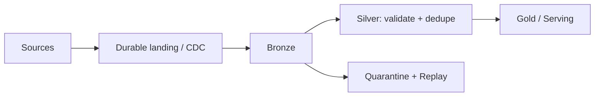
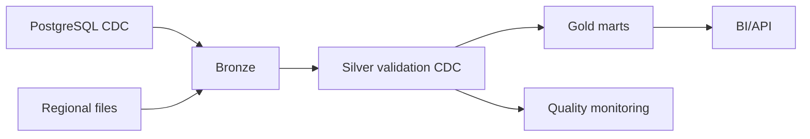
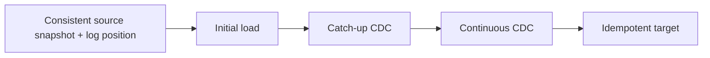

# 622 Senior Data Engineer Interview Questions + Answers

Public LinkedIn theme sources are in the separate source note. This compilation includes original practice expansions, not 622 independently verified interview questions.


---

# SQL: 104 Interview Questions with Detailed Answers

[[00 - Start Here]] · [[00 - Question Index]] · [[00 - LinkedIn Sources and Verification]] · [[00 - Progress Tracker]]

> [!important] Source interpretation
> The first section updates our previously collected, LinkedIn-linked question set. The expanded sections are **original, source-informed practice questions**, not verbatim LinkedIn quotations and not verified employer interview transcripts. Links identify public posts discussing the theme. Answers are independently drafted.

## Part A — Public-Post-Aligned Questions from the Earlier Collection

### SQL-001 — How do you return the third-highest distinct salary within each department?

**Provenance:** Paraphrased/source-aligned question from the previously collected LinkedIn-linked set; the post does not independently verify a specific employer interview.

**Priority:** `P0` · **Topics in publicly accessible LinkedIn posts:** [L08](https://www.linkedin.com/posts/techinterviewtitans_sql-dataengineering-dataengineer-activity-7506181391605391360-Upf2), [L09](https://www.linkedin.com/posts/rajat-jain-59a667102_stop-scrolling-if-you-cant-answer-these-activity-7413085049350455298-ut_t), [L14](https://www.linkedin.com/posts/anuj-shrivastav-466740184_sql-dataengineering-dataengineer-activity-7479730853821218816-ZBjS)

**Description — what the interviewer is testing:** Tests window-function selection, tie handling and distinct ranking.

### Reference answer

Use `DENSE_RANK()` ordered by salary descending within each department, then retain rank 3. `ROW_NUMBER()` is incorrect if identical salaries should share the same position. Departments with fewer than three distinct salaries do not appear.

### Example or implementation

```sql
WITH r AS (
 SELECT department, emp_id, salary,
        DENSE_RANK() OVER (PARTITION BY department ORDER BY salary DESC) AS dr
 FROM employees
)
SELECT department, emp_id, salary FROM r WHERE dr = 3;
```

> [!question] Senior follow-up
> What changes if the requirement is precisely three employees, regardless of ties?

^sql-001

### SQL-002 — What is the practical difference between ROW_NUMBER, RANK and DENSE_RANK?

**Provenance:** Paraphrased/source-aligned question from the previously collected LinkedIn-linked set; the post does not independently verify a specific employer interview.

**Priority:** `P0` · **Topics in publicly accessible LinkedIn posts:** [L09](https://www.linkedin.com/posts/rajat-jain-59a667102_stop-scrolling-if-you-cant-answer-these-activity-7413085049350455298-ut_t), [L14](https://www.linkedin.com/posts/anuj-shrivastav-466740184_sql-dataengineering-dataengineer-activity-7479730853821218816-ZBjS)

**Description — what the interviewer is testing:** Tests understanding of peer groups and ranking semantics.

### Reference answer

`ROW_NUMBER()` produces a unique sequence (add a stable tiebreaker); `RANK()` assigns ties the same rank with gaps; `DENSE_RANK()` assigns ties the same rank without gaps. Pick according to business requirements, not habit.

### Example or implementation

Salaries 100, 90, 90, 80 yield `RANK`: 1,2,2,4 and `DENSE_RANK`: 1,2,2,3.

> [!question] Senior follow-up
> What happens if you add employee_id to the ranking ORDER BY?

^sql-002

### SQL-003 — Can an INNER JOIN return more rows than either input?

**Provenance:** Paraphrased/source-aligned question from the previously collected LinkedIn-linked set; the post does not independently verify a specific employer interview.

**Priority:** `P0` · **Topics in publicly accessible LinkedIn posts:** [L01](https://www.linkedin.com/posts/jobguideee_dataengineering-pyspark-snowflake-activity-7494732272986763264-bSl7), [L14](https://www.linkedin.com/posts/anuj-shrivastav-466740184_sql-dataengineering-dataengineer-activity-7479730853821218816-ZBjS)

**Description — what the interviewer is testing:** Tests join fanout and one-to-many/many-to-many reasoning.

### Reference answer

Yes. Each matching row pair appears. If one key occurs four times in table A and five times in table B, that key alone creates twenty joined rows. Pre-aggregate or deduplicate at the correct business grain before joining measures.

### Example or implementation

```sql
SELECT a.id, b.id
FROM a JOIN b ON a.customer_id = b.customer_id;
-- 4 matching left rows x 5 right rows = 20 rows
```

> [!question] Senior follow-up
> How do you detect and prevent revenue duplication after a join?

^sql-003

### SQL-004 — How does LEFT JOIN filtering differ between ON and WHERE?

**Provenance:** Paraphrased/source-aligned question from the previously collected LinkedIn-linked set; the post does not independently verify a specific employer interview.

**Priority:** `P0` · **Topics in publicly accessible LinkedIn posts:** [L01](https://www.linkedin.com/posts/jobguideee_dataengineering-pyspark-snowflake-activity-7494732272986763264-bSl7), [L08](https://www.linkedin.com/posts/techinterviewtitans_sql-dataengineering-dataengineer-activity-7506181391605391360-Upf2)

**Description — what the interviewer is testing:** Tests preservation of unmatched rows.

### Reference answer

A right-table filter inside `ON` controls which rows match and preserves all left-side rows. The same filter in `WHERE` removes NULL-extended unmatched rows, potentially converting the outcome into an inner-match result.

### Example or implementation

```sql
SELECT c.id, o.id FROM customers c
LEFT JOIN orders o ON c.id=o.customer_id AND o.status='paid';
-- Keeps customers with no paid orders
```

> [!question] Senior follow-up
> Write a query for customers who have never made a paid order.

^sql-004

### SQL-005 — How do you find customers without any orders safely when NULL keys exist?

**Provenance:** Paraphrased/source-aligned question from the previously collected LinkedIn-linked set; the post does not independently verify a specific employer interview.

**Priority:** `P0` · **Topics in publicly accessible LinkedIn posts:** [L14](https://www.linkedin.com/posts/anuj-shrivastav-466740184_sql-dataengineering-dataengineer-activity-7479730853821218816-ZBjS)

**Description — what the interviewer is testing:** Tests anti-join and three-valued SQL logic.

### Reference answer

Use `NOT EXISTS` with a correlated equality predicate. `NOT IN (subquery)` can return UNKNOWN if the subquery contains NULL; this may produce no rows despite genuine nonmatches.

### Example or implementation

```sql
SELECT c.customer_id FROM customers c
WHERE NOT EXISTS (SELECT 1 FROM orders o
                  WHERE o.customer_id = c.customer_id);
```

> [!question] Senior follow-up
> When can LEFT JOIN ... WHERE right_id IS NULL be equally valid?

^sql-005

### SQL-006 — When should you use a CTE instead of a subquery?

**Provenance:** Paraphrased/source-aligned question from the previously collected LinkedIn-linked set; the post does not independently verify a specific employer interview.

**Priority:** `P0` · **Topics in publicly accessible LinkedIn posts:** [L09](https://www.linkedin.com/posts/rajat-jain-59a667102_stop-scrolling-if-you-cant-answer-these-activity-7413085049350455298-ut_t)

**Description — what the interviewer is testing:** Tests maintainability versus performance assumptions.

### Reference answer

Use a CTE for named stages, reuse within a statement and readable transformations; use a subquery for a compact localized operation. PostgreSQL may inline eligible single-use CTEs, while multiply referenced CTEs commonly materialize by default. Validate real plans instead of assuming a CTE is automatically faster.

### Example or implementation

Example: calculate paid totals in one CTE; rank customers in the next CTE.

> [!question] Senior follow-up
> How can MATERIALIZED and NOT MATERIALIZED change PostgreSQL plans?

^sql-006

### SQL-007 — How do you compute a 30-day rolling revenue sum?

**Provenance:** Paraphrased/source-aligned question from the previously collected LinkedIn-linked set; the post does not independently verify a specific employer interview.

**Priority:** `P0` · **Topics in publicly accessible LinkedIn posts:** [L14](https://www.linkedin.com/posts/anuj-shrivastav-466740184_sql-dataengineering-dataengineer-activity-7479730853821218816-ZBjS)

**Description — what the interviewer is testing:** Tests window frames and calendar semantics.

### Reference answer

First aggregate sales to one row per date. For a true calendar-based trailing 30 days, use a date/timestamp `RANGE` interval frame where supported and ensure days with no sales are handled according to requirements. `ROWS 29 PRECEDING` is 30 input rows, not necessarily 30 calendar days.

### Example or implementation

```sql
WITH daily AS (
 SELECT order_ts::date AS d, SUM(amount) AS revenue
 FROM orders WHERE status='paid' GROUP BY 1
)
SELECT d, revenue,
 SUM(revenue) OVER (ORDER BY d
  RANGE BETWEEN INTERVAL '29 days' PRECEDING AND CURRENT ROW) AS rev_30d
FROM daily;
```

> [!question] Senior follow-up
> What if the dashboard requires an explicit zero for missing dates?

^sql-007

### SQL-008 — How do you deduplicate incoming CDC rows and choose the latest version?

**Provenance:** Paraphrased/source-aligned question from the previously collected LinkedIn-linked set; the post does not independently verify a specific employer interview.

**Priority:** `P0` · **Topics in publicly accessible LinkedIn posts:** [L05](https://www.linkedin.com/posts/sangamnath-ingalalli_dataengineering-dataengineer-pyspark-activity-7511627191101829120-siXB), [L08](https://www.linkedin.com/posts/techinterviewtitans_sql-dataengineering-dataengineer-activity-7506181391605391360-Upf2), [L14](https://www.linkedin.com/posts/anuj-shrivastav-466740184_sql-dataengineering-dataengineer-activity-7479730853821218816-ZBjS)

**Description — what the interviewer is testing:** Tests deterministic ordering, business keys and replay safety.

### Reference answer

Partition by the stable business key and order by source sequence or event version descending. Add a reliable deterministic tiebreaker. Ingest order may not equal event order, so distinguish late arrivals from newer changes. Combine with idempotent writes and handling of delete events.

### Example or implementation

```sql
WITH x AS (
 SELECT *, ROW_NUMBER() OVER (
  PARTITION BY order_id ORDER BY source_seq DESC, ingestion_id DESC
 ) rn FROM staging_orders
)
SELECT * FROM x WHERE rn=1;
```

> [!question] Senior follow-up
> How does a delete tombstone affect your latest-state table?

^sql-008

### SQL-009 — Where and HAVING: what changes when paid orders are filtered?

**Provenance:** Paraphrased/source-aligned question from the previously collected LinkedIn-linked set; the post does not independently verify a specific employer interview.

**Priority:** `P0` · **Topics in publicly accessible LinkedIn posts:** [L01](https://www.linkedin.com/posts/jobguideee_dataengineering-pyspark-snowflake-activity-7494732272986763264-bSl7)

**Description — what the interviewer is testing:** Tests row versus group filtering.

### Reference answer

`WHERE` filters source rows before grouping; `HAVING` filters groups after aggregation. For “customers with two paid orders,” put the paid status filter in `WHERE`, group by customer, and apply `HAVING COUNT(*) >= 2`.

### Example or implementation

```sql
SELECT customer_id FROM orders
WHERE status='paid' GROUP BY customer_id HAVING COUNT(*) >= 2;
```

> [!question] Senior follow-up
> How do you include customers with zero paid orders?

^sql-009

### SQL-010 — What is the COUNT(*) versus COUNT(column) trap on LEFT JOIN?

**Provenance:** Paraphrased/source-aligned question from the previously collected LinkedIn-linked set; the post does not independently verify a specific employer interview.

**Priority:** `P0` · **Topics in publicly accessible LinkedIn posts:** [L01](https://www.linkedin.com/posts/jobguideee_dataengineering-pyspark-snowflake-activity-7494732272986763264-bSl7), [L14](https://www.linkedin.com/posts/anuj-shrivastav-466740184_sql-dataengineering-dataengineer-activity-7479730853821218816-ZBjS)

**Description — what the interviewer is testing:** Tests NULL-extended rows and reporting accuracy.

### Reference answer

`COUNT(*)` counts every joined result row, including the synthetic row for a left-side record with no matches. `COUNT(right_table.id)` counts only non-NULL matching IDs, so it correctly returns zero for unmatched rows.

### Example or implementation

```sql
SELECT c.customer_id, COUNT(o.order_id) AS n
FROM customers c LEFT JOIN orders o ON o.customer_id=c.customer_id
GROUP BY c.customer_id;
```

> [!question] Senior follow-up
> How can two one-to-many joins inflate sums?

^sql-010

### SQL-011 — How would you implement SCD Type 2 in SQL?

**Provenance:** Paraphrased/source-aligned question from the previously collected LinkedIn-linked set; the post does not independently verify a specific employer interview.

**Priority:** `P0` · **Topics in publicly accessible LinkedIn posts:** [L05](https://www.linkedin.com/posts/sangamnath-ingalalli_dataengineering-dataengineer-pyspark-activity-7511627191101829120-siXB), [L16](https://www.linkedin.com/posts/rafat-jahan-pune_databricks-deltalake-dataengineering-activity-7424128919236210688-GXmz)

**Description — what the interviewer is testing:** Tests historical data modeling and atomic change handling.

### Reference answer

Maintain surrogate version keys, business key, tracked attributes and nonoverlapping validity intervals `[valid_from, valid_to)`. Compare changed attributes NULL-safely, expire the prior current version, insert the new version in one transaction, and enforce one current row per business key. Handle late changes by restitching the timeline when necessary.

### Example or implementation

Customer city Pune before Nov 7; Mumbai from Nov 7: two rows with exclusive end bound and only Mumbai current.

> [!question] Senior follow-up
> How do you make SCD Type 2 rerunnable after failure?

^sql-011

### SQL-012 — How do you calculate top three products by revenue without double-counting?

**Provenance:** Paraphrased/source-aligned question from the previously collected LinkedIn-linked set; the post does not independently verify a specific employer interview.

**Priority:** `P0` · **Topics in publicly accessible LinkedIn posts:** [L14](https://www.linkedin.com/posts/anuj-shrivastav-466740184_sql-dataengineering-dataengineer-activity-7479730853821218816-ZBjS)

**Description — what the interviewer is testing:** Tests business grain and appropriate joins.

### Reference answer

Calculate line revenue at `order_items` grain (`quantity * unit_price`), aggregate per product, and apply ranking. Avoid joining the order header to payment rows before aggregation; multiple payments per order could duplicate item measures.

### Example or implementation

```sql
WITH totals AS (
 SELECT product_id, SUM(quantity*unit_price) AS revenue
 FROM order_items GROUP BY product_id
), ranked AS (
 SELECT *, DENSE_RANK() OVER (ORDER BY revenue DESC) AS pos FROM totals
)
SELECT * FROM ranked WHERE pos <= 3;
```

> [!question] Senior follow-up
> Would using ROW_NUMBER instead of DENSE_RANK alter the number of winners?

^sql-012

### SQL-013 — How would you compare rows in stage and target and find mismatches?

**Provenance:** Paraphrased/source-aligned question from the previously collected LinkedIn-linked set; the post does not independently verify a specific employer interview.

**Priority:** `P0` · **Topics in publicly accessible LinkedIn posts:** [L05](https://www.linkedin.com/posts/sangamnath-ingalalli_dataengineering-dataengineer-pyspark-activity-7511627191101829120-siXB), [L14](https://www.linkedin.com/posts/anuj-shrivastav-466740184_sql-dataengineering-dataengineer-activity-7479730853821218816-ZBjS)

**Description — what the interviewer is testing:** Tests reconciliation and NULL-safe comparisons.

### Reference answer

Use a FULL OUTER JOIN on unique business keys (or compare preaggregated hashes at matching grain). Classify stage-only, target-only and changed rows. `IS DISTINCT FROM` handles NULL attribute comparisons; store run IDs, counts and issue categories for observability.

### Example or implementation

```sql
SELECT COALESCE(s.id,t.id) AS id,
 CASE WHEN s.id IS NULL THEN 'TARGET_ONLY'
      WHEN t.id IS NULL THEN 'STAGE_ONLY'
      WHEN s.amount IS DISTINCT FROM t.amount THEN 'CHANGED'
      ELSE 'MATCHED' END AS status
FROM stage s FULL JOIN target t ON s.id=t.id;
```

> [!question] Senior follow-up
> What if business keys are duplicated in the staging table?

^sql-013

### SQL-014 — How would you calculate percent of department total without collapsing rows?

**Provenance:** Paraphrased/source-aligned question from the previously collected LinkedIn-linked set; the post does not independently verify a specific employer interview.

**Priority:** `P0` · **Topics in publicly accessible LinkedIn posts:** [L09](https://www.linkedin.com/posts/rajat-jain-59a667102_stop-scrolling-if-you-cant-answer-these-activity-7413085049350455298-ut_t)

**Description — what the interviewer is testing:** Tests `PARTITION BY` and divide-by-zero handling.

### Reference answer

Use a window aggregate that keeps detail rows: `salary / NULLIF(SUM(salary) OVER (PARTITION BY department),0)`. Use decimal numeric math and decide how to handle empty/zero groups.

### Example or implementation

```sql
SELECT emp_id, department,
 ROUND(100.0*salary / NULLIF(
 SUM(salary) OVER (PARTITION BY department),0), 2) AS pct
FROM employees;
```

> [!question] Senior follow-up
> How is this different from GROUP BY department?

^sql-014

## Part B — Advanced Concepts, Applied Cases and Failure Modes

> [!tip] For 7+ years interviews
> Answer the concept clearly, explain how you would use it in production, then discuss one measurable correctness/performance check. Never present these original expansions as directly quoted posts.

### SQL-015 — Explain Join cardinality and its practical use for a Senior Data Engineer.

**Question type:** Concept / design · **Priority:** P0 · **Topic:** Join cardinality

**Description — what the interviewer tests:** Conceptual understanding, terminology and when the technique fits.

**Detailed reference answer**

Every matching pair contributes a row; one-to-many and many-to-many relationships can multiply results. Decide output grain before joining facts.

**Public LinkedIn context:** [S01: PRAVEEN SINGH — SQL business scenario questions](https://www.linkedin.com/posts/contactpraveensingh_sql-dataengineering-dataengineer-activity-7488782474752356352-LAjd)

**Provenance:** Original interview-practice question expanded from recurring LinkedIn discussion themes. **Not** claimed to be directly asked by an employer.

> [!question] Senior follow-up
> What would you measure or test to prove your answer is correct at production scale?

^sql-015

### SQL-016 — Two detail tables each contain several rows per order; how do you prevent revenue inflation?

**Question type:** Scenario / implementation · **Priority:** P0 · **Topic:** Join cardinality

**Description — what the interviewer tests:** Production application, concrete solution and trade-off reasoning.

**Detailed reference answer**

Pre-aggregate each detail table to order_id, or join on a genuinely unique key, before summing order-level amounts. Compare totals before and after the join.

**Public LinkedIn context:** [S01: PRAVEEN SINGH — SQL business scenario questions](https://www.linkedin.com/posts/contactpraveensingh_sql-dataengineering-dataengineer-activity-7488782474752356352-LAjd)

**Provenance:** Original interview-practice question expanded from recurring LinkedIn discussion themes. **Not** claimed to be directly asked by an employer.

> [!question] Senior follow-up
> What would you measure or test to prove your answer is correct at production scale?

^sql-016

### SQL-017 — Which failure modes or edge cases should you test for Join cardinality?

**Question type:** Failure modes / testing · **Priority:** P0 · **Topic:** Join cardinality

**Description — what the interviewer tests:** Verification strategy, correctness under bad data and operational reliability.

**Detailed reference answer**

Test duplicated keys on both sides; SUM(DISTINCT amount) is not a valid general repair because legitimate equal amounts exist.

**Public LinkedIn context:** [S01: PRAVEEN SINGH — SQL business scenario questions](https://www.linkedin.com/posts/contactpraveensingh_sql-dataengineering-dataengineer-activity-7488782474752356352-LAjd)

**Provenance:** Original interview-practice question expanded from recurring LinkedIn discussion themes. **Not** claimed to be directly asked by an employer.

> [!question] Senior follow-up
> What would you measure or test to prove your answer is correct at production scale?

^sql-017

### SQL-018 — Explain Outer join predicate placement and its practical use for a Senior Data Engineer.

**Question type:** Concept / design · **Priority:** P0 · **Topic:** Outer join predicate placement

**Description — what the interviewer tests:** Conceptual understanding, terminology and when the technique fits.

**Detailed reference answer**

Predicates in ON control matches while preserving the outer side; right-side predicates in WHERE may remove null-extended rows.

**Practical illustration**

```sql
SELECT c.id, COUNT(o.id) paid_orders FROM customers c
LEFT JOIN orders o ON o.customer_id=c.id AND o.status='paid'
GROUP BY c.id;
```

**Public LinkedIn context:** [S02: Shilpa Das — SQL interview practice questions](https://www.linkedin.com/posts/shilpa-das-ln_sql-dataengineering-dataengineer-activity-7471026839088431104-FiUd)

**Provenance:** Original interview-practice question expanded from recurring LinkedIn discussion themes. **Not** claimed to be directly asked by an employer.

> [!question] Senior follow-up
> What would you measure or test to prove your answer is correct at production scale?

^sql-018

### SQL-019 — A report must show every customer including those with no paid orders; how do you write it?

**Question type:** Scenario / implementation · **Priority:** P0 · **Topic:** Outer join predicate placement

**Description — what the interviewer tests:** Production application, concrete solution and trade-off reasoning.

**Detailed reference answer**

LEFT JOIN orders ON matching customer AND status='paid', then count orders.order_id. A WHERE status='paid' would remove customers with zero paid orders.

**Public LinkedIn context:** [S02: Shilpa Das — SQL interview practice questions](https://www.linkedin.com/posts/shilpa-das-ln_sql-dataengineering-dataengineer-activity-7471026839088431104-FiUd)

**Provenance:** Original interview-practice question expanded from recurring LinkedIn discussion themes. **Not** claimed to be directly asked by an employer.

> [!question] Senior follow-up
> What would you measure or test to prove your answer is correct at production scale?

^sql-019

### SQL-020 — Which failure modes or edge cases should you test for Outer join predicate placement?

**Question type:** Failure modes / testing · **Priority:** P0 · **Topic:** Outer join predicate placement

**Description — what the interviewer tests:** Verification strategy, correctness under bad data and operational reliability.

**Detailed reference answer**

Include missing customers, only-cancelled customers and NULL statuses in test cases; verify zero counts remain.

**Public LinkedIn context:** [S02: Shilpa Das — SQL interview practice questions](https://www.linkedin.com/posts/shilpa-das-ln_sql-dataengineering-dataengineer-activity-7471026839088431104-FiUd)

**Provenance:** Original interview-practice question expanded from recurring LinkedIn discussion themes. **Not** claimed to be directly asked by an employer.

> [!question] Senior follow-up
> What would you measure or test to prove your answer is correct at production scale?

^sql-020

### SQL-021 — Explain Anti joins and NOT EXISTS and its practical use for a Senior Data Engineer.

**Question type:** Concept / design · **Priority:** P0 · **Topic:** Anti joins and NOT EXISTS

**Description — what the interviewer tests:** Conceptual understanding, terminology and when the technique fits.

**Detailed reference answer**

NOT EXISTS expresses absence of a correlated match and handles nullable subquery columns more predictably than NOT IN.

**Practical illustration**

```sql
SELECT p.product_id FROM products p
WHERE NOT EXISTS (SELECT 1 FROM order_items i WHERE i.product_id = p.product_id);
```

**Public LinkedIn context:** [S03: Gautam Kumar — SQL concepts, CTE and windows](https://www.linkedin.com/posts/gautam-kumar-40386b266_top-20-sql-interview-questions-activity-7448641243112247296--0e9)

**Provenance:** Original interview-practice question expanded from recurring LinkedIn discussion themes. **Not** claimed to be directly asked by an employer.

> [!question] Senior follow-up
> What would you measure or test to prove your answer is correct at production scale?

^sql-021

### SQL-022 — Find products that have never appeared in order_items even when order_items.product_id contains NULL.

**Question type:** Scenario / implementation · **Priority:** P0 · **Topic:** Anti joins and NOT EXISTS

**Description — what the interviewer tests:** Production application, concrete solution and trade-off reasoning.

**Detailed reference answer**

SELECT p.product_id FROM products p WHERE NOT EXISTS (SELECT 1 FROM order_items i WHERE i.product_id=p.product_id). Index the inner lookup key for scale.

**Public LinkedIn context:** [S03: Gautam Kumar — SQL concepts, CTE and windows](https://www.linkedin.com/posts/gautam-kumar-40386b266_top-20-sql-interview-questions-activity-7448641243112247296--0e9)

**Provenance:** Original interview-practice question expanded from recurring LinkedIn discussion themes. **Not** claimed to be directly asked by an employer.

> [!question] Senior follow-up
> What would you measure or test to prove your answer is correct at production scale?

^sql-022

### SQL-023 — Which failure modes or edge cases should you test for Anti joins and NOT EXISTS?

**Question type:** Failure modes / testing · **Priority:** P0 · **Topic:** Anti joins and NOT EXISTS

**Description — what the interviewer tests:** Verification strategy, correctness under bad data and operational reliability.

**Detailed reference answer**

A NULL in NOT IN's list can make a nonmatch UNKNOWN; test nullable keys and repeated child rows.

**Public LinkedIn context:** [S03: Gautam Kumar — SQL concepts, CTE and windows](https://www.linkedin.com/posts/gautam-kumar-40386b266_top-20-sql-interview-questions-activity-7448641243112247296--0e9)

**Provenance:** Original interview-practice question expanded from recurring LinkedIn discussion themes. **Not** claimed to be directly asked by an employer.

> [!question] Senior follow-up
> What would you measure or test to prove your answer is correct at production scale?

^sql-023

### SQL-024 — Explain Semi joins and EXISTS and its practical use for a Senior Data Engineer.

**Question type:** Concept / design · **Priority:** P0 · **Topic:** Semi joins and EXISTS

**Description — what the interviewer tests:** Conceptual understanding, terminology and when the technique fits.

**Detailed reference answer**

EXISTS returns a boolean per outer row and avoids row multiplication when only presence matters.

**Public LinkedIn context:** [S04: Sanjeev K. — Senior SQL production scenarios](https://www.linkedin.com/posts/sanjeev-k-96b40355_dataengineering-seniordataengineer-sql-activity-7499027205646204928-B183)

**Provenance:** Original interview-practice question expanded from recurring LinkedIn discussion themes. **Not** claimed to be directly asked by an employer.

> [!question] Senior follow-up
> What would you measure or test to prove your answer is correct at production scale?

^sql-024

### SQL-025 — Return customers who bought at least one item in the last 90 days, one row per customer.

**Question type:** Scenario / implementation · **Priority:** P0 · **Topic:** Semi joins and EXISTS

**Description — what the interviewer tests:** Production application, concrete solution and trade-off reasoning.

**Detailed reference answer**

Use WHERE EXISTS with a correlated customer ID and bounded order_date predicate; avoid unnecessary DISTINCT over a fanout join.

**Public LinkedIn context:** [S04: Sanjeev K. — Senior SQL production scenarios](https://www.linkedin.com/posts/sanjeev-k-96b40355_dataengineering-seniordataengineer-sql-activity-7499027205646204928-B183)

**Provenance:** Original interview-practice question expanded from recurring LinkedIn discussion themes. **Not** claimed to be directly asked by an employer.

> [!question] Senior follow-up
> What would you measure or test to prove your answer is correct at production scale?

^sql-025

### SQL-026 — Which failure modes or edge cases should you test for Semi joins and EXISTS?

**Question type:** Failure modes / testing · **Priority:** P0 · **Topic:** Semi joins and EXISTS

**Description — what the interviewer tests:** Verification strategy, correctness under bad data and operational reliability.

**Detailed reference answer**

Test customers with multiple orders and orders outside the date window; ensure they appear at most once.

**Public LinkedIn context:** [S04: Sanjeev K. — Senior SQL production scenarios](https://www.linkedin.com/posts/sanjeev-k-96b40355_dataengineering-seniordataengineer-sql-activity-7499027205646204928-B183)

**Provenance:** Original interview-practice question expanded from recurring LinkedIn discussion themes. **Not** claimed to be directly asked by an employer.

> [!question] Senior follow-up
> What would you measure or test to prove your answer is correct at production scale?

^sql-026

### SQL-027 — Explain ROW_NUMBER determinism and its practical use for a Senior Data Engineer.

**Question type:** Concept / design · **Priority:** P0 · **Topic:** ROW_NUMBER determinism

**Description — what the interviewer tests:** Conceptual understanding, terminology and when the technique fits.

**Detailed reference answer**

ROW_NUMBER selects one positional row per partition; a stable complete ORDER BY is essential for repeatability.

**Practical illustration**

```sql
WITH r AS (
 SELECT *, ROW_NUMBER() OVER (PARTITION BY order_id ORDER BY source_version DESC, ingestion_id DESC) rn
 FROM staging_orders
) SELECT * FROM r WHERE rn = 1;
```

**Public LinkedIn context:** [S01: PRAVEEN SINGH — SQL business scenario questions](https://www.linkedin.com/posts/contactpraveensingh_sql-dataengineering-dataengineer-activity-7488782474752356352-LAjd)

**Provenance:** Original interview-practice question expanded from recurring LinkedIn discussion themes. **Not** claimed to be directly asked by an employer.

> [!question] Senior follow-up
> What would you measure or test to prove your answer is correct at production scale?

^sql-027

### SQL-028 — Choose the newest CDC event for each business key when timestamps can tie.

**Question type:** Scenario / implementation · **Priority:** P0 · **Topic:** ROW_NUMBER determinism

**Description — what the interviewer tests:** Production application, concrete solution and trade-off reasoning.

**Detailed reference answer**

Partition by business_key and order by source_sequence DESC, ingestion_id DESC; keep rn=1, provided that ordering matches true source precedence.

**Public LinkedIn context:** [S01: PRAVEEN SINGH — SQL business scenario questions](https://www.linkedin.com/posts/contactpraveensingh_sql-dataengineering-dataengineer-activity-7488782474752356352-LAjd)

**Provenance:** Original interview-practice question expanded from recurring LinkedIn discussion themes. **Not** claimed to be directly asked by an employer.

> [!question] Senior follow-up
> What would you measure or test to prove your answer is correct at production scale?

^sql-028

### SQL-029 — Which failure modes or edge cases should you test for ROW_NUMBER determinism?

**Question type:** Failure modes / testing · **Priority:** P0 · **Topic:** ROW_NUMBER determinism

**Description — what the interviewer tests:** Verification strategy, correctness under bad data and operational reliability.

**Detailed reference answer**

Test tied timestamps and out-of-order arrivals; without deterministic ordering the selected row can vary across runs.

**Public LinkedIn context:** [S01: PRAVEEN SINGH — SQL business scenario questions](https://www.linkedin.com/posts/contactpraveensingh_sql-dataengineering-dataengineer-activity-7488782474752356352-LAjd)

**Provenance:** Original interview-practice question expanded from recurring LinkedIn discussion themes. **Not** claimed to be directly asked by an employer.

> [!question] Senior follow-up
> What would you measure or test to prove your answer is correct at production scale?

^sql-029

### SQL-030 — Explain RANK versus DENSE_RANK and its practical use for a Senior Data Engineer.

**Question type:** Concept / design · **Priority:** P0 · **Topic:** RANK versus DENSE_RANK

**Description — what the interviewer tests:** Conceptual understanding, terminology and when the technique fits.

**Detailed reference answer**

RANK leaves gaps after ties, while DENSE_RANK numbers distinct ordered values consecutively; ROW_NUMBER never ties.

**Practical illustration**

```sql
SELECT department, emp_id, salary,
 DENSE_RANK() OVER (PARTITION BY department ORDER BY salary DESC) AS dr
FROM employees;
```

**Public LinkedIn context:** [S02: Shilpa Das — SQL interview practice questions](https://www.linkedin.com/posts/shilpa-das-ln_sql-dataengineering-dataengineer-activity-7471026839088431104-FiUd)

**Provenance:** Original interview-practice question expanded from recurring LinkedIn discussion themes. **Not** claimed to be directly asked by an employer.

> [!question] Senior follow-up
> What would you measure or test to prove your answer is correct at production scale?

^sql-030

### SQL-031 — The requirement is third-highest DISTINCT salary including everyone tied at that salary; which function do you choose?

**Question type:** Scenario / implementation · **Priority:** P0 · **Topic:** RANK versus DENSE_RANK

**Description — what the interviewer tests:** Production application, concrete solution and trade-off reasoning.

**Detailed reference answer**

Use DENSE_RANK OVER(PARTITION BY department ORDER BY salary DESC), then filter rank=3 in an outer query.

**Public LinkedIn context:** [S02: Shilpa Das — SQL interview practice questions](https://www.linkedin.com/posts/shilpa-das-ln_sql-dataengineering-dataengineer-activity-7471026839088431104-FiUd)

**Provenance:** Original interview-practice question expanded from recurring LinkedIn discussion themes. **Not** claimed to be directly asked by an employer.

> [!question] Senior follow-up
> What would you measure or test to prove your answer is correct at production scale?

^sql-031

### SQL-032 — Which failure modes or edge cases should you test for RANK versus DENSE_RANK?

**Question type:** Failure modes / testing · **Priority:** P0 · **Topic:** RANK versus DENSE_RANK

**Description — what the interviewer tests:** Verification strategy, correctness under bad data and operational reliability.

**Detailed reference answer**

An ORDER BY including employee_id removes ties from RANK/DENSE_RANK; test duplicate salaries and small departments.

**Public LinkedIn context:** [S02: Shilpa Das — SQL interview practice questions](https://www.linkedin.com/posts/shilpa-das-ln_sql-dataengineering-dataengineer-activity-7471026839088431104-FiUd)

**Provenance:** Original interview-practice question expanded from recurring LinkedIn discussion themes. **Not** claimed to be directly asked by an employer.

> [!question] Senior follow-up
> What would you measure or test to prove your answer is correct at production scale?

^sql-032

### SQL-033 — Explain Window frame ROWS versus RANGE and its practical use for a Senior Data Engineer.

**Question type:** Concept / design · **Priority:** P0 · **Topic:** Window frame ROWS versus RANGE

**Description — what the interviewer tests:** Conceptual understanding, terminology and when the technique fits.

**Detailed reference answer**

ROWS measures physical row positions, whereas RANGE groups peers and applies value-based frame boundaries; defaults may surprise when order keys tie.

**Practical illustration**

```sql
SUM(amount) OVER (PARTITION BY customer_id ORDER BY event_ts, event_id
 ROWS BETWEEN UNBOUNDED PRECEDING AND CURRENT ROW)
```

**Public LinkedIn context:** [S03: Gautam Kumar — SQL concepts, CTE and windows](https://www.linkedin.com/posts/gautam-kumar-40386b266_top-20-sql-interview-questions-activity-7448641243112247296--0e9)

**Provenance:** Original interview-practice question expanded from recurring LinkedIn discussion themes. **Not** claimed to be directly asked by an employer.

> [!question] Senior follow-up
> What would you measure or test to prove your answer is correct at production scale?

^sql-033

### SQL-034 — A running revenue report jumps by two same-timestamp transactions simultaneously; how do you control it?

**Question type:** Scenario / implementation · **Priority:** P0 · **Topic:** Window frame ROWS versus RANGE

**Description — what the interviewer tests:** Production application, concrete solution and trade-off reasoning.

**Detailed reference answer**

Use ROWS BETWEEN UNBOUNDED PRECEDING AND CURRENT ROW with a deterministic event_id tie-breaker if row-by-row progression is intended.

**Public LinkedIn context:** [S03: Gautam Kumar — SQL concepts, CTE and windows](https://www.linkedin.com/posts/gautam-kumar-40386b266_top-20-sql-interview-questions-activity-7448641243112247296--0e9)

**Provenance:** Original interview-practice question expanded from recurring LinkedIn discussion themes. **Not** claimed to be directly asked by an employer.

> [!question] Senior follow-up
> What would you measure or test to prove your answer is correct at production scale?

^sql-034

### SQL-035 — Which failure modes or edge cases should you test for Window frame ROWS versus RANGE?

**Question type:** Failure modes / testing · **Priority:** P0 · **Topic:** Window frame ROWS versus RANGE

**Description — what the interviewer tests:** Verification strategy, correctness under bad data and operational reliability.

**Detailed reference answer**

Compare same-date peers: default RANGE may include all peers in the current frame; document the intended event order.

**Public LinkedIn context:** [S03: Gautam Kumar — SQL concepts, CTE and windows](https://www.linkedin.com/posts/gautam-kumar-40386b266_top-20-sql-interview-questions-activity-7448641243112247296--0e9)

**Provenance:** Original interview-practice question expanded from recurring LinkedIn discussion themes. **Not** claimed to be directly asked by an employer.

> [!question] Senior follow-up
> What would you measure or test to prove your answer is correct at production scale?

^sql-035

### SQL-036 — Explain LAG LEAD and gaps and its practical use for a Senior Data Engineer.

**Question type:** Concept / design · **Priority:** P0 · **Topic:** LAG LEAD and gaps

**Description — what the interviewer tests:** Conceptual understanding, terminology and when the technique fits.

**Detailed reference answer**

LAG/LEAD access values from prior/following ordered rows without self-joining the dataset.

**Public LinkedIn context:** [S04: Sanjeev K. — Senior SQL production scenarios](https://www.linkedin.com/posts/sanjeev-k-96b40355_dataengineering-seniordataengineer-sql-activity-7499027205646204928-B183)

**Provenance:** Original interview-practice question expanded from recurring LinkedIn discussion themes. **Not** claimed to be directly asked by an employer.

> [!question] Senior follow-up
> What would you measure or test to prove your answer is correct at production scale?

^sql-036

### SQL-037 — Detect customers whose new status differs from their immediately previous status.

**Question type:** Scenario / implementation · **Priority:** P0 · **Topic:** LAG LEAD and gaps

**Description — what the interviewer tests:** Production application, concrete solution and trade-off reasoning.

**Detailed reference answer**

Partition by customer_id, order by source_event_time and event_id, then compare status to LAG(status) using NULL-safe logic.

**Public LinkedIn context:** [S04: Sanjeev K. — Senior SQL production scenarios](https://www.linkedin.com/posts/sanjeev-k-96b40355_dataengineering-seniordataengineer-sql-activity-7499027205646204928-B183)

**Provenance:** Original interview-practice question expanded from recurring LinkedIn discussion themes. **Not** claimed to be directly asked by an employer.

> [!question] Senior follow-up
> What would you measure or test to prove your answer is correct at production scale?

^sql-037

### SQL-038 — Which failure modes or edge cases should you test for LAG LEAD and gaps?

**Question type:** Failure modes / testing · **Priority:** P0 · **Topic:** LAG LEAD and gaps

**Description — what the interviewer tests:** Verification strategy, correctness under bad data and operational reliability.

**Detailed reference answer**

The first row has no predecessor and tied timestamps can be ambiguous; test both and ensure no false change detection.

**Public LinkedIn context:** [S04: Sanjeev K. — Senior SQL production scenarios](https://www.linkedin.com/posts/sanjeev-k-96b40355_dataengineering-seniordataengineer-sql-activity-7499027205646204928-B183)

**Provenance:** Original interview-practice question expanded from recurring LinkedIn discussion themes. **Not** claimed to be directly asked by an employer.

> [!question] Senior follow-up
> What would you measure or test to prove your answer is correct at production scale?

^sql-038

### SQL-039 — Explain FIRST_VALUE LAST_VALUE and its practical use for a Senior Data Engineer.

**Question type:** Concept / design · **Priority:** P0 · **Topic:** FIRST_VALUE LAST_VALUE

**Description — what the interviewer tests:** Conceptual understanding, terminology and when the technique fits.

**Detailed reference answer**

FIRST_VALUE and LAST_VALUE read an ordered window's first/last values; LAST_VALUE often requires an explicit full-partition frame.

**Public LinkedIn context:** [S01: PRAVEEN SINGH — SQL business scenario questions](https://www.linkedin.com/posts/contactpraveensingh_sql-dataengineering-dataengineer-activity-7488782474752356352-LAjd)

**Provenance:** Original interview-practice question expanded from recurring LinkedIn discussion themes. **Not** claimed to be directly asked by an employer.

> [!question] Senior follow-up
> What would you measure or test to prove your answer is correct at production scale?

^sql-039

### SQL-040 — Show each order alongside that customer's most recent order amount.

**Question type:** Scenario / implementation · **Priority:** P0 · **Topic:** FIRST_VALUE LAST_VALUE

**Description — what the interviewer tests:** Production application, concrete solution and trade-off reasoning.

**Detailed reference answer**

Use FIRST_VALUE(amount) with ORDER BY order_time DESC, order_id DESC, or LAST_VALUE with an explicit UNBOUNDED FOLLOWING frame.

**Public LinkedIn context:** [S01: PRAVEEN SINGH — SQL business scenario questions](https://www.linkedin.com/posts/contactpraveensingh_sql-dataengineering-dataengineer-activity-7488782474752356352-LAjd)

**Provenance:** Original interview-practice question expanded from recurring LinkedIn discussion themes. **Not** claimed to be directly asked by an employer.

> [!question] Senior follow-up
> What would you measure or test to prove your answer is correct at production scale?

^sql-040

### SQL-041 — Which failure modes or edge cases should you test for FIRST_VALUE LAST_VALUE?

**Question type:** Failure modes / testing · **Priority:** P0 · **Topic:** FIRST_VALUE LAST_VALUE

**Description — what the interviewer tests:** Verification strategy, correctness under bad data and operational reliability.

**Detailed reference answer**

LAST_VALUE over the default frame commonly returns the current row's value; test three rows and ties.

**Public LinkedIn context:** [S01: PRAVEEN SINGH — SQL business scenario questions](https://www.linkedin.com/posts/contactpraveensingh_sql-dataengineering-dataengineer-activity-7488782474752356352-LAjd)

**Provenance:** Original interview-practice question expanded from recurring LinkedIn discussion themes. **Not** claimed to be directly asked by an employer.

> [!question] Senior follow-up
> What would you measure or test to prove your answer is correct at production scale?

^sql-041

### SQL-042 — Explain GROUP BY and grain and its practical use for a Senior Data Engineer.

**Question type:** Concept / design · **Priority:** P0 · **Topic:** GROUP BY and grain

**Description — what the interviewer tests:** Conceptual understanding, terminology and when the technique fits.

**Detailed reference answer**

GROUP BY collapses input rows to one row per distinct grouping key; granularity determines whether metrics are accurate.

**Public LinkedIn context:** [S02: Shilpa Das — SQL interview practice questions](https://www.linkedin.com/posts/shilpa-das-ln_sql-dataengineering-dataengineer-activity-7471026839088431104-FiUd)

**Provenance:** Original interview-practice question expanded from recurring LinkedIn discussion themes. **Not** claimed to be directly asked by an employer.

> [!question] Senior follow-up
> What would you measure or test to prove your answer is correct at production scale?

^sql-042

### SQL-043 — You need daily orders by region but raw data includes each line item; how do you count orders?

**Question type:** Scenario / implementation · **Priority:** P0 · **Topic:** GROUP BY and grain

**Description — what the interviewer tests:** Production application, concrete solution and trade-off reasoning.

**Detailed reference answer**

Group by region and date while COUNT(DISTINCT order_id) counts orders, or pre-aggregate at order grain before joining dimensions.

**Public LinkedIn context:** [S02: Shilpa Das — SQL interview practice questions](https://www.linkedin.com/posts/shilpa-das-ln_sql-dataengineering-dataengineer-activity-7471026839088431104-FiUd)

**Provenance:** Original interview-practice question expanded from recurring LinkedIn discussion themes. **Not** claimed to be directly asked by an employer.

> [!question] Senior follow-up
> What would you measure or test to prove your answer is correct at production scale?

^sql-043

### SQL-044 — Which failure modes or edge cases should you test for GROUP BY and grain?

**Question type:** Failure modes / testing · **Priority:** P0 · **Topic:** GROUP BY and grain

**Description — what the interviewer tests:** Verification strategy, correctness under bad data and operational reliability.

**Detailed reference answer**

Grouping by unneeded line-item attributes changes grain; test orders with several items and partial cancellations.

**Public LinkedIn context:** [S02: Shilpa Das — SQL interview practice questions](https://www.linkedin.com/posts/shilpa-das-ln_sql-dataengineering-dataengineer-activity-7471026839088431104-FiUd)

**Provenance:** Original interview-practice question expanded from recurring LinkedIn discussion themes. **Not** claimed to be directly asked by an employer.

> [!question] Senior follow-up
> What would you measure or test to prove your answer is correct at production scale?

^sql-044

### SQL-045 — Explain WHERE versus HAVING and its practical use for a Senior Data Engineer.

**Question type:** Concept / design · **Priority:** P0 · **Topic:** WHERE versus HAVING

**Description — what the interviewer tests:** Conceptual understanding, terminology and when the technique fits.

**Detailed reference answer**

WHERE filters source rows before aggregation, while HAVING filters aggregated groups afterward.

**Public LinkedIn context:** [S03: Gautam Kumar — SQL concepts, CTE and windows](https://www.linkedin.com/posts/gautam-kumar-40386b266_top-20-sql-interview-questions-activity-7448641243112247296--0e9)

**Provenance:** Original interview-practice question expanded from recurring LinkedIn discussion themes. **Not** claimed to be directly asked by an employer.

> [!question] Senior follow-up
> What would you measure or test to prove your answer is correct at production scale?

^sql-045

### SQL-046 — Find customers with at least five completed orders in November.

**Question type:** Scenario / implementation · **Priority:** P0 · **Topic:** WHERE versus HAVING

**Description — what the interviewer tests:** Production application, concrete solution and trade-off reasoning.

**Detailed reference answer**

WHERE status='completed' and date bounds, GROUP BY customer_id, HAVING COUNT(*)>=5.

**Public LinkedIn context:** [S03: Gautam Kumar — SQL concepts, CTE and windows](https://www.linkedin.com/posts/gautam-kumar-40386b266_top-20-sql-interview-questions-activity-7448641243112247296--0e9)

**Provenance:** Original interview-practice question expanded from recurring LinkedIn discussion themes. **Not** claimed to be directly asked by an employer.

> [!question] Senior follow-up
> What would you measure or test to prove your answer is correct at production scale?

^sql-046

### SQL-047 — Which failure modes or edge cases should you test for WHERE versus HAVING?

**Question type:** Failure modes / testing · **Priority:** P0 · **Topic:** WHERE versus HAVING

**Description — what the interviewer tests:** Verification strategy, correctness under bad data and operational reliability.

**Detailed reference answer**

Do not put aggregate predicates in WHERE; test customers with five orders only when cancelled rows are included.

**Public LinkedIn context:** [S03: Gautam Kumar — SQL concepts, CTE and windows](https://www.linkedin.com/posts/gautam-kumar-40386b266_top-20-sql-interview-questions-activity-7448641243112247296--0e9)

**Provenance:** Original interview-practice question expanded from recurring LinkedIn discussion themes. **Not** claimed to be directly asked by an employer.

> [!question] Senior follow-up
> What would you measure or test to prove your answer is correct at production scale?

^sql-047

### SQL-048 — Explain Conditional aggregation and its practical use for a Senior Data Engineer.

**Question type:** Concept / design · **Priority:** P0 · **Topic:** Conditional aggregation

**Description — what the interviewer tests:** Conceptual understanding, terminology and when the technique fits.

**Detailed reference answer**

CASE expressions or SQL FILTER clauses calculate multiple conditional metrics in one grouped scan.

**Practical illustration**

```sql
SELECT region, COUNT(*) FILTER (WHERE status = 'paid') AS paid_orders,
 COALESCE(SUM(amount) FILTER (WHERE status = 'paid'), 0) AS paid_revenue
FROM orders GROUP BY region;
```

**Public LinkedIn context:** [S04: Sanjeev K. — Senior SQL production scenarios](https://www.linkedin.com/posts/sanjeev-k-96b40355_dataengineering-seniordataengineer-sql-activity-7499027205646204928-B183)

**Provenance:** Original interview-practice question expanded from recurring LinkedIn discussion themes. **Not** claimed to be directly asked by an employer.

> [!question] Senior follow-up
> What would you measure or test to prove your answer is correct at production scale?

^sql-048

### SQL-049 — Compute paid revenue, cancelled count and distinct buyers by region in one query.

**Question type:** Scenario / implementation · **Priority:** P0 · **Topic:** Conditional aggregation

**Description — what the interviewer tests:** Production application, concrete solution and trade-off reasoning.

**Detailed reference answer**

Group by region and use SUM(amount) FILTER(WHERE status='paid'), COUNT(*) FILTER(WHERE status='cancelled') and COUNT(DISTINCT customer_id).

**Public LinkedIn context:** [S04: Sanjeev K. — Senior SQL production scenarios](https://www.linkedin.com/posts/sanjeev-k-96b40355_dataengineering-seniordataengineer-sql-activity-7499027205646204928-B183)

**Provenance:** Original interview-practice question expanded from recurring LinkedIn discussion themes. **Not** claimed to be directly asked by an employer.

> [!question] Senior follow-up
> What would you measure or test to prove your answer is correct at production scale?

^sql-049

### SQL-050 — Which failure modes or edge cases should you test for Conditional aggregation?

**Question type:** Failure modes / testing · **Priority:** P0 · **Topic:** Conditional aggregation

**Description — what the interviewer tests:** Verification strategy, correctness under bad data and operational reliability.

**Detailed reference answer**

SUM over an empty qualifying subset returns NULL; use COALESCE when the business metric requires zero.

**Public LinkedIn context:** [S04: Sanjeev K. — Senior SQL production scenarios](https://www.linkedin.com/posts/sanjeev-k-96b40355_dataengineering-seniordataengineer-sql-activity-7499027205646204928-B183)

**Provenance:** Original interview-practice question expanded from recurring LinkedIn discussion themes. **Not** claimed to be directly asked by an employer.

> [!question] Senior follow-up
> What would you measure or test to prove your answer is correct at production scale?

^sql-050

### SQL-051 — Explain NULL three-valued logic and its practical use for a Senior Data Engineer.

**Question type:** Concept / design · **Priority:** P0 · **Topic:** NULL three-valued logic

**Description — what the interviewer tests:** Conceptual understanding, terminology and when the technique fits.

**Detailed reference answer**

Comparisons to NULL evaluate UNKNOWN; WHERE keeps only TRUE, not FALSE or UNKNOWN.

**Public LinkedIn context:** [S01: PRAVEEN SINGH — SQL business scenario questions](https://www.linkedin.com/posts/contactpraveensingh_sql-dataengineering-dataengineer-activity-7488782474752356352-LAjd)

**Provenance:** Original interview-practice question expanded from recurring LinkedIn discussion themes. **Not** claimed to be directly asked by an employer.

> [!question] Senior follow-up
> What would you measure or test to prove your answer is correct at production scale?

^sql-051

### SQL-052 — An anti-filter with NOT IN unexpectedly returns no records; what happened?

**Question type:** Scenario / implementation · **Priority:** P0 · **Topic:** NULL three-valued logic

**Description — what the interviewer tests:** Production application, concrete solution and trade-off reasoning.

**Detailed reference answer**

Check the subquery for NULL and rewrite to NOT EXISTS with correlated equality when you mean absence of a match.

**Public LinkedIn context:** [S01: PRAVEEN SINGH — SQL business scenario questions](https://www.linkedin.com/posts/contactpraveensingh_sql-dataengineering-dataengineer-activity-7488782474752356352-LAjd)

**Provenance:** Original interview-practice question expanded from recurring LinkedIn discussion themes. **Not** claimed to be directly asked by an employer.

> [!question] Senior follow-up
> What would you measure or test to prove your answer is correct at production scale?

^sql-052

### SQL-053 — Which failure modes or edge cases should you test for NULL three-valued logic?

**Question type:** Failure modes / testing · **Priority:** P0 · **Topic:** NULL three-valued logic

**Description — what the interviewer tests:** Verification strategy, correctness under bad data and operational reliability.

**Detailed reference answer**

Include NULL on each side of comparisons; <> NULL and = NULL are not valid null tests.

**Public LinkedIn context:** [S01: PRAVEEN SINGH — SQL business scenario questions](https://www.linkedin.com/posts/contactpraveensingh_sql-dataengineering-dataengineer-activity-7488782474752356352-LAjd)

**Provenance:** Original interview-practice question expanded from recurring LinkedIn discussion themes. **Not** claimed to be directly asked by an employer.

> [!question] Senior follow-up
> What would you measure or test to prove your answer is correct at production scale?

^sql-053

### SQL-054 — Explain COUNT variants and its practical use for a Senior Data Engineer.

**Question type:** Concept / design · **Priority:** P0 · **Topic:** COUNT variants

**Description — what the interviewer tests:** Conceptual understanding, terminology and when the technique fits.

**Detailed reference answer**

COUNT(*) counts rows, COUNT(col) ignores NULL, and COUNT(DISTINCT col) counts distinct non-NULL values.

**Public LinkedIn context:** [S02: Shilpa Das — SQL interview practice questions](https://www.linkedin.com/posts/shilpa-das-ln_sql-dataengineering-dataengineer-activity-7471026839088431104-FiUd)

**Provenance:** Original interview-practice question expanded from recurring LinkedIn discussion themes. **Not** claimed to be directly asked by an employer.

> [!question] Senior follow-up
> What would you measure or test to prove your answer is correct at production scale?

^sql-054

### SQL-055 — A LEFT JOIN shows a customer with zero orders as one order; identify the bug.

**Question type:** Scenario / implementation · **Priority:** P0 · **Topic:** COUNT variants

**Description — what the interviewer tests:** Production application, concrete solution and trade-off reasoning.

**Detailed reference answer**

Replace COUNT(*) with COUNT(orders.order_id), assuming order_id is non-NULL for real orders; confirm the join grain.

**Public LinkedIn context:** [S02: Shilpa Das — SQL interview practice questions](https://www.linkedin.com/posts/shilpa-das-ln_sql-dataengineering-dataengineer-activity-7471026839088431104-FiUd)

**Provenance:** Original interview-practice question expanded from recurring LinkedIn discussion themes. **Not** claimed to be directly asked by an employer.

> [!question] Senior follow-up
> What would you measure or test to prove your answer is correct at production scale?

^sql-055

### SQL-056 — Which failure modes or edge cases should you test for COUNT variants?

**Question type:** Failure modes / testing · **Priority:** P0 · **Topic:** COUNT variants

**Description — what the interviewer tests:** Verification strategy, correctness under bad data and operational reliability.

**Detailed reference answer**

Test NULL-extended rows, nullable count columns and duplicated matches; COUNT(*) is not 'matched rows' after outer joins.

**Public LinkedIn context:** [S02: Shilpa Das — SQL interview practice questions](https://www.linkedin.com/posts/shilpa-das-ln_sql-dataengineering-dataengineer-activity-7471026839088431104-FiUd)

**Provenance:** Original interview-practice question expanded from recurring LinkedIn discussion themes. **Not** claimed to be directly asked by an employer.

> [!question] Senior follow-up
> What would you measure or test to prove your answer is correct at production scale?

^sql-056

### SQL-057 — Explain COALESCE versus NULLIF and its practical use for a Senior Data Engineer.

**Question type:** Concept / design · **Priority:** P0 · **Topic:** COALESCE versus NULLIF

**Description — what the interviewer tests:** Conceptual understanding, terminology and when the technique fits.

**Detailed reference answer**

COALESCE picks the first non-NULL value; NULLIF returns NULL if expressions compare equal and helps prevent division-by-zero.

**Public LinkedIn context:** [S03: Gautam Kumar — SQL concepts, CTE and windows](https://www.linkedin.com/posts/gautam-kumar-40386b266_top-20-sql-interview-questions-activity-7448641243112247296--0e9)

**Provenance:** Original interview-practice question expanded from recurring LinkedIn discussion themes. **Not** claimed to be directly asked by an employer.

> [!question] Senior follow-up
> What would you measure or test to prove your answer is correct at production scale?

^sql-057

### SQL-058 — Calculate conversion rate when some regions have zero visits.

**Question type:** Scenario / implementation · **Priority:** P0 · **Topic:** COALESCE versus NULLIF

**Description — what the interviewer tests:** Production application, concrete solution and trade-off reasoning.

**Detailed reference answer**

Use conversions::numeric / NULLIF(visits,0) and decide whether missing ratio should remain NULL or be displayed as zero.

**Public LinkedIn context:** [S03: Gautam Kumar — SQL concepts, CTE and windows](https://www.linkedin.com/posts/gautam-kumar-40386b266_top-20-sql-interview-questions-activity-7448641243112247296--0e9)

**Provenance:** Original interview-practice question expanded from recurring LinkedIn discussion themes. **Not** claimed to be directly asked by an employer.

> [!question] Senior follow-up
> What would you measure or test to prove your answer is correct at production scale?

^sql-058

### SQL-059 — Which failure modes or edge cases should you test for COALESCE versus NULLIF?

**Question type:** Failure modes / testing · **Priority:** P0 · **Topic:** COALESCE versus NULLIF

**Description — what the interviewer tests:** Verification strategy, correctness under bad data and operational reliability.

**Detailed reference answer**

Do not silently turn unknown revenue into zero; test missing denominators and integer division.

**Public LinkedIn context:** [S03: Gautam Kumar — SQL concepts, CTE and windows](https://www.linkedin.com/posts/gautam-kumar-40386b266_top-20-sql-interview-questions-activity-7448641243112247296--0e9)

**Provenance:** Original interview-practice question expanded from recurring LinkedIn discussion themes. **Not** claimed to be directly asked by an employer.

> [!question] Senior follow-up
> What would you measure or test to prove your answer is correct at production scale?

^sql-059

### SQL-060 — Explain CTE materialization behavior and its practical use for a Senior Data Engineer.

**Question type:** Concept / design · **Priority:** P0 · **Topic:** CTE materialization behavior

**Description — what the interviewer tests:** Conceptual understanding, terminology and when the technique fits.

**Detailed reference answer**

In PostgreSQL, some nonrecursive CTEs may be inlined; multiply referenced ones are often materialized unless hinted otherwise.

**Public LinkedIn context:** [S04: Sanjeev K. — Senior SQL production scenarios](https://www.linkedin.com/posts/sanjeev-k-96b40355_dataengineering-seniordataengineer-sql-activity-7499027205646204928-B183)

**Provenance:** Original interview-practice question expanded from recurring LinkedIn discussion themes. **Not** claimed to be directly asked by an employer.

> [!question] Senior follow-up
> What would you measure or test to prove your answer is correct at production scale?

^sql-060

### SQL-061 — A CTE queried twice causes a large temp result; how would you investigate?

**Question type:** Scenario / implementation · **Priority:** P0 · **Topic:** CTE materialization behavior

**Description — what the interviewer tests:** Production application, concrete solution and trade-off reasoning.

**Detailed reference answer**

Compare EXPLAIN plans and test MATERIALIZED or NOT MATERIALIZED where legal; benchmark because repeated computation can beat or lose to materialization.

**Public LinkedIn context:** [S04: Sanjeev K. — Senior SQL production scenarios](https://www.linkedin.com/posts/sanjeev-k-96b40355_dataengineering-seniordataengineer-sql-activity-7499027205646204928-B183)

**Provenance:** Original interview-practice question expanded from recurring LinkedIn discussion themes. **Not** claimed to be directly asked by an employer.

> [!question] Senior follow-up
> What would you measure or test to prove your answer is correct at production scale?

^sql-061

### SQL-062 — Which failure modes or edge cases should you test for CTE materialization behavior?

**Question type:** Failure modes / testing · **Priority:** P0 · **Topic:** CTE materialization behavior

**Description — what the interviewer tests:** Verification strategy, correctness under bad data and operational reliability.

**Detailed reference answer**

Never assume WITH is inherently faster; verify memory, repeated scans and predicate pushdown.

**Public LinkedIn context:** [S04: Sanjeev K. — Senior SQL production scenarios](https://www.linkedin.com/posts/sanjeev-k-96b40355_dataengineering-seniordataengineer-sql-activity-7499027205646204928-B183)

**Provenance:** Original interview-practice question expanded from recurring LinkedIn discussion themes. **Not** claimed to be directly asked by an employer.

> [!question] Senior follow-up
> What would you measure or test to prove your answer is correct at production scale?

^sql-062

### SQL-063 — Explain Recursive CTE and its practical use for a Senior Data Engineer.

**Question type:** Concept / design · **Priority:** P0 · **Topic:** Recursive CTE

**Description — what the interviewer tests:** Conceptual understanding, terminology and when the technique fits.

**Detailed reference answer**

A recursive CTE combines an anchor with recursive iterations to traverse hierarchies or graphs.

**Public LinkedIn context:** [S01: PRAVEEN SINGH — SQL business scenario questions](https://www.linkedin.com/posts/contactpraveensingh_sql-dataengineering-dataengineer-activity-7488782474752356352-LAjd)

**Provenance:** Original interview-practice question expanded from recurring LinkedIn discussion themes. **Not** claimed to be directly asked by an employer.

> [!question] Senior follow-up
> What would you measure or test to prove your answer is correct at production scale?

^sql-063

### SQL-064 — Produce all reporting employees under a manager with depth and loop protection.

**Question type:** Scenario / implementation · **Priority:** P0 · **Topic:** Recursive CTE

**Description — what the interviewer tests:** Production application, concrete solution and trade-off reasoning.

**Detailed reference answer**

Start from manager_id, UNION ALL children by parent_id; track visited IDs or use CYCLE support to avoid infinite loops.

**Public LinkedIn context:** [S01: PRAVEEN SINGH — SQL business scenario questions](https://www.linkedin.com/posts/contactpraveensingh_sql-dataengineering-dataengineer-activity-7488782474752356352-LAjd)

**Provenance:** Original interview-practice question expanded from recurring LinkedIn discussion themes. **Not** claimed to be directly asked by an employer.

> [!question] Senior follow-up
> What would you measure or test to prove your answer is correct at production scale?

^sql-064

### SQL-065 — Which failure modes or edge cases should you test for Recursive CTE?

**Question type:** Failure modes / testing · **Priority:** P0 · **Topic:** Recursive CTE

**Description — what the interviewer tests:** Verification strategy, correctness under bad data and operational reliability.

**Detailed reference answer**

Cycle and duplicate-parent data can explode recursion; test termination, duplicates and depth limits.

**Public LinkedIn context:** [S01: PRAVEEN SINGH — SQL business scenario questions](https://www.linkedin.com/posts/contactpraveensingh_sql-dataengineering-dataengineer-activity-7488782474752356352-LAjd)

**Provenance:** Original interview-practice question expanded from recurring LinkedIn discussion themes. **Not** claimed to be directly asked by an employer.

> [!question] Senior follow-up
> What would you measure or test to prove your answer is correct at production scale?

^sql-065

### SQL-066 — Explain Correlated subquery optimization and its practical use for a Senior Data Engineer.

**Question type:** Concept / design · **Priority:** P0 · **Topic:** Correlated subquery optimization

**Description — what the interviewer tests:** Conceptual understanding, terminology and when the technique fits.

**Detailed reference answer**

A correlated subquery references an outer row, but the planner may decorrelate it into a join or aggregate.

**Public LinkedIn context:** [S02: Shilpa Das — SQL interview practice questions](https://www.linkedin.com/posts/shilpa-das-ln_sql-dataengineering-dataengineer-activity-7471026839088431104-FiUd)

**Provenance:** Original interview-practice question expanded from recurring LinkedIn discussion themes. **Not** claimed to be directly asked by an employer.

> [!question] Senior follow-up
> What would you measure or test to prove your answer is correct at production scale?

^sql-066

### SQL-067 — Find employees earning above their own department average on a huge table.

**Question type:** Scenario / implementation · **Priority:** P0 · **Topic:** Correlated subquery optimization

**Description — what the interviewer tests:** Production application, concrete solution and trade-off reasoning.

**Detailed reference answer**

Either use AVG(salary) OVER(PARTITION BY dept) in a CTE or pre-aggregate department averages and join, then compare measured plans.

**Public LinkedIn context:** [S02: Shilpa Das — SQL interview practice questions](https://www.linkedin.com/posts/shilpa-das-ln_sql-dataengineering-dataengineer-activity-7471026839088431104-FiUd)

**Provenance:** Original interview-practice question expanded from recurring LinkedIn discussion themes. **Not** claimed to be directly asked by an employer.

> [!question] Senior follow-up
> What would you measure or test to prove your answer is correct at production scale?

^sql-067

### SQL-068 — Which failure modes or edge cases should you test for Correlated subquery optimization?

**Question type:** Failure modes / testing · **Priority:** P0 · **Topic:** Correlated subquery optimization

**Description — what the interviewer tests:** Verification strategy, correctness under bad data and operational reliability.

**Detailed reference answer**

Check departments with NULL salary and one employee; avoid assuming an inner query physically executes for every row.

**Public LinkedIn context:** [S02: Shilpa Das — SQL interview practice questions](https://www.linkedin.com/posts/shilpa-das-ln_sql-dataengineering-dataengineer-activity-7471026839088431104-FiUd)

**Provenance:** Original interview-practice question expanded from recurring LinkedIn discussion themes. **Not** claimed to be directly asked by an employer.

> [!question] Senior follow-up
> What would you measure or test to prove your answer is correct at production scale?

^sql-068

### SQL-069 — Explain IN versus EXISTS and its practical use for a Senior Data Engineer.

**Question type:** Concept / design · **Priority:** P0 · **Topic:** IN versus EXISTS

**Description — what the interviewer tests:** Conceptual understanding, terminology and when the technique fits.

**Detailed reference answer**

IN is membership testing and EXISTS checks row existence; planner rewrites depend on data and NULL semantics.

**Public LinkedIn context:** [S03: Gautam Kumar — SQL concepts, CTE and windows](https://www.linkedin.com/posts/gautam-kumar-40386b266_top-20-sql-interview-questions-activity-7448641243112247296--0e9)

**Provenance:** Original interview-practice question expanded from recurring LinkedIn discussion themes. **Not** claimed to be directly asked by an employer.

> [!question] Senior follow-up
> What would you measure or test to prove your answer is correct at production scale?

^sql-069

### SQL-070 — A membership query is slow because the inner list contains millions of keys.

**Question type:** Scenario / implementation · **Priority:** P0 · **Topic:** IN versus EXISTS

**Description — what the interviewer tests:** Production application, concrete solution and trade-off reasoning.

**Detailed reference answer**

Compare a semijoin via EXISTS with the IN plan, index key columns, and verify cardinality/statistics before choosing.

**Public LinkedIn context:** [S03: Gautam Kumar — SQL concepts, CTE and windows](https://www.linkedin.com/posts/gautam-kumar-40386b266_top-20-sql-interview-questions-activity-7448641243112247296--0e9)

**Provenance:** Original interview-practice question expanded from recurring LinkedIn discussion themes. **Not** claimed to be directly asked by an employer.

> [!question] Senior follow-up
> What would you measure or test to prove your answer is correct at production scale?

^sql-070

### SQL-071 — Which failure modes or edge cases should you test for IN versus EXISTS?

**Question type:** Failure modes / testing · **Priority:** P0 · **Topic:** IN versus EXISTS

**Description — what the interviewer tests:** Verification strategy, correctness under bad data and operational reliability.

**Detailed reference answer**

NOT IN differs critically when NULLs are present; test empty subqueries and nullable keys.

**Public LinkedIn context:** [S03: Gautam Kumar — SQL concepts, CTE and windows](https://www.linkedin.com/posts/gautam-kumar-40386b266_top-20-sql-interview-questions-activity-7448641243112247296--0e9)

**Provenance:** Original interview-practice question expanded from recurring LinkedIn discussion themes. **Not** claimed to be directly asked by an employer.

> [!question] Senior follow-up
> What would you measure or test to prove your answer is correct at production scale?

^sql-071

### SQL-072 — Explain Set operations and its practical use for a Senior Data Engineer.

**Question type:** Concept / design · **Priority:** P0 · **Topic:** Set operations

**Description — what the interviewer tests:** Conceptual understanding, terminology and when the technique fits.

**Detailed reference answer**

UNION removes duplicates; UNION ALL retains them; INTERSECT returns shared rows and EXCEPT returns left-only rows.

**Public LinkedIn context:** [S04: Sanjeev K. — Senior SQL production scenarios](https://www.linkedin.com/posts/sanjeev-k-96b40355_dataengineering-seniordataengineer-sql-activity-7499027205646204928-B183)

**Provenance:** Original interview-practice question expanded from recurring LinkedIn discussion themes. **Not** claimed to be directly asked by an employer.

> [!question] Senior follow-up
> What would you measure or test to prove your answer is correct at production scale?

^sql-072

### SQL-073 — Consolidate two region feeds while retaining source duplicates for quality auditing.

**Question type:** Scenario / implementation · **Priority:** P0 · **Topic:** Set operations

**Description — what the interviewer tests:** Production application, concrete solution and trade-off reasoning.

**Detailed reference answer**

UNION ALL with an added source_system column preserves evidence; deduplicate in a separate controlled stage.

**Public LinkedIn context:** [S04: Sanjeev K. — Senior SQL production scenarios](https://www.linkedin.com/posts/sanjeev-k-96b40355_dataengineering-seniordataengineer-sql-activity-7499027205646204928-B183)

**Provenance:** Original interview-practice question expanded from recurring LinkedIn discussion themes. **Not** claimed to be directly asked by an employer.

> [!question] Senior follow-up
> What would you measure or test to prove your answer is correct at production scale?

^sql-073

### SQL-074 — Which failure modes or edge cases should you test for Set operations?

**Question type:** Failure modes / testing · **Priority:** P0 · **Topic:** Set operations

**Description — what the interviewer tests:** Verification strategy, correctness under bad data and operational reliability.

**Detailed reference answer**

UNION can conceal duplicate upstream events and incurs deduplication costs; verify desired bag/set semantics.

**Public LinkedIn context:** [S04: Sanjeev K. — Senior SQL production scenarios](https://www.linkedin.com/posts/sanjeev-k-96b40355_dataengineering-seniordataengineer-sql-activity-7499027205646204928-B183)

**Provenance:** Original interview-practice question expanded from recurring LinkedIn discussion themes. **Not** claimed to be directly asked by an employer.

> [!question] Senior follow-up
> What would you measure or test to prove your answer is correct at production scale?

^sql-074

### SQL-075 — Explain Top N with ties and its practical use for a Senior Data Engineer.

**Question type:** Concept / design · **Priority:** P0 · **Topic:** Top N with ties

**Description — what the interviewer tests:** Conceptual understanding, terminology and when the technique fits.

**Detailed reference answer**

Window ranking expresses ranking within partitions; 'top 3 rows' and 'top 3 distinct scores with ties' are different requirements.

**Public LinkedIn context:** [S01: PRAVEEN SINGH — SQL business scenario questions](https://www.linkedin.com/posts/contactpraveensingh_sql-dataengineering-dataengineer-activity-7488782474752356352-LAjd)

**Provenance:** Original interview-practice question expanded from recurring LinkedIn discussion themes. **Not** claimed to be directly asked by an employer.

> [!question] Senior follow-up
> What would you measure or test to prove your answer is correct at production scale?

^sql-075

### SQL-076 — Show top three products per region including all products tied at third distinct revenue rank.

**Question type:** Scenario / implementation · **Priority:** P0 · **Topic:** Top N with ties

**Description — what the interviewer tests:** Production application, concrete solution and trade-off reasoning.

**Detailed reference answer**

Aggregate product revenue then DENSE_RANK() OVER(PARTITION BY region ORDER BY revenue DESC) and filter <=3.

**Public LinkedIn context:** [S01: PRAVEEN SINGH — SQL business scenario questions](https://www.linkedin.com/posts/contactpraveensingh_sql-dataengineering-dataengineer-activity-7488782474752356352-LAjd)

**Provenance:** Original interview-practice question expanded from recurring LinkedIn discussion themes. **Not** claimed to be directly asked by an employer.

> [!question] Senior follow-up
> What would you measure or test to prove your answer is correct at production scale?

^sql-076

### SQL-077 — Which failure modes or edge cases should you test for Top N with ties?

**Question type:** Failure modes / testing · **Priority:** P0 · **Topic:** Top N with ties

**Description — what the interviewer tests:** Verification strategy, correctness under bad data and operational reliability.

**Detailed reference answer**

If business wants at most 3 products, use ROW_NUMBER and deterministic tie-breakers instead.

**Public LinkedIn context:** [S01: PRAVEEN SINGH — SQL business scenario questions](https://www.linkedin.com/posts/contactpraveensingh_sql-dataengineering-dataengineer-activity-7488782474752356352-LAjd)

**Provenance:** Original interview-practice question expanded from recurring LinkedIn discussion themes. **Not** claimed to be directly asked by an employer.

> [!question] Senior follow-up
> What would you measure or test to prove your answer is correct at production scale?

^sql-077

### SQL-078 — Explain Gaps and islands and its practical use for a Senior Data Engineer.

**Question type:** Concept / design · **Priority:** P1 · **Topic:** Gaps and islands

**Description — what the interviewer tests:** Conceptual understanding, terminology and when the technique fits.

**Detailed reference answer**

Compare ordered values with row numbers or LAG to identify contiguous runs of dates or sequence numbers.

**Practical illustration**

```sql
WITH d AS (SELECT DISTINCT customer_id, event_date FROM events),
r AS (SELECT *, ROW_NUMBER() OVER (PARTITION BY customer_id ORDER BY event_date) rn FROM d)
SELECT customer_id, MIN(event_date), MAX(event_date) FROM r
GROUP BY customer_id, event_date - rn::int;
```

**Public LinkedIn context:** [S02: Shilpa Das — SQL interview practice questions](https://www.linkedin.com/posts/shilpa-das-ln_sql-dataengineering-dataengineer-activity-7471026839088431104-FiUd)

**Provenance:** Original interview-practice question expanded from recurring LinkedIn discussion themes. **Not** claimed to be directly asked by an employer.

> [!question] Senior follow-up
> What would you measure or test to prove your answer is correct at production scale?

^sql-078

### SQL-079 — Find consecutive days when a service had at least one failed batch.

**Question type:** Scenario / implementation · **Priority:** P1 · **Topic:** Gaps and islands

**Description — what the interviewer tests:** Production application, concrete solution and trade-off reasoning.

**Detailed reference answer**

Deduplicate service/date first; group date minus ROW_NUMBER day offset into islands and aggregate each island's start/end.

**Public LinkedIn context:** [S02: Shilpa Das — SQL interview practice questions](https://www.linkedin.com/posts/shilpa-das-ln_sql-dataengineering-dataengineer-activity-7471026839088431104-FiUd)

**Provenance:** Original interview-practice question expanded from recurring LinkedIn discussion themes. **Not** claimed to be directly asked by an employer.

> [!question] Senior follow-up
> What would you measure or test to prove your answer is correct at production scale?

^sql-079

### SQL-080 — Which failure modes or edge cases should you test for Gaps and islands?

**Question type:** Failure modes / testing · **Priority:** P1 · **Topic:** Gaps and islands

**Description — what the interviewer tests:** Verification strategy, correctness under bad data and operational reliability.

**Detailed reference answer**

Duplicate dates and missing timezone normalization can create false islands; test both.

**Public LinkedIn context:** [S02: Shilpa Das — SQL interview practice questions](https://www.linkedin.com/posts/shilpa-das-ln_sql-dataengineering-dataengineer-activity-7471026839088431104-FiUd)

**Provenance:** Original interview-practice question expanded from recurring LinkedIn discussion themes. **Not** claimed to be directly asked by an employer.

> [!question] Senior follow-up
> What would you measure or test to prove your answer is correct at production scale?

^sql-080

### SQL-081 — Explain Sessionization and its practical use for a Senior Data Engineer.

**Question type:** Concept / design · **Priority:** P1 · **Topic:** Sessionization

**Description — what the interviewer tests:** Conceptual understanding, terminology and when the technique fits.

**Detailed reference answer**

Use LAG(event_time) to detect inactivity gaps, then a cumulative sum of session starts to assign session identifiers.

**Public LinkedIn context:** [S03: Gautam Kumar — SQL concepts, CTE and windows](https://www.linkedin.com/posts/gautam-kumar-40386b266_top-20-sql-interview-questions-activity-7448641243112247296--0e9)

**Provenance:** Original interview-practice question expanded from recurring LinkedIn discussion themes. **Not** claimed to be directly asked by an employer.

> [!question] Senior follow-up
> What would you measure or test to prove your answer is correct at production scale?

^sql-081

### SQL-082 — Create user sessions when successive events are more than 30 minutes apart.

**Question type:** Scenario / implementation · **Priority:** P1 · **Topic:** Sessionization

**Description — what the interviewer tests:** Production application, concrete solution and trade-off reasoning.

**Detailed reference answer**

Partition by user, order by event timestamp and event ID, flag gaps > INTERVAL '30 minutes', then SUM(flag) OVER ordered window.

**Public LinkedIn context:** [S03: Gautam Kumar — SQL concepts, CTE and windows](https://www.linkedin.com/posts/gautam-kumar-40386b266_top-20-sql-interview-questions-activity-7448641243112247296--0e9)

**Provenance:** Original interview-practice question expanded from recurring LinkedIn discussion themes. **Not** claimed to be directly asked by an employer.

> [!question] Senior follow-up
> What would you measure or test to prove your answer is correct at production scale?

^sql-082

### SQL-083 — Which failure modes or edge cases should you test for Sessionization?

**Question type:** Failure modes / testing · **Priority:** P1 · **Topic:** Sessionization

**Description — what the interviewer tests:** Verification strategy, correctness under bad data and operational reliability.

**Detailed reference answer**

Define boundary exactly: 30 minutes equal versus greater; test tied timestamps and late events.

**Public LinkedIn context:** [S03: Gautam Kumar — SQL concepts, CTE and windows](https://www.linkedin.com/posts/gautam-kumar-40386b266_top-20-sql-interview-questions-activity-7448641243112247296--0e9)

**Provenance:** Original interview-practice question expanded from recurring LinkedIn discussion themes. **Not** claimed to be directly asked by an employer.

> [!question] Senior follow-up
> What would you measure or test to prove your answer is correct at production scale?

^sql-083

### SQL-084 — Explain Date bucketing and time zones and its practical use for a Senior Data Engineer.

**Question type:** Concept / design · **Priority:** P1 · **Topic:** Date bucketing and time zones

**Description — what the interviewer tests:** Conceptual understanding, terminology and when the technique fits.

**Detailed reference answer**

DATE_TRUNC groups timestamps by a temporal boundary, but timezone treatment determines business-day correctness.

**Public LinkedIn context:** [S04: Sanjeev K. — Senior SQL production scenarios](https://www.linkedin.com/posts/sanjeev-k-96b40355_dataengineering-seniordataengineer-sql-activity-7499027205646204928-B183)

**Provenance:** Original interview-practice question expanded from recurring LinkedIn discussion themes. **Not** claimed to be directly asked by an employer.

> [!question] Senior follow-up
> What would you measure or test to prove your answer is correct at production scale?

^sql-084

### SQL-085 — Sales reports disagree between India local day and UTC day; how do you fix it?

**Question type:** Scenario / implementation · **Priority:** P1 · **Topic:** Date bucketing and time zones

**Description — what the interviewer tests:** Production application, concrete solution and trade-off reasoning.

**Detailed reference answer**

Convert instants into the agreed business timezone before bucketing and store clear timezone/UTC conventions.

**Public LinkedIn context:** [S04: Sanjeev K. — Senior SQL production scenarios](https://www.linkedin.com/posts/sanjeev-k-96b40355_dataengineering-seniordataengineer-sql-activity-7499027205646204928-B183)

**Provenance:** Original interview-practice question expanded from recurring LinkedIn discussion themes. **Not** claimed to be directly asked by an employer.

> [!question] Senior follow-up
> What would you measure or test to prove your answer is correct at production scale?

^sql-085

### SQL-086 — Which failure modes or edge cases should you test for Date bucketing and time zones?

**Question type:** Failure modes / testing · **Priority:** P1 · **Topic:** Date bucketing and time zones

**Description — what the interviewer tests:** Verification strategy, correctness under bad data and operational reliability.

**Detailed reference answer**

Daylight saving and midnight boundaries can shift dates; never assume server timezone equals reporting timezone.

**Public LinkedIn context:** [S04: Sanjeev K. — Senior SQL production scenarios](https://www.linkedin.com/posts/sanjeev-k-96b40355_dataengineering-seniordataengineer-sql-activity-7499027205646204928-B183)

**Provenance:** Original interview-practice question expanded from recurring LinkedIn discussion themes. **Not** claimed to be directly asked by an employer.

> [!question] Senior follow-up
> What would you measure or test to prove your answer is correct at production scale?

^sql-086

### SQL-087 — Explain Pivot via FILTER and its practical use for a Senior Data Engineer.

**Question type:** Concept / design · **Priority:** P1 · **Topic:** Pivot via FILTER

**Description — what the interviewer tests:** Conceptual understanding, terminology and when the technique fits.

**Detailed reference answer**

Conditional aggregates can transform category rows into columns without relying on vendor-specific pivot syntax.

**Public LinkedIn context:** [S01: PRAVEEN SINGH — SQL business scenario questions](https://www.linkedin.com/posts/contactpraveensingh_sql-dataengineering-dataengineer-activity-7488782474752356352-LAjd)

**Provenance:** Original interview-practice question expanded from recurring LinkedIn discussion themes. **Not** claimed to be directly asked by an employer.

> [!question] Senior follow-up
> What would you measure or test to prove your answer is correct at production scale?

^sql-087

### SQL-088 — Create a monthly report showing revenue by paid, refunded and cancelled status.

**Question type:** Scenario / implementation · **Priority:** P1 · **Topic:** Pivot via FILTER

**Description — what the interviewer tests:** Production application, concrete solution and trade-off reasoning.

**Detailed reference answer**

Group by month and use SUM(amount) FILTER(WHERE status='paid') and analogous columns.

**Public LinkedIn context:** [S01: PRAVEEN SINGH — SQL business scenario questions](https://www.linkedin.com/posts/contactpraveensingh_sql-dataengineering-dataengineer-activity-7488782474752356352-LAjd)

**Provenance:** Original interview-practice question expanded from recurring LinkedIn discussion themes. **Not** claimed to be directly asked by an employer.

> [!question] Senior follow-up
> What would you measure or test to prove your answer is correct at production scale?

^sql-088

### SQL-089 — Which failure modes or edge cases should you test for Pivot via FILTER?

**Question type:** Failure modes / testing · **Priority:** P1 · **Topic:** Pivot via FILTER

**Description — what the interviewer tests:** Verification strategy, correctness under bad data and operational reliability.

**Detailed reference answer**

New statuses do not automatically create columns; ensure classification rules and null revenues are handled.

**Public LinkedIn context:** [S01: PRAVEEN SINGH — SQL business scenario questions](https://www.linkedin.com/posts/contactpraveensingh_sql-dataengineering-dataengineer-activity-7488782474752356352-LAjd)

**Provenance:** Original interview-practice question expanded from recurring LinkedIn discussion themes. **Not** claimed to be directly asked by an employer.

> [!question] Senior follow-up
> What would you measure or test to prove your answer is correct at production scale?

^sql-089

### SQL-090 — Explain SCD Type 2 SQL logic and its practical use for a Senior Data Engineer.

**Question type:** Concept / design · **Priority:** P1 · **Topic:** SCD Type 2 SQL logic

**Description — what the interviewer tests:** Conceptual understanding, terminology and when the technique fits.

**Detailed reference answer**

SCD2 expires the previous dimension version and inserts a new version with effective dates to preserve history.

**Practical illustration**

```sql
-- Conceptual validity test (end exclusive):
SELECT * FROM dim_customer
WHERE customer_id = 42 AND effective_from <= :as_of
  AND (effective_to > :as_of OR effective_to IS NULL);
```

**Public LinkedIn context:** [S02: Shilpa Das — SQL interview practice questions](https://www.linkedin.com/posts/shilpa-das-ln_sql-dataengineering-dataengineer-activity-7471026839088431104-FiUd)

**Provenance:** Original interview-practice question expanded from recurring LinkedIn discussion themes. **Not** claimed to be directly asked by an employer.

> [!question] Senior follow-up
> What would you measure or test to prove your answer is correct at production scale?

^sql-090

### SQL-091 — A customer changes city twice in a single batch, and one event arrives late; what is safe?

**Question type:** Scenario / implementation · **Priority:** P1 · **Topic:** SCD Type 2 SQL logic

**Description — what the interviewer tests:** Production application, concrete solution and trade-off reasoning.

**Detailed reference answer**

Sequence changes by source event position, apply each transition transactionally or via ordered CDC, and split intervals so histories do not overlap.

**Public LinkedIn context:** [S02: Shilpa Das — SQL interview practice questions](https://www.linkedin.com/posts/shilpa-das-ln_sql-dataengineering-dataengineer-activity-7471026839088431104-FiUd)

**Provenance:** Original interview-practice question expanded from recurring LinkedIn discussion themes. **Not** claimed to be directly asked by an employer.

> [!question] Senior follow-up
> What would you measure or test to prove your answer is correct at production scale?

^sql-091

### SQL-092 — Which failure modes or edge cases should you test for SCD Type 2 SQL logic?

**Question type:** Failure modes / testing · **Priority:** P1 · **Topic:** SCD Type 2 SQL logic

**Description — what the interviewer tests:** Verification strategy, correctness under bad data and operational reliability.

**Detailed reference answer**

Test one current row per business key, backdated events, idempotent replay, and null-safe attribute comparisons.

**Public LinkedIn context:** [S02: Shilpa Das — SQL interview practice questions](https://www.linkedin.com/posts/shilpa-das-ln_sql-dataengineering-dataengineer-activity-7471026839088431104-FiUd)

**Provenance:** Original interview-practice question expanded from recurring LinkedIn discussion themes. **Not** claimed to be directly asked by an employer.

> [!question] Senior follow-up
> What would you measure or test to prove your answer is correct at production scale?

^sql-092

### SQL-093 — Explain MERGE and UPSERT safety and its practical use for a Senior Data Engineer.

**Question type:** Concept / design · **Priority:** P1 · **Topic:** MERGE and UPSERT safety

**Description — what the interviewer tests:** Conceptual understanding, terminology and when the technique fits.

**Detailed reference answer**

MERGE matches source to target for controlled changes; PostgreSQL ON CONFLICT supports unique-key upserts with different semantics.

**Public LinkedIn context:** [S03: Gautam Kumar — SQL concepts, CTE and windows](https://www.linkedin.com/posts/gautam-kumar-40386b266_top-20-sql-interview-questions-activity-7448641243112247296--0e9)

**Provenance:** Original interview-practice question expanded from recurring LinkedIn discussion themes. **Not** claimed to be directly asked by an employer.

> [!question] Senior follow-up
> What would you measure or test to prove your answer is correct at production scale?

^sql-093

### SQL-094 — Two retries ingest the same order, but you must never create two target rows.

**Question type:** Scenario / implementation · **Priority:** P1 · **Topic:** MERGE and UPSERT safety

**Description — what the interviewer tests:** Production application, concrete solution and trade-off reasoning.

**Detailed reference answer**

Enforce a unique business key, deduplicate the source, then use INSERT...ON CONFLICT DO UPDATE with event-order guard.

**Public LinkedIn context:** [S03: Gautam Kumar — SQL concepts, CTE and windows](https://www.linkedin.com/posts/gautam-kumar-40386b266_top-20-sql-interview-questions-activity-7448641243112247296--0e9)

**Provenance:** Original interview-practice question expanded from recurring LinkedIn discussion themes. **Not** claimed to be directly asked by an employer.

> [!question] Senior follow-up
> What would you measure or test to prove your answer is correct at production scale?

^sql-094

### SQL-095 — Which failure modes or edge cases should you test for MERGE and UPSERT safety?

**Question type:** Failure modes / testing · **Priority:** P1 · **Topic:** MERGE and UPSERT safety

**Description — what the interviewer tests:** Verification strategy, correctness under bad data and operational reliability.

**Detailed reference answer**

Without a constraint or ordering guard, concurrent runs can duplicate data or overwrite newer values with stale records.

**Public LinkedIn context:** [S03: Gautam Kumar — SQL concepts, CTE and windows](https://www.linkedin.com/posts/gautam-kumar-40386b266_top-20-sql-interview-questions-activity-7448641243112247296--0e9)

**Provenance:** Original interview-practice question expanded from recurring LinkedIn discussion themes. **Not** claimed to be directly asked by an employer.

> [!question] Senior follow-up
> What would you measure or test to prove your answer is correct at production scale?

^sql-095

### SQL-096 — Explain Index-aware predicates and its practical use for a Senior Data Engineer.

**Question type:** Concept / design · **Priority:** P1 · **Topic:** Index-aware predicates

**Description — what the interviewer tests:** Conceptual understanding, terminology and when the technique fits.

**Detailed reference answer**

Predicates on indexed base columns can be more searchable than applying nonmatching functions to those columns.

**Public LinkedIn context:** [S04: Sanjeev K. — Senior SQL production scenarios](https://www.linkedin.com/posts/sanjeev-k-96b40355_dataengineering-seniordataengineer-sql-activity-7499027205646204928-B183)

**Provenance:** Original interview-practice question expanded from recurring LinkedIn discussion themes. **Not** claimed to be directly asked by an employer.

> [!question] Senior follow-up
> What would you measure or test to prove your answer is correct at production scale?

^sql-096

### SQL-097 — DATE(order_timestamp) prevents a plain timestamp index from being efficient; fix it.

**Question type:** Scenario / implementation · **Priority:** P1 · **Topic:** Index-aware predicates

**Description — what the interviewer tests:** Production application, concrete solution and trade-off reasoning.

**Detailed reference answer**

Use timestamp >= day_start AND timestamp < next_day; consider an expression index only if needed by many workloads.

**Public LinkedIn context:** [S04: Sanjeev K. — Senior SQL production scenarios](https://www.linkedin.com/posts/sanjeev-k-96b40355_dataengineering-seniordataengineer-sql-activity-7499027205646204928-B183)

**Provenance:** Original interview-practice question expanded from recurring LinkedIn discussion themes. **Not** claimed to be directly asked by an employer.

> [!question] Senior follow-up
> What would you measure or test to prove your answer is correct at production scale?

^sql-097

### SQL-098 — Which failure modes or edge cases should you test for Index-aware predicates?

**Question type:** Failure modes / testing · **Priority:** P1 · **Topic:** Index-aware predicates

**Description — what the interviewer tests:** Verification strategy, correctness under bad data and operational reliability.

**Detailed reference answer**

Test timezone boundaries and equality of returned rows before changing date filters.

**Public LinkedIn context:** [S04: Sanjeev K. — Senior SQL production scenarios](https://www.linkedin.com/posts/sanjeev-k-96b40355_dataengineering-seniordataengineer-sql-activity-7499027205646204928-B183)

**Provenance:** Original interview-practice question expanded from recurring LinkedIn discussion themes. **Not** claimed to be directly asked by an employer.

> [!question] Senior follow-up
> What would you measure or test to prove your answer is correct at production scale?

^sql-098

### SQL-099 — Explain EXPLAIN plan reasoning and its practical use for a Senior Data Engineer.

**Question type:** Concept / design · **Priority:** P1 · **Topic:** EXPLAIN plan reasoning

**Description — what the interviewer tests:** Conceptual understanding, terminology and when the technique fits.

**Detailed reference answer**

An execution plan reports cost estimates, row estimates and physical operations; actual runtime must be measured independently.

**Practical illustration**

```sql
EXPLAIN (ANALYZE, BUFFERS) SELECT * FROM orders WHERE customer_id = 42;
```

**Public LinkedIn context:** [S01: PRAVEEN SINGH — SQL business scenario questions](https://www.linkedin.com/posts/contactpraveensingh_sql-dataengineering-dataengineer-activity-7488782474752356352-LAjd)

**Provenance:** Original interview-practice question expanded from recurring LinkedIn discussion themes. **Not** claimed to be directly asked by an employer.

> [!question] Senior follow-up
> What would you measure or test to prove your answer is correct at production scale?

^sql-099

### SQL-100 — Estimated 100 rows become 10 million actual rows in a join: what do you do?

**Question type:** Scenario / implementation · **Priority:** P1 · **Topic:** EXPLAIN plan reasoning

**Description — what the interviewer tests:** Production application, concrete solution and trade-off reasoning.

**Detailed reference answer**

Investigate stale statistics, correlation and skew; ANALYZE, extended statistics or query rewrite can improve estimates.

**Public LinkedIn context:** [S01: PRAVEEN SINGH — SQL business scenario questions](https://www.linkedin.com/posts/contactpraveensingh_sql-dataengineering-dataengineer-activity-7488782474752356352-LAjd)

**Provenance:** Original interview-practice question expanded from recurring LinkedIn discussion themes. **Not** claimed to be directly asked by an employer.

> [!question] Senior follow-up
> What would you measure or test to prove your answer is correct at production scale?

^sql-100

### SQL-101 — Which failure modes or edge cases should you test for EXPLAIN plan reasoning?

**Question type:** Failure modes / testing · **Priority:** P1 · **Topic:** EXPLAIN plan reasoning

**Description — what the interviewer tests:** Verification strategy, correctness under bad data and operational reliability.

**Detailed reference answer**

A sequential scan is not inherently wrong; compare actual timing and buffers, not the node name alone.

**Public LinkedIn context:** [S01: PRAVEEN SINGH — SQL business scenario questions](https://www.linkedin.com/posts/contactpraveensingh_sql-dataengineering-dataengineer-activity-7488782474752356352-LAjd)

**Provenance:** Original interview-practice question expanded from recurring LinkedIn discussion themes. **Not** claimed to be directly asked by an employer.

> [!question] Senior follow-up
> What would you measure or test to prove your answer is correct at production scale?

^sql-101

### SQL-102 — Explain Reconciliation with FULL OUTER JOIN and its practical use for a Senior Data Engineer.

**Question type:** Concept / design · **Priority:** P1 · **Topic:** Reconciliation with FULL OUTER JOIN

**Description — what the interviewer tests:** Conceptual understanding, terminology and when the technique fits.

**Detailed reference answer**

FULL JOIN and NULL-safe comparisons expose missing, unexpected and changed records across source and target.

**Practical illustration**

```sql
SELECT COALESCE(s.id,t.id) id,
 CASE WHEN s.id IS NULL THEN 'TARGET_ONLY' WHEN t.id IS NULL THEN 'SOURCE_ONLY'
 WHEN s.amount IS DISTINCT FROM t.amount THEN 'MISMATCH' ELSE 'MATCH' END status
FROM source_orders s FULL JOIN target_orders t USING (id);
```

**Public LinkedIn context:** [S02: Shilpa Das — SQL interview practice questions](https://www.linkedin.com/posts/shilpa-das-ln_sql-dataengineering-dataengineer-activity-7471026839088431104-FiUd)

**Provenance:** Original interview-practice question expanded from recurring LinkedIn discussion themes. **Not** claimed to be directly asked by an employer.

> [!question] Senior follow-up
> What would you measure or test to prove your answer is correct at production scale?

^sql-102

### SQL-103 — Daily source and target counts match, but amounts differ; design a reconciliation query.

**Question type:** Scenario / implementation · **Priority:** P1 · **Topic:** Reconciliation with FULL OUTER JOIN

**Description — what the interviewer tests:** Production application, concrete solution and trade-off reasoning.

**Detailed reference answer**

FULL JOIN on stable keys; classify source-only, target-only and mismatched metrics using IS DISTINCT FROM, then report count and sum deltas.

**Public LinkedIn context:** [S02: Shilpa Das — SQL interview practice questions](https://www.linkedin.com/posts/shilpa-das-ln_sql-dataengineering-dataengineer-activity-7471026839088431104-FiUd)

**Provenance:** Original interview-practice question expanded from recurring LinkedIn discussion themes. **Not** claimed to be directly asked by an employer.

> [!question] Senior follow-up
> What would you measure or test to prove your answer is correct at production scale?

^sql-103

### SQL-104 — Which failure modes or edge cases should you test for Reconciliation with FULL OUTER JOIN?

**Question type:** Failure modes / testing · **Priority:** P1 · **Topic:** Reconciliation with FULL OUTER JOIN

**Description — what the interviewer tests:** Verification strategy, correctness under bad data and operational reliability.

**Detailed reference answer**

Matching counts do not guarantee matching data; test duplicated keys and numeric precision.

**Public LinkedIn context:** [S02: Shilpa Das — SQL interview practice questions](https://www.linkedin.com/posts/shilpa-das-ln_sql-dataengineering-dataengineer-activity-7471026839088431104-FiUd)

**Provenance:** Original interview-practice question expanded from recurring LinkedIn discussion themes. **Not** claimed to be directly asked by an employer.

> [!question] Senior follow-up
> What would you measure or test to prove your answer is correct at production scale?

^sql-104

## Official technical reference

- [PostgreSQL SQL language official reference](https://www.postgresql.org/docs/current/sql.html)


---

# PostgreSQL: 100 Interview Questions with Detailed Answers

[[00 - Start Here]] · [[00 - Question Index]] · [[00 - LinkedIn Sources and Verification]] · [[00 - Progress Tracker]]

> [!important] Source interpretation
> The first section updates our previously collected, LinkedIn-linked question set. The expanded sections are **original, source-informed practice questions**, not verbatim LinkedIn quotations and not verified employer interview transcripts. Links identify public posts discussing the theme. Answers are independently drafted.

## Part A — Public-Post-Aligned Questions from the Earlier Collection

### PG-001 — How would you tune a PostgreSQL query against a billion-row orders table?

**Provenance:** Paraphrased/source-aligned question from the previously collected LinkedIn-linked set; the post does not independently verify a specific employer interview.

**Priority:** `P0` · **Topics in publicly accessible LinkedIn posts:** [L05](https://www.linkedin.com/posts/sangamnath-ingalalli_dataengineering-dataengineer-pyspark-activity-7511627191101829120-siXB), [L15](https://www.linkedin.com/posts/sangamnath-ingalalli_dataengineering-dataengineer-pyspark-activity-7506908372928086016-Cmjq)

**Description — what the interviewer is testing:** Tests a measurable investigation plan rather than generic advice.

### Reference answer

Capture SQL, parameters, baseline runtime and workload. Use `EXPLAIN (ANALYZE, BUFFERS)` in a safe context, compare estimated and actual rows, inspect scan and join nodes, spills, cache versus reads, partition pruning, stale stats and contention. Apply one targeted change at a time; validate output parity and regression metrics.

### Example or implementation

```sql
EXPLAIN (ANALYZE, BUFFERS, VERBOSE)
SELECT customer_id, SUM(amount)
FROM orders WHERE order_date >= DATE '2026-10-01'
GROUP BY customer_id;
```

> [!question] Senior follow-up
> What if most of the table matches the filter and the planner chooses Seq Scan?

^pg-001

### PG-002 — What are B-tree, BRIN, GIN and GiST indexes good for?

**Provenance:** Paraphrased/source-aligned question from the previously collected LinkedIn-linked set; the post does not independently verify a specific employer interview.

**Priority:** `P0` · **Topics in publicly accessible LinkedIn posts:** [L09](https://www.linkedin.com/posts/rajat-jain-59a667102_stop-scrolling-if-you-cant-answer-these-activity-7413085049350455298-ut_t), [L05](https://www.linkedin.com/posts/sangamnath-ingalalli_dataengineering-dataengineer-pyspark-activity-7511627191101829120-siXB)

**Description — what the interviewer is testing:** Tests index-selection tradeoffs.

### Reference answer

B-tree is the general default for equality, ranges and ordering; BRIN summarizes page ranges and works well for huge physically correlated columns; GIN is useful for JSONB containment, arrays and full-text; GiST supports specialized geometries, ranges and extensible operators. Storage/write overhead and operator-class support matter.

### Example or implementation

For append-heavy timestamp data ordered on disk, consider BRIN; for `jsonb @>` predicates consider GIN.

> [!question] Senior follow-up
> Why might a BRIN index perform badly after random row updates?

^pg-002

### PG-003 — How does composite index column order affect planning?

**Provenance:** Paraphrased/source-aligned question from the previously collected LinkedIn-linked set; the post does not independently verify a specific employer interview.

**Priority:** `P0` · **Topics in publicly accessible LinkedIn posts:** [L05](https://www.linkedin.com/posts/sangamnath-ingalalli_dataengineering-dataengineer-pyspark-activity-7511627191101829120-siXB)

**Description — what the interviewer is testing:** Tests leading-key and range-predicate reasoning.

### Reference answer

For `(customer_id, order_date DESC)`, equality on `customer_id` and range/order on `order_date` often fit well. The planner may choose different scans depending on selectivity, clustering and visibility; skip scan can sometimes help even without leading-key predicates. Test actual plans.

### Example or implementation

```sql
CREATE INDEX orders_customer_date_idx
ON orders (customer_id, order_date DESC);
```

> [!question] Senior follow-up
> Would indexing `(order_date, customer_id)` help the same workload equally?

^pg-003

### PG-004 — Why can PostgreSQL ignore a newly created index?

**Provenance:** Paraphrased/source-aligned question from the previously collected LinkedIn-linked set; the post does not independently verify a specific employer interview.

**Priority:** `P0` · **Topics in publicly accessible LinkedIn posts:** [L09](https://www.linkedin.com/posts/rajat-jain-59a667102_stop-scrolling-if-you-cant-answer-these-activity-7413085049350455298-ut_t)

**Description — what the interviewer is testing:** Tests cost-based optimizer mechanics.

### Reference answer

Possible reasons: a large fraction of rows is needed, the table is small, columns are poorly selective, statistics are stale, index expressions do not match predicates, collation/type casts differ, or heap access would be expensive. Use ANALYZE and actual plans before creating another index.

### Example or implementation

A scan returning 80% of a table may legitimately prefer Seq Scan.

> [!question] Senior follow-up
> How can an index-only scan still read heap pages?

^pg-004

### PG-005 — How do you read EXPLAIN ANALYZE accurately?

**Provenance:** Paraphrased/source-aligned question from the previously collected LinkedIn-linked set; the post does not independently verify a specific employer interview.

**Priority:** `P0` · **Topics in publicly accessible LinkedIn posts:** [L05](https://www.linkedin.com/posts/sangamnath-ingalalli_dataengineering-dataengineer-pyspark-activity-7511627191101829120-siXB), [L15](https://www.linkedin.com/posts/sangamnath-ingalalli_dataengineering-dataengineer-pyspark-activity-7506908372928086016-Cmjq)

**Description — what the interviewer is testing:** Tests estimated-versus-actual interpretation.

### Reference answer

Focus on node timings, loops, row estimate errors, buffers, filter counts, join types and sort spill. `actual rows` are per execution for looping nodes; multiply conceptually by loops to understand total output. Costs are arbitrary planner units, not milliseconds. Running EXPLAIN ANALYZE executes the statement.

### Example or implementation

Look for underestimated joins that produce far more rows than predicted, causing a poor physical strategy.

> [!question] Senior follow-up
> When could EXPLAIN ANALYZE be unsafe on a production UPDATE?

^pg-005

### PG-006 — What is MVCC and why does PostgreSQL need VACUUM?

**Provenance:** Paraphrased/source-aligned question from the previously collected LinkedIn-linked set; the post does not independently verify a specific employer interview.

**Priority:** `P0` · **Topics in publicly accessible LinkedIn posts:** [L05](https://www.linkedin.com/posts/sangamnath-ingalalli_dataengineering-dataengineer-pyspark-activity-7511627191101829120-siXB)

**Description — what the interviewer is testing:** Tests concurrency and storage internals.

### Reference answer

Multi-Version Concurrency Control allows transactions to see consistent row versions based on snapshots. Updates create new tuple versions rather than overwriting visible history. VACUUM reclaims reusable space and maintains visibility metadata; autovacuum is essential to avoid bloat and transaction-ID wraparound. Plain VACUUM does not always shrink the table file.

### Example or implementation

A long-running transaction can prevent reclaiming otherwise dead tuples.

> [!question] Senior follow-up
> What is different about VACUUM FULL?

^pg-006

### PG-007 — How do you troubleshoot a PostgreSQL deadlock or lock wait?

**Provenance:** Paraphrased/source-aligned question from the previously collected LinkedIn-linked set; the post does not independently verify a specific employer interview.

**Priority:** `P0` · **Topics in publicly accessible LinkedIn posts:** [L05](https://www.linkedin.com/posts/sangamnath-ingalalli_dataengineering-dataengineer-pyspark-activity-7511627191101829120-siXB)

**Description — what the interviewer is testing:** Tests live production debugging.

### Reference answer

Check `pg_stat_activity`, `pg_locks`, blocked queries and `pg_blocking_pids(pid)`. Minimize transaction duration, index update predicates, access tables in consistent order and add proper retries for deadlock victims. Avoid killing sessions indiscriminately; first confirm the blocker and impact.

### Example or implementation

```sql
SELECT pid, state, wait_event_type, wait_event,
       pg_blocking_pids(pid) AS blockers, query
FROM pg_stat_activity WHERE wait_event_type='Lock';
```

> [!question] Senior follow-up
> Explain how two updates of rows A and B in opposite order can deadlock.

^pg-007

### PG-008 — How would you use partitioning for a very large orders table?

**Provenance:** Paraphrased/source-aligned question from the previously collected LinkedIn-linked set; the post does not independently verify a specific employer interview.

**Priority:** `P0` · **Topics in publicly accessible LinkedIn posts:** [L15](https://www.linkedin.com/posts/sangamnath-ingalalli_dataengineering-dataengineer-pyspark-activity-7506908372928086016-Cmjq)

**Description — what the interviewer is testing:** Tests design across pruning, maintenance and cardinality.

### Reference answer

Partition by a stable, commonly filtered field such as order date if it materially improves pruning and retention management. Avoid thousands of tiny partitions; validate date bounds, indexing on partitions, uniqueness constraints and archiving operations. Partitioning is not a substitute for correct query design.

### Example or implementation

Monthly range partitions often serve retention and pruning well, but daily partitions may be appropriate for much larger ingestion rates.

> [!question] Senior follow-up
> How would you handle a query missing the partition key?

^pg-008

### PG-009 — When do partial and covering indexes help?

**Provenance:** Paraphrased/source-aligned question from the previously collected LinkedIn-linked set; the post does not independently verify a specific employer interview.

**Priority:** `P0` · **Topics in publicly accessible LinkedIn posts:** [L09](https://www.linkedin.com/posts/rajat-jain-59a667102_stop-scrolling-if-you-cant-answer-these-activity-7413085049350455298-ut_t)

**Description — what the interviewer is testing:** Tests index footprint and visibility tradeoffs.

### Reference answer

A partial index stores only rows meeting its predicate; a covering index uses INCLUDE columns to potentially avoid heap fetches for read-only or visible pages. Keep predicates aligned with workload and consider increased write amplification, bloat and storage cost.

### Example or implementation

```sql
CREATE INDEX paid_customer_idx ON orders(customer_id)
INCLUDE (amount) WHERE status='paid';
```

> [!question] Senior follow-up
> Could a query with a parameterized status value fail to use the partial index?

^pg-009

### PG-010 — How do you recover from bad data changes and plan for PostgreSQL backup?

**Provenance:** Paraphrased/source-aligned question from the previously collected LinkedIn-linked set; the post does not independently verify a specific employer interview.

**Priority:** `P1` · **Topics in publicly accessible LinkedIn posts:** [L05](https://www.linkedin.com/posts/sangamnath-ingalalli_dataengineering-dataengineer-pyspark-activity-7511627191101829120-siXB)

**Description — what the interviewer is testing:** Tests recovery planning and operational risk.

### Reference answer

Choose backup and recovery procedures against RPO/RTO targets: physical base backups plus WAL archiving support PITR. Verify backups via restore drills; document transaction consistency and dependency order. For logical corruption, restore to an isolated database, reconcile good rows and avoid blindly restoring over current state.

### Example or implementation

If a batch overwrites yesterday’s values, an isolated PITR restore can help reconstruct correct versions.

> [!question] Senior follow-up
> How would replication differ from backup against accidental DELETE?

^pg-010

## Part B — Advanced Concepts, Applied Cases and Failure Modes

> [!tip] For 7+ years interviews
> Answer the concept clearly, explain how you would use it in production, then discuss one measurable correctness/performance check. Never present these original expansions as directly quoted posts.

### PG-011 — Explain PostgreSQL architecture and its practical use for a Senior Data Engineer.

**Question type:** Concept / design · **Priority:** P0 · **Topic:** PostgreSQL architecture

**Description — what the interviewer tests:** Conceptual understanding, terminology and when the technique fits.

**Detailed reference answer**

Postmaster accepts connections while backend processes execute statements; shared buffers, WAL, background writer, checkpointer and autovacuum coordinate durability and maintenance.

**Public LinkedIn context:** [S05: Shahbaz Ahmad — PostgreSQL 50 question checklist](https://www.linkedin.com/posts/shahbaz-ahmad-21b8791b9_postgresql-postgresqlinterview-sql-activity-7504483813151064064-GbzV)

**Provenance:** Original interview-practice question expanded from recurring LinkedIn discussion themes. **Not** claimed to be directly asked by an employer.

> [!question] Senior follow-up
> What would you measure or test to prove your answer is correct at production scale?

^pg-011

### PG-012 — An ingestion query spikes latency while many clients connect; where do you look first?

**Question type:** Scenario / implementation · **Priority:** P0 · **Topic:** PostgreSQL architecture

**Description — what the interviewer tests:** Production application, concrete solution and trade-off reasoning.

**Detailed reference answer**

Check pg_stat_activity for connection pressure and wait events, pg_stat_statements for workload, plus CPU/I/O and checkpoint metrics before adding resources.

**Public LinkedIn context:** [S05: Shahbaz Ahmad — PostgreSQL 50 question checklist](https://www.linkedin.com/posts/shahbaz-ahmad-21b8791b9_postgresql-postgresqlinterview-sql-activity-7504483813151064064-GbzV)

**Provenance:** Original interview-practice question expanded from recurring LinkedIn discussion themes. **Not** claimed to be directly asked by an employer.

> [!question] Senior follow-up
> What would you measure or test to prove your answer is correct at production scale?

^pg-012

### PG-013 — Which failure modes or edge cases should you test for PostgreSQL architecture?

**Question type:** Failure modes / testing · **Priority:** P0 · **Topic:** PostgreSQL architecture

**Description — what the interviewer tests:** Verification strategy, correctness under bad data and operational reliability.

**Detailed reference answer**

Confusing a connection process with an executor thread leads to wrong sizing; test connection storms and pooling.

**Public LinkedIn context:** [S05: Shahbaz Ahmad — PostgreSQL 50 question checklist](https://www.linkedin.com/posts/shahbaz-ahmad-21b8791b9_postgresql-postgresqlinterview-sql-activity-7504483813151064064-GbzV)

**Provenance:** Original interview-practice question expanded from recurring LinkedIn discussion themes. **Not** claimed to be directly asked by an employer.

> [!question] Senior follow-up
> What would you measure or test to prove your answer is correct at production scale?

^pg-013

### PG-014 — Explain MVCC tuple visibility and its practical use for a Senior Data Engineer.

**Question type:** Concept / design · **Priority:** P0 · **Topic:** MVCC tuple visibility

**Description — what the interviewer tests:** Conceptual understanding, terminology and when the technique fits.

**Detailed reference answer**

MVCC stores row versions whose visibility depends on transaction snapshots and tuple metadata, allowing readers and writers to coexist.

**Public LinkedIn context:** [S06: SKY DB Consultant n Trainer — PostgreSQL operational questions](https://www.linkedin.com/posts/skydbconsultan_interview-question-postgresql-activity-7491439949477490688-zVbb)

**Provenance:** Original interview-practice question expanded from recurring LinkedIn discussion themes. **Not** claimed to be directly asked by an employer.

> [!question] Senior follow-up
> What would you measure or test to prove your answer is correct at production scale?

^pg-014

### PG-015 — A long-running report continues to see old customer values after an update commits; why?

**Question type:** Scenario / implementation · **Priority:** P0 · **Topic:** MVCC tuple visibility

**Description — what the interviewer tests:** Production application, concrete solution and trade-off reasoning.

**Detailed reference answer**

Under repeatable read, the report can retain its original snapshot; inspect isolation level and transaction age, then scope transaction duration appropriately.

**Public LinkedIn context:** [S06: SKY DB Consultant n Trainer — PostgreSQL operational questions](https://www.linkedin.com/posts/skydbconsultan_interview-question-postgresql-activity-7491439949477490688-zVbb)

**Provenance:** Original interview-practice question expanded from recurring LinkedIn discussion themes. **Not** claimed to be directly asked by an employer.

> [!question] Senior follow-up
> What would you measure or test to prove your answer is correct at production scale?

^pg-015

### PG-016 — Which failure modes or edge cases should you test for MVCC tuple visibility?

**Question type:** Failure modes / testing · **Priority:** P0 · **Topic:** MVCC tuple visibility

**Description — what the interviewer tests:** Verification strategy, correctness under bad data and operational reliability.

**Detailed reference answer**

Long-lived snapshots retain dead tuples and can cause bloat; test concurrent update plus read in separate sessions.

**Public LinkedIn context:** [S06: SKY DB Consultant n Trainer — PostgreSQL operational questions](https://www.linkedin.com/posts/skydbconsultan_interview-question-postgresql-activity-7491439949477490688-zVbb)

**Provenance:** Original interview-practice question expanded from recurring LinkedIn discussion themes. **Not** claimed to be directly asked by an employer.

> [!question] Senior follow-up
> What would you measure or test to prove your answer is correct at production scale?

^pg-016

### PG-017 — Explain Read committed isolation and its practical use for a Senior Data Engineer.

**Question type:** Concept / design · **Priority:** P0 · **Topic:** Read committed isolation

**Description — what the interviewer tests:** Conceptual understanding, terminology and when the technique fits.

**Detailed reference answer**

Each statement gets a fresh snapshot in PostgreSQL's default Read Committed level; repeat statements can see new commits.

**Public LinkedIn context:** [S07: Hari M — PostgreSQL 100 topic collection](https://www.linkedin.com/posts/hari-m-47299b54_postgresql-top-100-interview-questions-and-answers-activity-7495177870504460288-6peI)

**Provenance:** Original interview-practice question expanded from recurring LinkedIn discussion themes. **Not** claimed to be directly asked by an employer.

> [!question] Senior follow-up
> What would you measure or test to prove your answer is correct at production scale?

^pg-017

### PG-018 — Two SELECTs in one transaction return different balances; explain.

**Question type:** Scenario / implementation · **Priority:** P0 · **Topic:** Read committed isolation

**Description — what the interviewer tests:** Production application, concrete solution and trade-off reasoning.

**Detailed reference answer**

Read Committed permits nonrepeatable reads across statements. Use a higher isolation level or redesign consistency requirements.

**Public LinkedIn context:** [S07: Hari M — PostgreSQL 100 topic collection](https://www.linkedin.com/posts/hari-m-47299b54_postgresql-top-100-interview-questions-and-answers-activity-7495177870504460288-6peI)

**Provenance:** Original interview-practice question expanded from recurring LinkedIn discussion themes. **Not** claimed to be directly asked by an employer.

> [!question] Senior follow-up
> What would you measure or test to prove your answer is correct at production scale?

^pg-018

### PG-019 — Which failure modes or edge cases should you test for Read committed isolation?

**Question type:** Failure modes / testing · **Priority:** P0 · **Topic:** Read committed isolation

**Description — what the interviewer tests:** Verification strategy, correctness under bad data and operational reliability.

**Detailed reference answer**

Test concurrent transactions explicitly; do not infer statement atomicity means repeatable transaction-wide results.

**Public LinkedIn context:** [S07: Hari M — PostgreSQL 100 topic collection](https://www.linkedin.com/posts/hari-m-47299b54_postgresql-top-100-interview-questions-and-answers-activity-7495177870504460288-6peI)

**Provenance:** Original interview-practice question expanded from recurring LinkedIn discussion themes. **Not** claimed to be directly asked by an employer.

> [!question] Senior follow-up
> What would you measure or test to prove your answer is correct at production scale?

^pg-019

### PG-020 — Explain Repeatable read and its practical use for a Senior Data Engineer.

**Question type:** Concept / design · **Priority:** P0 · **Topic:** Repeatable read

**Description — what the interviewer tests:** Conceptual understanding, terminology and when the technique fits.

**Detailed reference answer**

A PostgreSQL Repeatable Read transaction uses a stable snapshot, preventing nonrepeatable reads and phantoms in its snapshot view.

**Public LinkedIn context:** [S05: Shahbaz Ahmad — PostgreSQL 50 question checklist](https://www.linkedin.com/posts/shahbaz-ahmad-21b8791b9_postgresql-postgresqlinterview-sql-activity-7504483813151064064-GbzV)

**Provenance:** Original interview-practice question expanded from recurring LinkedIn discussion themes. **Not** claimed to be directly asked by an employer.

> [!question] Senior follow-up
> What would you measure or test to prove your answer is correct at production scale?

^pg-020

### PG-021 — An ETL batch must reconcile several queries against one consistent source snapshot.

**Question type:** Scenario / implementation · **Priority:** P0 · **Topic:** Repeatable read

**Description — what the interviewer tests:** Production application, concrete solution and trade-off reasoning.

**Detailed reference answer**

Run within a properly scoped Repeatable Read read-only transaction if supported by operational load; avoid holding it open for hours.

**Public LinkedIn context:** [S05: Shahbaz Ahmad — PostgreSQL 50 question checklist](https://www.linkedin.com/posts/shahbaz-ahmad-21b8791b9_postgresql-postgresqlinterview-sql-activity-7504483813151064064-GbzV)

**Provenance:** Original interview-practice question expanded from recurring LinkedIn discussion themes. **Not** claimed to be directly asked by an employer.

> [!question] Senior follow-up
> What would you measure or test to prove your answer is correct at production scale?

^pg-021

### PG-022 — Which failure modes or edge cases should you test for Repeatable read?

**Question type:** Failure modes / testing · **Priority:** P0 · **Topic:** Repeatable read

**Description — what the interviewer tests:** Verification strategy, correctness under bad data and operational reliability.

**Detailed reference answer**

Long transactions can hinder cleanup; test update conflicts and distinguish it from Serializable guarantees.

**Public LinkedIn context:** [S05: Shahbaz Ahmad — PostgreSQL 50 question checklist](https://www.linkedin.com/posts/shahbaz-ahmad-21b8791b9_postgresql-postgresqlinterview-sql-activity-7504483813151064064-GbzV)

**Provenance:** Original interview-practice question expanded from recurring LinkedIn discussion themes. **Not** claimed to be directly asked by an employer.

> [!question] Senior follow-up
> What would you measure or test to prove your answer is correct at production scale?

^pg-022

### PG-023 — Explain Serializable isolation and its practical use for a Senior Data Engineer.

**Question type:** Concept / design · **Priority:** P0 · **Topic:** Serializable isolation

**Description — what the interviewer tests:** Conceptual understanding, terminology and when the technique fits.

**Detailed reference answer**

Serializable aims for outcomes equivalent to some serial order and may abort transactions with serialization failures.

**Public LinkedIn context:** [S06: SKY DB Consultant n Trainer — PostgreSQL operational questions](https://www.linkedin.com/posts/skydbconsultan_interview-question-postgresql-activity-7491439949477490688-zVbb)

**Provenance:** Original interview-practice question expanded from recurring LinkedIn discussion themes. **Not** claimed to be directly asked by an employer.

> [!question] Senior follow-up
> What would you measure or test to prove your answer is correct at production scale?

^pg-023

### PG-024 — Two concurrent transfers each see a safe balance but together violate the invariant; what do you change?

**Question type:** Scenario / implementation · **Priority:** P0 · **Topic:** Serializable isolation

**Description — what the interviewer tests:** Production application, concrete solution and trade-off reasoning.

**Detailed reference answer**

Use Serializable where appropriate and implement retry of the entire transaction on serialization failure; also enforce constraints.

**Public LinkedIn context:** [S06: SKY DB Consultant n Trainer — PostgreSQL operational questions](https://www.linkedin.com/posts/skydbconsultan_interview-question-postgresql-activity-7491439949477490688-zVbb)

**Provenance:** Original interview-practice question expanded from recurring LinkedIn discussion themes. **Not** claimed to be directly asked by an employer.

> [!question] Senior follow-up
> What would you measure or test to prove your answer is correct at production scale?

^pg-024

### PG-025 — Which failure modes or edge cases should you test for Serializable isolation?

**Question type:** Failure modes / testing · **Priority:** P0 · **Topic:** Serializable isolation

**Description — what the interviewer tests:** Verification strategy, correctness under bad data and operational reliability.

**Detailed reference answer**

Assuming Serializable always waits without aborting is wrong; test retries and side-effect idempotency.

**Public LinkedIn context:** [S06: SKY DB Consultant n Trainer — PostgreSQL operational questions](https://www.linkedin.com/posts/skydbconsultan_interview-question-postgresql-activity-7491439949477490688-zVbb)

**Provenance:** Original interview-practice question expanded from recurring LinkedIn discussion themes. **Not** claimed to be directly asked by an employer.

> [!question] Senior follow-up
> What would you measure or test to prove your answer is correct at production scale?

^pg-025

### PG-026 — Explain Row and table locks and its practical use for a Senior Data Engineer.

**Question type:** Concept / design · **Priority:** P0 · **Topic:** Row and table locks

**Description — what the interviewer tests:** Conceptual understanding, terminology and when the technique fits.

**Detailed reference answer**

Row locks coordinate concurrent mutations; table lock modes protect schema and other operations, with different conflict matrices.

**Public LinkedIn context:** [S07: Hari M — PostgreSQL 100 topic collection](https://www.linkedin.com/posts/hari-m-47299b54_postgresql-top-100-interview-questions-and-answers-activity-7495177870504460288-6peI)

**Provenance:** Original interview-practice question expanded from recurring LinkedIn discussion themes. **Not** claimed to be directly asked by an employer.

> [!question] Senior follow-up
> What would you measure or test to prove your answer is correct at production scale?

^pg-026

### PG-027 — An ALTER TABLE blocks a critical CDC writer for 10 minutes; investigate.

**Question type:** Scenario / implementation · **Priority:** P0 · **Topic:** Row and table locks

**Description — what the interviewer tests:** Production application, concrete solution and trade-off reasoning.

**Detailed reference answer**

Inspect pg_locks, pg_stat_activity and blocking PIDs; identify DDL's requested lock, cancel safely or schedule with lock_timeout.

**Public LinkedIn context:** [S07: Hari M — PostgreSQL 100 topic collection](https://www.linkedin.com/posts/hari-m-47299b54_postgresql-top-100-interview-questions-and-answers-activity-7495177870504460288-6peI)

**Provenance:** Original interview-practice question expanded from recurring LinkedIn discussion themes. **Not** claimed to be directly asked by an employer.

> [!question] Senior follow-up
> What would you measure or test to prove your answer is correct at production scale?

^pg-027

### PG-028 — Which failure modes or edge cases should you test for Row and table locks?

**Question type:** Failure modes / testing · **Priority:** P0 · **Topic:** Row and table locks

**Description — what the interviewer tests:** Verification strategy, correctness under bad data and operational reliability.

**Detailed reference answer**

Do not kill sessions blindly; simulate blocking and observe lock mode, timeout and transaction rollback.

**Public LinkedIn context:** [S07: Hari M — PostgreSQL 100 topic collection](https://www.linkedin.com/posts/hari-m-47299b54_postgresql-top-100-interview-questions-and-answers-activity-7495177870504460288-6peI)

**Provenance:** Original interview-practice question expanded from recurring LinkedIn discussion themes. **Not** claimed to be directly asked by an employer.

> [!question] Senior follow-up
> What would you measure or test to prove your answer is correct at production scale?

^pg-028

### PG-029 — Explain Deadlocks and its practical use for a Senior Data Engineer.

**Question type:** Concept / design · **Priority:** P0 · **Topic:** Deadlocks

**Description — what the interviewer tests:** Conceptual understanding, terminology and when the technique fits.

**Detailed reference answer**

A deadlock is a cycle of sessions waiting for each other's locks; PostgreSQL detects it and aborts one transaction.

**Public LinkedIn context:** [S05: Shahbaz Ahmad — PostgreSQL 50 question checklist](https://www.linkedin.com/posts/shahbaz-ahmad-21b8791b9_postgresql-postgresqlinterview-sql-activity-7504483813151064064-GbzV)

**Provenance:** Original interview-practice question expanded from recurring LinkedIn discussion themes. **Not** claimed to be directly asked by an employer.

> [!question] Senior follow-up
> What would you measure or test to prove your answer is correct at production scale?

^pg-029

### PG-030 — Two workers update account A then B in opposite order and one fails.

**Question type:** Scenario / implementation · **Priority:** P0 · **Topic:** Deadlocks

**Description — what the interviewer tests:** Production application, concrete solution and trade-off reasoning.

**Detailed reference answer**

Use consistent key ordering across transactions, keep transactions short and retry deadlock-victim transactions safely.

**Public LinkedIn context:** [S05: Shahbaz Ahmad — PostgreSQL 50 question checklist](https://www.linkedin.com/posts/shahbaz-ahmad-21b8791b9_postgresql-postgresqlinterview-sql-activity-7504483813151064064-GbzV)

**Provenance:** Original interview-practice question expanded from recurring LinkedIn discussion themes. **Not** claimed to be directly asked by an employer.

> [!question] Senior follow-up
> What would you measure or test to prove your answer is correct at production scale?

^pg-030

### PG-031 — Which failure modes or edge cases should you test for Deadlocks?

**Question type:** Failure modes / testing · **Priority:** P0 · **Topic:** Deadlocks

**Description — what the interviewer tests:** Verification strategy, correctness under bad data and operational reliability.

**Detailed reference answer**

Deadlock retry without idempotent external side effects may double-send messages; test opposite update orders.

**Public LinkedIn context:** [S05: Shahbaz Ahmad — PostgreSQL 50 question checklist](https://www.linkedin.com/posts/shahbaz-ahmad-21b8791b9_postgresql-postgresqlinterview-sql-activity-7504483813151064064-GbzV)

**Provenance:** Original interview-practice question expanded from recurring LinkedIn discussion themes. **Not** claimed to be directly asked by an employer.

> [!question] Senior follow-up
> What would you measure or test to prove your answer is correct at production scale?

^pg-031

### PG-032 — Explain VACUUM versus VACUUM FULL and its practical use for a Senior Data Engineer.

**Question type:** Concept / design · **Priority:** P0 · **Topic:** VACUUM versus VACUUM FULL

**Description — what the interviewer tests:** Conceptual understanding, terminology and when the technique fits.

**Detailed reference answer**

VACUUM makes dead space reusable and maintains visibility metadata; VACUUM FULL rewrites a table and takes a stronger lock.

**Public LinkedIn context:** [S06: SKY DB Consultant n Trainer — PostgreSQL operational questions](https://www.linkedin.com/posts/skydbconsultan_interview-question-postgresql-activity-7491439949477490688-zVbb)

**Provenance:** Original interview-practice question expanded from recurring LinkedIn discussion themes. **Not** claimed to be directly asked by an employer.

> [!question] Senior follow-up
> What would you measure or test to prove your answer is correct at production scale?

^pg-032

### PG-033 — A heavily updated 500GB table is bloated; should you immediately run VACUUM FULL?

**Question type:** Scenario / implementation · **Priority:** P0 · **Topic:** VACUUM versus VACUUM FULL

**Description — what the interviewer tests:** Production application, concrete solution and trade-off reasoning.

**Detailed reference answer**

First diagnose dead tuples, autovacuum effectiveness and free-space reuse; consider maintenance-window rewrite tools only when needed.

**Public LinkedIn context:** [S06: SKY DB Consultant n Trainer — PostgreSQL operational questions](https://www.linkedin.com/posts/skydbconsultan_interview-question-postgresql-activity-7491439949477490688-zVbb)

**Provenance:** Original interview-practice question expanded from recurring LinkedIn discussion themes. **Not** claimed to be directly asked by an employer.

> [!question] Senior follow-up
> What would you measure or test to prove your answer is correct at production scale?

^pg-033

### PG-034 — Which failure modes or edge cases should you test for VACUUM versus VACUUM FULL?

**Question type:** Failure modes / testing · **Priority:** P0 · **Topic:** VACUUM versus VACUUM FULL

**Description — what the interviewer tests:** Verification strategy, correctness under bad data and operational reliability.

**Detailed reference answer**

VACUUM normally does not shrink the physical file to minimal size; test locking and disk capacity before FULL.

**Public LinkedIn context:** [S06: SKY DB Consultant n Trainer — PostgreSQL operational questions](https://www.linkedin.com/posts/skydbconsultan_interview-question-postgresql-activity-7491439949477490688-zVbb)

**Provenance:** Original interview-practice question expanded from recurring LinkedIn discussion themes. **Not** claimed to be directly asked by an employer.

> [!question] Senior follow-up
> What would you measure or test to prove your answer is correct at production scale?

^pg-034

### PG-035 — Explain Autovacuum tuning and its practical use for a Senior Data Engineer.

**Question type:** Concept / design · **Priority:** P0 · **Topic:** Autovacuum tuning

**Description — what the interviewer tests:** Conceptual understanding, terminology and when the technique fits.

**Detailed reference answer**

Autovacuum automatically vacuums/analyzes tables based on activity thresholds and helps prevent transaction ID wraparound.

**Public LinkedIn context:** [S07: Hari M — PostgreSQL 100 topic collection](https://www.linkedin.com/posts/hari-m-47299b54_postgresql-top-100-interview-questions-and-answers-activity-7495177870504460288-6peI)

**Provenance:** Original interview-practice question expanded from recurring LinkedIn discussion themes. **Not** claimed to be directly asked by an employer.

> [!question] Senior follow-up
> What would you measure or test to prove your answer is correct at production scale?

^pg-035

### PG-036 — A hot table's dead tuples grow faster than autovacuum clears them; what would you tune?

**Question type:** Scenario / implementation · **Priority:** P0 · **Topic:** Autovacuum tuning

**Description — what the interviewer tests:** Production application, concrete solution and trade-off reasoning.

**Detailed reference answer**

Inspect last_autovacuum, n_dead_tup, vacuum progress, long transactions and table-specific thresholds/cost limits.

**Public LinkedIn context:** [S07: Hari M — PostgreSQL 100 topic collection](https://www.linkedin.com/posts/hari-m-47299b54_postgresql-top-100-interview-questions-and-answers-activity-7495177870504460288-6peI)

**Provenance:** Original interview-practice question expanded from recurring LinkedIn discussion themes. **Not** claimed to be directly asked by an employer.

> [!question] Senior follow-up
> What would you measure or test to prove your answer is correct at production scale?

^pg-036

### PG-037 — Which failure modes or edge cases should you test for Autovacuum tuning?

**Question type:** Failure modes / testing · **Priority:** P0 · **Topic:** Autovacuum tuning

**Description — what the interviewer tests:** Verification strategy, correctness under bad data and operational reliability.

**Detailed reference answer**

Disabling autovacuum is dangerous for wraparound; test workload impact and monitor freeze age.

**Public LinkedIn context:** [S07: Hari M — PostgreSQL 100 topic collection](https://www.linkedin.com/posts/hari-m-47299b54_postgresql-top-100-interview-questions-and-answers-activity-7495177870504460288-6peI)

**Provenance:** Original interview-practice question expanded from recurring LinkedIn discussion themes. **Not** claimed to be directly asked by an employer.

> [!question] Senior follow-up
> What would you measure or test to prove your answer is correct at production scale?

^pg-037

### PG-038 — Explain HOT updates and its practical use for a Senior Data Engineer.

**Question type:** Concept / design · **Priority:** P0 · **Topic:** HOT updates

**Description — what the interviewer tests:** Conceptual understanding, terminology and when the technique fits.

**Detailed reference answer**

Heap-only tuple updates may avoid new index entries when indexed columns are unchanged and enough space exists on the heap page.

**Public LinkedIn context:** [S05: Shahbaz Ahmad — PostgreSQL 50 question checklist](https://www.linkedin.com/posts/shahbaz-ahmad-21b8791b9_postgresql-postgresqlinterview-sql-activity-7504483813151064064-GbzV)

**Provenance:** Original interview-practice question expanded from recurring LinkedIn discussion themes. **Not** claimed to be directly asked by an employer.

> [!question] Senior follow-up
> What would you measure or test to prove your answer is correct at production scale?

^pg-038

### PG-039 — An update-heavy dimension table experiences index bloat; what design changes help?

**Question type:** Scenario / implementation · **Priority:** P0 · **Topic:** HOT updates

**Description — what the interviewer tests:** Production application, concrete solution and trade-off reasoning.

**Detailed reference answer**

Keep frequently changing attributes out of indexes where practical, tune fillfactor and watch HOT-update statistics.

**Public LinkedIn context:** [S05: Shahbaz Ahmad — PostgreSQL 50 question checklist](https://www.linkedin.com/posts/shahbaz-ahmad-21b8791b9_postgresql-postgresqlinterview-sql-activity-7504483813151064064-GbzV)

**Provenance:** Original interview-practice question expanded from recurring LinkedIn discussion themes. **Not** claimed to be directly asked by an employer.

> [!question] Senior follow-up
> What would you measure or test to prove your answer is correct at production scale?

^pg-039

### PG-040 — Which failure modes or edge cases should you test for HOT updates?

**Question type:** Failure modes / testing · **Priority:** P0 · **Topic:** HOT updates

**Description — what the interviewer tests:** Verification strategy, correctness under bad data and operational reliability.

**Detailed reference answer**

HOT eligibility depends on indexed expressions and page space; test update patterns, not just index count.

**Public LinkedIn context:** [S05: Shahbaz Ahmad — PostgreSQL 50 question checklist](https://www.linkedin.com/posts/shahbaz-ahmad-21b8791b9_postgresql-postgresqlinterview-sql-activity-7504483813151064064-GbzV)

**Provenance:** Original interview-practice question expanded from recurring LinkedIn discussion themes. **Not** claimed to be directly asked by an employer.

> [!question] Senior follow-up
> What would you measure or test to prove your answer is correct at production scale?

^pg-040

### PG-041 — Explain WAL and durability and its practical use for a Senior Data Engineer.

**Question type:** Concept / design · **Priority:** P0 · **Topic:** WAL and durability

**Description — what the interviewer tests:** Conceptual understanding, terminology and when the technique fits.

**Detailed reference answer**

Write-Ahead Logging records changes before corresponding data pages are made durable, enabling crash recovery and replication.

**Public LinkedIn context:** [S06: SKY DB Consultant n Trainer — PostgreSQL operational questions](https://www.linkedin.com/posts/skydbconsultan_interview-question-postgresql-activity-7491439949477490688-zVbb)

**Provenance:** Original interview-practice question expanded from recurring LinkedIn discussion themes. **Not** claimed to be directly asked by an employer.

> [!question] Senior follow-up
> What would you measure or test to prove your answer is correct at production scale?

^pg-041

### PG-042 — A primary crashes during a large transaction; how is consistency restored?

**Question type:** Scenario / implementation · **Priority:** P0 · **Topic:** WAL and durability

**Description — what the interviewer tests:** Production application, concrete solution and trade-off reasoning.

**Detailed reference answer**

PostgreSQL replays WAL from a checkpoint, following commit records so committed operations persist and incomplete ones remain uncommitted.

**Public LinkedIn context:** [S06: SKY DB Consultant n Trainer — PostgreSQL operational questions](https://www.linkedin.com/posts/skydbconsultan_interview-question-postgresql-activity-7491439949477490688-zVbb)

**Provenance:** Original interview-practice question expanded from recurring LinkedIn discussion themes. **Not** claimed to be directly asked by an employer.

> [!question] Senior follow-up
> What would you measure or test to prove your answer is correct at production scale?

^pg-042

### PG-043 — Which failure modes or edge cases should you test for WAL and durability?

**Question type:** Failure modes / testing · **Priority:** P0 · **Topic:** WAL and durability

**Description — what the interviewer tests:** Verification strategy, correctness under bad data and operational reliability.

**Detailed reference answer**

Never manually delete WAL to fix disk pressure; test disk alerts and replication-slot retention.

**Public LinkedIn context:** [S06: SKY DB Consultant n Trainer — PostgreSQL operational questions](https://www.linkedin.com/posts/skydbconsultan_interview-question-postgresql-activity-7491439949477490688-zVbb)

**Provenance:** Original interview-practice question expanded from recurring LinkedIn discussion themes. **Not** claimed to be directly asked by an employer.

> [!question] Senior follow-up
> What would you measure or test to prove your answer is correct at production scale?

^pg-043

### PG-044 — Explain Checkpoints and its practical use for a Senior Data Engineer.

**Question type:** Concept / design · **Priority:** P0 · **Topic:** Checkpoints

**Description — what the interviewer tests:** Conceptual understanding, terminology and when the technique fits.

**Detailed reference answer**

Checkpoints bound recovery work by flushing dirty buffers and recording a recovery position; aggressive checkpoints can increase I/O.

**Public LinkedIn context:** [S07: Hari M — PostgreSQL 100 topic collection](https://www.linkedin.com/posts/hari-m-47299b54_postgresql-top-100-interview-questions-and-answers-activity-7495177870504460288-6peI)

**Provenance:** Original interview-practice question expanded from recurring LinkedIn discussion themes. **Not** claimed to be directly asked by an employer.

> [!question] Senior follow-up
> What would you measure or test to prove your answer is correct at production scale?

^pg-044

### PG-045 — Write latency spikes periodically while checkpoint activity increases.

**Question type:** Scenario / implementation · **Priority:** P0 · **Topic:** Checkpoints

**Description — what the interviewer tests:** Production application, concrete solution and trade-off reasoning.

**Detailed reference answer**

Inspect checkpoint frequency, checkpoint_write_time, WAL generation and storage throughput; tune settings according to measured workload.

**Public LinkedIn context:** [S07: Hari M — PostgreSQL 100 topic collection](https://www.linkedin.com/posts/hari-m-47299b54_postgresql-top-100-interview-questions-and-answers-activity-7495177870504460288-6peI)

**Provenance:** Original interview-practice question expanded from recurring LinkedIn discussion themes. **Not** claimed to be directly asked by an employer.

> [!question] Senior follow-up
> What would you measure or test to prove your answer is correct at production scale?

^pg-045

### PG-046 — Which failure modes or edge cases should you test for Checkpoints?

**Question type:** Failure modes / testing · **Priority:** P0 · **Topic:** Checkpoints

**Description — what the interviewer tests:** Verification strategy, correctness under bad data and operational reliability.

**Detailed reference answer**

Changing checkpoint settings without sufficient WAL disk capacity can create risk; correlate latency to checkpoints.

**Public LinkedIn context:** [S07: Hari M — PostgreSQL 100 topic collection](https://www.linkedin.com/posts/hari-m-47299b54_postgresql-top-100-interview-questions-and-answers-activity-7495177870504460288-6peI)

**Provenance:** Original interview-practice question expanded from recurring LinkedIn discussion themes. **Not** claimed to be directly asked by an employer.

> [!question] Senior follow-up
> What would you measure or test to prove your answer is correct at production scale?

^pg-046

### PG-047 — Explain B-tree indexes and its practical use for a Senior Data Engineer.

**Question type:** Concept / design · **Priority:** P0 · **Topic:** B-tree indexes

**Description — what the interviewer tests:** Conceptual understanding, terminology and when the technique fits.

**Detailed reference answer**

B-tree handles most equality and ordered range predicates; scan usefulness depends on selectivity and heap locality.

**Public LinkedIn context:** [S05: Shahbaz Ahmad — PostgreSQL 50 question checklist](https://www.linkedin.com/posts/shahbaz-ahmad-21b8791b9_postgresql-postgresqlinterview-sql-activity-7504483813151064064-GbzV)

**Provenance:** Original interview-practice question expanded from recurring LinkedIn discussion themes. **Not** claimed to be directly asked by an employer.

> [!question] Senior follow-up
> What would you measure or test to prove your answer is correct at production scale?

^pg-047

### PG-048 — A query filters customer_id then sorts recent orders by created_at; design an index.

**Question type:** Scenario / implementation · **Priority:** P0 · **Topic:** B-tree indexes

**Description — what the interviewer tests:** Production application, concrete solution and trade-off reasoning.

**Detailed reference answer**

Consider (customer_id, created_at DESC), test with LIMIT and EXPLAIN (ANALYZE,BUFFERS), and account for write overhead.

**Public LinkedIn context:** [S05: Shahbaz Ahmad — PostgreSQL 50 question checklist](https://www.linkedin.com/posts/shahbaz-ahmad-21b8791b9_postgresql-postgresqlinterview-sql-activity-7504483813151064064-GbzV)

**Provenance:** Original interview-practice question expanded from recurring LinkedIn discussion themes. **Not** claimed to be directly asked by an employer.

> [!question] Senior follow-up
> What would you measure or test to prove your answer is correct at production scale?

^pg-048

### PG-049 — Which failure modes or edge cases should you test for B-tree indexes?

**Question type:** Failure modes / testing · **Priority:** P0 · **Topic:** B-tree indexes

**Description — what the interviewer tests:** Verification strategy, correctness under bad data and operational reliability.

**Detailed reference answer**

Column order matters; check plans for leading-key absence and heavy insert rate.

**Public LinkedIn context:** [S05: Shahbaz Ahmad — PostgreSQL 50 question checklist](https://www.linkedin.com/posts/shahbaz-ahmad-21b8791b9_postgresql-postgresqlinterview-sql-activity-7504483813151064064-GbzV)

**Provenance:** Original interview-practice question expanded from recurring LinkedIn discussion themes. **Not** claimed to be directly asked by an employer.

> [!question] Senior follow-up
> What would you measure or test to prove your answer is correct at production scale?

^pg-049

### PG-050 — Explain Hash and BRIN indexes and its practical use for a Senior Data Engineer.

**Question type:** Concept / design · **Priority:** P0 · **Topic:** Hash and BRIN indexes

**Description — what the interviewer tests:** Conceptual understanding, terminology and when the technique fits.

**Detailed reference answer**

Hash supports equality operations; BRIN summarizes page ranges and excels on huge physically correlated data.

**Public LinkedIn context:** [S06: SKY DB Consultant n Trainer — PostgreSQL operational questions](https://www.linkedin.com/posts/skydbconsultan_interview-question-postgresql-activity-7491439949477490688-zVbb)

**Provenance:** Original interview-practice question expanded from recurring LinkedIn discussion themes. **Not** claimed to be directly asked by an employer.

> [!question] Senior follow-up
> What would you measure or test to prove your answer is correct at production scale?

^pg-050

### PG-051 — A 10TB append-only events table is queried by event_time; B-tree is huge.

**Question type:** Scenario / implementation · **Priority:** P0 · **Topic:** Hash and BRIN indexes

**Description — what the interviewer tests:** Production application, concrete solution and trade-off reasoning.

**Detailed reference answer**

Test BRIN on event_time if row order correlates with time, and compare page ranges, false positives and update patterns.

**Public LinkedIn context:** [S06: SKY DB Consultant n Trainer — PostgreSQL operational questions](https://www.linkedin.com/posts/skydbconsultan_interview-question-postgresql-activity-7491439949477490688-zVbb)

**Provenance:** Original interview-practice question expanded from recurring LinkedIn discussion themes. **Not** claimed to be directly asked by an employer.

> [!question] Senior follow-up
> What would you measure or test to prove your answer is correct at production scale?

^pg-051

### PG-052 — Which failure modes or edge cases should you test for Hash and BRIN indexes?

**Question type:** Failure modes / testing · **Priority:** P0 · **Topic:** Hash and BRIN indexes

**Description — what the interviewer tests:** Verification strategy, correctness under bad data and operational reliability.

**Detailed reference answer**

BRIN can degrade when timestamps are scattered; test real ordering correlation.

**Public LinkedIn context:** [S06: SKY DB Consultant n Trainer — PostgreSQL operational questions](https://www.linkedin.com/posts/skydbconsultan_interview-question-postgresql-activity-7491439949477490688-zVbb)

**Provenance:** Original interview-practice question expanded from recurring LinkedIn discussion themes. **Not** claimed to be directly asked by an employer.

> [!question] Senior follow-up
> What would you measure or test to prove your answer is correct at production scale?

^pg-052

### PG-053 — Explain GIN and GiST indexes and its practical use for a Senior Data Engineer.

**Question type:** Concept / design · **Priority:** P0 · **Topic:** GIN and GiST indexes

**Description — what the interviewer tests:** Conceptual understanding, terminology and when the technique fits.

**Detailed reference answer**

GIN is an inverted index useful for arrays/JSONB/full-text; GiST supports extensible structures such as spatial and ranges.

**Public LinkedIn context:** [S07: Hari M — PostgreSQL 100 topic collection](https://www.linkedin.com/posts/hari-m-47299b54_postgresql-top-100-interview-questions-and-answers-activity-7495177870504460288-6peI)

**Provenance:** Original interview-practice question expanded from recurring LinkedIn discussion themes. **Not** claimed to be directly asked by an employer.

> [!question] Senior follow-up
> What would you measure or test to prove your answer is correct at production scale?

^pg-053

### PG-054 — A JSONB containment predicate scans millions of rows; what index helps?

**Question type:** Scenario / implementation · **Priority:** P0 · **Topic:** GIN and GiST indexes

**Description — what the interviewer tests:** Production application, concrete solution and trade-off reasoning.

**Detailed reference answer**

Choose GIN with an operator class compatible with queried operators, measure size and DML cost, and EXPLAIN the exact predicate.

**Public LinkedIn context:** [S07: Hari M — PostgreSQL 100 topic collection](https://www.linkedin.com/posts/hari-m-47299b54_postgresql-top-100-interview-questions-and-answers-activity-7495177870504460288-6peI)

**Provenance:** Original interview-practice question expanded from recurring LinkedIn discussion themes. **Not** claimed to be directly asked by an employer.

> [!question] Senior follow-up
> What would you measure or test to prove your answer is correct at production scale?

^pg-054

### PG-055 — Which failure modes or edge cases should you test for GIN and GiST indexes?

**Question type:** Failure modes / testing · **Priority:** P0 · **Topic:** GIN and GiST indexes

**Description — what the interviewer tests:** Verification strategy, correctness under bad data and operational reliability.

**Detailed reference answer**

An index operator class may not support a different JSONB operator; test workload before creating it.

**Public LinkedIn context:** [S07: Hari M — PostgreSQL 100 topic collection](https://www.linkedin.com/posts/hari-m-47299b54_postgresql-top-100-interview-questions-and-answers-activity-7495177870504460288-6peI)

**Provenance:** Original interview-practice question expanded from recurring LinkedIn discussion themes. **Not** claimed to be directly asked by an employer.

> [!question] Senior follow-up
> What would you measure or test to prove your answer is correct at production scale?

^pg-055

### PG-056 — Explain Composite index column order and its practical use for a Senior Data Engineer.

**Question type:** Concept / design · **Priority:** P0 · **Topic:** Composite index column order

**Description — what the interviewer tests:** Conceptual understanding, terminology and when the technique fits.

**Detailed reference answer**

Multicolumn indexes are most effective when their layout matches equality, range and ordering patterns, though skip scan can help certain cases.

**Practical illustration**

```sql
CREATE INDEX idx_orders_customer_date ON orders(customer_id, order_date DESC);
```

**Public LinkedIn context:** [S05: Shahbaz Ahmad — PostgreSQL 50 question checklist](https://www.linkedin.com/posts/shahbaz-ahmad-21b8791b9_postgresql-postgresqlinterview-sql-activity-7504483813151064064-GbzV)

**Provenance:** Original interview-practice question expanded from recurring LinkedIn discussion themes. **Not** claimed to be directly asked by an employer.

> [!question] Senior follow-up
> What would you measure or test to prove your answer is correct at production scale?

^pg-056

### PG-057 — There are indexes on (date,customer) but the workload mostly filters customer; what would you consider?

**Question type:** Scenario / implementation · **Priority:** P0 · **Topic:** Composite index column order

**Description — what the interviewer tests:** Production application, concrete solution and trade-off reasoning.

**Detailed reference answer**

Compare plans and consider (customer_id,order_date) or another workload-driven design, rather than blindly creating both.

**Public LinkedIn context:** [S05: Shahbaz Ahmad — PostgreSQL 50 question checklist](https://www.linkedin.com/posts/shahbaz-ahmad-21b8791b9_postgresql-postgresqlinterview-sql-activity-7504483813151064064-GbzV)

**Provenance:** Original interview-practice question expanded from recurring LinkedIn discussion themes. **Not** claimed to be directly asked by an employer.

> [!question] Senior follow-up
> What would you measure or test to prove your answer is correct at production scale?

^pg-057

### PG-058 — Which failure modes or edge cases should you test for Composite index column order?

**Question type:** Failure modes / testing · **Priority:** P0 · **Topic:** Composite index column order

**Description — what the interviewer tests:** Verification strategy, correctness under bad data and operational reliability.

**Detailed reference answer**

Many overlapping indexes slow writes; check actual index usage and plan stability.

**Public LinkedIn context:** [S05: Shahbaz Ahmad — PostgreSQL 50 question checklist](https://www.linkedin.com/posts/shahbaz-ahmad-21b8791b9_postgresql-postgresqlinterview-sql-activity-7504483813151064064-GbzV)

**Provenance:** Original interview-practice question expanded from recurring LinkedIn discussion themes. **Not** claimed to be directly asked by an employer.

> [!question] Senior follow-up
> What would you measure or test to prove your answer is correct at production scale?

^pg-058

### PG-059 — Explain Partial indexes and its practical use for a Senior Data Engineer.

**Question type:** Concept / design · **Priority:** P0 · **Topic:** Partial indexes

**Description — what the interviewer tests:** Conceptual understanding, terminology and when the technique fits.

**Detailed reference answer**

A partial index stores rows satisfying a predicate and can be much smaller than a full-table index.

**Practical illustration**

```sql
CREATE INDEX idx_pending_tasks ON tasks(created_at) WHERE state = 'pending';
```

**Public LinkedIn context:** [S06: SKY DB Consultant n Trainer — PostgreSQL operational questions](https://www.linkedin.com/posts/skydbconsultan_interview-question-postgresql-activity-7491439949477490688-zVbb)

**Provenance:** Original interview-practice question expanded from recurring LinkedIn discussion themes. **Not** claimed to be directly asked by an employer.

> [!question] Senior follow-up
> What would you measure or test to prove your answer is correct at production scale?

^pg-059

### PG-060 — Only 1% of tasks are pending, and dashboards query them constantly.

**Question type:** Scenario / implementation · **Priority:** P0 · **Topic:** Partial indexes

**Description — what the interviewer tests:** Production application, concrete solution and trade-off reasoning.

**Detailed reference answer**

Create an index on needed lookup columns WHERE state='pending'; ensure query predicates imply that condition.

**Public LinkedIn context:** [S06: SKY DB Consultant n Trainer — PostgreSQL operational questions](https://www.linkedin.com/posts/skydbconsultan_interview-question-postgresql-activity-7491439949477490688-zVbb)

**Provenance:** Original interview-practice question expanded from recurring LinkedIn discussion themes. **Not** claimed to be directly asked by an employer.

> [!question] Senior follow-up
> What would you measure or test to prove your answer is correct at production scale?

^pg-060

### PG-061 — Which failure modes or edge cases should you test for Partial indexes?

**Question type:** Failure modes / testing · **Priority:** P0 · **Topic:** Partial indexes

**Description — what the interviewer tests:** Verification strategy, correctness under bad data and operational reliability.

**Detailed reference answer**

Parameterized or logically different predicates may not use it; test representative prepared queries.

**Public LinkedIn context:** [S06: SKY DB Consultant n Trainer — PostgreSQL operational questions](https://www.linkedin.com/posts/skydbconsultan_interview-question-postgresql-activity-7491439949477490688-zVbb)

**Provenance:** Original interview-practice question expanded from recurring LinkedIn discussion themes. **Not** claimed to be directly asked by an employer.

> [!question] Senior follow-up
> What would you measure or test to prove your answer is correct at production scale?

^pg-061

### PG-062 — Explain Expression indexes and its practical use for a Senior Data Engineer.

**Question type:** Concept / design · **Priority:** P0 · **Topic:** Expression indexes

**Description — what the interviewer tests:** Conceptual understanding, terminology and when the technique fits.

**Detailed reference answer**

An expression index precomputes a deterministic expression for lookup and incurs maintenance on writes.

**Practical illustration**

```sql
CREATE INDEX idx_lower_email ON customers (lower(email));
```

**Public LinkedIn context:** [S07: Hari M — PostgreSQL 100 topic collection](https://www.linkedin.com/posts/hari-m-47299b54_postgresql-top-100-interview-questions-and-answers-activity-7495177870504460288-6peI)

**Provenance:** Original interview-practice question expanded from recurring LinkedIn discussion themes. **Not** claimed to be directly asked by an employer.

> [!question] Senior follow-up
> What would you measure or test to prove your answer is correct at production scale?

^pg-062

### PG-063 — Email lookup is case-insensitive and LOWER(email) is used on every request.

**Question type:** Scenario / implementation · **Priority:** P0 · **Topic:** Expression indexes

**Description — what the interviewer tests:** Production application, concrete solution and trade-off reasoning.

**Detailed reference answer**

Index LOWER(email) or use appropriate collation/citext design after checking semantics; benchmark.

**Public LinkedIn context:** [S07: Hari M — PostgreSQL 100 topic collection](https://www.linkedin.com/posts/hari-m-47299b54_postgresql-top-100-interview-questions-and-answers-activity-7495177870504460288-6peI)

**Provenance:** Original interview-practice question expanded from recurring LinkedIn discussion themes. **Not** claimed to be directly asked by an employer.

> [!question] Senior follow-up
> What would you measure or test to prove your answer is correct at production scale?

^pg-063

### PG-064 — Which failure modes or edge cases should you test for Expression indexes?

**Question type:** Failure modes / testing · **Priority:** P0 · **Topic:** Expression indexes

**Description — what the interviewer tests:** Verification strategy, correctness under bad data and operational reliability.

**Detailed reference answer**

Case folding depends on locale/collation; test international characters and uniqueness.

**Public LinkedIn context:** [S07: Hari M — PostgreSQL 100 topic collection](https://www.linkedin.com/posts/hari-m-47299b54_postgresql-top-100-interview-questions-and-answers-activity-7495177870504460288-6peI)

**Provenance:** Original interview-practice question expanded from recurring LinkedIn discussion themes. **Not** claimed to be directly asked by an employer.

> [!question] Senior follow-up
> What would you measure or test to prove your answer is correct at production scale?

^pg-064

### PG-065 — Explain Covering indexes and visibility map and its practical use for a Senior Data Engineer.

**Question type:** Concept / design · **Priority:** P0 · **Topic:** Covering indexes and visibility map

**Description — what the interviewer tests:** Conceptual understanding, terminology and when the technique fits.

**Detailed reference answer**

INCLUDE stores payload columns in an index, allowing index-only scans when visibility information and query shape permit.

**Practical illustration**

```sql
CREATE INDEX idx_orders_cover ON orders(customer_id,created_at) INCLUDE(status,amount);
```

**Public LinkedIn context:** [S05: Shahbaz Ahmad — PostgreSQL 50 question checklist](https://www.linkedin.com/posts/shahbaz-ahmad-21b8791b9_postgresql-postgresqlinterview-sql-activity-7504483813151064064-GbzV)

**Provenance:** Original interview-practice question expanded from recurring LinkedIn discussion themes. **Not** claimed to be directly asked by an employer.

> [!question] Senior follow-up
> What would you measure or test to prove your answer is correct at production scale?

^pg-065

### PG-066 — A lookup returns just id, timestamp and status yet still hits the heap heavily.

**Question type:** Scenario / implementation · **Priority:** P0 · **Topic:** Covering indexes and visibility map

**Description — what the interviewer tests:** Production application, concrete solution and trade-off reasoning.

**Detailed reference answer**

Consider INCLUDE status plus regular vacuum/visibility maintenance; check heap fetches in an index-only scan.

**Public LinkedIn context:** [S05: Shahbaz Ahmad — PostgreSQL 50 question checklist](https://www.linkedin.com/posts/shahbaz-ahmad-21b8791b9_postgresql-postgresqlinterview-sql-activity-7504483813151064064-GbzV)

**Provenance:** Original interview-practice question expanded from recurring LinkedIn discussion themes. **Not** claimed to be directly asked by an employer.

> [!question] Senior follow-up
> What would you measure or test to prove your answer is correct at production scale?

^pg-066

### PG-067 — Which failure modes or edge cases should you test for Covering indexes and visibility map?

**Question type:** Failure modes / testing · **Priority:** P0 · **Topic:** Covering indexes and visibility map

**Description — what the interviewer tests:** Verification strategy, correctness under bad data and operational reliability.

**Detailed reference answer**

Index-only eligibility does not guarantee zero heap reads; validate visibility map behavior.

**Public LinkedIn context:** [S05: Shahbaz Ahmad — PostgreSQL 50 question checklist](https://www.linkedin.com/posts/shahbaz-ahmad-21b8791b9_postgresql-postgresqlinterview-sql-activity-7504483813151064064-GbzV)

**Provenance:** Original interview-practice question expanded from recurring LinkedIn discussion themes. **Not** claimed to be directly asked by an employer.

> [!question] Senior follow-up
> What would you measure or test to prove your answer is correct at production scale?

^pg-067

### PG-068 — Explain EXPLAIN estimated versus actual rows and its practical use for a Senior Data Engineer.

**Question type:** Concept / design · **Priority:** P0 · **Topic:** EXPLAIN estimated versus actual rows

**Description — what the interviewer tests:** Conceptual understanding, terminology and when the technique fits.

**Detailed reference answer**

Planner estimates derive from statistics; large estimate errors can cause poor join/scan choices.

**Practical illustration**

```sql
EXPLAIN (ANALYZE, BUFFERS, VERBOSE) SELECT * FROM orders WHERE customer_id = 42;
```

**Public LinkedIn context:** [S06: SKY DB Consultant n Trainer — PostgreSQL operational questions](https://www.linkedin.com/posts/skydbconsultan_interview-question-postgresql-activity-7491439949477490688-zVbb)

**Provenance:** Original interview-practice question expanded from recurring LinkedIn discussion themes. **Not** claimed to be directly asked by an employer.

> [!question] Senior follow-up
> What would you measure or test to prove your answer is correct at production scale?

^pg-068

### PG-069 — Hash Join expected 100 rows but produces 30 million rows.

**Question type:** Scenario / implementation · **Priority:** P0 · **Topic:** EXPLAIN estimated versus actual rows

**Description — what the interviewer tests:** Production application, concrete solution and trade-off reasoning.

**Detailed reference answer**

Refresh ANALYZE, examine key distribution, cross-column correlation and extended statistics, then rerun.

**Public LinkedIn context:** [S06: SKY DB Consultant n Trainer — PostgreSQL operational questions](https://www.linkedin.com/posts/skydbconsultan_interview-question-postgresql-activity-7491439949477490688-zVbb)

**Provenance:** Original interview-practice question expanded from recurring LinkedIn discussion themes. **Not** claimed to be directly asked by an employer.

> [!question] Senior follow-up
> What would you measure or test to prove your answer is correct at production scale?

^pg-069

### PG-070 — Which failure modes or edge cases should you test for EXPLAIN estimated versus actual rows?

**Question type:** Failure modes / testing · **Priority:** P0 · **Topic:** EXPLAIN estimated versus actual rows

**Description — what the interviewer tests:** Verification strategy, correctness under bad data and operational reliability.

**Detailed reference answer**

EXPLAIN ANALYZE executes SQL; wrap data-changing explain in rollback during investigation.

**Public LinkedIn context:** [S06: SKY DB Consultant n Trainer — PostgreSQL operational questions](https://www.linkedin.com/posts/skydbconsultan_interview-question-postgresql-activity-7491439949477490688-zVbb)

**Provenance:** Original interview-practice question expanded from recurring LinkedIn discussion themes. **Not** claimed to be directly asked by an employer.

> [!question] Senior follow-up
> What would you measure or test to prove your answer is correct at production scale?

^pg-070

### PG-071 — Explain Scan types and its practical use for a Senior Data Engineer.

**Question type:** Concept / design · **Priority:** P0 · **Topic:** Scan types

**Description — what the interviewer tests:** Conceptual understanding, terminology and when the technique fits.

**Detailed reference answer**

Sequential, index, bitmap heap and index-only scans represent different access trade-offs.

**Public LinkedIn context:** [S07: Hari M — PostgreSQL 100 topic collection](https://www.linkedin.com/posts/hari-m-47299b54_postgresql-top-100-interview-questions-and-answers-activity-7495177870504460288-6peI)

**Provenance:** Original interview-practice question expanded from recurring LinkedIn discussion themes. **Not** claimed to be directly asked by an employer.

> [!question] Senior follow-up
> What would you measure or test to prove your answer is correct at production scale?

^pg-071

### PG-072 — A Seq Scan appears even with an index on a 200-row dimension.

**Question type:** Scenario / implementation · **Priority:** P0 · **Topic:** Scan types

**Description — what the interviewer tests:** Production application, concrete solution and trade-off reasoning.

**Detailed reference answer**

Explain that scanning the tiny relation may be cheaper than index traversal; check measured buffer accesses.

**Public LinkedIn context:** [S07: Hari M — PostgreSQL 100 topic collection](https://www.linkedin.com/posts/hari-m-47299b54_postgresql-top-100-interview-questions-and-answers-activity-7495177870504460288-6peI)

**Provenance:** Original interview-practice question expanded from recurring LinkedIn discussion themes. **Not** claimed to be directly asked by an employer.

> [!question] Senior follow-up
> What would you measure or test to prove your answer is correct at production scale?

^pg-072

### PG-073 — Which failure modes or edge cases should you test for Scan types?

**Question type:** Failure modes / testing · **Priority:** P0 · **Topic:** Scan types

**Description — what the interviewer tests:** Verification strategy, correctness under bad data and operational reliability.

**Detailed reference answer**

Never conclude Seq Scan is a regression solely from operator name.

**Public LinkedIn context:** [S07: Hari M — PostgreSQL 100 topic collection](https://www.linkedin.com/posts/hari-m-47299b54_postgresql-top-100-interview-questions-and-answers-activity-7495177870504460288-6peI)

**Provenance:** Original interview-practice question expanded from recurring LinkedIn discussion themes. **Not** claimed to be directly asked by an employer.

> [!question] Senior follow-up
> What would you measure or test to prove your answer is correct at production scale?

^pg-073

### PG-074 — Explain Nested loop, hash and merge joins and its practical use for a Senior Data Engineer.

**Question type:** Concept / design · **Priority:** P1 · **Topic:** Nested loop, hash and merge joins

**Description — what the interviewer tests:** Conceptual understanding, terminology and when the technique fits.

**Detailed reference answer**

Nested loops are efficient with cheap inner lookups, hash joins suit equality joins and merge joins leverage sorted inputs.

**Public LinkedIn context:** [S05: Shahbaz Ahmad — PostgreSQL 50 question checklist](https://www.linkedin.com/posts/shahbaz-ahmad-21b8791b9_postgresql-postgresqlinterview-sql-activity-7504483813151064064-GbzV)

**Provenance:** Original interview-practice question expanded from recurring LinkedIn discussion themes. **Not** claimed to be directly asked by an employer.

> [!question] Senior follow-up
> What would you measure or test to prove your answer is correct at production scale?

^pg-074

### PG-075 — The planner uses nested loops with 2 million outer rows and expensive inner scans.

**Question type:** Scenario / implementation · **Priority:** P1 · **Topic:** Nested loop, hash and merge joins

**Description — what the interviewer tests:** Production application, concrete solution and trade-off reasoning.

**Detailed reference answer**

Check loops, row estimates and inner access paths; add suitable indexes or repair statistics/shape.

**Public LinkedIn context:** [S05: Shahbaz Ahmad — PostgreSQL 50 question checklist](https://www.linkedin.com/posts/shahbaz-ahmad-21b8791b9_postgresql-postgresqlinterview-sql-activity-7504483813151064064-GbzV)

**Provenance:** Original interview-practice question expanded from recurring LinkedIn discussion themes. **Not** claimed to be directly asked by an employer.

> [!question] Senior follow-up
> What would you measure or test to prove your answer is correct at production scale?

^pg-075

### PG-076 — Which failure modes or edge cases should you test for Nested loop, hash and merge joins?

**Question type:** Failure modes / testing · **Priority:** P1 · **Topic:** Nested loop, hash and merge joins

**Description — what the interviewer tests:** Verification strategy, correctness under bad data and operational reliability.

**Detailed reference answer**

Disabling a join strategy globally hides problems and risks other queries; benchmark locally.

**Public LinkedIn context:** [S05: Shahbaz Ahmad — PostgreSQL 50 question checklist](https://www.linkedin.com/posts/shahbaz-ahmad-21b8791b9_postgresql-postgresqlinterview-sql-activity-7504483813151064064-GbzV)

**Provenance:** Original interview-practice question expanded from recurring LinkedIn discussion themes. **Not** claimed to be directly asked by an employer.

> [!question] Senior follow-up
> What would you measure or test to prove your answer is correct at production scale?

^pg-076

### PG-077 — Explain Statistics and ANALYZE and its practical use for a Senior Data Engineer.

**Question type:** Concept / design · **Priority:** P1 · **Topic:** Statistics and ANALYZE

**Description — what the interviewer tests:** Conceptual understanding, terminology and when the technique fits.

**Detailed reference answer**

ANALYZE samples column distributions to inform row estimates, selectivity and join ordering.

**Public LinkedIn context:** [S06: SKY DB Consultant n Trainer — PostgreSQL operational questions](https://www.linkedin.com/posts/skydbconsultan_interview-question-postgresql-activity-7491439949477490688-zVbb)

**Provenance:** Original interview-practice question expanded from recurring LinkedIn discussion themes. **Not** claimed to be directly asked by an employer.

> [!question] Senior follow-up
> What would you measure or test to prove your answer is correct at production scale?

^pg-077

### PG-078 — A suddenly skewed customer_id makes the old plan 20 times slower.

**Question type:** Scenario / implementation · **Priority:** P1 · **Topic:** Statistics and ANALYZE

**Description — what the interviewer tests:** Production application, concrete solution and trade-off reasoning.

**Detailed reference answer**

Update statistics and consider higher statistics target or CREATE STATISTICS for correlated columns.

**Public LinkedIn context:** [S06: SKY DB Consultant n Trainer — PostgreSQL operational questions](https://www.linkedin.com/posts/skydbconsultan_interview-question-postgresql-activity-7491439949477490688-zVbb)

**Provenance:** Original interview-practice question expanded from recurring LinkedIn discussion themes. **Not** claimed to be directly asked by an employer.

> [!question] Senior follow-up
> What would you measure or test to prove your answer is correct at production scale?

^pg-078

### PG-079 — Which failure modes or edge cases should you test for Statistics and ANALYZE?

**Question type:** Failure modes / testing · **Priority:** P1 · **Topic:** Statistics and ANALYZE

**Description — what the interviewer tests:** Verification strategy, correctness under bad data and operational reliability.

**Detailed reference answer**

Statistics won't fix all skew or data-model errors; test with current representative data.

**Public LinkedIn context:** [S06: SKY DB Consultant n Trainer — PostgreSQL operational questions](https://www.linkedin.com/posts/skydbconsultan_interview-question-postgresql-activity-7491439949477490688-zVbb)

**Provenance:** Original interview-practice question expanded from recurring LinkedIn discussion themes. **Not** claimed to be directly asked by an employer.

> [!question] Senior follow-up
> What would you measure or test to prove your answer is correct at production scale?

^pg-079

### PG-080 — Explain Table partitioning and pruning and its practical use for a Senior Data Engineer.

**Question type:** Concept / design · **Priority:** P1 · **Topic:** Table partitioning and pruning

**Description — what the interviewer tests:** Conceptual understanding, terminology and when the technique fits.

**Detailed reference answer**

Partitioning divides one logical table into child tables by key; pruning skips partitions that cannot match predicates.

**Public LinkedIn context:** [S07: Hari M — PostgreSQL 100 topic collection](https://www.linkedin.com/posts/hari-m-47299b54_postgresql-top-100-interview-questions-and-answers-activity-7495177870504460288-6peI)

**Provenance:** Original interview-practice question expanded from recurring LinkedIn discussion themes. **Not** claimed to be directly asked by an employer.

> [!question] Senior follow-up
> What would you measure or test to prove your answer is correct at production scale?

^pg-080

### PG-081 — A billion-row orders table is queried almost always by order_date ranges.

**Question type:** Scenario / implementation · **Priority:** P1 · **Topic:** Table partitioning and pruning

**Description — what the interviewer tests:** Production application, concrete solution and trade-off reasoning.

**Detailed reference answer**

Use date-range partitioning with suitable partition sizes and filters; inspect pruning in EXPLAIN.

**Public LinkedIn context:** [S07: Hari M — PostgreSQL 100 topic collection](https://www.linkedin.com/posts/hari-m-47299b54_postgresql-top-100-interview-questions-and-answers-activity-7495177870504460288-6peI)

**Provenance:** Original interview-practice question expanded from recurring LinkedIn discussion themes. **Not** claimed to be directly asked by an employer.

> [!question] Senior follow-up
> What would you measure or test to prove your answer is correct at production scale?

^pg-081

### PG-082 — Which failure modes or edge cases should you test for Table partitioning and pruning?

**Question type:** Failure modes / testing · **Priority:** P1 · **Topic:** Table partitioning and pruning

**Description — what the interviewer tests:** Verification strategy, correctness under bad data and operational reliability.

**Detailed reference answer**

Too many partitions increase planning and maintenance overhead; avoid partitioning tiny datasets.

**Public LinkedIn context:** [S07: Hari M — PostgreSQL 100 topic collection](https://www.linkedin.com/posts/hari-m-47299b54_postgresql-top-100-interview-questions-and-answers-activity-7495177870504460288-6peI)

**Provenance:** Original interview-practice question expanded from recurring LinkedIn discussion themes. **Not** claimed to be directly asked by an employer.

> [!question] Senior follow-up
> What would you measure or test to prove your answer is correct at production scale?

^pg-082

### PG-083 — Explain Partition indexes and uniqueness and its practical use for a Senior Data Engineer.

**Question type:** Concept / design · **Priority:** P1 · **Topic:** Partition indexes and uniqueness

**Description — what the interviewer tests:** Conceptual understanding, terminology and when the technique fits.

**Detailed reference answer**

Indexes on partitioned tables are managed per partition, and unique constraints have restrictions around partition keys.

**Practical illustration**

```sql
-- Unique constraints on partitioned tables generally need partition key columns.
CREATE TABLE orders_p(order_date date, order_id bigint) PARTITION BY RANGE(order_date);
```

**Public LinkedIn context:** [S05: Shahbaz Ahmad — PostgreSQL 50 question checklist](https://www.linkedin.com/posts/shahbaz-ahmad-21b8791b9_postgresql-postgresqlinterview-sql-activity-7504483813151064064-GbzV)

**Provenance:** Original interview-practice question expanded from recurring LinkedIn discussion themes. **Not** claimed to be directly asked by an employer.

> [!question] Senior follow-up
> What would you measure or test to prove your answer is correct at production scale?

^pg-083

### PG-084 — You want globally unique order_id on a range-partitioned order_date table.

**Question type:** Scenario / implementation · **Priority:** P1 · **Topic:** Partition indexes and uniqueness

**Description — what the interviewer tests:** Production application, concrete solution and trade-off reasoning.

**Detailed reference answer**

Evaluate composite uniqueness including partition key, a separate identity table, or alternative schema that enforces global business uniqueness.

**Public LinkedIn context:** [S05: Shahbaz Ahmad — PostgreSQL 50 question checklist](https://www.linkedin.com/posts/shahbaz-ahmad-21b8791b9_postgresql-postgresqlinterview-sql-activity-7504483813151064064-GbzV)

**Provenance:** Original interview-practice question expanded from recurring LinkedIn discussion themes. **Not** claimed to be directly asked by an employer.

> [!question] Senior follow-up
> What would you measure or test to prove your answer is correct at production scale?

^pg-084

### PG-085 — Which failure modes or edge cases should you test for Partition indexes and uniqueness?

**Question type:** Failure modes / testing · **Priority:** P1 · **Topic:** Partition indexes and uniqueness

**Description — what the interviewer tests:** Verification strategy, correctness under bad data and operational reliability.

**Detailed reference answer**

Do not promise a standalone globally unique index across all partitions; test constraint design.

**Public LinkedIn context:** [S05: Shahbaz Ahmad — PostgreSQL 50 question checklist](https://www.linkedin.com/posts/shahbaz-ahmad-21b8791b9_postgresql-postgresqlinterview-sql-activity-7504483813151064064-GbzV)

**Provenance:** Original interview-practice question expanded from recurring LinkedIn discussion themes. **Not** claimed to be directly asked by an employer.

> [!question] Senior follow-up
> What would you measure or test to prove your answer is correct at production scale?

^pg-085

### PG-086 — Explain JSONB storage and indexing and its practical use for a Senior Data Engineer.

**Question type:** Concept / design · **Priority:** P1 · **Topic:** JSONB storage and indexing

**Description — what the interviewer tests:** Conceptual understanding, terminology and when the technique fits.

**Detailed reference answer**

JSONB normalizes parsed JSON into binary representation and supports JSONB operators and indexing; JSON preserves input text characteristics.

**Public LinkedIn context:** [S06: SKY DB Consultant n Trainer — PostgreSQL operational questions](https://www.linkedin.com/posts/skydbconsultan_interview-question-postgresql-activity-7491439949477490688-zVbb)

**Provenance:** Original interview-practice question expanded from recurring LinkedIn discussion themes. **Not** claimed to be directly asked by an employer.

> [!question] Senior follow-up
> What would you measure or test to prove your answer is correct at production scale?

^pg-086

### PG-087 — Frequent containment filters over incoming event payloads are slow.

**Question type:** Scenario / implementation · **Priority:** P1 · **Topic:** JSONB storage and indexing

**Description — what the interviewer tests:** Production application, concrete solution and trade-off reasoning.

**Detailed reference answer**

Use JSONB with a suitable GIN operator class; extract hot scalar attributes into typed columns if repeatedly queried.

**Public LinkedIn context:** [S06: SKY DB Consultant n Trainer — PostgreSQL operational questions](https://www.linkedin.com/posts/skydbconsultan_interview-question-postgresql-activity-7491439949477490688-zVbb)

**Provenance:** Original interview-practice question expanded from recurring LinkedIn discussion themes. **Not** claimed to be directly asked by an employer.

> [!question] Senior follow-up
> What would you measure or test to prove your answer is correct at production scale?

^pg-087

### PG-088 — Which failure modes or edge cases should you test for JSONB storage and indexing?

**Question type:** Failure modes / testing · **Priority:** P1 · **Topic:** JSONB storage and indexing

**Description — what the interviewer tests:** Verification strategy, correctness under bad data and operational reliability.

**Detailed reference answer**

JSONB is not a substitute for well-defined schema and types; test missing key versus JSON null.

**Public LinkedIn context:** [S06: SKY DB Consultant n Trainer — PostgreSQL operational questions](https://www.linkedin.com/posts/skydbconsultan_interview-question-postgresql-activity-7491439949477490688-zVbb)

**Provenance:** Original interview-practice question expanded from recurring LinkedIn discussion themes. **Not** claimed to be directly asked by an employer.

> [!question] Senior follow-up
> What would you measure or test to prove your answer is correct at production scale?

^pg-088

### PG-089 — Explain Materialized views and its practical use for a Senior Data Engineer.

**Question type:** Concept / design · **Priority:** P1 · **Topic:** Materialized views

**Description — what the interviewer tests:** Conceptual understanding, terminology and when the technique fits.

**Detailed reference answer**

Materialized views store query results and require explicit refresh; ordinary views execute their definitions when queried.

**Public LinkedIn context:** [S07: Hari M — PostgreSQL 100 topic collection](https://www.linkedin.com/posts/hari-m-47299b54_postgresql-top-100-interview-questions-and-answers-activity-7495177870504460288-6peI)

**Provenance:** Original interview-practice question expanded from recurring LinkedIn discussion themes. **Not** claimed to be directly asked by an employer.

> [!question] Senior follow-up
> What would you measure or test to prove your answer is correct at production scale?

^pg-089

### PG-090 — A complex hourly KPI query repeatedly scans a billion rows.

**Question type:** Scenario / implementation · **Priority:** P1 · **Topic:** Materialized views

**Description — what the interviewer tests:** Production application, concrete solution and trade-off reasoning.

**Detailed reference answer**

Use a materialized view or incremental summary table when refresh cost and staleness are acceptable.

**Public LinkedIn context:** [S07: Hari M — PostgreSQL 100 topic collection](https://www.linkedin.com/posts/hari-m-47299b54_postgresql-top-100-interview-questions-and-answers-activity-7495177870504460288-6peI)

**Provenance:** Original interview-practice question expanded from recurring LinkedIn discussion themes. **Not** claimed to be directly asked by an employer.

> [!question] Senior follow-up
> What would you measure or test to prove your answer is correct at production scale?

^pg-090

### PG-091 — Which failure modes or edge cases should you test for Materialized views?

**Question type:** Failure modes / testing · **Priority:** P1 · **Topic:** Materialized views

**Description — what the interviewer tests:** Verification strategy, correctness under bad data and operational reliability.

**Detailed reference answer**

REFRESH can be costly; concurrent refresh has prerequisites and never updates instantly on base-table writes.

**Public LinkedIn context:** [S07: Hari M — PostgreSQL 100 topic collection](https://www.linkedin.com/posts/hari-m-47299b54_postgresql-top-100-interview-questions-and-answers-activity-7495177870504460288-6peI)

**Provenance:** Original interview-practice question expanded from recurring LinkedIn discussion themes. **Not** claimed to be directly asked by an employer.

> [!question] Senior follow-up
> What would you measure or test to prove your answer is correct at production scale?

^pg-091

### PG-092 — Explain Connection pooling and its practical use for a Senior Data Engineer.

**Question type:** Concept / design · **Priority:** P1 · **Topic:** Connection pooling

**Description — what the interviewer tests:** Conceptual understanding, terminology and when the technique fits.

**Detailed reference answer**

PostgreSQL backends consume resources per connection; pooling bounds concurrent sessions and may reuse them.

**Public LinkedIn context:** [S05: Shahbaz Ahmad — PostgreSQL 50 question checklist](https://www.linkedin.com/posts/shahbaz-ahmad-21b8791b9_postgresql-postgresqlinterview-sql-activity-7504483813151064064-GbzV)

**Provenance:** Original interview-practice question expanded from recurring LinkedIn discussion themes. **Not** claimed to be directly asked by an employer.

> [!question] Senior follow-up
> What would you measure or test to prove your answer is correct at production scale?

^pg-092

### PG-093 — ETL jobs open thousands of short-lived connections and database memory spikes.

**Question type:** Scenario / implementation · **Priority:** P1 · **Topic:** Connection pooling

**Description — what the interviewer tests:** Production application, concrete solution and trade-off reasoning.

**Detailed reference answer**

Introduce a connection pool such as PgBouncer and tune application concurrency and transaction behavior.

**Public LinkedIn context:** [S05: Shahbaz Ahmad — PostgreSQL 50 question checklist](https://www.linkedin.com/posts/shahbaz-ahmad-21b8791b9_postgresql-postgresqlinterview-sql-activity-7504483813151064064-GbzV)

**Provenance:** Original interview-practice question expanded from recurring LinkedIn discussion themes. **Not** claimed to be directly asked by an employer.

> [!question] Senior follow-up
> What would you measure or test to prove your answer is correct at production scale?

^pg-093

### PG-094 — Which failure modes or edge cases should you test for Connection pooling?

**Question type:** Failure modes / testing · **Priority:** P1 · **Topic:** Connection pooling

**Description — what the interviewer tests:** Verification strategy, correctness under bad data and operational reliability.

**Detailed reference answer**

Transaction pooling may break session-level state assumptions; test temp tables, prepared statements and session settings.

**Public LinkedIn context:** [S05: Shahbaz Ahmad — PostgreSQL 50 question checklist](https://www.linkedin.com/posts/shahbaz-ahmad-21b8791b9_postgresql-postgresqlinterview-sql-activity-7504483813151064064-GbzV)

**Provenance:** Original interview-practice question expanded from recurring LinkedIn discussion themes. **Not** claimed to be directly asked by an employer.

> [!question] Senior follow-up
> What would you measure or test to prove your answer is correct at production scale?

^pg-094

### PG-095 — Explain Replication, backups and PITR and its practical use for a Senior Data Engineer.

**Question type:** Concept / design · **Priority:** P1 · **Topic:** Replication, backups and PITR

**Description — what the interviewer tests:** Conceptual understanding, terminology and when the technique fits.

**Detailed reference answer**

Physical replication streams WAL for standby consistency; logical replication streams selected changes; PITR restores a base backup then replays WAL.

**Public LinkedIn context:** [S06: SKY DB Consultant n Trainer — PostgreSQL operational questions](https://www.linkedin.com/posts/skydbconsultan_interview-question-postgresql-activity-7491439949477490688-zVbb)

**Provenance:** Original interview-practice question expanded from recurring LinkedIn discussion themes. **Not** claimed to be directly asked by an employer.

> [!question] Senior follow-up
> What would you measure or test to prove your answer is correct at production scale?

^pg-095

### PG-096 — A bad deployment deletes several hours of data; how do you recover?

**Question type:** Scenario / implementation · **Priority:** P1 · **Topic:** Replication, backups and PITR

**Description — what the interviewer tests:** Production application, concrete solution and trade-off reasoning.

**Detailed reference answer**

Use tested backups and WAL archive to restore to a point before the incident, isolate and reconcile after recovery.

**Public LinkedIn context:** [S06: SKY DB Consultant n Trainer — PostgreSQL operational questions](https://www.linkedin.com/posts/skydbconsultan_interview-question-postgresql-activity-7491439949477490688-zVbb)

**Provenance:** Original interview-practice question expanded from recurring LinkedIn discussion themes. **Not** claimed to be directly asked by an employer.

> [!question] Senior follow-up
> What would you measure or test to prove your answer is correct at production scale?

^pg-096

### PG-097 — Which failure modes or edge cases should you test for Replication, backups and PITR?

**Question type:** Failure modes / testing · **Priority:** P1 · **Topic:** Replication, backups and PITR

**Description — what the interviewer tests:** Verification strategy, correctness under bad data and operational reliability.

**Detailed reference answer**

A replica is not a backup against logical deletes; test actual restores and recovery objectives.

**Public LinkedIn context:** [S06: SKY DB Consultant n Trainer — PostgreSQL operational questions](https://www.linkedin.com/posts/skydbconsultan_interview-question-postgresql-activity-7491439949477490688-zVbb)

**Provenance:** Original interview-practice question expanded from recurring LinkedIn discussion themes. **Not** claimed to be directly asked by an employer.

> [!question] Senior follow-up
> What would you measure or test to prove your answer is correct at production scale?

^pg-097

### PG-098 — Explain pg_stat_statements and production triage and its practical use for a Senior Data Engineer.

**Question type:** Concept / design · **Priority:** P1 · **Topic:** pg_stat_statements and production triage

**Description — what the interviewer tests:** Conceptual understanding, terminology and when the technique fits.

**Detailed reference answer**

pg_stat_statements aggregates normalized query metrics; pg_stat_activity and pg_locks reveal running sessions and blocking.

**Practical illustration**

```sql
SELECT query, calls, total_exec_time, mean_exec_time
FROM pg_stat_statements ORDER BY total_exec_time DESC LIMIT 10;
```

**Public LinkedIn context:** [S07: Hari M — PostgreSQL 100 topic collection](https://www.linkedin.com/posts/hari-m-47299b54_postgresql-top-100-interview-questions-and-answers-activity-7495177870504460288-6peI)

**Provenance:** Original interview-practice question expanded from recurring LinkedIn discussion themes. **Not** claimed to be directly asked by an employer.

> [!question] Senior follow-up
> What would you measure or test to prove your answer is correct at production scale?

^pg-098

### PG-099 — CPU surges after a release, but the dashboard does not identify a culprit.

**Question type:** Scenario / implementation · **Priority:** P1 · **Topic:** pg_stat_statements and production triage

**Description — what the interviewer tests:** Production application, concrete solution and trade-off reasoning.

**Detailed reference answer**

Compare top total-time queries, calls and mean time across periods, inspect wait events and slow plans, then correlate releases.

**Public LinkedIn context:** [S07: Hari M — PostgreSQL 100 topic collection](https://www.linkedin.com/posts/hari-m-47299b54_postgresql-top-100-interview-questions-and-answers-activity-7495177870504460288-6peI)

**Provenance:** Original interview-practice question expanded from recurring LinkedIn discussion themes. **Not** claimed to be directly asked by an employer.

> [!question] Senior follow-up
> What would you measure or test to prove your answer is correct at production scale?

^pg-099

### PG-100 — Which failure modes or edge cases should you test for pg_stat_statements and production triage?

**Question type:** Failure modes / testing · **Priority:** P1 · **Topic:** pg_stat_statements and production triage

**Description — what the interviewer tests:** Verification strategy, correctness under bad data and operational reliability.

**Detailed reference answer**

Aggregate query metrics hide parameter skew; test worst-case parameter values and record a before/after baseline.

**Public LinkedIn context:** [S07: Hari M — PostgreSQL 100 topic collection](https://www.linkedin.com/posts/hari-m-47299b54_postgresql-top-100-interview-questions-and-answers-activity-7495177870504460288-6peI)

**Provenance:** Original interview-practice question expanded from recurring LinkedIn discussion themes. **Not** claimed to be directly asked by an employer.

> [!question] Senior follow-up
> What would you measure or test to prove your answer is correct at production scale?

^pg-100

## Official technical reference

- [PostgreSQL official documentation](https://www.postgresql.org/docs/current/)


---

# Python: 101 Interview Questions with Detailed Answers

[[00 - Start Here]] · [[00 - Question Index]] · [[00 - LinkedIn Sources and Verification]] · [[00 - Progress Tracker]]

> [!important] Source interpretation
> The first section updates our previously collected, LinkedIn-linked question set. The expanded sections are **original, source-informed practice questions**, not verbatim LinkedIn quotations and not verified employer interview transcripts. Links identify public posts discussing the theme. Answers are independently drafted.

## Part A — Public-Post-Aligned Questions from the Earlier Collection

### PY-001 — How would you process a 10 GB JSON source without loading it into RAM?

**Provenance:** Paraphrased/source-aligned question from the previously collected LinkedIn-linked set; the post does not independently verify a specific employer interview.

**Priority:** `P0` · **Topics in publicly accessible LinkedIn posts:** [L05](https://www.linkedin.com/posts/sangamnath-ingalalli_dataengineering-dataengineer-pyspark-activity-7511627191101829120-siXB), [L15](https://www.linkedin.com/posts/sangamnath-ingalalli_dataengineering-dataengineer-pyspark-activity-7506908372928086016-Cmjq)

**Description — what the interviewer is testing:** Tests file format awareness and bounded-memory iteration.

### Reference answer

Determine whether it is NDJSON (one object per line) or a giant JSON array. NDJSON can be streamed line-by-line with `json.loads`. A giant array needs an incremental parser (e.g. `ijson`), or upstream conversion to NDJSON/Parquet. Validate records, log rejects, write output in bounded batches and monitor memory.

### Example or implementation

```python
import json
with open('events.ndjson', encoding='utf-8') as f:
    for line in f:
        if line.strip():
            event = json.loads(line)
            process(event)  # emit or batch; do not accumulate all
```

> [!question] Senior follow-up
> What if the JSON source is a single enormous array?

^py-001

### PY-002 — How would you debug a memory-hungry Python ETL?

**Provenance:** Paraphrased/source-aligned question from the previously collected LinkedIn-linked set; the post does not independently verify a specific employer interview.

**Priority:** `P0` · **Topics in publicly accessible LinkedIn posts:** [L05](https://www.linkedin.com/posts/sangamnath-ingalalli_dataengineering-dataengineer-pyspark-activity-7511627191101829120-siXB)

**Description — what the interviewer is testing:** Tests profiling and high-leverage memory controls.

### Reference answer

Measure RSS and object allocations first, avoid materializing full input collections, use iterators/generators, chunk output, drop unused columns, avoid duplicate copies and inspect leaks/caches. For CPU-heavy transformations, consider vectorization or distributed execution instead of just increasing machine memory.

### Example or implementation

Profile a batch with tracemalloc and RSS metrics, then measure throughput and peak memory after changes.

> [!question] Senior follow-up
> When do Python generators actually save memory?

^py-002

### PY-003 — What is the difference between list, tuple, set and dict for ETL?

**Provenance:** Paraphrased/source-aligned question from the previously collected LinkedIn-linked set; the post does not independently verify a specific employer interview.

**Priority:** `P0` · **Topics in publicly accessible LinkedIn posts:** [L09](https://www.linkedin.com/posts/rajat-jain-59a667102_stop-scrolling-if-you-cant-answer-these-activity-7413085049350455298-ut_t)

**Description — what the interviewer is testing:** Tests collection semantics and complexity.

### Reference answer

Lists are ordered mutable sequences; tuples are immutable records; sets support membership and deduplication; dicts map keys to values. Dict/set average lookup is often O(1) but consumes memory; for huge keys, use a database or a distributed key store instead of an in-memory set.

### Example or implementation

Use a dict keyed by business ID to reconcile a small dimension, not a hundred-million-row fact.

> [!question] Senior follow-up
> Why can a set destroy the original input order?

^py-003

### PY-004 — How would you build reliable paginated REST API ingestion?

**Provenance:** Paraphrased/source-aligned question from the previously collected LinkedIn-linked set; the post does not independently verify a specific employer interview.

**Priority:** `P0` · **Topics in publicly accessible LinkedIn posts:** [L09](https://www.linkedin.com/posts/rajat-jain-59a667102_stop-scrolling-if-you-cant-answer-these-activity-7413085049350455298-ut_t)

**Description — what the interviewer is testing:** Tests rate limits, retries, state and completeness.

### Reference answer

Use bounded request timeouts, auth renewal, 429/5xx retries with exponential backoff and jitter, cursor-based pagination when available, durable checkpointing, data validation and idempotent sink writes. Persist page/cursor/run identifiers and reconcile total counts. Avoid retrying non-idempotent POSTs without an idempotency key.

### Example or implementation

Persist `(run_id, last_cursor)` after safely committing the previous page.

> [!question] Senior follow-up
> How do you handle an API that returns duplicates across pages?

^py-004

### PY-005 — How do you design reusable and testable ETL components?

**Provenance:** Paraphrased/source-aligned question from the previously collected LinkedIn-linked set; the post does not independently verify a specific employer interview.

**Priority:** `P0` · **Topics in publicly accessible LinkedIn posts:** [L15](https://www.linkedin.com/posts/sangamnath-ingalalli_dataengineering-dataengineer-pyspark-activity-7506908372928086016-Cmjq)

**Description — what the interviewer is testing:** Tests interface design and separation of concerns.

### Reference answer

Separate extract, validate, transform and load stages behind small functions/interfaces. Inject clients and configuration; avoid global I/O inside business logic. Unit test transformations with in-memory fixtures, integration-test adapters and exercise failure paths (rate limits, duplicates, nulls).

### Example or implementation

```python
def normalize_order(row: dict) -> dict:
    return {"order_id": str(row["id"]),
            "amount": round(float(row["amount"]), 2)}
```

> [!question] Senior follow-up
> What will you mock versus run against a test database?

^py-005

### PY-006 — When should you use threads, processes or asyncio in Python ETL?

**Provenance:** Paraphrased/source-aligned question from the previously collected LinkedIn-linked set; the post does not independently verify a specific employer interview.

**Priority:** `P0` · **Topics in publicly accessible LinkedIn posts:** [L15](https://www.linkedin.com/posts/sangamnath-ingalalli_dataengineering-dataengineer-pyspark-activity-7506908372928086016-Cmjq)

**Description — what the interviewer is testing:** Tests concurrency bottleneck identification.

### Reference answer

Threading and asyncio are usually helpful for I/O concurrency; processes can help CPU-bound Python code bypass the CPython GIL, at the cost of serialization and memory. Asyncio is cooperative and requires async-aware I/O clients. Measure service rate limits, ordering and retry behavior before increasing concurrency.

### Example or implementation

Fetching 100 pages from an API may benefit from bounded async requests; CPU-heavy JSON transforms may benefit from processes.

> [!question] Senior follow-up
> How would you preserve ordered output when requests complete out of order?

^py-006

### PY-007 — Explain a generator and why it helps a pipeline.

**Provenance:** Paraphrased/source-aligned question from the previously collected LinkedIn-linked set; the post does not independently verify a specific employer interview.

**Priority:** `P0` · **Topics in publicly accessible LinkedIn posts:** [L09](https://www.linkedin.com/posts/rajat-jain-59a667102_stop-scrolling-if-you-cant-answer-these-activity-7413085049350455298-ut_t)

**Description — what the interviewer is testing:** Tests lazy evaluation and iteration mechanics.

### Reference answer

A generator uses `yield` to produce values on demand, holding limited state rather than a full result list. It reduces peak memory and enables streaming composition. It does not guarantee faster CPU performance, and downstream code like `list(generator)` defeats the memory advantage.

### Example or implementation

```python
def rows(path):
    with open(path, encoding='utf-8') as f:
        for line in f:
            yield line.rstrip('
')
```

> [!question] Senior follow-up
> How would you batch generator output into chunks of 10,000?

^py-007

### PY-008 — How do you make a Python ETL idempotent?

**Provenance:** Paraphrased/source-aligned question from the previously collected LinkedIn-linked set; the post does not independently verify a specific employer interview.

**Priority:** `P0` · **Topics in publicly accessible LinkedIn posts:** [L05](https://www.linkedin.com/posts/sangamnath-ingalalli_dataengineering-dataengineer-pyspark-activity-7511627191101829120-siXB)

**Description — what the interviewer is testing:** Tests replay safety and business-key reasoning.

### Reference answer

Use stable source identifiers, deterministic transformations, batch/run tracking and a transactional UPSERT or merge target. Store watermarks only after successful commits and handle late events separately. A retry must not create duplicate logical records or drop legitimate corrections.

### Example or implementation

Use unique constraints on `(source_system, event_id)` for raw events.

> [!question] Senior follow-up
> What does exactly-once mean across API extraction and database commits?

^py-008

### PY-009 — How would you test an ETL handling schema drift and malformed records?

**Provenance:** Paraphrased/source-aligned question from the previously collected LinkedIn-linked set; the post does not independently verify a specific employer interview.

**Priority:** `P0` · **Topics in publicly accessible LinkedIn posts:** [L12](https://www.linkedin.com/posts/shilpa-das-ln_dataengineering-dataengineer-cgi-activity-7473222047997927424--Mtm)

**Description — what the interviewer is testing:** Tests negative paths and data contracts.

### Reference answer

Write fixtures for added, missing, renamed and type-changed fields; malformed JSON; duplicate IDs; null keys; empty input; late events. Validate policy per field: fail, quarantine, default or evolve. Capture test coverage and metrics that distinguish silently dropped data from expected filtering.

### Example or implementation

An unexpected rename from `customer_id` to `cust_id` should trigger an explicit schema contract check.

> [!question] Senior follow-up
> Should an unknown nullable field necessarily fail the pipeline?

^py-009

### PY-010 — How do decorators and context managers help production ETL?

**Provenance:** Paraphrased/source-aligned question from the previously collected LinkedIn-linked set; the post does not independently verify a specific employer interview.

**Priority:** `P1` · **Topics in publicly accessible LinkedIn posts:** [L09](https://www.linkedin.com/posts/rajat-jain-59a667102_stop-scrolling-if-you-cant-answer-these-activity-7413085049350455298-ut_t)

**Description — what the interviewer is testing:** Tests Python language features in practical operations.

### Reference answer

Decorators can wrap metrics, retries or tracing, but retry logic must account for idempotency and failure types. Context managers guarantee clean-up of files, transactions and connections. Avoid retrying a whole transaction without understanding partial side effects.

### Example or implementation

```python
from contextlib import contextmanager
@contextmanager
def opened(path):
    with open(path, 'rb') as f:
        yield f
```

> [!question] Senior follow-up
> What happens to a context manager when an exception is raised?

^py-010

### PY-011 — How would you expose data quality and run diagnostics in Python?

**Provenance:** Paraphrased/source-aligned question from the previously collected LinkedIn-linked set; the post does not independently verify a specific employer interview.

**Priority:** `P0` · **Topics in publicly accessible LinkedIn posts:** [L13](https://business.linkedin.com/hire/resources/how-to-hire-guides/data-engineer-interview-questions)

**Description — what the interviewer is testing:** Tests observability and SLA-focused practice.

### Reference answer

Emit structured logs (run ID, source, batch, exception), metrics (rows in/out, rejects, duration, freshness), trace IDs and alert thresholds. Avoid logging PII or secrets. Persist run metadata so counts can be reconciled, and log the exact commit/watermark point.

### Example or implementation

For 1M extracted rows and 990k loaded, 10k quarantined must be explained, not hidden.

> [!question] Senior follow-up
> What metrics detect a pipeline that completes successfully but processes zero new rows?

^py-011

## Part B — Advanced Concepts, Applied Cases and Failure Modes

> [!tip] For 7+ years interviews
> Answer the concept clearly, explain how you would use it in production, then discuss one measurable correctness/performance check. Never present these original expansions as directly quoted posts.

### PY-012 — Explain Mutable versus immutable objects and its practical use for a Senior Data Engineer.

**Question type:** Concept / design · **Priority:** P0 · **Topic:** Mutable versus immutable objects

**Description — what the interviewer tests:** Conceptual understanding, terminology and when the technique fits.

**Detailed reference answer**

Lists and dicts are mutable; tuples, strings and integers are immutable values. Aliasing a mutable object means changes can be visible through multiple references.

**Public LinkedIn context:** [S08: Himanshu Agarwal — Python 2026 interview topic list](https://www.linkedin.com/posts/himanshuai_free-100-python-interview-questions-activity-7481528299526205440-h5hB)

**Provenance:** Original interview-practice question expanded from recurring LinkedIn discussion themes. **Not** claimed to be directly asked by an employer.

> [!question] Senior follow-up
> What would you measure or test to prove your answer is correct at production scale?

^py-012

### PY-013 — An ETL helper unexpectedly alters its caller's configuration dictionary; why?

**Question type:** Scenario / implementation · **Priority:** P0 · **Topic:** Mutable versus immutable objects

**Description — what the interviewer tests:** Production application, concrete solution and trade-off reasoning.

**Detailed reference answer**

The helper mutated the shared dict. Copy the needed nested data or use immutable configuration objects and explicit return values.

**Public LinkedIn context:** [S08: Himanshu Agarwal — Python 2026 interview topic list](https://www.linkedin.com/posts/himanshuai_free-100-python-interview-questions-activity-7481528299526205440-h5hB)

**Provenance:** Original interview-practice question expanded from recurring LinkedIn discussion themes. **Not** claimed to be directly asked by an employer.

> [!question] Senior follow-up
> What would you measure or test to prove your answer is correct at production scale?

^py-013

### PY-014 — Which failure modes or edge cases should you test for Mutable versus immutable objects?

**Question type:** Failure modes / testing · **Priority:** P0 · **Topic:** Mutable versus immutable objects

**Description — what the interviewer tests:** Verification strategy, correctness under bad data and operational reliability.

**Detailed reference answer**

Test two callers sharing nested objects; shallow copying does not isolate nested lists/dicts.

**Public LinkedIn context:** [S08: Himanshu Agarwal — Python 2026 interview topic list](https://www.linkedin.com/posts/himanshuai_free-100-python-interview-questions-activity-7481528299526205440-h5hB)

**Provenance:** Original interview-practice question expanded from recurring LinkedIn discussion themes. **Not** claimed to be directly asked by an employer.

> [!question] Senior follow-up
> What would you measure or test to prove your answer is correct at production scale?

^py-014

### PY-015 — Explain List tuple set dictionary choices and its practical use for a Senior Data Engineer.

**Question type:** Concept / design · **Priority:** P0 · **Topic:** List tuple set dictionary choices

**Description — what the interviewer tests:** Conceptual understanding, terminology and when the technique fits.

**Detailed reference answer**

Lists preserve order and duplicates, tuples suit fixed records, sets support membership/uniqueness and dicts map keys to values.

**Public LinkedIn context:** [S09: Sangamnath Ingalalli — TCS senior Data Engineer interview recap (author-reported)](https://www.linkedin.com/posts/sangamnath-ingalalli_dataengineering-dataengineer-pyspark-activity-7511627191101829120-siXB)

**Provenance:** Original interview-practice question expanded from recurring LinkedIn discussion themes. **Not** claimed to be directly asked by an employer.

> [!question] Senior follow-up
> What would you measure or test to prove your answer is correct at production scale?

^py-015

### PY-016 — You need to remove duplicate IDs while preserving the first-seen order in a batch.

**Question type:** Scenario / implementation · **Priority:** P0 · **Topic:** List tuple set dictionary choices

**Description — what the interviewer tests:** Production application, concrete solution and trade-off reasoning.

**Detailed reference answer**

Use list(dict.fromkeys(ids)) on modern Python, or track a seen set while appending to output.

**Public LinkedIn context:** [S09: Sangamnath Ingalalli — TCS senior Data Engineer interview recap (author-reported)](https://www.linkedin.com/posts/sangamnath-ingalalli_dataengineering-dataengineer-pyspark-activity-7511627191101829120-siXB)

**Provenance:** Original interview-practice question expanded from recurring LinkedIn discussion themes. **Not** claimed to be directly asked by an employer.

> [!question] Senior follow-up
> What would you measure or test to prove your answer is correct at production scale?

^py-016

### PY-017 — Which failure modes or edge cases should you test for List tuple set dictionary choices?

**Question type:** Failure modes / testing · **Priority:** P0 · **Topic:** List tuple set dictionary choices

**Description — what the interviewer tests:** Verification strategy, correctness under bad data and operational reliability.

**Detailed reference answer**

A set alone loses original sequence order guarantees; test null-like values and unhashable inputs.

**Public LinkedIn context:** [S09: Sangamnath Ingalalli — TCS senior Data Engineer interview recap (author-reported)](https://www.linkedin.com/posts/sangamnath-ingalalli_dataengineering-dataengineer-pyspark-activity-7511627191101829120-siXB)

**Provenance:** Original interview-practice question expanded from recurring LinkedIn discussion themes. **Not** claimed to be directly asked by an employer.

> [!question] Senior follow-up
> What would you measure or test to prove your answer is correct at production scale?

^py-017

### PY-018 — Explain Comprehensions and generator expressions and its practical use for a Senior Data Engineer.

**Question type:** Concept / design · **Priority:** P0 · **Topic:** Comprehensions and generator expressions

**Description — what the interviewer tests:** Conceptual understanding, terminology and when the technique fits.

**Detailed reference answer**

Comprehensions build collections concisely; generator expressions defer evaluation and avoid materializing all results.

**Public LinkedIn context:** [S10: Praneeth Kallepelli — KPMG Data Engineering interview recap (author-reported)](https://www.linkedin.com/posts/praneeth-kallepelli-1a2960218_databricks-azure-python-activity-7466690111330570240-wcER)

**Provenance:** Original interview-practice question expanded from recurring LinkedIn discussion themes. **Not** claimed to be directly asked by an employer.

> [!question] Senior follow-up
> What would you measure or test to prove your answer is correct at production scale?

^py-018

### PY-019 — Transform a million records but only consume the first hundred valid ones.

**Question type:** Scenario / implementation · **Priority:** P0 · **Topic:** Comprehensions and generator expressions

**Description — what the interviewer tests:** Production application, concrete solution and trade-off reasoning.

**Detailed reference answer**

Use a generator pipeline and itertools.islice rather than eagerly creating multiple lists.

**Public LinkedIn context:** [S10: Praneeth Kallepelli — KPMG Data Engineering interview recap (author-reported)](https://www.linkedin.com/posts/praneeth-kallepelli-1a2960218_databricks-azure-python-activity-7466690111330570240-wcER)

**Provenance:** Original interview-practice question expanded from recurring LinkedIn discussion themes. **Not** claimed to be directly asked by an employer.

> [!question] Senior follow-up
> What would you measure or test to prove your answer is correct at production scale?

^py-019

### PY-020 — Which failure modes or edge cases should you test for Comprehensions and generator expressions?

**Question type:** Failure modes / testing · **Priority:** P0 · **Topic:** Comprehensions and generator expressions

**Description — what the interviewer tests:** Verification strategy, correctness under bad data and operational reliability.

**Detailed reference answer**

Lazy generators are single-pass; test side effects, exhaustion and exception timing.

**Public LinkedIn context:** [S10: Praneeth Kallepelli — KPMG Data Engineering interview recap (author-reported)](https://www.linkedin.com/posts/praneeth-kallepelli-1a2960218_databricks-azure-python-activity-7466690111330570240-wcER)

**Provenance:** Original interview-practice question expanded from recurring LinkedIn discussion themes. **Not** claimed to be directly asked by an employer.

> [!question] Senior follow-up
> What would you measure or test to prove your answer is correct at production scale?

^py-020

### PY-021 — Explain Iterators and generators and its practical use for a Senior Data Engineer.

**Question type:** Concept / design · **Priority:** P0 · **Topic:** Iterators and generators

**Description — what the interviewer tests:** Conceptual understanding, terminology and when the technique fits.

**Detailed reference answer**

An iterator yields values through __next__; a generator uses yield to suspend/resume execution and support streaming transformations.

**Practical illustration**

```python
import json
with open('events.jsonl', encoding='utf-8') as f:
    for line in f:
        event = json.loads(line)
        process(event)
```

**Public LinkedIn context:** [S08: Himanshu Agarwal — Python 2026 interview topic list](https://www.linkedin.com/posts/himanshuai_free-100-python-interview-questions-activity-7481528299526205440-h5hB)

**Provenance:** Original interview-practice question expanded from recurring LinkedIn discussion themes. **Not** claimed to be directly asked by an employer.

> [!question] Senior follow-up
> What would you measure or test to prove your answer is correct at production scale?

^py-021

### PY-022 — A 10GB newline-delimited JSON file cannot fit in worker memory.

**Question type:** Scenario / implementation · **Priority:** P0 · **Topic:** Iterators and generators

**Description — what the interviewer tests:** Production application, concrete solution and trade-off reasoning.

**Detailed reference answer**

Read line by line with a context manager, parse and transform incrementally, then flush batches to storage.

**Public LinkedIn context:** [S08: Himanshu Agarwal — Python 2026 interview topic list](https://www.linkedin.com/posts/himanshuai_free-100-python-interview-questions-activity-7481528299526205440-h5hB)

**Provenance:** Original interview-practice question expanded from recurring LinkedIn discussion themes. **Not** claimed to be directly asked by an employer.

> [!question] Senior follow-up
> What would you measure or test to prove your answer is correct at production scale?

^py-022

### PY-023 — Which failure modes or edge cases should you test for Iterators and generators?

**Question type:** Failure modes / testing · **Priority:** P0 · **Topic:** Iterators and generators

**Description — what the interviewer tests:** Verification strategy, correctness under bad data and operational reliability.

**Detailed reference answer**

Regular json.load on one huge JSON array may still load everything; test actual input format and peak RSS.

**Public LinkedIn context:** [S08: Himanshu Agarwal — Python 2026 interview topic list](https://www.linkedin.com/posts/himanshuai_free-100-python-interview-questions-activity-7481528299526205440-h5hB)

**Provenance:** Original interview-practice question expanded from recurring LinkedIn discussion themes. **Not** claimed to be directly asked by an employer.

> [!question] Senior follow-up
> What would you measure or test to prove your answer is correct at production scale?

^py-023

### PY-024 — Explain Decorators and closures and its practical use for a Senior Data Engineer.

**Question type:** Concept / design · **Priority:** P0 · **Topic:** Decorators and closures

**Description — what the interviewer tests:** Conceptual understanding, terminology and when the technique fits.

**Detailed reference answer**

Decorators wrap callable behavior; closures retain lexical bindings and can support metrics, retries and authorization.

**Practical illustration**

```python
import functools, time
def timed(fn):
    @functools.wraps(fn)
    def wrapped(*a, **kw):
        t = time.perf_counter()
        try: return fn(*a, **kw)
        finally: print(fn.__name__, time.perf_counter() - t)
    return wrapped
```

**Public LinkedIn context:** [S09: Sangamnath Ingalalli — TCS senior Data Engineer interview recap (author-reported)](https://www.linkedin.com/posts/sangamnath-ingalalli_dataengineering-dataengineer-pyspark-activity-7511627191101829120-siXB)

**Provenance:** Original interview-practice question expanded from recurring LinkedIn discussion themes. **Not** claimed to be directly asked by an employer.

> [!question] Senior follow-up
> What would you measure or test to prove your answer is correct at production scale?

^py-024

### PY-025 — Add duration logging to dozens of ETL functions without changing their core code.

**Question type:** Scenario / implementation · **Priority:** P0 · **Topic:** Decorators and closures

**Description — what the interviewer tests:** Production application, concrete solution and trade-off reasoning.

**Detailed reference answer**

Create a decorator using functools.wraps and finally for timing, propagating exceptions and preserving signatures.

**Public LinkedIn context:** [S09: Sangamnath Ingalalli — TCS senior Data Engineer interview recap (author-reported)](https://www.linkedin.com/posts/sangamnath-ingalalli_dataengineering-dataengineer-pyspark-activity-7511627191101829120-siXB)

**Provenance:** Original interview-practice question expanded from recurring LinkedIn discussion themes. **Not** claimed to be directly asked by an employer.

> [!question] Senior follow-up
> What would you measure or test to prove your answer is correct at production scale?

^py-025

### PY-026 — Which failure modes or edge cases should you test for Decorators and closures?

**Question type:** Failure modes / testing · **Priority:** P0 · **Topic:** Decorators and closures

**Description — what the interviewer tests:** Verification strategy, correctness under bad data and operational reliability.

**Detailed reference answer**

Retry wrappers must avoid duplicating non-idempotent writes; test thrown exceptions and metadata preservation.

**Public LinkedIn context:** [S09: Sangamnath Ingalalli — TCS senior Data Engineer interview recap (author-reported)](https://www.linkedin.com/posts/sangamnath-ingalalli_dataengineering-dataengineer-pyspark-activity-7511627191101829120-siXB)

**Provenance:** Original interview-practice question expanded from recurring LinkedIn discussion themes. **Not** claimed to be directly asked by an employer.

> [!question] Senior follow-up
> What would you measure or test to prove your answer is correct at production scale?

^py-026

### PY-027 — Explain *args and **kwargs and its practical use for a Senior Data Engineer.

**Question type:** Concept / design · **Priority:** P0 · **Topic:** *args and **kwargs

**Description — what the interviewer tests:** Conceptual understanding, terminology and when the technique fits.

**Detailed reference answer**

*args collects positional arguments; **kwargs collects named arguments, helpful for adapters and flexible function signatures.

**Public LinkedIn context:** [S10: Praneeth Kallepelli — KPMG Data Engineering interview recap (author-reported)](https://www.linkedin.com/posts/praneeth-kallepelli-1a2960218_databricks-azure-python-activity-7466690111330570240-wcER)

**Provenance:** Original interview-practice question expanded from recurring LinkedIn discussion themes. **Not** claimed to be directly asked by an employer.

> [!question] Senior follow-up
> What would you measure or test to prove your answer is correct at production scale?

^py-027

### PY-028 — A generic extract function needs optional pagination, headers and timeout configuration.

**Question type:** Scenario / implementation · **Priority:** P0 · **Topic:** *args and **kwargs

**Description — what the interviewer tests:** Production application, concrete solution and trade-off reasoning.

**Detailed reference answer**

Define explicit core parameters and validate supported **kwargs before forwarding to an API client.

**Public LinkedIn context:** [S10: Praneeth Kallepelli — KPMG Data Engineering interview recap (author-reported)](https://www.linkedin.com/posts/praneeth-kallepelli-1a2960218_databricks-azure-python-activity-7466690111330570240-wcER)

**Provenance:** Original interview-practice question expanded from recurring LinkedIn discussion themes. **Not** claimed to be directly asked by an employer.

> [!question] Senior follow-up
> What would you measure or test to prove your answer is correct at production scale?

^py-028

### PY-029 — Which failure modes or edge cases should you test for *args and **kwargs?

**Question type:** Failure modes / testing · **Priority:** P0 · **Topic:** *args and **kwargs

**Description — what the interviewer tests:** Verification strategy, correctness under bad data and operational reliability.

**Detailed reference answer**

Blindly accepting arbitrary kwargs conceals typos; test unsupported settings and defaults.

**Public LinkedIn context:** [S10: Praneeth Kallepelli — KPMG Data Engineering interview recap (author-reported)](https://www.linkedin.com/posts/praneeth-kallepelli-1a2960218_databricks-azure-python-activity-7466690111330570240-wcER)

**Provenance:** Original interview-practice question expanded from recurring LinkedIn discussion themes. **Not** claimed to be directly asked by an employer.

> [!question] Senior follow-up
> What would you measure or test to prove your answer is correct at production scale?

^py-029

### PY-030 — Explain Scopes and closure binding and its practical use for a Senior Data Engineer.

**Question type:** Concept / design · **Priority:** P0 · **Topic:** Scopes and closure binding

**Description — what the interviewer tests:** Conceptual understanding, terminology and when the technique fits.

**Detailed reference answer**

LEGB resolves local, enclosing, global and built-in names; closures capture variables by reference rather than freezing values automatically.

**Public LinkedIn context:** [S08: Himanshu Agarwal — Python 2026 interview topic list](https://www.linkedin.com/posts/himanshuai_free-100-python-interview-questions-activity-7481528299526205440-h5hB)

**Provenance:** Original interview-practice question expanded from recurring LinkedIn discussion themes. **Not** claimed to be directly asked by an employer.

> [!question] Senior follow-up
> What would you measure or test to prove your answer is correct at production scale?

^py-030

### PY-031 — Lambdas built in a loop all use the final column name; fix this bug.

**Question type:** Scenario / implementation · **Priority:** P0 · **Topic:** Scopes and closure binding

**Description — what the interviewer tests:** Production application, concrete solution and trade-off reasoning.

**Detailed reference answer**

Bind the current loop variable as a default argument or use a factory function to create a closure per column.

**Public LinkedIn context:** [S08: Himanshu Agarwal — Python 2026 interview topic list](https://www.linkedin.com/posts/himanshuai_free-100-python-interview-questions-activity-7481528299526205440-h5hB)

**Provenance:** Original interview-practice question expanded from recurring LinkedIn discussion themes. **Not** claimed to be directly asked by an employer.

> [!question] Senior follow-up
> What would you measure or test to prove your answer is correct at production scale?

^py-031

### PY-032 — Which failure modes or edge cases should you test for Scopes and closure binding?

**Question type:** Failure modes / testing · **Priority:** P0 · **Topic:** Scopes and closure binding

**Description — what the interviewer tests:** Verification strategy, correctness under bad data and operational reliability.

**Detailed reference answer**

Test functions after the loop completes; a closure that appears correct immediately can still be late-bound.

**Public LinkedIn context:** [S08: Himanshu Agarwal — Python 2026 interview topic list](https://www.linkedin.com/posts/himanshuai_free-100-python-interview-questions-activity-7481528299526205440-h5hB)

**Provenance:** Original interview-practice question expanded from recurring LinkedIn discussion themes. **Not** claimed to be directly asked by an employer.

> [!question] Senior follow-up
> What would you measure or test to prove your answer is correct at production scale?

^py-032

### PY-033 — Explain OOP and composition and its practical use for a Senior Data Engineer.

**Question type:** Concept / design · **Priority:** P0 · **Topic:** OOP and composition

**Description — what the interviewer tests:** Conceptual understanding, terminology and when the technique fits.

**Detailed reference answer**

Objects bundle state and behavior; composition often keeps ETL components independently testable compared with deep inheritance.

**Public LinkedIn context:** [S09: Sangamnath Ingalalli — TCS senior Data Engineer interview recap (author-reported)](https://www.linkedin.com/posts/sangamnath-ingalalli_dataengineering-dataengineer-pyspark-activity-7511627191101829120-siXB)

**Provenance:** Original interview-practice question expanded from recurring LinkedIn discussion themes. **Not** claimed to be directly asked by an employer.

> [!question] Senior follow-up
> What would you measure or test to prove your answer is correct at production scale?

^py-033

### PY-034 — You need interchangeable S3 and PostgreSQL extractors behind one pipeline interface.

**Question type:** Scenario / implementation · **Priority:** P0 · **Topic:** OOP and composition

**Description — what the interviewer tests:** Production application, concrete solution and trade-off reasoning.

**Detailed reference answer**

Define a Protocol/abstract extractor contract and inject implementations; make data transformations pure where possible.

**Public LinkedIn context:** [S09: Sangamnath Ingalalli — TCS senior Data Engineer interview recap (author-reported)](https://www.linkedin.com/posts/sangamnath-ingalalli_dataengineering-dataengineer-pyspark-activity-7511627191101829120-siXB)

**Provenance:** Original interview-practice question expanded from recurring LinkedIn discussion themes. **Not** claimed to be directly asked by an employer.

> [!question] Senior follow-up
> What would you measure or test to prove your answer is correct at production scale?

^py-034

### PY-035 — Which failure modes or edge cases should you test for OOP and composition?

**Question type:** Failure modes / testing · **Priority:** P0 · **Topic:** OOP and composition

**Description — what the interviewer tests:** Verification strategy, correctness under bad data and operational reliability.

**Detailed reference answer**

Avoid a giant base class with irrelevant methods; test mocks and alternate implementations.

**Public LinkedIn context:** [S09: Sangamnath Ingalalli — TCS senior Data Engineer interview recap (author-reported)](https://www.linkedin.com/posts/sangamnath-ingalalli_dataengineering-dataengineer-pyspark-activity-7511627191101829120-siXB)

**Provenance:** Original interview-practice question expanded from recurring LinkedIn discussion themes. **Not** claimed to be directly asked by an employer.

> [!question] Senior follow-up
> What would you measure or test to prove your answer is correct at production scale?

^py-035

### PY-036 — Explain Dataclasses and validation and its practical use for a Senior Data Engineer.

**Question type:** Concept / design · **Priority:** P0 · **Topic:** Dataclasses and validation

**Description — what the interviewer tests:** Conceptual understanding, terminology and when the technique fits.

**Detailed reference answer**

Dataclasses reduce boilerplate for typed record containers but do not automatically enforce runtime field types.

**Public LinkedIn context:** [S10: Praneeth Kallepelli — KPMG Data Engineering interview recap (author-reported)](https://www.linkedin.com/posts/praneeth-kallepelli-1a2960218_databricks-azure-python-activity-7466690111330570240-wcER)

**Provenance:** Original interview-practice question expanded from recurring LinkedIn discussion themes. **Not** claimed to be directly asked by an employer.

> [!question] Senior follow-up
> What would you measure or test to prove your answer is correct at production scale?

^py-036

### PY-037 — An API client emits incorrect numeric fields and downstream arithmetic silently fails.

**Question type:** Scenario / implementation · **Priority:** P0 · **Topic:** Dataclasses and validation

**Description — what the interviewer tests:** Production application, concrete solution and trade-off reasoning.

**Detailed reference answer**

Validate at boundaries with explicit checks or a schema library, then create typed domain records.

**Public LinkedIn context:** [S10: Praneeth Kallepelli — KPMG Data Engineering interview recap (author-reported)](https://www.linkedin.com/posts/praneeth-kallepelli-1a2960218_databricks-azure-python-activity-7466690111330570240-wcER)

**Provenance:** Original interview-practice question expanded from recurring LinkedIn discussion themes. **Not** claimed to be directly asked by an employer.

> [!question] Senior follow-up
> What would you measure or test to prove your answer is correct at production scale?

^py-037

### PY-038 — Which failure modes or edge cases should you test for Dataclasses and validation?

**Question type:** Failure modes / testing · **Priority:** P0 · **Topic:** Dataclasses and validation

**Description — what the interviewer tests:** Verification strategy, correctness under bad data and operational reliability.

**Detailed reference answer**

Frozen dataclasses limit reassignment but do not recursively freeze nested objects; test invalid input types.

**Public LinkedIn context:** [S10: Praneeth Kallepelli — KPMG Data Engineering interview recap (author-reported)](https://www.linkedin.com/posts/praneeth-kallepelli-1a2960218_databricks-azure-python-activity-7466690111330570240-wcER)

**Provenance:** Original interview-practice question expanded from recurring LinkedIn discussion themes. **Not** claimed to be directly asked by an employer.

> [!question] Senior follow-up
> What would you measure or test to prove your answer is correct at production scale?

^py-038

### PY-039 — Explain Equality versus identity and its practical use for a Senior Data Engineer.

**Question type:** Concept / design · **Priority:** P0 · **Topic:** Equality versus identity

**Description — what the interviewer tests:** Conceptual understanding, terminology and when the technique fits.

**Detailed reference answer**

== compares values by equality semantics while is checks object identity; use is None for singleton None.

**Public LinkedIn context:** [S08: Himanshu Agarwal — Python 2026 interview topic list](https://www.linkedin.com/posts/himanshuai_free-100-python-interview-questions-activity-7481528299526205440-h5hB)

**Provenance:** Original interview-practice question expanded from recurring LinkedIn discussion themes. **Not** claimed to be directly asked by an employer.

> [!question] Senior follow-up
> What would you measure or test to prove your answer is correct at production scale?

^py-039

### PY-040 — A data-cleaning condition uses if value is 0 and fails intermittently.

**Question type:** Scenario / implementation · **Priority:** P0 · **Topic:** Equality versus identity

**Description — what the interviewer tests:** Production application, concrete solution and trade-off reasoning.

**Detailed reference answer**

Use == 0 for numeric equality and is None for missing sentinel checks; normalize NumPy/pandas scalar semantics separately.

**Public LinkedIn context:** [S08: Himanshu Agarwal — Python 2026 interview topic list](https://www.linkedin.com/posts/himanshuai_free-100-python-interview-questions-activity-7481528299526205440-h5hB)

**Provenance:** Original interview-practice question expanded from recurring LinkedIn discussion themes. **Not** claimed to be directly asked by an employer.

> [!question] Senior follow-up
> What would you measure or test to prove your answer is correct at production scale?

^py-040

### PY-041 — Which failure modes or edge cases should you test for Equality versus identity?

**Question type:** Failure modes / testing · **Priority:** P0 · **Topic:** Equality versus identity

**Description — what the interviewer tests:** Verification strategy, correctness under bad data and operational reliability.

**Detailed reference answer**

Integer interning is implementation-dependent; never use identity for value equality.

**Public LinkedIn context:** [S08: Himanshu Agarwal — Python 2026 interview topic list](https://www.linkedin.com/posts/himanshuai_free-100-python-interview-questions-activity-7481528299526205440-h5hB)

**Provenance:** Original interview-practice question expanded from recurring LinkedIn discussion themes. **Not** claimed to be directly asked by an employer.

> [!question] Senior follow-up
> What would you measure or test to prove your answer is correct at production scale?

^py-041

### PY-042 — Explain Shallow versus deep copy and its practical use for a Senior Data Engineer.

**Question type:** Concept / design · **Priority:** P0 · **Topic:** Shallow versus deep copy

**Description — what the interviewer tests:** Conceptual understanding, terminology and when the technique fits.

**Detailed reference answer**

copy.copy creates a new outer container but shares nested members; deepcopy recursively copies supported nested values.

**Public LinkedIn context:** [S09: Sangamnath Ingalalli — TCS senior Data Engineer interview recap (author-reported)](https://www.linkedin.com/posts/sangamnath-ingalalli_dataengineering-dataengineer-pyspark-activity-7511627191101829120-siXB)

**Provenance:** Original interview-practice question expanded from recurring LinkedIn discussion themes. **Not** claimed to be directly asked by an employer.

> [!question] Senior follow-up
> What would you measure or test to prove your answer is correct at production scale?

^py-042

### PY-043 — A retry modifies nested metadata and corrupts the original request used by later attempts.

**Question type:** Scenario / implementation · **Priority:** P0 · **Topic:** Shallow versus deep copy

**Description — what the interviewer tests:** Production application, concrete solution and trade-off reasoning.

**Detailed reference answer**

Rebuild immutable request payloads, explicitly clone nested mutable fields or use deepcopy cautiously.

**Public LinkedIn context:** [S09: Sangamnath Ingalalli — TCS senior Data Engineer interview recap (author-reported)](https://www.linkedin.com/posts/sangamnath-ingalalli_dataengineering-dataengineer-pyspark-activity-7511627191101829120-siXB)

**Provenance:** Original interview-practice question expanded from recurring LinkedIn discussion themes. **Not** claimed to be directly asked by an employer.

> [!question] Senior follow-up
> What would you measure or test to prove your answer is correct at production scale?

^py-043

### PY-044 — Which failure modes or edge cases should you test for Shallow versus deep copy?

**Question type:** Failure modes / testing · **Priority:** P0 · **Topic:** Shallow versus deep copy

**Description — what the interviewer tests:** Verification strategy, correctness under bad data and operational reliability.

**Detailed reference answer**

Deep copying connections, locks and large DataFrames can be invalid or expensive; test target types.

**Public LinkedIn context:** [S09: Sangamnath Ingalalli — TCS senior Data Engineer interview recap (author-reported)](https://www.linkedin.com/posts/sangamnath-ingalalli_dataengineering-dataengineer-pyspark-activity-7511627191101829120-siXB)

**Provenance:** Original interview-practice question expanded from recurring LinkedIn discussion themes. **Not** claimed to be directly asked by an employer.

> [!question] Senior follow-up
> What would you measure or test to prove your answer is correct at production scale?

^py-044

### PY-045 — Explain Context managers and its practical use for a Senior Data Engineer.

**Question type:** Concept / design · **Priority:** P0 · **Topic:** Context managers

**Description — what the interviewer tests:** Conceptual understanding, terminology and when the technique fits.

**Detailed reference answer**

A context manager uses __enter__/__exit__ or contextlib to guarantee cleanup around a block.

**Public LinkedIn context:** [S10: Praneeth Kallepelli — KPMG Data Engineering interview recap (author-reported)](https://www.linkedin.com/posts/praneeth-kallepelli-1a2960218_databricks-azure-python-activity-7466690111330570240-wcER)

**Provenance:** Original interview-practice question expanded from recurring LinkedIn discussion themes. **Not** claimed to be directly asked by an employer.

> [!question] Senior follow-up
> What would you measure or test to prove your answer is correct at production scale?

^py-045

### PY-046 — An exception halfway through a CSV-to-Postgres load leaves a connection open.

**Question type:** Scenario / implementation · **Priority:** P0 · **Topic:** Context managers

**Description — what the interviewer tests:** Production application, concrete solution and trade-off reasoning.

**Detailed reference answer**

Use with for files, transaction contexts for DB writes, and finally/contextlib to close resources reliably.

**Public LinkedIn context:** [S10: Praneeth Kallepelli — KPMG Data Engineering interview recap (author-reported)](https://www.linkedin.com/posts/praneeth-kallepelli-1a2960218_databricks-azure-python-activity-7466690111330570240-wcER)

**Provenance:** Original interview-practice question expanded from recurring LinkedIn discussion themes. **Not** claimed to be directly asked by an employer.

> [!question] Senior follow-up
> What would you measure or test to prove your answer is correct at production scale?

^py-046

### PY-047 — Which failure modes or edge cases should you test for Context managers?

**Question type:** Failure modes / testing · **Priority:** P0 · **Topic:** Context managers

**Description — what the interviewer tests:** Verification strategy, correctness under bad data and operational reliability.

**Detailed reference answer**

A context manager does not make external writes atomic automatically; test failure after partial commits.

**Public LinkedIn context:** [S10: Praneeth Kallepelli — KPMG Data Engineering interview recap (author-reported)](https://www.linkedin.com/posts/praneeth-kallepelli-1a2960218_databricks-azure-python-activity-7466690111330570240-wcER)

**Provenance:** Original interview-practice question expanded from recurring LinkedIn discussion themes. **Not** claimed to be directly asked by an employer.

> [!question] Senior follow-up
> What would you measure or test to prove your answer is correct at production scale?

^py-047

### PY-048 — Explain Exception taxonomy and its practical use for a Senior Data Engineer.

**Question type:** Concept / design · **Priority:** P0 · **Topic:** Exception taxonomy

**Description — what the interviewer tests:** Conceptual understanding, terminology and when the technique fits.

**Detailed reference answer**

Catch narrow exceptions that you can handle; unexpected bugs should surface with useful context and tracebacks.

**Public LinkedIn context:** [S08: Himanshu Agarwal — Python 2026 interview topic list](https://www.linkedin.com/posts/himanshuai_free-100-python-interview-questions-activity-7481528299526205440-h5hB)

**Provenance:** Original interview-practice question expanded from recurring LinkedIn discussion themes. **Not** claimed to be directly asked by an employer.

> [!question] Senior follow-up
> What would you measure or test to prove your answer is correct at production scale?

^py-048

### PY-049 — An API fetch sometimes times out but malformed JSON also appears; design recovery.

**Question type:** Scenario / implementation · **Priority:** P0 · **Topic:** Exception taxonomy

**Description — what the interviewer tests:** Production application, concrete solution and trade-off reasoning.

**Detailed reference answer**

Retry transient network errors with backoff; quarantine parsing failures; log correlation IDs and let nonrecoverable errors fail visibly.

**Public LinkedIn context:** [S08: Himanshu Agarwal — Python 2026 interview topic list](https://www.linkedin.com/posts/himanshuai_free-100-python-interview-questions-activity-7481528299526205440-h5hB)

**Provenance:** Original interview-practice question expanded from recurring LinkedIn discussion themes. **Not** claimed to be directly asked by an employer.

> [!question] Senior follow-up
> What would you measure or test to prove your answer is correct at production scale?

^py-049

### PY-050 — Which failure modes or edge cases should you test for Exception taxonomy?

**Question type:** Failure modes / testing · **Priority:** P0 · **Topic:** Exception taxonomy

**Description — what the interviewer tests:** Verification strategy, correctness under bad data and operational reliability.

**Detailed reference answer**

Bare except hides programming errors and can create endless retry loops; test retry caps and poison records.

**Public LinkedIn context:** [S08: Himanshu Agarwal — Python 2026 interview topic list](https://www.linkedin.com/posts/himanshuai_free-100-python-interview-questions-activity-7481528299526205440-h5hB)

**Provenance:** Original interview-practice question expanded from recurring LinkedIn discussion themes. **Not** claimed to be directly asked by an employer.

> [!question] Senior follow-up
> What would you measure or test to prove your answer is correct at production scale?

^py-050

### PY-051 — Explain Structured logging and its practical use for a Senior Data Engineer.

**Question type:** Concept / design · **Priority:** P0 · **Topic:** Structured logging

**Description — what the interviewer tests:** Conceptual understanding, terminology and when the technique fits.

**Detailed reference answer**

Structured logs include stable keys such as run_id, source, offset, records and latency for downstream querying.

**Public LinkedIn context:** [S09: Sangamnath Ingalalli — TCS senior Data Engineer interview recap (author-reported)](https://www.linkedin.com/posts/sangamnath-ingalalli_dataengineering-dataengineer-pyspark-activity-7511627191101829120-siXB)

**Provenance:** Original interview-practice question expanded from recurring LinkedIn discussion themes. **Not** claimed to be directly asked by an employer.

> [!question] Senior follow-up
> What would you measure or test to prove your answer is correct at production scale?

^py-051

### PY-052 — Operations cannot correlate ingestion failures to specific batches.

**Question type:** Scenario / implementation · **Priority:** P0 · **Topic:** Structured logging

**Description — what the interviewer tests:** Production application, concrete solution and trade-off reasoning.

**Detailed reference answer**

Emit JSON logs with run_id, endpoint, page and exception type, and redact credentials and PII.

**Public LinkedIn context:** [S09: Sangamnath Ingalalli — TCS senior Data Engineer interview recap (author-reported)](https://www.linkedin.com/posts/sangamnath-ingalalli_dataengineering-dataengineer-pyspark-activity-7511627191101829120-siXB)

**Provenance:** Original interview-practice question expanded from recurring LinkedIn discussion themes. **Not** claimed to be directly asked by an employer.

> [!question] Senior follow-up
> What would you measure or test to prove your answer is correct at production scale?

^py-052

### PY-053 — Which failure modes or edge cases should you test for Structured logging?

**Question type:** Failure modes / testing · **Priority:** P0 · **Topic:** Structured logging

**Description — what the interviewer tests:** Verification strategy, correctness under bad data and operational reliability.

**Detailed reference answer**

Logging every record can increase costs and leak secrets; test logs for passwords and customer details.

**Public LinkedIn context:** [S09: Sangamnath Ingalalli — TCS senior Data Engineer interview recap (author-reported)](https://www.linkedin.com/posts/sangamnath-ingalalli_dataengineering-dataengineer-pyspark-activity-7511627191101829120-siXB)

**Provenance:** Original interview-practice question expanded from recurring LinkedIn discussion themes. **Not** claimed to be directly asked by an employer.

> [!question] Senior follow-up
> What would you measure or test to prove your answer is correct at production scale?

^py-053

### PY-054 — Explain Unit tests and pytest and its practical use for a Senior Data Engineer.

**Question type:** Concept / design · **Priority:** P0 · **Topic:** Unit tests and pytest

**Description — what the interviewer tests:** Conceptual understanding, terminology and when the technique fits.

**Detailed reference answer**

Unit tests isolate pure transformations; fixtures and parametrization exercise edge cases; integration tests validate external contracts.

**Practical illustration**

```python
import pytest
@pytest.mark.parametrize('value,expected', [('12.30',1230), ('0.01',1)])
def test_cents(value, expected):
    assert to_cents(value) == expected
```

**Public LinkedIn context:** [S10: Praneeth Kallepelli — KPMG Data Engineering interview recap (author-reported)](https://www.linkedin.com/posts/praneeth-kallepelli-1a2960218_databricks-azure-python-activity-7466690111330570240-wcER)

**Provenance:** Original interview-practice question expanded from recurring LinkedIn discussion themes. **Not** claimed to be directly asked by an employer.

> [!question] Senior follow-up
> What would you measure or test to prove your answer is correct at production scale?

^py-054

### PY-055 — A refactor changes price rounding and breaks a daily reconciliation only in production.

**Question type:** Scenario / implementation · **Priority:** P0 · **Topic:** Unit tests and pytest

**Description — what the interviewer tests:** Production application, concrete solution and trade-off reasoning.

**Detailed reference answer**

Add parametrized decimal and NULL test cases, fixture datasets, and a small database integration test in CI.

**Public LinkedIn context:** [S10: Praneeth Kallepelli — KPMG Data Engineering interview recap (author-reported)](https://www.linkedin.com/posts/praneeth-kallepelli-1a2960218_databricks-azure-python-activity-7466690111330570240-wcER)

**Provenance:** Original interview-practice question expanded from recurring LinkedIn discussion themes. **Not** claimed to be directly asked by an employer.

> [!question] Senior follow-up
> What would you measure or test to prove your answer is correct at production scale?

^py-055

### PY-056 — Which failure modes or edge cases should you test for Unit tests and pytest?

**Question type:** Failure modes / testing · **Priority:** P0 · **Topic:** Unit tests and pytest

**Description — what the interviewer tests:** Verification strategy, correctness under bad data and operational reliability.

**Detailed reference answer**

Mocks alone cannot prove SQL transaction behavior; test both in-memory logic and real database paths.

**Public LinkedIn context:** [S10: Praneeth Kallepelli — KPMG Data Engineering interview recap (author-reported)](https://www.linkedin.com/posts/praneeth-kallepelli-1a2960218_databricks-azure-python-activity-7466690111330570240-wcER)

**Provenance:** Original interview-practice question expanded from recurring LinkedIn discussion themes. **Not** claimed to be directly asked by an employer.

> [!question] Senior follow-up
> What would you measure or test to prove your answer is correct at production scale?

^py-056

### PY-057 — Explain Mocking external services and its practical use for a Senior Data Engineer.

**Question type:** Concept / design · **Priority:** P0 · **Topic:** Mocking external services

**Description — what the interviewer tests:** Conceptual understanding, terminology and when the technique fits.

**Detailed reference answer**

Use fake clients and injected dependencies for deterministic unit tests of retry and API code.

**Public LinkedIn context:** [S08: Himanshu Agarwal — Python 2026 interview topic list](https://www.linkedin.com/posts/himanshuai_free-100-python-interview-questions-activity-7481528299526205440-h5hB)

**Provenance:** Original interview-practice question expanded from recurring LinkedIn discussion themes. **Not** claimed to be directly asked by an employer.

> [!question] Senior follow-up
> What would you measure or test to prove your answer is correct at production scale?

^py-057

### PY-058 — A provider imposes rate limits, making CI unreliable.

**Question type:** Scenario / implementation · **Priority:** P0 · **Topic:** Mocking external services

**Description — what the interviewer tests:** Production application, concrete solution and trade-off reasoning.

**Detailed reference answer**

Inject an HTTP interface and mock 429, 500, malformed JSON and cursor pagination responses; verify backoff decisions.

**Public LinkedIn context:** [S08: Himanshu Agarwal — Python 2026 interview topic list](https://www.linkedin.com/posts/himanshuai_free-100-python-interview-questions-activity-7481528299526205440-h5hB)

**Provenance:** Original interview-practice question expanded from recurring LinkedIn discussion themes. **Not** claimed to be directly asked by an employer.

> [!question] Senior follow-up
> What would you measure or test to prove your answer is correct at production scale?

^py-058

### PY-059 — Which failure modes or edge cases should you test for Mocking external services?

**Question type:** Failure modes / testing · **Priority:** P0 · **Topic:** Mocking external services

**Description — what the interviewer tests:** Verification strategy, correctness under bad data and operational reliability.

**Detailed reference answer**

Do not assert on exact sleep timing without controlling the clock; test call counts and idempotence.

**Public LinkedIn context:** [S08: Himanshu Agarwal — Python 2026 interview topic list](https://www.linkedin.com/posts/himanshuai_free-100-python-interview-questions-activity-7481528299526205440-h5hB)

**Provenance:** Original interview-practice question expanded from recurring LinkedIn discussion themes. **Not** claimed to be directly asked by an employer.

> [!question] Senior follow-up
> What would you measure or test to prove your answer is correct at production scale?

^py-059

### PY-060 — Explain Time complexity and big-O and its practical use for a Senior Data Engineer.

**Question type:** Concept / design · **Priority:** P0 · **Topic:** Time complexity and big-O

**Description — what the interviewer tests:** Conceptual understanding, terminology and when the technique fits.

**Detailed reference answer**

Complexity estimates bound how work grows; hash lookups are expected O(1) average, while sorts are often O(n log n).

**Public LinkedIn context:** [S09: Sangamnath Ingalalli — TCS senior Data Engineer interview recap (author-reported)](https://www.linkedin.com/posts/sangamnath-ingalalli_dataengineering-dataengineer-pyspark-activity-7511627191101829120-siXB)

**Provenance:** Original interview-practice question expanded from recurring LinkedIn discussion themes. **Not** claimed to be directly asked by an employer.

> [!question] Senior follow-up
> What would you measure or test to prove your answer is correct at production scale?

^py-060

### PY-061 — A nested loop compares every order against every customer and becomes too slow.

**Question type:** Scenario / implementation · **Priority:** P0 · **Topic:** Time complexity and big-O

**Description — what the interviewer tests:** Production application, concrete solution and trade-off reasoning.

**Detailed reference answer**

Build a dictionary/set keyed by customer ID instead of O(n*m) scanning when memory permits.

**Public LinkedIn context:** [S09: Sangamnath Ingalalli — TCS senior Data Engineer interview recap (author-reported)](https://www.linkedin.com/posts/sangamnath-ingalalli_dataengineering-dataengineer-pyspark-activity-7511627191101829120-siXB)

**Provenance:** Original interview-practice question expanded from recurring LinkedIn discussion themes. **Not** claimed to be directly asked by an employer.

> [!question] Senior follow-up
> What would you measure or test to prove your answer is correct at production scale?

^py-061

### PY-062 — Which failure modes or edge cases should you test for Time complexity and big-O?

**Question type:** Failure modes / testing · **Priority:** P0 · **Topic:** Time complexity and big-O

**Description — what the interviewer tests:** Verification strategy, correctness under bad data and operational reliability.

**Detailed reference answer**

Hash tables have memory cost and worst-case behavior; benchmark representative distributions.

**Public LinkedIn context:** [S09: Sangamnath Ingalalli — TCS senior Data Engineer interview recap (author-reported)](https://www.linkedin.com/posts/sangamnath-ingalalli_dataengineering-dataengineer-pyspark-activity-7511627191101829120-siXB)

**Provenance:** Original interview-practice question expanded from recurring LinkedIn discussion themes. **Not** claimed to be directly asked by an employer.

> [!question] Senior follow-up
> What would you measure or test to prove your answer is correct at production scale?

^py-062

### PY-063 — Explain Counter and defaultdict and its practical use for a Senior Data Engineer.

**Question type:** Concept / design · **Priority:** P0 · **Topic:** Counter and defaultdict

**Description — what the interviewer tests:** Conceptual understanding, terminology and when the technique fits.

**Detailed reference answer**

collections.Counter counts hashable values and defaultdict supplies missing-value defaults; useful for aggregations.

**Practical illustration**

```python
from collections import Counter
counts = Counter()
for row in source:
    counts.update([row['customer_id']])
```

**Public LinkedIn context:** [S10: Praneeth Kallepelli — KPMG Data Engineering interview recap (author-reported)](https://www.linkedin.com/posts/praneeth-kallepelli-1a2960218_databricks-azure-python-activity-7466690111330570240-wcER)

**Provenance:** Original interview-practice question expanded from recurring LinkedIn discussion themes. **Not** claimed to be directly asked by an employer.

> [!question] Senior follow-up
> What would you measure or test to prove your answer is correct at production scale?

^py-063

### PY-064 — Build frequency counts for a log stream without accumulating all raw records.

**Question type:** Scenario / implementation · **Priority:** P0 · **Topic:** Counter and defaultdict

**Description — what the interviewer tests:** Production application, concrete solution and trade-off reasoning.

**Detailed reference answer**

Update a Counter per parsed line or use defaultdict(int) with streaming iteration.

**Public LinkedIn context:** [S10: Praneeth Kallepelli — KPMG Data Engineering interview recap (author-reported)](https://www.linkedin.com/posts/praneeth-kallepelli-1a2960218_databricks-azure-python-activity-7466690111330570240-wcER)

**Provenance:** Original interview-practice question expanded from recurring LinkedIn discussion themes. **Not** claimed to be directly asked by an employer.

> [!question] Senior follow-up
> What would you measure or test to prove your answer is correct at production scale?

^py-064

### PY-065 — Which failure modes or edge cases should you test for Counter and defaultdict?

**Question type:** Failure modes / testing · **Priority:** P0 · **Topic:** Counter and defaultdict

**Description — what the interviewer tests:** Verification strategy, correctness under bad data and operational reliability.

**Detailed reference answer**

An unbounded number of unique keys still exhausts memory; test cardinality and spill strategy.

**Public LinkedIn context:** [S10: Praneeth Kallepelli — KPMG Data Engineering interview recap (author-reported)](https://www.linkedin.com/posts/praneeth-kallepelli-1a2960218_databricks-azure-python-activity-7466690111330570240-wcER)

**Provenance:** Original interview-practice question expanded from recurring LinkedIn discussion themes. **Not** claimed to be directly asked by an employer.

> [!question] Senior follow-up
> What would you measure or test to prove your answer is correct at production scale?

^py-065

### PY-066 — Explain Heapq and Top-K and its practical use for a Senior Data Engineer.

**Question type:** Concept / design · **Priority:** P0 · **Topic:** Heapq and Top-K

**Description — what the interviewer tests:** Conceptual understanding, terminology and when the technique fits.

**Detailed reference answer**

heapq maintains a min-heap and can select top K without sorting the full dataset.

**Practical illustration**

```python
import heapq
top_100 = heapq.nlargest(100, transactions, key=lambda x: x['amount'])
```

**Public LinkedIn context:** [S08: Himanshu Agarwal — Python 2026 interview topic list](https://www.linkedin.com/posts/himanshuai_free-100-python-interview-questions-activity-7481528299526205440-h5hB)

**Provenance:** Original interview-practice question expanded from recurring LinkedIn discussion themes. **Not** claimed to be directly asked by an employer.

> [!question] Senior follow-up
> What would you measure or test to prove your answer is correct at production scale?

^py-066

### PY-067 — Find the 100 largest transaction amounts from a stream of millions of rows.

**Question type:** Scenario / implementation · **Priority:** P0 · **Topic:** Heapq and Top-K

**Description — what the interviewer tests:** Production application, concrete solution and trade-off reasoning.

**Detailed reference answer**

Use heapq.nlargest for an iterable or maintain a heap of size 100 for controlled streaming.

**Public LinkedIn context:** [S08: Himanshu Agarwal — Python 2026 interview topic list](https://www.linkedin.com/posts/himanshuai_free-100-python-interview-questions-activity-7481528299526205440-h5hB)

**Provenance:** Original interview-practice question expanded from recurring LinkedIn discussion themes. **Not** claimed to be directly asked by an employer.

> [!question] Senior follow-up
> What would you measure or test to prove your answer is correct at production scale?

^py-067

### PY-068 — Which failure modes or edge cases should you test for Heapq and Top-K?

**Question type:** Failure modes / testing · **Priority:** P0 · **Topic:** Heapq and Top-K

**Description — what the interviewer tests:** Verification strategy, correctness under bad data and operational reliability.

**Detailed reference answer**

Define tie-breaking for equal amounts and never assume heap output is stable across equal keys.

**Public LinkedIn context:** [S08: Himanshu Agarwal — Python 2026 interview topic list](https://www.linkedin.com/posts/himanshuai_free-100-python-interview-questions-activity-7481528299526205440-h5hB)

**Provenance:** Original interview-practice question expanded from recurring LinkedIn discussion themes. **Not** claimed to be directly asked by an employer.

> [!question] Senior follow-up
> What would you measure or test to prove your answer is correct at production scale?

^py-068

### PY-069 — Explain Regex and text normalization and its practical use for a Senior Data Engineer.

**Question type:** Concept / design · **Priority:** P0 · **Topic:** Regex and text normalization

**Description — what the interviewer tests:** Conceptual understanding, terminology and when the technique fits.

**Detailed reference answer**

Regex matches patterns; simple string operations are often clearer and faster for fixed tokens.

**Public LinkedIn context:** [S09: Sangamnath Ingalalli — TCS senior Data Engineer interview recap (author-reported)](https://www.linkedin.com/posts/sangamnath-ingalalli_dataengineering-dataengineer-pyspark-activity-7511627191101829120-siXB)

**Provenance:** Original interview-practice question expanded from recurring LinkedIn discussion themes. **Not** claimed to be directly asked by an employer.

> [!question] Senior follow-up
> What would you measure or test to prove your answer is correct at production scale?

^py-069

### PY-070 — Partner files contain inconsistent identifiers, whitespace and mixed date formats.

**Question type:** Scenario / implementation · **Priority:** P0 · **Topic:** Regex and text normalization

**Description — what the interviewer tests:** Production application, concrete solution and trade-off reasoning.

**Detailed reference answer**

Normalize whitespace and case with string methods, validate IDs with compiled regex, reject ambiguous dates.

**Public LinkedIn context:** [S09: Sangamnath Ingalalli — TCS senior Data Engineer interview recap (author-reported)](https://www.linkedin.com/posts/sangamnath-ingalalli_dataengineering-dataengineer-pyspark-activity-7511627191101829120-siXB)

**Provenance:** Original interview-practice question expanded from recurring LinkedIn discussion themes. **Not** claimed to be directly asked by an employer.

> [!question] Senior follow-up
> What would you measure or test to prove your answer is correct at production scale?

^py-070

### PY-071 — Which failure modes or edge cases should you test for Regex and text normalization?

**Question type:** Failure modes / testing · **Priority:** P0 · **Topic:** Regex and text normalization

**Description — what the interviewer tests:** Verification strategy, correctness under bad data and operational reliability.

**Detailed reference answer**

Overly permissive regex can accept corrupt IDs; test Unicode and catastrophic backtracking risks.

**Public LinkedIn context:** [S09: Sangamnath Ingalalli — TCS senior Data Engineer interview recap (author-reported)](https://www.linkedin.com/posts/sangamnath-ingalalli_dataengineering-dataengineer-pyspark-activity-7511627191101829120-siXB)

**Provenance:** Original interview-practice question expanded from recurring LinkedIn discussion themes. **Not** claimed to be directly asked by an employer.

> [!question] Senior follow-up
> What would you measure or test to prove your answer is correct at production scale?

^py-071

### PY-072 — Explain CSV and JSON parsing and its practical use for a Senior Data Engineer.

**Question type:** Concept / design · **Priority:** P0 · **Topic:** CSV and JSON parsing

**Description — what the interviewer tests:** Conceptual understanding, terminology and when the technique fits.

**Detailed reference answer**

csv handles quoting/escaping; json parses structured content; schemas and encoding must be explicit.

**Public LinkedIn context:** [S10: Praneeth Kallepelli — KPMG Data Engineering interview recap (author-reported)](https://www.linkedin.com/posts/praneeth-kallepelli-1a2960218_databricks-azure-python-activity-7466690111330570240-wcER)

**Provenance:** Original interview-practice question expanded from recurring LinkedIn discussion themes. **Not** claimed to be directly asked by an employer.

> [!question] Senior follow-up
> What would you measure or test to prove your answer is correct at production scale?

^py-072

### PY-073 — A CSV row contains a comma inside a quoted customer name and a UTF-8 BOM.

**Question type:** Scenario / implementation · **Priority:** P0 · **Topic:** CSV and JSON parsing

**Description — what the interviewer tests:** Production application, concrete solution and trade-off reasoning.

**Detailed reference answer**

Use csv.DictReader with encoding='utf-8-sig' where appropriate and validate required columns before mapping.

**Public LinkedIn context:** [S10: Praneeth Kallepelli — KPMG Data Engineering interview recap (author-reported)](https://www.linkedin.com/posts/praneeth-kallepelli-1a2960218_databricks-azure-python-activity-7466690111330570240-wcER)

**Provenance:** Original interview-practice question expanded from recurring LinkedIn discussion themes. **Not** claimed to be directly asked by an employer.

> [!question] Senior follow-up
> What would you measure or test to prove your answer is correct at production scale?

^py-073

### PY-074 — Which failure modes or edge cases should you test for CSV and JSON parsing?

**Question type:** Failure modes / testing · **Priority:** P0 · **Topic:** CSV and JSON parsing

**Description — what the interviewer tests:** Verification strategy, correctness under bad data and operational reliability.

**Detailed reference answer**

Splitting lines on commas is incorrect for quoted CSV; test multiline values and bad encodings.

**Public LinkedIn context:** [S10: Praneeth Kallepelli — KPMG Data Engineering interview recap (author-reported)](https://www.linkedin.com/posts/praneeth-kallepelli-1a2960218_databricks-azure-python-activity-7466690111330570240-wcER)

**Provenance:** Original interview-practice question expanded from recurring LinkedIn discussion themes. **Not** claimed to be directly asked by an employer.

> [!question] Senior follow-up
> What would you measure or test to prove your answer is correct at production scale?

^py-074

### PY-075 — Explain Decimal and floating-point and its practical use for a Senior Data Engineer.

**Question type:** Concept / design · **Priority:** P1 · **Topic:** Decimal and floating-point

**Description — what the interviewer tests:** Conceptual understanding, terminology and when the technique fits.

**Detailed reference answer**

Binary float has rounding approximations; decimal.Decimal is appropriate for controlled monetary decimal arithmetic.

**Practical illustration**

```python
from decimal import Decimal
amount = Decimal('12.30')
assert amount + Decimal('0.20') == Decimal('12.50')
```

**Public LinkedIn context:** [S08: Himanshu Agarwal — Python 2026 interview topic list](https://www.linkedin.com/posts/himanshuai_free-100-python-interview-questions-activity-7481528299526205440-h5hB)

**Provenance:** Original interview-practice question expanded from recurring LinkedIn discussion themes. **Not** claimed to be directly asked by an employer.

> [!question] Senior follow-up
> What would you measure or test to prove your answer is correct at production scale?

^py-075

### PY-076 — A reconciliation reports 0.0000001 mismatch in currency totals.

**Question type:** Scenario / implementation · **Priority:** P1 · **Topic:** Decimal and floating-point

**Description — what the interviewer tests:** Production application, concrete solution and trade-off reasoning.

**Detailed reference answer**

Parse money to Decimal from strings, apply business rounding rules, and use NUMERIC/DECIMAL in SQL.

**Public LinkedIn context:** [S08: Himanshu Agarwal — Python 2026 interview topic list](https://www.linkedin.com/posts/himanshuai_free-100-python-interview-questions-activity-7481528299526205440-h5hB)

**Provenance:** Original interview-practice question expanded from recurring LinkedIn discussion themes. **Not** claimed to be directly asked by an employer.

> [!question] Senior follow-up
> What would you measure or test to prove your answer is correct at production scale?

^py-076

### PY-077 — Which failure modes or edge cases should you test for Decimal and floating-point?

**Question type:** Failure modes / testing · **Priority:** P1 · **Topic:** Decimal and floating-point

**Description — what the interviewer tests:** Verification strategy, correctness under bad data and operational reliability.

**Detailed reference answer**

Creating Decimal from an already rounded float preserves an inaccurate binary approximation; test exact cents.

**Public LinkedIn context:** [S08: Himanshu Agarwal — Python 2026 interview topic list](https://www.linkedin.com/posts/himanshuai_free-100-python-interview-questions-activity-7481528299526205440-h5hB)

**Provenance:** Original interview-practice question expanded from recurring LinkedIn discussion themes. **Not** claimed to be directly asked by an employer.

> [!question] Senior follow-up
> What would you measure or test to prove your answer is correct at production scale?

^py-077

### PY-078 — Explain Datetime and time zones and its practical use for a Senior Data Engineer.

**Question type:** Concept / design · **Priority:** P1 · **Topic:** Datetime and time zones

**Description — what the interviewer tests:** Conceptual understanding, terminology and when the technique fits.

**Detailed reference answer**

Use timezone-aware datetimes for instants, typically UTC internally, and explicit business timezone for reporting.

**Public LinkedIn context:** [S09: Sangamnath Ingalalli — TCS senior Data Engineer interview recap (author-reported)](https://www.linkedin.com/posts/sangamnath-ingalalli_dataengineering-dataengineer-pyspark-activity-7511627191101829120-siXB)

**Provenance:** Original interview-practice question expanded from recurring LinkedIn discussion themes. **Not** claimed to be directly asked by an employer.

> [!question] Senior follow-up
> What would you measure or test to prove your answer is correct at production scale?

^py-078

### PY-079 — An API emits local timestamps during daylight saving transitions.

**Question type:** Scenario / implementation · **Priority:** P1 · **Topic:** Datetime and time zones

**Description — what the interviewer tests:** Production application, concrete solution and trade-off reasoning.

**Detailed reference answer**

Parse timezone information, normalize to UTC and apply explicit ambiguity rules for local times.

**Public LinkedIn context:** [S09: Sangamnath Ingalalli — TCS senior Data Engineer interview recap (author-reported)](https://www.linkedin.com/posts/sangamnath-ingalalli_dataengineering-dataengineer-pyspark-activity-7511627191101829120-siXB)

**Provenance:** Original interview-practice question expanded from recurring LinkedIn discussion themes. **Not** claimed to be directly asked by an employer.

> [!question] Senior follow-up
> What would you measure or test to prove your answer is correct at production scale?

^py-079

### PY-080 — Which failure modes or edge cases should you test for Datetime and time zones?

**Question type:** Failure modes / testing · **Priority:** P1 · **Topic:** Datetime and time zones

**Description — what the interviewer tests:** Verification strategy, correctness under bad data and operational reliability.

**Detailed reference answer**

Naive local timestamps cannot always identify a unique instant; test DST gaps and repeated hours.

**Public LinkedIn context:** [S09: Sangamnath Ingalalli — TCS senior Data Engineer interview recap (author-reported)](https://www.linkedin.com/posts/sangamnath-ingalalli_dataengineering-dataengineer-pyspark-activity-7511627191101829120-siXB)

**Provenance:** Original interview-practice question expanded from recurring LinkedIn discussion themes. **Not** claimed to be directly asked by an employer.

> [!question] Senior follow-up
> What would you measure or test to prove your answer is correct at production scale?

^py-080

### PY-081 — Explain Threads versus processes and its practical use for a Senior Data Engineer.

**Question type:** Concept / design · **Priority:** P1 · **Topic:** Threads versus processes

**Description — what the interviewer tests:** Conceptual understanding, terminology and when the technique fits.

**Detailed reference answer**

Threads suit I/O-bound concurrency; processes can parallelize CPU-bound Python depending on interpreter/GIL mode and overhead.

**Public LinkedIn context:** [S10: Praneeth Kallepelli — KPMG Data Engineering interview recap (author-reported)](https://www.linkedin.com/posts/praneeth-kallepelli-1a2960218_databricks-azure-python-activity-7466690111330570240-wcER)

**Provenance:** Original interview-practice question expanded from recurring LinkedIn discussion themes. **Not** claimed to be directly asked by an employer.

> [!question] Senior follow-up
> What would you measure or test to prove your answer is correct at production scale?

^py-081

### PY-082 — Concurrent API calls are slow, while one CPU-heavy parser maxes a core.

**Question type:** Scenario / implementation · **Priority:** P1 · **Topic:** Threads versus processes

**Description — what the interviewer tests:** Production application, concrete solution and trade-off reasoning.

**Detailed reference answer**

Use ThreadPoolExecutor for network I/O and process-based or vectorized processing for CPU tasks; benchmark serialization costs.

**Public LinkedIn context:** [S10: Praneeth Kallepelli — KPMG Data Engineering interview recap (author-reported)](https://www.linkedin.com/posts/praneeth-kallepelli-1a2960218_databricks-azure-python-activity-7466690111330570240-wcER)

**Provenance:** Original interview-practice question expanded from recurring LinkedIn discussion themes. **Not** claimed to be directly asked by an employer.

> [!question] Senior follow-up
> What would you measure or test to prove your answer is correct at production scale?

^py-082

### PY-083 — Which failure modes or edge cases should you test for Threads versus processes?

**Question type:** Failure modes / testing · **Priority:** P1 · **Topic:** Threads versus processes

**Description — what the interviewer tests:** Verification strategy, correctness under bad data and operational reliability.

**Detailed reference answer**

GIL behavior varies with interpreter builds/free-threading; don't claim all Python always forbids CPU parallel threads.

**Public LinkedIn context:** [S10: Praneeth Kallepelli — KPMG Data Engineering interview recap (author-reported)](https://www.linkedin.com/posts/praneeth-kallepelli-1a2960218_databricks-azure-python-activity-7466690111330570240-wcER)

**Provenance:** Original interview-practice question expanded from recurring LinkedIn discussion themes. **Not** claimed to be directly asked by an employer.

> [!question] Senior follow-up
> What would you measure or test to prove your answer is correct at production scale?

^py-083

### PY-084 — Explain Asyncio and bounded concurrency and its practical use for a Senior Data Engineer.

**Question type:** Concept / design · **Priority:** P1 · **Topic:** Asyncio and bounded concurrency

**Description — what the interviewer tests:** Conceptual understanding, terminology and when the technique fits.

**Detailed reference answer**

asyncio schedules cooperative coroutines around awaited I/O; a semaphore bounds simultaneous requests.

**Public LinkedIn context:** [S08: Himanshu Agarwal — Python 2026 interview topic list](https://www.linkedin.com/posts/himanshuai_free-100-python-interview-questions-activity-7481528299526205440-h5hB)

**Provenance:** Original interview-practice question expanded from recurring LinkedIn discussion themes. **Not** claimed to be directly asked by an employer.

> [!question] Senior follow-up
> What would you measure or test to prove your answer is correct at production scale?

^py-084

### PY-085 — An async extractor sends 10,000 requests at once and triggers rate limiting.

**Question type:** Scenario / implementation · **Priority:** P1 · **Topic:** Asyncio and bounded concurrency

**Description — what the interviewer tests:** Production application, concrete solution and trade-off reasoning.

**Detailed reference answer**

Use an async HTTP client, Semaphore, timeouts, retries and cancellation-aware cleanup.

**Public LinkedIn context:** [S08: Himanshu Agarwal — Python 2026 interview topic list](https://www.linkedin.com/posts/himanshuai_free-100-python-interview-questions-activity-7481528299526205440-h5hB)

**Provenance:** Original interview-practice question expanded from recurring LinkedIn discussion themes. **Not** claimed to be directly asked by an employer.

> [!question] Senior follow-up
> What would you measure or test to prove your answer is correct at production scale?

^py-085

### PY-086 — Which failure modes or edge cases should you test for Asyncio and bounded concurrency?

**Question type:** Failure modes / testing · **Priority:** P1 · **Topic:** Asyncio and bounded concurrency

**Description — what the interviewer tests:** Verification strategy, correctness under bad data and operational reliability.

**Detailed reference answer**

Blocking functions inside async coroutines stall the event loop; test concurrency caps and cancellations.

**Public LinkedIn context:** [S08: Himanshu Agarwal — Python 2026 interview topic list](https://www.linkedin.com/posts/himanshuai_free-100-python-interview-questions-activity-7481528299526205440-h5hB)

**Provenance:** Original interview-practice question expanded from recurring LinkedIn discussion themes. **Not** claimed to be directly asked by an employer.

> [!question] Senior follow-up
> What would you measure or test to prove your answer is correct at production scale?

^py-086

### PY-087 — Explain Memory profiling and garbage collection and its practical use for a Senior Data Engineer.

**Question type:** Concept / design · **Priority:** P1 · **Topic:** Memory profiling and garbage collection

**Description — what the interviewer tests:** Conceptual understanding, terminology and when the technique fits.

**Detailed reference answer**

Reference counting and cyclic garbage collection manage objects in CPython; profiling identifies actual retention paths.

**Public LinkedIn context:** [S09: Sangamnath Ingalalli — TCS senior Data Engineer interview recap (author-reported)](https://www.linkedin.com/posts/sangamnath-ingalalli_dataengineering-dataengineer-pyspark-activity-7511627191101829120-siXB)

**Provenance:** Original interview-practice question expanded from recurring LinkedIn discussion themes. **Not** claimed to be directly asked by an employer.

> [!question] Senior follow-up
> What would you measure or test to prove your answer is correct at production scale?

^py-087

### PY-088 — A Python ETL worker's RSS grows every batch until it is killed.

**Question type:** Scenario / implementation · **Priority:** P1 · **Topic:** Memory profiling and garbage collection

**Description — what the interviewer tests:** Production application, concrete solution and trade-off reasoning.

**Detailed reference answer**

Use tracemalloc/object profiling, inspect retained references and batch sizes, and avoid collecting entire iterators.

**Public LinkedIn context:** [S09: Sangamnath Ingalalli — TCS senior Data Engineer interview recap (author-reported)](https://www.linkedin.com/posts/sangamnath-ingalalli_dataengineering-dataengineer-pyspark-activity-7511627191101829120-siXB)

**Provenance:** Original interview-practice question expanded from recurring LinkedIn discussion themes. **Not** claimed to be directly asked by an employer.

> [!question] Senior follow-up
> What would you measure or test to prove your answer is correct at production scale?

^py-088

### PY-089 — Which failure modes or edge cases should you test for Memory profiling and garbage collection?

**Question type:** Failure modes / testing · **Priority:** P1 · **Topic:** Memory profiling and garbage collection

**Description — what the interviewer tests:** Verification strategy, correctness under bad data and operational reliability.

**Detailed reference answer**

Calling gc.collect repeatedly cannot fix live references; test a long-running soak workload.

**Public LinkedIn context:** [S09: Sangamnath Ingalalli — TCS senior Data Engineer interview recap (author-reported)](https://www.linkedin.com/posts/sangamnath-ingalalli_dataengineering-dataengineer-pyspark-activity-7511627191101829120-siXB)

**Provenance:** Original interview-practice question expanded from recurring LinkedIn discussion themes. **Not** claimed to be directly asked by an employer.

> [!question] Senior follow-up
> What would you measure or test to prove your answer is correct at production scale?

^py-089

### PY-090 — Explain API pagination and rate limits and its practical use for a Senior Data Engineer.

**Question type:** Concept / design · **Priority:** P1 · **Topic:** API pagination and rate limits

**Description — what the interviewer tests:** Conceptual understanding, terminology and when the technique fits.

**Detailed reference answer**

Pagination uses offset, cursor or token; robust clients preserve progress and honor 429/backoff semantics.

**Practical illustration**

```python
cursor = checkpoint.load()
while True:
    page = api.fetch(cursor=cursor)
    sink.upsert(page['items'])
    checkpoint.save(page['next_cursor'])
    if not page['next_cursor']: break
```

**Public LinkedIn context:** [S10: Praneeth Kallepelli — KPMG Data Engineering interview recap (author-reported)](https://www.linkedin.com/posts/praneeth-kallepelli-1a2960218_databricks-azure-python-activity-7466690111330570240-wcER)

**Provenance:** Original interview-practice question expanded from recurring LinkedIn discussion themes. **Not** claimed to be directly asked by an employer.

> [!question] Senior follow-up
> What would you measure or test to prove your answer is correct at production scale?

^py-090

### PY-091 — A REST API returns changing pages while new rows are inserted upstream.

**Question type:** Scenario / implementation · **Priority:** P1 · **Topic:** API pagination and rate limits

**Description — what the interviewer tests:** Production application, concrete solution and trade-off reasoning.

**Detailed reference answer**

Prefer cursor or stable snapshot pagination, checkpoint the cursor, and deduplicate records by ID/version.

**Public LinkedIn context:** [S10: Praneeth Kallepelli — KPMG Data Engineering interview recap (author-reported)](https://www.linkedin.com/posts/praneeth-kallepelli-1a2960218_databricks-azure-python-activity-7466690111330570240-wcER)

**Provenance:** Original interview-practice question expanded from recurring LinkedIn discussion themes. **Not** claimed to be directly asked by an employer.

> [!question] Senior follow-up
> What would you measure or test to prove your answer is correct at production scale?

^py-091

### PY-092 — Which failure modes or edge cases should you test for API pagination and rate limits?

**Question type:** Failure modes / testing · **Priority:** P1 · **Topic:** API pagination and rate limits

**Description — what the interviewer tests:** Verification strategy, correctness under bad data and operational reliability.

**Detailed reference answer**

Offset pagination can skip or duplicate rows under concurrent inserts; test restarts between pages.

**Public LinkedIn context:** [S10: Praneeth Kallepelli — KPMG Data Engineering interview recap (author-reported)](https://www.linkedin.com/posts/praneeth-kallepelli-1a2960218_databricks-azure-python-activity-7466690111330570240-wcER)

**Provenance:** Original interview-practice question expanded from recurring LinkedIn discussion themes. **Not** claimed to be directly asked by an employer.

> [!question] Senior follow-up
> What would you measure or test to prove your answer is correct at production scale?

^py-092

### PY-093 — Explain Database transactions and bulk writes and its practical use for a Senior Data Engineer.

**Question type:** Concept / design · **Priority:** P1 · **Topic:** Database transactions and bulk writes

**Description — what the interviewer tests:** Conceptual understanding, terminology and when the technique fits.

**Detailed reference answer**

Use parameterized statements and batch operations with explicit commits; transaction boundaries ensure atomic groups of changes.

**Public LinkedIn context:** [S08: Himanshu Agarwal — Python 2026 interview topic list](https://www.linkedin.com/posts/himanshuai_free-100-python-interview-questions-activity-7481528299526205440-h5hB)

**Provenance:** Original interview-practice question expanded from recurring LinkedIn discussion themes. **Not** claimed to be directly asked by an employer.

> [!question] Senior follow-up
> What would you measure or test to prove your answer is correct at production scale?

^py-093

### PY-094 — A Python load inserts 100,000 rows but fails at row 90,000.

**Question type:** Scenario / implementation · **Priority:** P1 · **Topic:** Database transactions and bulk writes

**Description — what the interviewer tests:** Production application, concrete solution and trade-off reasoning.

**Detailed reference answer**

Stage data with COPY/bulk load then validate and merge transactionally, or rollback/retry bounded batches according to design.

**Public LinkedIn context:** [S08: Himanshu Agarwal — Python 2026 interview topic list](https://www.linkedin.com/posts/himanshuai_free-100-python-interview-questions-activity-7481528299526205440-h5hB)

**Provenance:** Original interview-practice question expanded from recurring LinkedIn discussion themes. **Not** claimed to be directly asked by an employer.

> [!question] Senior follow-up
> What would you measure or test to prove your answer is correct at production scale?

^py-094

### PY-095 — Which failure modes or edge cases should you test for Database transactions and bulk writes?

**Question type:** Failure modes / testing · **Priority:** P1 · **Topic:** Database transactions and bulk writes

**Description — what the interviewer tests:** Verification strategy, correctness under bad data and operational reliability.

**Detailed reference answer**

Committing each row is slow; retrying an unguarded partial batch duplicates data.

**Public LinkedIn context:** [S08: Himanshu Agarwal — Python 2026 interview topic list](https://www.linkedin.com/posts/himanshuai_free-100-python-interview-questions-activity-7481528299526205440-h5hB)

**Provenance:** Original interview-practice question expanded from recurring LinkedIn discussion themes. **Not** claimed to be directly asked by an employer.

> [!question] Senior follow-up
> What would you measure or test to prove your answer is correct at production scale?

^py-095

### PY-096 — Explain Packaging and environments and its practical use for a Senior Data Engineer.

**Question type:** Concept / design · **Priority:** P1 · **Topic:** Packaging and environments

**Description — what the interviewer tests:** Conceptual understanding, terminology and when the technique fits.

**Detailed reference answer**

Virtual environments and pinned dependencies make code reproducible; packaging separates reusable modules from notebooks.

**Public LinkedIn context:** [S09: Sangamnath Ingalalli — TCS senior Data Engineer interview recap (author-reported)](https://www.linkedin.com/posts/sangamnath-ingalalli_dataengineering-dataengineer-pyspark-activity-7511627191101829120-siXB)

**Provenance:** Original interview-practice question expanded from recurring LinkedIn discussion themes. **Not** claimed to be directly asked by an employer.

> [!question] Senior follow-up
> What would you measure or test to prove your answer is correct at production scale?

^py-096

### PY-097 — The same pipeline succeeds locally but fails due to a dependency change in production.

**Question type:** Scenario / implementation · **Priority:** P1 · **Topic:** Packaging and environments

**Description — what the interviewer tests:** Production application, concrete solution and trade-off reasoning.

**Detailed reference answer**

Use locked versions, artifact builds, isolated envs and CI smoke tests; log runtime and package versions.

**Public LinkedIn context:** [S09: Sangamnath Ingalalli — TCS senior Data Engineer interview recap (author-reported)](https://www.linkedin.com/posts/sangamnath-ingalalli_dataengineering-dataengineer-pyspark-activity-7511627191101829120-siXB)

**Provenance:** Original interview-practice question expanded from recurring LinkedIn discussion themes. **Not** claimed to be directly asked by an employer.

> [!question] Senior follow-up
> What would you measure or test to prove your answer is correct at production scale?

^py-097

### PY-098 — Which failure modes or edge cases should you test for Packaging and environments?

**Question type:** Failure modes / testing · **Priority:** P1 · **Topic:** Packaging and environments

**Description — what the interviewer tests:** Verification strategy, correctness under bad data and operational reliability.

**Detailed reference answer**

Unpinned transitive packages cause drifting behavior; test clean installs rather than relying on local caches.

**Public LinkedIn context:** [S09: Sangamnath Ingalalli — TCS senior Data Engineer interview recap (author-reported)](https://www.linkedin.com/posts/sangamnath-ingalalli_dataengineering-dataengineer-pyspark-activity-7511627191101829120-siXB)

**Provenance:** Original interview-practice question expanded from recurring LinkedIn discussion themes. **Not** claimed to be directly asked by an employer.

> [!question] Senior follow-up
> What would you measure or test to prove your answer is correct at production scale?

^py-098

### PY-099 — Explain Idempotent Python ETL design and its practical use for a Senior Data Engineer.

**Question type:** Concept / design · **Priority:** P1 · **Topic:** Idempotent Python ETL design

**Description — what the interviewer tests:** Conceptual understanding, terminology and when the technique fits.

**Detailed reference answer**

An idempotent load yields the same target state after reruns, usually via stable keys, staging and guarded upserts.

**Public LinkedIn context:** [S10: Praneeth Kallepelli — KPMG Data Engineering interview recap (author-reported)](https://www.linkedin.com/posts/praneeth-kallepelli-1a2960218_databricks-azure-python-activity-7466690111330570240-wcER)

**Provenance:** Original interview-practice question expanded from recurring LinkedIn discussion themes. **Not** claimed to be directly asked by an employer.

> [!question] Senior follow-up
> What would you measure or test to prove your answer is correct at production scale?

^py-099

### PY-100 — The scheduler retries a completed batch after losing the acknowledgement.

**Question type:** Scenario / implementation · **Priority:** P1 · **Topic:** Idempotent Python ETL design

**Description — what the interviewer tests:** Production application, concrete solution and trade-off reasoning.

**Detailed reference answer**

Store batch identity, stage deterministically, use ON CONFLICT/MERGE and commit with an audit record; safe reruns should not double-count.

**Public LinkedIn context:** [S10: Praneeth Kallepelli — KPMG Data Engineering interview recap (author-reported)](https://www.linkedin.com/posts/praneeth-kallepelli-1a2960218_databricks-azure-python-activity-7466690111330570240-wcER)

**Provenance:** Original interview-practice question expanded from recurring LinkedIn discussion themes. **Not** claimed to be directly asked by an employer.

> [!question] Senior follow-up
> What would you measure or test to prove your answer is correct at production scale?

^py-100

### PY-101 — Which failure modes or edge cases should you test for Idempotent Python ETL design?

**Question type:** Failure modes / testing · **Priority:** P1 · **Topic:** Idempotent Python ETL design

**Description — what the interviewer tests:** Verification strategy, correctness under bad data and operational reliability.

**Detailed reference answer**

Duplicate detection by whole-row hash can miss logical duplicates; test retries, partial success and newer event ordering.

**Public LinkedIn context:** [S10: Praneeth Kallepelli — KPMG Data Engineering interview recap (author-reported)](https://www.linkedin.com/posts/praneeth-kallepelli-1a2960218_databricks-azure-python-activity-7466690111330570240-wcER)

**Provenance:** Original interview-practice question expanded from recurring LinkedIn discussion themes. **Not** claimed to be directly asked by an employer.

> [!question] Senior follow-up
> What would you measure or test to prove your answer is correct at production scale?

^py-101

## Official technical reference

- [Python standard library documentation](https://docs.python.org/3/library/)


---

# PySpark: 106 Interview Questions with Detailed Answers

[[00 - Start Here]] · [[00 - Question Index]] · [[00 - LinkedIn Sources and Verification]] · [[00 - Progress Tracker]]

> [!important] Source interpretation
> The first section updates our previously collected, LinkedIn-linked question set. The expanded sections are **original, source-informed practice questions**, not verbatim LinkedIn quotations and not verified employer interview transcripts. Links identify public posts discussing the theme. Answers are independently drafted.

## Part A — Public-Post-Aligned Questions from the Earlier Collection

### SPARK-001 — What happens from Spark action to driver, DAG, stages and tasks?

**Provenance:** Paraphrased/source-aligned question from the previously collected LinkedIn-linked set; the post does not independently verify a specific employer interview.

**Priority:** `P0` · **Topics in publicly accessible LinkedIn posts:** [L03](https://www.linkedin.com/posts/neha-gupta-56b26417b_pyspark-apachespark-dataengineering-activity-7475601756484448256-nEsJ), [L12](https://www.linkedin.com/posts/shilpa-das-ln_dataengineering-dataengineer-cgi-activity-7473222047997927424--Mtm)

**Description — what the interviewer is testing:** Tests distributed execution mechanics.

### Reference answer

Transformations build a lazy logical plan. An action triggers execution; Spark optimizes a physical plan, splits it into stages at shuffle boundaries, then runs tasks on executor partitions. The driver schedules work, tracks metadata and coordinates retries. Explain broadcast and storage memory separately from cluster-manager responsibilities.

### Example or implementation

A `groupBy().sum().count()` typically introduces an aggregation shuffle and jobs triggered by action.

> [!question] Senior follow-up
> Can multiple Spark jobs arise from one high-level command?

^spark-001

### SPARK-002 — What is lazy evaluation and why does it matter?

**Provenance:** Paraphrased/source-aligned question from the previously collected LinkedIn-linked set; the post does not independently verify a specific employer interview.

**Priority:** `P0` · **Topics in publicly accessible LinkedIn posts:** [L02](https://www.linkedin.com/posts/shivani-bakhade_here-are-30-most-asked-databricks-interview-activity-7498285785083899904-Motp), [L03](https://www.linkedin.com/posts/neha-gupta-56b26417b_pyspark-apachespark-dataengineering-activity-7475601756484448256-nEsJ)

**Description — what the interviewer is testing:** Tests optimization opportunities and the action boundary.

### Reference answer

Spark defers DataFrame transformations until an action needs output. That permits the optimizer to combine projections, push filters and plan joins. A `cache()` declaration alone does not materialize data; an action usually triggers cache population.

### Example or implementation

```python
filtered = df.filter("status = 'paid'").select('customer_id')
filtered.count()  # triggers computation
```

> [!question] Senior follow-up
> How can repeated actions recompute the same transformations?

^spark-002

### SPARK-003 — Explain narrow versus wide transformations and shuffle.

**Provenance:** Paraphrased/source-aligned question from the previously collected LinkedIn-linked set; the post does not independently verify a specific employer interview.

**Priority:** `P0` · **Topics in publicly accessible LinkedIn posts:** [L03](https://www.linkedin.com/posts/neha-gupta-56b26417b_pyspark-apachespark-dataengineering-activity-7475601756484448256-nEsJ)

**Description — what the interviewer is testing:** Tests data movement reasoning.

### Reference answer

Narrow transformations (`select`, `filter`) can run with parent partitions locally; wide transformations (`groupBy`, `distinct`, many joins/repartitions) often require records to move across partitions. Shuffles cause network I/O, sort, spill and skew risks. Physical plans tell you when Spark can avoid them.

### Example or implementation

Look for `Exchange` nodes in `explain("formatted")` output.

> [!question] Senior follow-up
> Why can a window function require shuffling and sorting?

^spark-003

### SPARK-004 — What is the difference between repartition and coalesce?

**Provenance:** Paraphrased/source-aligned question from the previously collected LinkedIn-linked set; the post does not independently verify a specific employer interview.

**Priority:** `P0` · **Topics in publicly accessible LinkedIn posts:** [L03](https://www.linkedin.com/posts/neha-gupta-56b26417b_pyspark-apachespark-dataengineering-activity-7475601756484448256-nEsJ), [L11](https://www.linkedin.com/posts/techinterviewtitans_dataengineer-azuredataengineer-azuredatafactory-activity-7476480684010758144-Gtyz)

**Description — what the interviewer is testing:** Tests partition layout and costs.

### Reference answer

`repartition(n)` normally triggers a shuffle to rebalance data and can increase/decrease partition counts; `coalesce(n)` often reduces partitions without a full shuffle, preserving data skew. For a highly skewed input, a shuffle may be worth the cost. Neither should be used blindly before every write.

### Example or implementation

```python
balanced = df.repartition(64, 'customer_id')
fewer = df.coalesce(8)
```

> [!question] Senior follow-up
> When would coalesce(1) cause a severe bottleneck?

^spark-004

### SPARK-005 — How do you identify and fix a severely skewed join?

**Provenance:** Paraphrased/source-aligned question from the previously collected LinkedIn-linked set; the post does not independently verify a specific employer interview.

**Priority:** `P0` · **Topics in publicly accessible LinkedIn posts:** [L03](https://www.linkedin.com/posts/neha-gupta-56b26417b_pyspark-apachespark-dataengineering-activity-7475601756484448256-nEsJ), [L04](https://www.linkedin.com/pulse/you-know-pyspark-databricks-can-survive-interview-questions-mondal-xdhmf), [L05](https://www.linkedin.com/posts/sangamnath-ingalalli_dataengineering-dataengineer-pyspark-activity-7511627191101829120-siXB)

**Description — what the interviewer is testing:** Tests stage metrics and targeted remedies.

### Reference answer

Check Spark UI task-duration outliers, input records per task, skewed shuffle partitions and heavy keys. Mitigate with selective broadcast, pre-aggregation, key salting for dominant keys, AQE skew join handling, or separating hot keys. Validate correctness and compare p95 task times after changes.

### Example or implementation

If one customer_id represents 40% of rows, adding executors alone will not split its huge reduce partition.

> [!question] Senior follow-up
> How do you salt without duplicating all records incorrectly?

^spark-005

### SPARK-006 — When is a broadcast join appropriate or dangerous?

**Provenance:** Paraphrased/source-aligned question from the previously collected LinkedIn-linked set; the post does not independently verify a specific employer interview.

**Priority:** `P0` · **Topics in publicly accessible LinkedIn posts:** [L03](https://www.linkedin.com/posts/neha-gupta-56b26417b_pyspark-apachespark-dataengineering-activity-7475601756484448256-nEsJ), [L06](https://www.linkedin.com/posts/satya-siva-avinash-4a1119aa_databricks-interview-questions-activity-7498682582403035136-aclV)

**Description — what the interviewer is testing:** Tests memory/runtime tradeoffs.

### Reference answer

Broadcast a genuinely small side to avoid a large shuffle join. It can be harmful if broadcast size is underestimated, executor memory is constrained, many tasks repeat costly materialization or the “small” table grows. Confirm physical join strategy and runtime metrics rather than only setting a hint.

### Example or implementation

```python
from pyspark.sql.functions import broadcast
result = fact.join(broadcast(dim), 'customer_id')
```

> [!question] Senior follow-up
> How would you back out a broadcast hint that causes OOM?

^spark-006

### SPARK-007 — What does AQE do and what does it not fix?

**Provenance:** Paraphrased/source-aligned question from the previously collected LinkedIn-linked set; the post does not independently verify a specific employer interview.

**Priority:** `P0` · **Topics in publicly accessible LinkedIn posts:** [L02](https://www.linkedin.com/posts/shivani-bakhade_here-are-30-most-asked-databricks-interview-activity-7498285785083899904-Motp), [L03](https://www.linkedin.com/posts/neha-gupta-56b26417b_pyspark-apachespark-dataengineering-activity-7475601756484448256-nEsJ)

**Description — what the interviewer is testing:** Tests adaptive physical plan reasoning.

### Reference answer

Adaptive Query Execution re-optimizes selected physical decisions at runtime using statistics, such as coalescing shuffle partitions, switching join strategies and splitting skewed partitions when applicable. It cannot repair an incorrect join condition, an accidental many-to-many relationship or broken business logic.

### Example or implementation

Inspect final adaptive plan and stage metrics before claiming improvement.

> [!question] Senior follow-up
> Can AQE replace all intentional partition design?

^spark-007

### SPARK-008 — What is Catalyst optimizer and what is predicate pushdown?

**Provenance:** Paraphrased/source-aligned question from the previously collected LinkedIn-linked set; the post does not independently verify a specific employer interview.

**Priority:** `P0` · **Topics in publicly accessible LinkedIn posts:** [L03](https://www.linkedin.com/posts/neha-gupta-56b26417b_pyspark-apachespark-dataengineering-activity-7475601756484448256-nEsJ)

**Description — what the interviewer is testing:** Tests logical versus physical optimization.

### Reference answer

Catalyst transforms analyzed logical plans using optimization rules and selects physical strategies. Pushdown sends supported filters/columns closer to the data source, reducing data read. Partition pruning excludes irrelevant partitions, while Parquet predicate pushdown and row-group skipping can reduce I/O within files.

### Example or implementation

Use `.explain("formatted")` and file-scan node filters to see what was pushed.

> [!question] Senior follow-up
> Why can Python UDFs limit optimizer visibility?

^spark-008

### SPARK-009 — How do you investigate a Spark job that grew from 20 minutes to two hours?

**Provenance:** Paraphrased/source-aligned question from the previously collected LinkedIn-linked set; the post does not independently verify a specific employer interview.

**Priority:** `P0` · **Topics in publicly accessible LinkedIn posts:** [L01](https://www.linkedin.com/posts/jobguideee_dataengineering-pyspark-snowflake-activity-7494732272986763264-bSl7), [L04](https://www.linkedin.com/pulse/you-know-pyspark-databricks-can-survive-interview-questions-mondal-xdhmf), [L06](https://www.linkedin.com/posts/satya-siva-avinash-4a1119aa_databricks-interview-questions-activity-7498682582403035136-aclV)

**Description — what the interviewer is testing:** Tests systematic incident response.

### Reference answer

Compare input size, file counts, schema and cardinality changes, stage timeline, shuffle bytes, spills, skew, join choices, cluster resources and recent environment/runtime changes. Identify the slowest critical stage and whether its input or per-task processing changed. Fix the root cause and preserve a measured baseline.

### Example or implementation

199 tasks finish in 2 minutes and one takes 40: inspect hot-key skew or a straggling host rather than raising all executor memory blindly.

> [!question] Senior follow-up
> How do you distinguish skew from a slow executor?

^spark-009

### SPARK-010 — How do you diagnose frequent executor OOM errors?

**Provenance:** Paraphrased/source-aligned question from the previously collected LinkedIn-linked set; the post does not independently verify a specific employer interview.

**Priority:** `P0` · **Topics in publicly accessible LinkedIn posts:** [L05](https://www.linkedin.com/posts/sangamnath-ingalalli_dataengineering-dataengineer-pyspark-activity-7511627191101829120-siXB), [L15](https://www.linkedin.com/posts/sangamnath-ingalalli_dataengineering-dataengineer-pyspark-activity-7506908372928086016-Cmjq)

**Description — what the interviewer is testing:** Tests heap and off-heap memory considerations.

### Reference answer

Inspect failed-task logs, executor metrics, GC, shuffle spill, batch sizes and partition sizes. Common causes include skew, massive broadcast tables, cache pressure and `.collect()` misuse. Reduce per-task working set, tune partitioning/joins and only then right-size memory. Also distinguish driver OOM from executor OOM.

### Example or implementation

A `.collect()` on a large DataFrame can crash the driver even if executors were healthy.

> [!question] Senior follow-up
> Can increasing shuffle partitions reduce per-task peak memory?

^spark-010

### SPARK-011 — What is the difference between cache, persist and checkpoint?

**Provenance:** Paraphrased/source-aligned question from the previously collected LinkedIn-linked set; the post does not independently verify a specific employer interview.

**Priority:** `P0` · **Topics in publicly accessible LinkedIn posts:** [L02](https://www.linkedin.com/posts/shivani-bakhade_here-are-30-most-asked-databricks-interview-activity-7498285785083899904-Motp), [L03](https://www.linkedin.com/posts/neha-gupta-56b26417b_pyspark-apachespark-dataengineering-activity-7475601756484448256-nEsJ)

**Description — what the interviewer is testing:** Tests lineage and recomputation decisions.

### Reference answer

`cache()` is shorthand for the DataFrame default persistence level; `persist(level)` allows explicit levels. Both keep computed partitions for reuse but can be evicted. Checkpoint truncates lineage by writing durable state to configured storage, useful for long iterative plans and some recovery scenarios. Cache only when reuse benefits outweigh memory cost.

### Example or implementation

For one write after a single transform, caching usually adds overhead without benefit.

> [!question] Senior follow-up
> What happens to cached data after an executor disappears?

^spark-011

### SPARK-012 — How do you deduplicate CDC rows in PySpark?

**Provenance:** Paraphrased/source-aligned question from the previously collected LinkedIn-linked set; the post does not independently verify a specific employer interview.

**Priority:** `P0` · **Topics in publicly accessible LinkedIn posts:** [L03](https://www.linkedin.com/posts/neha-gupta-56b26417b_pyspark-apachespark-dataengineering-activity-7475601756484448256-nEsJ), [L05](https://www.linkedin.com/posts/sangamnath-ingalalli_dataengineering-dataengineer-pyspark-activity-7511627191101829120-siXB)

**Description — what the interviewer is testing:** Tests windows, deterministic source ordering and late events.

### Reference answer

Use a window partitioned by business key ordered by source sequence or version descending with a stable tie-breaker, retain row_number 1, then MERGE into a target. Do not treat arrival time as necessarily authoritative; include operation type so deletes are handled.

### Example or implementation

```python
from pyspark.sql import functions as F, Window
w = Window.partitionBy('order_id').orderBy(F.col('source_seq').desc(), F.col('ingest_id').desc())
latest = df.withColumn('rn', F.row_number().over(w)).filter('rn=1').drop('rn')
```

> [!question] Senior follow-up
> How do you guarantee that deletes remain visible to downstream consumers?

^spark-012

### SPARK-013 — How do watermarks and late data affect streaming results?

**Provenance:** Paraphrased/source-aligned question from the previously collected LinkedIn-linked set; the post does not independently verify a specific employer interview.

**Priority:** `P0` · **Topics in publicly accessible LinkedIn posts:** [L10](https://www.linkedin.com/posts/dhanasekaran4563_databricks-data-engineering-interview-will-activity-7497971426650542080-VFqO)

**Description — what the interviewer is testing:** Tests state management and event-time semantics.

### Reference answer

Watermarks give the engine a bound on expected lateness for stateful operations. Very late records may be discarded from stateful aggregations or joins depending on mode and query, so they are not a general promise to never lose data. Decide allowed lateness against latency, correctness and state-store size.

### Example or implementation

A two-hour watermark is a business latency/correctness tradeoff, not a guarantee that events arrive within two hours.

> [!question] Senior follow-up
> How would you backfill events beyond the watermark?

^spark-013

### SPARK-014 — How would you reduce tiny-file problems in a PySpark/Delta pipeline?

**Provenance:** Paraphrased/source-aligned question from the previously collected LinkedIn-linked set; the post does not independently verify a specific employer interview.

**Priority:** `P0` · **Topics in publicly accessible LinkedIn posts:** [L03](https://www.linkedin.com/posts/neha-gupta-56b26417b_pyspark-apachespark-dataengineering-activity-7475601756484448256-nEsJ), [L06](https://www.linkedin.com/posts/satya-siva-avinash-4a1119aa_databricks-interview-questions-activity-7498682582403035136-aclV)

**Description — what the interviewer is testing:** Tests write-layout and cost tradeoffs.

### Reference answer

Avoid excessive partition cardinality and unnecessary small micro-batches, optimize file sizes using platform features and compaction, and monitor file counts and read planning latency. On Databricks, OPTIMIZE and liquid clustering can help; design based on table scale and query patterns.

### Example or implementation

100k files averaging 20 KB is often worse than a smaller number of reasonably sized files for reads and metadata overhead.

> [!question] Senior follow-up
> Why is coalesce(1) not the right universal fix?

^spark-014

### SPARK-015 — When should you use built-ins versus Python UDF and Pandas UDF?

**Provenance:** Paraphrased/source-aligned question from the previously collected LinkedIn-linked set; the post does not independently verify a specific employer interview.

**Priority:** `P0` · **Topics in publicly accessible LinkedIn posts:** [L03](https://www.linkedin.com/posts/neha-gupta-56b26417b_pyspark-apachespark-dataengineering-activity-7475601756484448256-nEsJ)

**Description — what the interviewer is testing:** Tests serialization and optimizer tradeoffs.

### Reference answer

Prefer Spark SQL built-ins for optimization and JVM-native evaluation. A standard Python UDF adds Python/JVM serialization overhead and limits some plan optimizations. Pandas UDFs can be efficient for supported vectorized operations via Arrow, but have memory/batch caveats; measure before adopting.

### Example or implementation

Prefer `regexp_replace`, `transform`, `from_json`, `when` rather than Python UDF equivalents.

> [!question] Senior follow-up
> What happens to predicate pushdown around a UDF?

^spark-015

### SPARK-016 — How do you validate a Spark optimization without changing results?

**Provenance:** Paraphrased/source-aligned question from the previously collected LinkedIn-linked set; the post does not independently verify a specific employer interview.

**Priority:** `P0` · **Topics in publicly accessible LinkedIn posts:** [L12](https://www.linkedin.com/posts/shilpa-das-ln_dataengineering-dataengineer-cgi-activity-7473222047997927424--Mtm)

**Description — what the interviewer is testing:** Tests reproducibility, costs and correctness.

### Reference answer

Benchmark on representative data; record runtime, Spark UI stages, shuffle read/write, spilled bytes, task skew and cost. Compare row counts, schema, business-key uniqueness, null-rate and reconciliation aggregates; make only one important plan change per experiment. Keep a rollback path.

### Example or implementation

A faster join that multiplies revenue by 3 is a failure, even if runtime is 60% lower.

> [!question] Senior follow-up
> How can data sampling mislead a performance benchmark?

^spark-016

## Part B — Advanced Concepts, Applied Cases and Failure Modes

> [!tip] For 7+ years interviews
> Answer the concept clearly, explain how you would use it in production, then discuss one measurable correctness/performance check. Never present these original expansions as directly quoted posts.

### SPARK-017 — Explain Driver executors and cluster manager and its practical use for a Senior Data Engineer.

**Question type:** Concept / design · **Priority:** P0 · **Topic:** Driver executors and cluster manager

**Description — what the interviewer tests:** Conceptual understanding, terminology and when the technique fits.

**Detailed reference answer**

The driver builds plans and schedules tasks; executors run partition tasks and hold cached data; a cluster manager allocates resources.

**Public LinkedIn context:** [S11: Shubham Wadekar — PySpark interview topics](https://www.linkedin.com/posts/shubhamwadekar_deloitte-pyspark-interview-questions-for-activity-7463953960597622784-37ty)

**Provenance:** Original interview-practice question expanded from recurring LinkedIn discussion themes. **Not** claimed to be directly asked by an employer.

> [!question] Senior follow-up
> What would you measure or test to prove your answer is correct at production scale?

^spark-017

### SPARK-018 — A Spark job hangs before tasks launch, although cluster CPUs appear idle.

**Question type:** Scenario / implementation · **Priority:** P0 · **Topic:** Driver executors and cluster manager

**Description — what the interviewer tests:** Production application, concrete solution and trade-off reasoning.

**Detailed reference answer**

Inspect driver logs, scheduling, resource allocation and metadata planning before tuning executor code.

**Public LinkedIn context:** [S11: Shubham Wadekar — PySpark interview topics](https://www.linkedin.com/posts/shubhamwadekar_deloitte-pyspark-interview-questions-for-activity-7463953960597622784-37ty)

**Provenance:** Original interview-practice question expanded from recurring LinkedIn discussion themes. **Not** claimed to be directly asked by an employer.

> [!question] Senior follow-up
> What would you measure or test to prove your answer is correct at production scale?

^spark-018

### SPARK-019 — Which failure modes or edge cases should you test for Driver executors and cluster manager?

**Question type:** Failure modes / testing · **Priority:** P0 · **Topic:** Driver executors and cluster manager

**Description — what the interviewer tests:** Verification strategy, correctness under bad data and operational reliability.

**Detailed reference answer**

A driver OOM from collect or huge plan differs from executor OOM; test each failure class.

**Public LinkedIn context:** [S11: Shubham Wadekar — PySpark interview topics](https://www.linkedin.com/posts/shubhamwadekar_deloitte-pyspark-interview-questions-for-activity-7463953960597622784-37ty)

**Provenance:** Original interview-practice question expanded from recurring LinkedIn discussion themes. **Not** claimed to be directly asked by an employer.

> [!question] Senior follow-up
> What would you measure or test to prove your answer is correct at production scale?

^spark-019

### SPARK-020 — Explain DAG jobs stages and tasks and its practical use for a Senior Data Engineer.

**Question type:** Concept / design · **Priority:** P0 · **Topic:** DAG jobs stages and tasks

**Description — what the interviewer tests:** Conceptual understanding, terminology and when the technique fits.

**Detailed reference answer**

Transformations form logical lineage; actions trigger jobs; shuffle boundaries often divide stages and tasks process partitions.

**Public LinkedIn context:** [S12: Shubham Gavhane — 10 years of Data Engineering discussion questions](https://www.linkedin.com/posts/shubham-gavhane-0aa804193_interview-questions-for-10-year-data-activity-7397269424489172992-jbnK)

**Provenance:** Original interview-practice question expanded from recurring LinkedIn discussion themes. **Not** claimed to be directly asked by an employer.

> [!question] Senior follow-up
> What would you measure or test to prove your answer is correct at production scale?

^spark-020

### SPARK-021 — A groupBy creates far more tasks than expected; trace its execution.

**Question type:** Scenario / implementation · **Priority:** P0 · **Topic:** DAG jobs stages and tasks

**Description — what the interviewer tests:** Production application, concrete solution and trade-off reasoning.

**Detailed reference answer**

Inspect Spark UI stages and SQL physical plan; understand scan-side tasks versus post-shuffle partitions.

**Public LinkedIn context:** [S12: Shubham Gavhane — 10 years of Data Engineering discussion questions](https://www.linkedin.com/posts/shubham-gavhane-0aa804193_interview-questions-for-10-year-data-activity-7397269424489172992-jbnK)

**Provenance:** Original interview-practice question expanded from recurring LinkedIn discussion themes. **Not** claimed to be directly asked by an employer.

> [!question] Senior follow-up
> What would you measure or test to prove your answer is correct at production scale?

^spark-021

### SPARK-022 — Which failure modes or edge cases should you test for DAG jobs stages and tasks?

**Question type:** Failure modes / testing · **Priority:** P0 · **Topic:** DAG jobs stages and tasks

**Description — what the interviewer tests:** Verification strategy, correctness under bad data and operational reliability.

**Detailed reference answer**

One SQL query can launch multiple jobs; never assume job count equals action count in all runtimes.

**Public LinkedIn context:** [S12: Shubham Gavhane — 10 years of Data Engineering discussion questions](https://www.linkedin.com/posts/shubham-gavhane-0aa804193_interview-questions-for-10-year-data-activity-7397269424489172992-jbnK)

**Provenance:** Original interview-practice question expanded from recurring LinkedIn discussion themes. **Not** claimed to be directly asked by an employer.

> [!question] Senior follow-up
> What would you measure or test to prove your answer is correct at production scale?

^spark-022

### SPARK-023 — Explain Lazy evaluation and its practical use for a Senior Data Engineer.

**Question type:** Concept / design · **Priority:** P0 · **Topic:** Lazy evaluation

**Description — what the interviewer tests:** Conceptual understanding, terminology and when the technique fits.

**Detailed reference answer**

DataFrame transformations build a logical plan until an action or write triggers execution.

**Public LinkedIn context:** [S13: Sanjeev K. — Spark skew/OOM/scenario questions](https://www.linkedin.com/posts/sanjeev-k-96b40355_dataengineering-seniordataengineer-sql-activity-7499027205646204928-B183)

**Provenance:** Original interview-practice question expanded from recurring LinkedIn discussion themes. **Not** claimed to be directly asked by an employer.

> [!question] Senior follow-up
> What would you measure or test to prove your answer is correct at production scale?

^spark-023

### SPARK-024 — A DataFrame with many transformations runs quickly until count; why?

**Question type:** Scenario / implementation · **Priority:** P0 · **Topic:** Lazy evaluation

**Description — what the interviewer tests:** Production application, concrete solution and trade-off reasoning.

**Detailed reference answer**

count is an action that executes the lineage, whereas select/filter merely register operations.

**Public LinkedIn context:** [S13: Sanjeev K. — Spark skew/OOM/scenario questions](https://www.linkedin.com/posts/sanjeev-k-96b40355_dataengineering-seniordataengineer-sql-activity-7499027205646204928-B183)

**Provenance:** Original interview-practice question expanded from recurring LinkedIn discussion themes. **Not** claimed to be directly asked by an employer.

> [!question] Senior follow-up
> What would you measure or test to prove your answer is correct at production scale?

^spark-024

### SPARK-025 — Which failure modes or edge cases should you test for Lazy evaluation?

**Question type:** Failure modes / testing · **Priority:** P0 · **Topic:** Lazy evaluation

**Description — what the interviewer tests:** Verification strategy, correctness under bad data and operational reliability.

**Detailed reference answer**

Repeated actions can recompute lineage; test whether caching is justified and materialized.

**Public LinkedIn context:** [S13: Sanjeev K. — Spark skew/OOM/scenario questions](https://www.linkedin.com/posts/sanjeev-k-96b40355_dataengineering-seniordataengineer-sql-activity-7499027205646204928-B183)

**Provenance:** Original interview-practice question expanded from recurring LinkedIn discussion themes. **Not** claimed to be directly asked by an employer.

> [!question] Senior follow-up
> What would you measure or test to prove your answer is correct at production scale?

^spark-025

### SPARK-026 — Explain RDD versus DataFrame and its practical use for a Senior Data Engineer.

**Question type:** Concept / design · **Priority:** P0 · **Topic:** RDD versus DataFrame

**Description — what the interviewer tests:** Conceptual understanding, terminology and when the technique fits.

**Detailed reference answer**

DataFrames provide schemas and Catalyst optimizations; RDDs expose lower-level distributed collections without the same SQL optimization.

**Public LinkedIn context:** [S11: Shubham Wadekar — PySpark interview topics](https://www.linkedin.com/posts/shubhamwadekar_deloitte-pyspark-interview-questions-for-activity-7463953960597622784-37ty)

**Provenance:** Original interview-practice question expanded from recurring LinkedIn discussion themes. **Not** claimed to be directly asked by an employer.

> [!question] Senior follow-up
> What would you measure or test to prove your answer is correct at production scale?

^spark-026

### SPARK-027 — A Python RDD-based ETL performs poorly compared with DataFrame expressions.

**Question type:** Scenario / implementation · **Priority:** P0 · **Topic:** RDD versus DataFrame

**Description — what the interviewer tests:** Production application, concrete solution and trade-off reasoning.

**Detailed reference answer**

Rewrite structured transformations in DataFrame built-ins to enable projection pushdown and code generation.

**Public LinkedIn context:** [S11: Shubham Wadekar — PySpark interview topics](https://www.linkedin.com/posts/shubhamwadekar_deloitte-pyspark-interview-questions-for-activity-7463953960597622784-37ty)

**Provenance:** Original interview-practice question expanded from recurring LinkedIn discussion themes. **Not** claimed to be directly asked by an employer.

> [!question] Senior follow-up
> What would you measure or test to prove your answer is correct at production scale?

^spark-027

### SPARK-028 — Which failure modes or edge cases should you test for RDD versus DataFrame?

**Question type:** Failure modes / testing · **Priority:** P0 · **Topic:** RDD versus DataFrame

**Description — what the interviewer tests:** Verification strategy, correctness under bad data and operational reliability.

**Detailed reference answer**

Low-level RDD conversion can lose optimization and schema; benchmark unavoidable custom logic.

**Public LinkedIn context:** [S11: Shubham Wadekar — PySpark interview topics](https://www.linkedin.com/posts/shubhamwadekar_deloitte-pyspark-interview-questions-for-activity-7463953960597622784-37ty)

**Provenance:** Original interview-practice question expanded from recurring LinkedIn discussion themes. **Not** claimed to be directly asked by an employer.

> [!question] Senior follow-up
> What would you measure or test to prove your answer is correct at production scale?

^spark-028

### SPARK-029 — Explain Catalyst optimizer and its practical use for a Senior Data Engineer.

**Question type:** Concept / design · **Priority:** P0 · **Topic:** Catalyst optimizer

**Description — what the interviewer tests:** Conceptual understanding, terminology and when the technique fits.

**Detailed reference answer**

Catalyst analyzes expressions, rewrites logical plans and selects physical operators based on rules and statistics.

**Public LinkedIn context:** [S12: Shubham Gavhane — 10 years of Data Engineering discussion questions](https://www.linkedin.com/posts/shubham-gavhane-0aa804193_interview-questions-for-10-year-data-activity-7397269424489172992-jbnK)

**Provenance:** Original interview-practice question expanded from recurring LinkedIn discussion themes. **Not** claimed to be directly asked by an employer.

> [!question] Senior follow-up
> What would you measure or test to prove your answer is correct at production scale?

^spark-029

### SPARK-030 — A filter applied after select executes early; is Spark ignoring SQL order?

**Question type:** Scenario / implementation · **Priority:** P0 · **Topic:** Catalyst optimizer

**Description — what the interviewer tests:** Production application, concrete solution and trade-off reasoning.

**Detailed reference answer**

Inspect optimized logical plan; predicate pushdown can safely change physical execution ordering.

**Public LinkedIn context:** [S12: Shubham Gavhane — 10 years of Data Engineering discussion questions](https://www.linkedin.com/posts/shubham-gavhane-0aa804193_interview-questions-for-10-year-data-activity-7397269424489172992-jbnK)

**Provenance:** Original interview-practice question expanded from recurring LinkedIn discussion themes. **Not** claimed to be directly asked by an employer.

> [!question] Senior follow-up
> What would you measure or test to prove your answer is correct at production scale?

^spark-030

### SPARK-031 — Which failure modes or edge cases should you test for Catalyst optimizer?

**Question type:** Failure modes / testing · **Priority:** P0 · **Topic:** Catalyst optimizer

**Description — what the interviewer tests:** Verification strategy, correctness under bad data and operational reliability.

**Detailed reference answer**

UDFs and nondeterministic expressions may limit optimization; verify results and explain plans.

**Public LinkedIn context:** [S12: Shubham Gavhane — 10 years of Data Engineering discussion questions](https://www.linkedin.com/posts/shubham-gavhane-0aa804193_interview-questions-for-10-year-data-activity-7397269424489172992-jbnK)

**Provenance:** Original interview-practice question expanded from recurring LinkedIn discussion themes. **Not** claimed to be directly asked by an employer.

> [!question] Senior follow-up
> What would you measure or test to prove your answer is correct at production scale?

^spark-031

### SPARK-032 — Explain Tungsten and whole-stage codegen and its practical use for a Senior Data Engineer.

**Question type:** Concept / design · **Priority:** P0 · **Topic:** Tungsten and whole-stage codegen

**Description — what the interviewer tests:** Conceptual understanding, terminology and when the technique fits.

**Detailed reference answer**

Spark can generate JVM code and use compact memory processing to reduce overhead for compatible operators.

**Public LinkedIn context:** [S13: Sanjeev K. — Spark skew/OOM/scenario questions](https://www.linkedin.com/posts/sanjeev-k-96b40355_dataengineering-seniordataengineer-sql-activity-7499027205646204928-B183)

**Provenance:** Original interview-practice question expanded from recurring LinkedIn discussion themes. **Not** claimed to be directly asked by an employer.

> [!question] Senior follow-up
> What would you measure or test to prove your answer is correct at production scale?

^spark-032

### SPARK-033 — A pipeline using Python UDFs loses whole-stage code generation and slows down.

**Question type:** Scenario / implementation · **Priority:** P0 · **Topic:** Tungsten and whole-stage codegen

**Description — what the interviewer tests:** Production application, concrete solution and trade-off reasoning.

**Detailed reference answer**

Replace UDF with SQL built-ins where possible and inspect explain formatted/codegen-related plan details.

**Public LinkedIn context:** [S13: Sanjeev K. — Spark skew/OOM/scenario questions](https://www.linkedin.com/posts/sanjeev-k-96b40355_dataengineering-seniordataengineer-sql-activity-7499027205646204928-B183)

**Provenance:** Original interview-practice question expanded from recurring LinkedIn discussion themes. **Not** claimed to be directly asked by an employer.

> [!question] Senior follow-up
> What would you measure or test to prove your answer is correct at production scale?

^spark-033

### SPARK-034 — Which failure modes or edge cases should you test for Tungsten and whole-stage codegen?

**Question type:** Failure modes / testing · **Priority:** P0 · **Topic:** Tungsten and whole-stage codegen

**Description — what the interviewer tests:** Verification strategy, correctness under bad data and operational reliability.

**Detailed reference answer**

Not all operators can be code-generated; measure before making blanket optimization claims.

**Public LinkedIn context:** [S13: Sanjeev K. — Spark skew/OOM/scenario questions](https://www.linkedin.com/posts/sanjeev-k-96b40355_dataengineering-seniordataengineer-sql-activity-7499027205646204928-B183)

**Provenance:** Original interview-practice question expanded from recurring LinkedIn discussion themes. **Not** claimed to be directly asked by an employer.

> [!question] Senior follow-up
> What would you measure or test to prove your answer is correct at production scale?

^spark-034

### SPARK-035 — Explain Wide versus narrow transformations and its practical use for a Senior Data Engineer.

**Question type:** Concept / design · **Priority:** P0 · **Topic:** Wide versus narrow transformations

**Description — what the interviewer tests:** Conceptual understanding, terminology and when the technique fits.

**Detailed reference answer**

Narrow transformations read local parent partitions; wide transformations require data exchange across partitions.

**Public LinkedIn context:** [S11: Shubham Wadekar — PySpark interview topics](https://www.linkedin.com/posts/shubhamwadekar_deloitte-pyspark-interview-questions-for-activity-7463953960597622784-37ty)

**Provenance:** Original interview-practice question expanded from recurring LinkedIn discussion themes. **Not** claimed to be directly asked by an employer.

> [!question] Senior follow-up
> What would you measure or test to prove your answer is correct at production scale?

^spark-035

### SPARK-036 — Adding groupBy suddenly causes network traffic and spill.

**Question type:** Scenario / implementation · **Priority:** P0 · **Topic:** Wide versus narrow transformations

**Description — what the interviewer tests:** Production application, concrete solution and trade-off reasoning.

**Detailed reference answer**

Recognize the shuffle from grouping by key; reduce data early and choose pre-aggregation or balanced keys.

**Public LinkedIn context:** [S11: Shubham Wadekar — PySpark interview topics](https://www.linkedin.com/posts/shubhamwadekar_deloitte-pyspark-interview-questions-for-activity-7463953960597622784-37ty)

**Provenance:** Original interview-practice question expanded from recurring LinkedIn discussion themes. **Not** claimed to be directly asked by an employer.

> [!question] Senior follow-up
> What would you measure or test to prove your answer is correct at production scale?

^spark-036

### SPARK-037 — Which failure modes or edge cases should you test for Wide versus narrow transformations?

**Question type:** Failure modes / testing · **Priority:** P0 · **Topic:** Wide versus narrow transformations

**Description — what the interviewer tests:** Verification strategy, correctness under bad data and operational reliability.

**Detailed reference answer**

Map-side combine does not eliminate final shuffle; inspect bytes shuffled.

**Public LinkedIn context:** [S11: Shubham Wadekar — PySpark interview topics](https://www.linkedin.com/posts/shubhamwadekar_deloitte-pyspark-interview-questions-for-activity-7463953960597622784-37ty)

**Provenance:** Original interview-practice question expanded from recurring LinkedIn discussion themes. **Not** claimed to be directly asked by an employer.

> [!question] Senior follow-up
> What would you measure or test to prove your answer is correct at production scale?

^spark-037

### SPARK-038 — Explain Broadcast hash join and its practical use for a Senior Data Engineer.

**Question type:** Concept / design · **Priority:** P0 · **Topic:** Broadcast hash join

**Description — what the interviewer tests:** Conceptual understanding, terminology and when the technique fits.

**Detailed reference answer**

Broadcasting a small relation allows each executor to join without shuffling a large fact table.

**Practical illustration**

```python
from pyspark.sql.functions import broadcast
result = fact.join(broadcast(dimension), 'customer_id', 'left')
```

**Public LinkedIn context:** [S12: Shubham Gavhane — 10 years of Data Engineering discussion questions](https://www.linkedin.com/posts/shubham-gavhane-0aa804193_interview-questions-for-10-year-data-activity-7397269424489172992-jbnK)

**Provenance:** Original interview-practice question expanded from recurring LinkedIn discussion themes. **Not** claimed to be directly asked by an employer.

> [!question] Senior follow-up
> What would you measure or test to prove your answer is correct at production scale?

^spark-038

### SPARK-039 — Join a 5TB fact to a 20MB clean dimension table; optimize it.

**Question type:** Scenario / implementation · **Priority:** P0 · **Topic:** Broadcast hash join

**Description — what the interviewer tests:** Production application, concrete solution and trade-off reasoning.

**Detailed reference answer**

Consider broadcasting the dimension, subject to runtime thresholds and per-executor memory, and validate physical plan.

**Public LinkedIn context:** [S12: Shubham Gavhane — 10 years of Data Engineering discussion questions](https://www.linkedin.com/posts/shubham-gavhane-0aa804193_interview-questions-for-10-year-data-activity-7397269424489172992-jbnK)

**Provenance:** Original interview-practice question expanded from recurring LinkedIn discussion themes. **Not** claimed to be directly asked by an employer.

> [!question] Senior follow-up
> What would you measure or test to prove your answer is correct at production scale?

^spark-039

### SPARK-040 — Which failure modes or edge cases should you test for Broadcast hash join?

**Question type:** Failure modes / testing · **Priority:** P0 · **Topic:** Broadcast hash join

**Description — what the interviewer tests:** Verification strategy, correctness under bad data and operational reliability.

**Detailed reference answer**

Broadcasting a 3GB table can OOM executors; test actual serialized size and worker memory.

**Public LinkedIn context:** [S12: Shubham Gavhane — 10 years of Data Engineering discussion questions](https://www.linkedin.com/posts/shubham-gavhane-0aa804193_interview-questions-for-10-year-data-activity-7397269424489172992-jbnK)

**Provenance:** Original interview-practice question expanded from recurring LinkedIn discussion themes. **Not** claimed to be directly asked by an employer.

> [!question] Senior follow-up
> What would you measure or test to prove your answer is correct at production scale?

^spark-040

### SPARK-041 — Explain Sort merge join and its practical use for a Senior Data Engineer.

**Question type:** Concept / design · **Priority:** P0 · **Topic:** Sort merge join

**Description — what the interviewer tests:** Conceptual understanding, terminology and when the technique fits.

**Detailed reference answer**

Sort-merge join typically shuffles/sorts both sides by join key for large equijoins and can be robust at scale.

**Public LinkedIn context:** [S13: Sanjeev K. — Spark skew/OOM/scenario questions](https://www.linkedin.com/posts/sanjeev-k-96b40355_dataengineering-seniordataengineer-sql-activity-7499027205646204928-B183)

**Provenance:** Original interview-practice question expanded from recurring LinkedIn discussion themes. **Not** claimed to be directly asked by an employer.

> [!question] Senior follow-up
> What would you measure or test to prove your answer is correct at production scale?

^spark-041

### SPARK-042 — A big-big join dominates runtime due to sort and shuffle.

**Question type:** Scenario / implementation · **Priority:** P0 · **Topic:** Sort merge join

**Description — what the interviewer tests:** Production application, concrete solution and trade-off reasoning.

**Detailed reference answer**

Prune columns, filter early, align partitioning if reusable, mitigate skew and inspect AQE behavior.

**Public LinkedIn context:** [S13: Sanjeev K. — Spark skew/OOM/scenario questions](https://www.linkedin.com/posts/sanjeev-k-96b40355_dataengineering-seniordataengineer-sql-activity-7499027205646204928-B183)

**Provenance:** Original interview-practice question expanded from recurring LinkedIn discussion themes. **Not** claimed to be directly asked by an employer.

> [!question] Senior follow-up
> What would you measure or test to prove your answer is correct at production scale?

^spark-042

### SPARK-043 — Which failure modes or edge cases should you test for Sort merge join?

**Question type:** Failure modes / testing · **Priority:** P0 · **Topic:** Sort merge join

**Description — what the interviewer tests:** Verification strategy, correctness under bad data and operational reliability.

**Detailed reference answer**

Changing join hints without knowing data size can worsen plans; inspect spills and skewed tasks.

**Public LinkedIn context:** [S13: Sanjeev K. — Spark skew/OOM/scenario questions](https://www.linkedin.com/posts/sanjeev-k-96b40355_dataengineering-seniordataengineer-sql-activity-7499027205646204928-B183)

**Provenance:** Original interview-practice question expanded from recurring LinkedIn discussion themes. **Not** claimed to be directly asked by an employer.

> [!question] Senior follow-up
> What would you measure or test to prove your answer is correct at production scale?

^spark-043

### SPARK-044 — Explain Adaptive Query Execution and its practical use for a Senior Data Engineer.

**Question type:** Concept / design · **Priority:** P0 · **Topic:** Adaptive Query Execution

**Description — what the interviewer tests:** Conceptual understanding, terminology and when the technique fits.

**Detailed reference answer**

AQE uses runtime statistics to adjust plan decisions, including partition coalescing and skew handling in supported cases.

**Practical illustration**

```python
spark.conf.set('spark.sql.adaptive.enabled', 'true')
df.explain('formatted')
```

**Public LinkedIn context:** [S11: Shubham Wadekar — PySpark interview topics](https://www.linkedin.com/posts/shubhamwadekar_deloitte-pyspark-interview-questions-for-activity-7463953960597622784-37ty)

**Provenance:** Original interview-practice question expanded from recurring LinkedIn discussion themes. **Not** claimed to be directly asked by an employer.

> [!question] Senior follow-up
> What would you measure or test to prove your answer is correct at production scale?

^spark-044

### SPARK-045 — A dimension turns out smaller than expected after filters; can join strategy change?

**Question type:** Scenario / implementation · **Priority:** P0 · **Topic:** Adaptive Query Execution

**Description — what the interviewer tests:** Production application, concrete solution and trade-off reasoning.

**Detailed reference answer**

With AQE enabled, Spark may switch to broadcast join using observed shuffle statistics; inspect final adaptive plan.

**Public LinkedIn context:** [S11: Shubham Wadekar — PySpark interview topics](https://www.linkedin.com/posts/shubhamwadekar_deloitte-pyspark-interview-questions-for-activity-7463953960597622784-37ty)

**Provenance:** Original interview-practice question expanded from recurring LinkedIn discussion themes. **Not** claimed to be directly asked by an employer.

> [!question] Senior follow-up
> What would you measure or test to prove your answer is correct at production scale?

^spark-045

### SPARK-046 — Which failure modes or edge cases should you test for Adaptive Query Execution?

**Question type:** Failure modes / testing · **Priority:** P0 · **Topic:** Adaptive Query Execution

**Description — what the interviewer tests:** Verification strategy, correctness under bad data and operational reliability.

**Detailed reference answer**

AQE does not fix invalid business logic or all skew; test with representative input shapes.

**Public LinkedIn context:** [S11: Shubham Wadekar — PySpark interview topics](https://www.linkedin.com/posts/shubhamwadekar_deloitte-pyspark-interview-questions-for-activity-7463953960597622784-37ty)

**Provenance:** Original interview-practice question expanded from recurring LinkedIn discussion themes. **Not** claimed to be directly asked by an employer.

> [!question] Senior follow-up
> What would you measure or test to prove your answer is correct at production scale?

^spark-046

### SPARK-047 — Explain Data skew identification and its practical use for a Senior Data Engineer.

**Question type:** Concept / design · **Priority:** P0 · **Topic:** Data skew identification

**Description — what the interviewer tests:** Conceptual understanding, terminology and when the technique fits.

**Detailed reference answer**

Skew means some keys or partitions receive disproportionate rows or bytes, creating straggler tasks.

**Public LinkedIn context:** [S12: Shubham Gavhane — 10 years of Data Engineering discussion questions](https://www.linkedin.com/posts/shubham-gavhane-0aa804193_interview-questions-for-10-year-data-activity-7397269424489172992-jbnK)

**Provenance:** Original interview-practice question expanded from recurring LinkedIn discussion themes. **Not** claimed to be directly asked by an employer.

> [!question] Senior follow-up
> What would you measure or test to prove your answer is correct at production scale?

^spark-047

### SPARK-048 — A single customer_id owns 40% of a day's events and one task runs 20 times longer.

**Question type:** Scenario / implementation · **Priority:** P0 · **Topic:** Data skew identification

**Description — what the interviewer tests:** Production application, concrete solution and trade-off reasoning.

**Detailed reference answer**

Inspect Spark UI per-task duration/input/shuffle metrics and key histograms, then decide whether to split the hot key.

**Public LinkedIn context:** [S12: Shubham Gavhane — 10 years of Data Engineering discussion questions](https://www.linkedin.com/posts/shubham-gavhane-0aa804193_interview-questions-for-10-year-data-activity-7397269424489172992-jbnK)

**Provenance:** Original interview-practice question expanded from recurring LinkedIn discussion themes. **Not** claimed to be directly asked by an employer.

> [!question] Senior follow-up
> What would you measure or test to prove your answer is correct at production scale?

^spark-048

### SPARK-049 — Which failure modes or edge cases should you test for Data skew identification?

**Question type:** Failure modes / testing · **Priority:** P0 · **Topic:** Data skew identification

**Description — what the interviewer tests:** Verification strategy, correctness under bad data and operational reliability.

**Detailed reference answer**

Adding partitions blindly may not split one heavy hash key; test hot-key distribution.

**Public LinkedIn context:** [S12: Shubham Gavhane — 10 years of Data Engineering discussion questions](https://www.linkedin.com/posts/shubham-gavhane-0aa804193_interview-questions-for-10-year-data-activity-7397269424489172992-jbnK)

**Provenance:** Original interview-practice question expanded from recurring LinkedIn discussion themes. **Not** claimed to be directly asked by an employer.

> [!question] Senior follow-up
> What would you measure or test to prove your answer is correct at production scale?

^spark-049

### SPARK-050 — Explain Salting skewed joins and its practical use for a Senior Data Engineer.

**Question type:** Concept / design · **Priority:** P0 · **Topic:** Salting skewed joins

**Description — what the interviewer tests:** Conceptual understanding, terminology and when the technique fits.

**Detailed reference answer**

Salting spreads hot keys across artificial keys, often requiring dimension replication for each salt value.

**Public LinkedIn context:** [S13: Sanjeev K. — Spark skew/OOM/scenario questions](https://www.linkedin.com/posts/sanjeev-k-96b40355_dataengineering-seniordataengineer-sql-activity-7499027205646204928-B183)

**Provenance:** Original interview-practice question expanded from recurring LinkedIn discussion themes. **Not** claimed to be directly asked by an employer.

> [!question] Senior follow-up
> What would you measure or test to prove your answer is correct at production scale?

^spark-050

### SPARK-051 — A hot key in a 2TB fact causes one enormous join partition.

**Question type:** Scenario / implementation · **Priority:** P0 · **Topic:** Salting skewed joins

**Description — what the interviewer tests:** Production application, concrete solution and trade-off reasoning.

**Detailed reference answer**

Salt only identified heavy keys and replicate small-side matches by salt; validate exact output counts.

**Public LinkedIn context:** [S13: Sanjeev K. — Spark skew/OOM/scenario questions](https://www.linkedin.com/posts/sanjeev-k-96b40355_dataengineering-seniordataengineer-sql-activity-7499027205646204928-B183)

**Provenance:** Original interview-practice question expanded from recurring LinkedIn discussion themes. **Not** claimed to be directly asked by an employer.

> [!question] Senior follow-up
> What would you measure or test to prove your answer is correct at production scale?

^spark-051

### SPARK-052 — Which failure modes or edge cases should you test for Salting skewed joins?

**Question type:** Failure modes / testing · **Priority:** P0 · **Topic:** Salting skewed joins

**Description — what the interviewer tests:** Verification strategy, correctness under bad data and operational reliability.

**Detailed reference answer**

Careless salting changes join semantics or multiplies results; test hot and cold keys with row counts.

**Public LinkedIn context:** [S13: Sanjeev K. — Spark skew/OOM/scenario questions](https://www.linkedin.com/posts/sanjeev-k-96b40355_dataengineering-seniordataengineer-sql-activity-7499027205646204928-B183)

**Provenance:** Original interview-practice question expanded from recurring LinkedIn discussion themes. **Not** claimed to be directly asked by an employer.

> [!question] Senior follow-up
> What would you measure or test to prove your answer is correct at production scale?

^spark-052

### SPARK-053 — Explain Repartition versus coalesce and its practical use for a Senior Data Engineer.

**Question type:** Concept / design · **Priority:** P0 · **Topic:** Repartition versus coalesce

**Description — what the interviewer tests:** Conceptual understanding, terminology and when the technique fits.

**Detailed reference answer**

repartition generally shuffles to rebalance distribution; coalesce can reduce partitions with a narrower dependency.

**Practical illustration**

```python
df.repartition(200, 'customer_id')  # shuffle/balance by key
df.coalesce(20)  # reduce partitions without full shuffle in common cases
```

**Public LinkedIn context:** [S11: Shubham Wadekar — PySpark interview topics](https://www.linkedin.com/posts/shubhamwadekar_deloitte-pyspark-interview-questions-for-activity-7463953960597622784-37ty)

**Provenance:** Original interview-practice question expanded from recurring LinkedIn discussion themes. **Not** claimed to be directly asked by an employer.

> [!question] Senior follow-up
> What would you measure or test to prove your answer is correct at production scale?

^spark-053

### SPARK-054 — You need to reduce 2,000 tiny output files to roughly 100 without huge skew.

**Question type:** Scenario / implementation · **Priority:** P0 · **Topic:** Repartition versus coalesce

**Description — what the interviewer tests:** Production application, concrete solution and trade-off reasoning.

**Detailed reference answer**

Use coalesce when reducing partitions cheaply is safe; repartition when balancing data is important.

**Public LinkedIn context:** [S11: Shubham Wadekar — PySpark interview topics](https://www.linkedin.com/posts/shubhamwadekar_deloitte-pyspark-interview-questions-for-activity-7463953960597622784-37ty)

**Provenance:** Original interview-practice question expanded from recurring LinkedIn discussion themes. **Not** claimed to be directly asked by an employer.

> [!question] Senior follow-up
> What would you measure or test to prove your answer is correct at production scale?

^spark-054

### SPARK-055 — Which failure modes or edge cases should you test for Repartition versus coalesce?

**Question type:** Failure modes / testing · **Priority:** P0 · **Topic:** Repartition versus coalesce

**Description — what the interviewer tests:** Verification strategy, correctness under bad data and operational reliability.

**Detailed reference answer**

Coalesce can create uneven large partitions; benchmark output task times and sizes.

**Public LinkedIn context:** [S11: Shubham Wadekar — PySpark interview topics](https://www.linkedin.com/posts/shubhamwadekar_deloitte-pyspark-interview-questions-for-activity-7463953960597622784-37ty)

**Provenance:** Original interview-practice question expanded from recurring LinkedIn discussion themes. **Not** claimed to be directly asked by an employer.

> [!question] Senior follow-up
> What would you measure or test to prove your answer is correct at production scale?

^spark-055

### SPARK-056 — Explain Partition pruning and its practical use for a Senior Data Engineer.

**Question type:** Concept / design · **Priority:** P0 · **Topic:** Partition pruning

**Description — what the interviewer tests:** Conceptual understanding, terminology and when the technique fits.

**Detailed reference answer**

Partition predicates can skip irrelevant directory/file groups when using an appropriate partition layout.

**Public LinkedIn context:** [S12: Shubham Gavhane — 10 years of Data Engineering discussion questions](https://www.linkedin.com/posts/shubham-gavhane-0aa804193_interview-questions-for-10-year-data-activity-7397269424489172992-jbnK)

**Provenance:** Original interview-practice question expanded from recurring LinkedIn discussion themes. **Not** claimed to be directly asked by an employer.

> [!question] Senior follow-up
> What would you measure or test to prove your answer is correct at production scale?

^spark-056

### SPARK-057 — A daily job scans all history although it requests one month.

**Question type:** Scenario / implementation · **Priority:** P0 · **Topic:** Partition pruning

**Description — what the interviewer tests:** Production application, concrete solution and trade-off reasoning.

**Detailed reference answer**

Filter the partition column with compatible predicates and confirm pruning in the scan plan.

**Public LinkedIn context:** [S12: Shubham Gavhane — 10 years of Data Engineering discussion questions](https://www.linkedin.com/posts/shubham-gavhane-0aa804193_interview-questions-for-10-year-data-activity-7397269424489172992-jbnK)

**Provenance:** Original interview-practice question expanded from recurring LinkedIn discussion themes. **Not** claimed to be directly asked by an employer.

> [!question] Senior follow-up
> What would you measure or test to prove your answer is correct at production scale?

^spark-057

### SPARK-058 — Which failure modes or edge cases should you test for Partition pruning?

**Question type:** Failure modes / testing · **Priority:** P0 · **Topic:** Partition pruning

**Description — what the interviewer tests:** Verification strategy, correctness under bad data and operational reliability.

**Detailed reference answer**

Applying functions to partition keys or mismatched types can inhibit pruning; check actual files scanned.

**Public LinkedIn context:** [S12: Shubham Gavhane — 10 years of Data Engineering discussion questions](https://www.linkedin.com/posts/shubham-gavhane-0aa804193_interview-questions-for-10-year-data-activity-7397269424489172992-jbnK)

**Provenance:** Original interview-practice question expanded from recurring LinkedIn discussion themes. **Not** claimed to be directly asked by an employer.

> [!question] Senior follow-up
> What would you measure or test to prove your answer is correct at production scale?

^spark-058

### SPARK-059 — Explain Predicate pushdown and column pruning and its practical use for a Senior Data Engineer.

**Question type:** Concept / design · **Priority:** P0 · **Topic:** Predicate pushdown and column pruning

**Description — what the interviewer tests:** Conceptual understanding, terminology and when the technique fits.

**Detailed reference answer**

Supported formats/data sources can evaluate filters or read only referenced columns before full Spark processing.

**Public LinkedIn context:** [S13: Sanjeev K. — Spark skew/OOM/scenario questions](https://www.linkedin.com/posts/sanjeev-k-96b40355_dataengineering-seniordataengineer-sql-activity-7499027205646204928-B183)

**Provenance:** Original interview-practice question expanded from recurring LinkedIn discussion themes. **Not** claimed to be directly asked by an employer.

> [!question] Senior follow-up
> What would you measure or test to prove your answer is correct at production scale?

^spark-059

### SPARK-060 — A Parquet query reads a table with 200 fields but only needs three.

**Question type:** Scenario / implementation · **Priority:** P0 · **Topic:** Predicate pushdown and column pruning

**Description — what the interviewer tests:** Production application, concrete solution and trade-off reasoning.

**Detailed reference answer**

Select only required columns and filter early; inspect pushed filters and read schema.

**Public LinkedIn context:** [S13: Sanjeev K. — Spark skew/OOM/scenario questions](https://www.linkedin.com/posts/sanjeev-k-96b40355_dataengineering-seniordataengineer-sql-activity-7499027205646204928-B183)

**Provenance:** Original interview-practice question expanded from recurring LinkedIn discussion themes. **Not** claimed to be directly asked by an employer.

> [!question] Senior follow-up
> What would you measure or test to prove your answer is correct at production scale?

^spark-060

### SPARK-061 — Which failure modes or edge cases should you test for Predicate pushdown and column pruning?

**Question type:** Failure modes / testing · **Priority:** P0 · **Topic:** Predicate pushdown and column pruning

**Description — what the interviewer tests:** Verification strategy, correctness under bad data and operational reliability.

**Detailed reference answer**

Pushdown depends on format/operator and data source; verify execution plan, not syntax alone.

**Public LinkedIn context:** [S13: Sanjeev K. — Spark skew/OOM/scenario questions](https://www.linkedin.com/posts/sanjeev-k-96b40355_dataengineering-seniordataengineer-sql-activity-7499027205646204928-B183)

**Provenance:** Original interview-practice question expanded from recurring LinkedIn discussion themes. **Not** claimed to be directly asked by an employer.

> [!question] Senior follow-up
> What would you measure or test to prove your answer is correct at production scale?

^spark-061

### SPARK-062 — Explain Caching and persistence and its practical use for a Senior Data Engineer.

**Question type:** Concept / design · **Priority:** P0 · **Topic:** Caching and persistence

**Description — what the interviewer tests:** Conceptual understanding, terminology and when the technique fits.

**Detailed reference answer**

Cache/persist retain data across multiple actions, trading memory/storage for reduced recomputation.

**Practical illustration**

```python
cleaned = raw.filter('id IS NOT NULL').cache()
cleaned.count()   # materialize once
# ... multiple reuse operations ...
cleaned.unpersist()
```

**Public LinkedIn context:** [S11: Shubham Wadekar — PySpark interview topics](https://www.linkedin.com/posts/shubhamwadekar_deloitte-pyspark-interview-questions-for-activity-7463953960597622784-37ty)

**Provenance:** Original interview-practice question expanded from recurring LinkedIn discussion themes. **Not** claimed to be directly asked by an employer.

> [!question] Senior follow-up
> What would you measure or test to prove your answer is correct at production scale?

^spark-062

### SPARK-063 — One cleaned dimension is used in six downstream joins each run.

**Question type:** Scenario / implementation · **Priority:** P0 · **Topic:** Caching and persistence

**Description — what the interviewer tests:** Production application, concrete solution and trade-off reasoning.

**Detailed reference answer**

Cache it if re-use outweighs storage and materialization costs; unpersist after last use.

**Public LinkedIn context:** [S11: Shubham Wadekar — PySpark interview topics](https://www.linkedin.com/posts/shubhamwadekar_deloitte-pyspark-interview-questions-for-activity-7463953960597622784-37ty)

**Provenance:** Original interview-practice question expanded from recurring LinkedIn discussion themes. **Not** claimed to be directly asked by an employer.

> [!question] Senior follow-up
> What would you measure or test to prove your answer is correct at production scale?

^spark-063

### SPARK-064 — Which failure modes or edge cases should you test for Caching and persistence?

**Question type:** Failure modes / testing · **Priority:** P0 · **Topic:** Caching and persistence

**Description — what the interviewer tests:** Verification strategy, correctness under bad data and operational reliability.

**Detailed reference answer**

Caching a huge one-time dataset can cause eviction/OOM; compare with uncached baseline.

**Public LinkedIn context:** [S11: Shubham Wadekar — PySpark interview topics](https://www.linkedin.com/posts/shubhamwadekar_deloitte-pyspark-interview-questions-for-activity-7463953960597622784-37ty)

**Provenance:** Original interview-practice question expanded from recurring LinkedIn discussion themes. **Not** claimed to be directly asked by an employer.

> [!question] Senior follow-up
> What would you measure or test to prove your answer is correct at production scale?

^spark-064

### SPARK-065 — Explain Checkpointing lineage and its practical use for a Senior Data Engineer.

**Question type:** Concept / design · **Priority:** P0 · **Topic:** Checkpointing lineage

**Description — what the interviewer tests:** Conceptual understanding, terminology and when the technique fits.

**Detailed reference answer**

Checkpointing materializes a stable state to truncate lineage; streaming checkpoints also track progress/state, with different semantics.

**Public LinkedIn context:** [S12: Shubham Gavhane — 10 years of Data Engineering discussion questions](https://www.linkedin.com/posts/shubham-gavhane-0aa804193_interview-questions-for-10-year-data-activity-7397269424489172992-jbnK)

**Provenance:** Original interview-practice question expanded from recurring LinkedIn discussion themes. **Not** claimed to be directly asked by an employer.

> [!question] Senior follow-up
> What would you measure or test to prove your answer is correct at production scale?

^spark-065

### SPARK-066 — A graph of hundreds of iterative transformations has enormous lineage and driver overhead.

**Question type:** Scenario / implementation · **Priority:** P0 · **Topic:** Checkpointing lineage

**Description — what the interviewer tests:** Production application, concrete solution and trade-off reasoning.

**Detailed reference answer**

Persist or checkpoint at suitable boundaries, ensure reliable storage, and validate reprocessing guarantees.

**Public LinkedIn context:** [S12: Shubham Gavhane — 10 years of Data Engineering discussion questions](https://www.linkedin.com/posts/shubham-gavhane-0aa804193_interview-questions-for-10-year-data-activity-7397269424489172992-jbnK)

**Provenance:** Original interview-practice question expanded from recurring LinkedIn discussion themes. **Not** claimed to be directly asked by an employer.

> [!question] Senior follow-up
> What would you measure or test to prove your answer is correct at production scale?

^spark-066

### SPARK-067 — Which failure modes or edge cases should you test for Checkpointing lineage?

**Question type:** Failure modes / testing · **Priority:** P0 · **Topic:** Checkpointing lineage

**Description — what the interviewer tests:** Verification strategy, correctness under bad data and operational reliability.

**Detailed reference answer**

Don't confuse batch lineage checkpoint with streaming checkpoint; deleting streaming state may replay data.

**Public LinkedIn context:** [S12: Shubham Gavhane — 10 years of Data Engineering discussion questions](https://www.linkedin.com/posts/shubham-gavhane-0aa804193_interview-questions-for-10-year-data-activity-7397269424489172992-jbnK)

**Provenance:** Original interview-practice question expanded from recurring LinkedIn discussion themes. **Not** claimed to be directly asked by an employer.

> [!question] Senior follow-up
> What would you measure or test to prove your answer is correct at production scale?

^spark-067

### SPARK-068 — Explain Executor memory and spill and its practical use for a Senior Data Engineer.

**Question type:** Concept / design · **Priority:** P0 · **Topic:** Executor memory and spill

**Description — what the interviewer tests:** Conceptual understanding, terminology and when the technique fits.

**Detailed reference answer**

Execution consumes heap, off-heap and overhead; memory pressure can spill shuffle/sort data or kill executors.

**Public LinkedIn context:** [S13: Sanjeev K. — Spark skew/OOM/scenario questions](https://www.linkedin.com/posts/sanjeev-k-96b40355_dataengineering-seniordataengineer-sql-activity-7499027205646204928-B183)

**Provenance:** Original interview-practice question expanded from recurring LinkedIn discussion themes. **Not** claimed to be directly asked by an employer.

> [!question] Senior follow-up
> What would you measure or test to prove your answer is correct at production scale?

^spark-068

### SPARK-069 — One join fails with ExecutorLost/OOM after input volume doubles.

**Question type:** Scenario / implementation · **Priority:** P0 · **Topic:** Executor memory and spill

**Description — what the interviewer tests:** Production application, concrete solution and trade-off reasoning.

**Detailed reference answer**

Inspect skew, partition sizes, spill, broadcast and memory overhead before increasing executor memory.

**Public LinkedIn context:** [S13: Sanjeev K. — Spark skew/OOM/scenario questions](https://www.linkedin.com/posts/sanjeev-k-96b40355_dataengineering-seniordataengineer-sql-activity-7499027205646204928-B183)

**Provenance:** Original interview-practice question expanded from recurring LinkedIn discussion themes. **Not** claimed to be directly asked by an employer.

> [!question] Senior follow-up
> What would you measure or test to prove your answer is correct at production scale?

^spark-069

### SPARK-070 — Which failure modes or edge cases should you test for Executor memory and spill?

**Question type:** Failure modes / testing · **Priority:** P0 · **Topic:** Executor memory and spill

**Description — what the interviewer tests:** Verification strategy, correctness under bad data and operational reliability.

**Detailed reference answer**

A larger executor may reduce parallelism or increase GC pauses; test with metrics.

**Public LinkedIn context:** [S13: Sanjeev K. — Spark skew/OOM/scenario questions](https://www.linkedin.com/posts/sanjeev-k-96b40355_dataengineering-seniordataengineer-sql-activity-7499027205646204928-B183)

**Provenance:** Original interview-practice question expanded from recurring LinkedIn discussion themes. **Not** claimed to be directly asked by an employer.

> [!question] Senior follow-up
> What would you measure or test to prove your answer is correct at production scale?

^spark-070

### SPARK-071 — Explain Small-file problem and its practical use for a Senior Data Engineer.

**Question type:** Concept / design · **Priority:** P0 · **Topic:** Small-file problem

**Description — what the interviewer tests:** Conceptual understanding, terminology and when the technique fits.

**Detailed reference answer**

Thousands of tiny data files increase listing, scheduling and metadata overhead during reads.

**Public LinkedIn context:** [S11: Shubham Wadekar — PySpark interview topics](https://www.linkedin.com/posts/shubhamwadekar_deloitte-pyspark-interview-questions-for-activity-7463953960597622784-37ty)

**Provenance:** Original interview-practice question expanded from recurring LinkedIn discussion themes. **Not** claimed to be directly asked by an employer.

> [!question] Senior follow-up
> What would you measure or test to prove your answer is correct at production scale?

^spark-071

### SPARK-072 — A pipeline writes 200,000 tiny Parquet files per day.

**Question type:** Scenario / implementation · **Priority:** P0 · **Topic:** Small-file problem

**Description — what the interviewer tests:** Production application, concrete solution and trade-off reasoning.

**Detailed reference answer**

Repartition/coalesce output, use appropriate file size controls, and compact in a table format supporting it.

**Public LinkedIn context:** [S11: Shubham Wadekar — PySpark interview topics](https://www.linkedin.com/posts/shubhamwadekar_deloitte-pyspark-interview-questions-for-activity-7463953960597622784-37ty)

**Provenance:** Original interview-practice question expanded from recurring LinkedIn discussion themes. **Not** claimed to be directly asked by an employer.

> [!question] Senior follow-up
> What would you measure or test to prove your answer is correct at production scale?

^spark-072

### SPARK-073 — Which failure modes or edge cases should you test for Small-file problem?

**Question type:** Failure modes / testing · **Priority:** P0 · **Topic:** Small-file problem

**Description — what the interviewer tests:** Verification strategy, correctness under bad data and operational reliability.

**Detailed reference answer**

One giant file also hurts parallelism; validate average file size and read concurrency.

**Public LinkedIn context:** [S11: Shubham Wadekar — PySpark interview topics](https://www.linkedin.com/posts/shubhamwadekar_deloitte-pyspark-interview-questions-for-activity-7463953960597622784-37ty)

**Provenance:** Original interview-practice question expanded from recurring LinkedIn discussion themes. **Not** claimed to be directly asked by an employer.

> [!question] Senior follow-up
> What would you measure or test to prove your answer is correct at production scale?

^spark-073

### SPARK-074 — Explain Built-ins versus Python UDFs and its practical use for a Senior Data Engineer.

**Question type:** Concept / design · **Priority:** P0 · **Topic:** Built-ins versus Python UDFs

**Description — what the interviewer tests:** Conceptual understanding, terminology and when the technique fits.

**Detailed reference answer**

Spark SQL built-in functions remain optimizer-visible and avoid most Python serialization overhead; Python UDFs cross execution boundaries.

**Public LinkedIn context:** [S12: Shubham Gavhane — 10 years of Data Engineering discussion questions](https://www.linkedin.com/posts/shubham-gavhane-0aa804193_interview-questions-for-10-year-data-activity-7397269424489172992-jbnK)

**Provenance:** Original interview-practice question expanded from recurring LinkedIn discussion themes. **Not** claimed to be directly asked by an employer.

> [!question] Senior follow-up
> What would you measure or test to prove your answer is correct at production scale?

^spark-074

### SPARK-075 — An UDF parses JSON and takes most CPU time.

**Question type:** Scenario / implementation · **Priority:** P0 · **Topic:** Built-ins versus Python UDFs

**Description — what the interviewer tests:** Production application, concrete solution and trade-off reasoning.

**Detailed reference answer**

Replace it with from_json, get_json_object, transform and native expressions, then compare plans and outputs.

**Public LinkedIn context:** [S12: Shubham Gavhane — 10 years of Data Engineering discussion questions](https://www.linkedin.com/posts/shubham-gavhane-0aa804193_interview-questions-for-10-year-data-activity-7397269424489172992-jbnK)

**Provenance:** Original interview-practice question expanded from recurring LinkedIn discussion themes. **Not** claimed to be directly asked by an employer.

> [!question] Senior follow-up
> What would you measure or test to prove your answer is correct at production scale?

^spark-075

### SPARK-076 — Which failure modes or edge cases should you test for Built-ins versus Python UDFs?

**Question type:** Failure modes / testing · **Priority:** P0 · **Topic:** Built-ins versus Python UDFs

**Description — what the interviewer tests:** Verification strategy, correctness under bad data and operational reliability.

**Detailed reference answer**

UDF semantics for NULL/invalid data may differ; regression-test before rewriting.

**Public LinkedIn context:** [S12: Shubham Gavhane — 10 years of Data Engineering discussion questions](https://www.linkedin.com/posts/shubham-gavhane-0aa804193_interview-questions-for-10-year-data-activity-7397269424489172992-jbnK)

**Provenance:** Original interview-practice question expanded from recurring LinkedIn discussion themes. **Not** claimed to be directly asked by an employer.

> [!question] Senior follow-up
> What would you measure or test to prove your answer is correct at production scale?

^spark-076

### SPARK-077 — Explain Pandas UDF and Arrow and its practical use for a Senior Data Engineer.

**Question type:** Concept / design · **Priority:** P0 · **Topic:** Pandas UDF and Arrow

**Description — what the interviewer tests:** Conceptual understanding, terminology and when the technique fits.

**Detailed reference answer**

Vectorized Pandas UDFs use Arrow batches between JVM and Python, often faster than row UDFs but still have overhead.

**Public LinkedIn context:** [S13: Sanjeev K. — Spark skew/OOM/scenario questions](https://www.linkedin.com/posts/sanjeev-k-96b40355_dataengineering-seniordataengineer-sql-activity-7499027205646204928-B183)

**Provenance:** Original interview-practice question expanded from recurring LinkedIn discussion themes. **Not** claimed to be directly asked by an employer.

> [!question] Senior follow-up
> What would you measure or test to prove your answer is correct at production scale?

^spark-077

### SPARK-078 — A custom vectorized calculation cannot be expressed by built-ins.

**Question type:** Scenario / implementation · **Priority:** P0 · **Topic:** Pandas UDF and Arrow

**Description — what the interviewer tests:** Production application, concrete solution and trade-off reasoning.

**Detailed reference answer**

Use a Pandas UDF with explicit schema and batch memory checks, benchmark it against built-ins and row UDFs.

**Public LinkedIn context:** [S13: Sanjeev K. — Spark skew/OOM/scenario questions](https://www.linkedin.com/posts/sanjeev-k-96b40355_dataengineering-seniordataengineer-sql-activity-7499027205646204928-B183)

**Provenance:** Original interview-practice question expanded from recurring LinkedIn discussion themes. **Not** claimed to be directly asked by an employer.

> [!question] Senior follow-up
> What would you measure or test to prove your answer is correct at production scale?

^spark-078

### SPARK-079 — Which failure modes or edge cases should you test for Pandas UDF and Arrow?

**Question type:** Failure modes / testing · **Priority:** P0 · **Topic:** Pandas UDF and Arrow

**Description — what the interviewer tests:** Verification strategy, correctness under bad data and operational reliability.

**Detailed reference answer**

Large Arrow batches can exhaust Python worker memory; test data types and null handling.

**Public LinkedIn context:** [S13: Sanjeev K. — Spark skew/OOM/scenario questions](https://www.linkedin.com/posts/sanjeev-k-96b40355_dataengineering-seniordataengineer-sql-activity-7499027205646204928-B183)

**Provenance:** Original interview-practice question expanded from recurring LinkedIn discussion themes. **Not** claimed to be directly asked by an employer.

> [!question] Senior follow-up
> What would you measure or test to prove your answer is correct at production scale?

^spark-079

### SPARK-080 — Explain JSON explode and flatten and its practical use for a Senior Data Engineer.

**Question type:** Concept / design · **Priority:** P1 · **Topic:** JSON explode and flatten

**Description — what the interviewer tests:** Conceptual understanding, terminology and when the technique fits.

**Detailed reference answer**

from_json parses typed nested structures; explode expands arrays into rows, changing output grain.

**Practical illustration**

```python
from pyspark.sql.functions import from_json, explode_outer, col
parsed = raw.select(from_json('payload', order_schema).alias('o'))
items = parsed.select(col('o.order_id'), explode_outer('o.items').alias('item'))
```

**Public LinkedIn context:** [S11: Shubham Wadekar — PySpark interview topics](https://www.linkedin.com/posts/shubhamwadekar_deloitte-pyspark-interview-questions-for-activity-7463953960597622784-37ty)

**Provenance:** Original interview-practice question expanded from recurring LinkedIn discussion themes. **Not** claimed to be directly asked by an employer.

> [!question] Senior follow-up
> What would you measure or test to prove your answer is correct at production scale?

^spark-080

### SPARK-081 — A source JSON order has nested line items; create one row per item.

**Question type:** Scenario / implementation · **Priority:** P1 · **Topic:** JSON explode and flatten

**Description — what the interviewer tests:** Production application, concrete solution and trade-off reasoning.

**Detailed reference answer**

Define schema, parse, explode items and preserve order_id/item_id keys before joining or aggregating.

**Public LinkedIn context:** [S11: Shubham Wadekar — PySpark interview topics](https://www.linkedin.com/posts/shubhamwadekar_deloitte-pyspark-interview-questions-for-activity-7463953960597622784-37ty)

**Provenance:** Original interview-practice question expanded from recurring LinkedIn discussion themes. **Not** claimed to be directly asked by an employer.

> [!question] Senior follow-up
> What would you measure or test to prove your answer is correct at production scale?

^spark-081

### SPARK-082 — Which failure modes or edge cases should you test for JSON explode and flatten?

**Question type:** Failure modes / testing · **Priority:** P1 · **Topic:** JSON explode and flatten

**Description — what the interviewer tests:** Verification strategy, correctness under bad data and operational reliability.

**Detailed reference answer**

Empty arrays may disappear under explode; use explode_outer if preserving parents is required.

**Public LinkedIn context:** [S11: Shubham Wadekar — PySpark interview topics](https://www.linkedin.com/posts/shubhamwadekar_deloitte-pyspark-interview-questions-for-activity-7463953960597622784-37ty)

**Provenance:** Original interview-practice question expanded from recurring LinkedIn discussion themes. **Not** claimed to be directly asked by an employer.

> [!question] Senior follow-up
> What would you measure or test to prove your answer is correct at production scale?

^spark-082

### SPARK-083 — Explain Window deduplication and its practical use for a Senior Data Engineer.

**Question type:** Concept / design · **Priority:** P1 · **Topic:** Window deduplication

**Description — what the interviewer tests:** Conceptual understanding, terminology and when the technique fits.

**Detailed reference answer**

Window ranking can pick a version by business key and source sequence, but shuffling/sorting cost matters.

**Practical illustration**

```python
from pyspark.sql.window import Window
from pyspark.sql import functions as F
w = Window.partitionBy('order_id').orderBy(F.col('source_seq').desc(), F.col('ingestion_id').desc())
latest = events.withColumn('rn', F.row_number().over(w)).where('rn=1').drop('rn')
```

**Public LinkedIn context:** [S12: Shubham Gavhane — 10 years of Data Engineering discussion questions](https://www.linkedin.com/posts/shubham-gavhane-0aa804193_interview-questions-for-10-year-data-activity-7397269424489172992-jbnK)

**Provenance:** Original interview-practice question expanded from recurring LinkedIn discussion themes. **Not** claimed to be directly asked by an employer.

> [!question] Senior follow-up
> What would you measure or test to prove your answer is correct at production scale?

^spark-083

### SPARK-084 — Raw events contain replayed CDC with out-of-order timestamps.

**Question type:** Scenario / implementation · **Priority:** P1 · **Topic:** Window deduplication

**Description — what the interviewer tests:** Production application, concrete solution and trade-off reasoning.

**Detailed reference answer**

Partition by key, order by authoritative sequence and deterministic tiebreaker, filter rn=1, then merge into target.

**Public LinkedIn context:** [S12: Shubham Gavhane — 10 years of Data Engineering discussion questions](https://www.linkedin.com/posts/shubham-gavhane-0aa804193_interview-questions-for-10-year-data-activity-7397269424489172992-jbnK)

**Provenance:** Original interview-practice question expanded from recurring LinkedIn discussion themes. **Not** claimed to be directly asked by an employer.

> [!question] Senior follow-up
> What would you measure or test to prove your answer is correct at production scale?

^spark-084

### SPARK-085 — Which failure modes or edge cases should you test for Window deduplication?

**Question type:** Failure modes / testing · **Priority:** P1 · **Topic:** Window deduplication

**Description — what the interviewer tests:** Verification strategy, correctness under bad data and operational reliability.

**Detailed reference answer**

Ingestion timestamp is not always business recency; test late and duplicate events.

**Public LinkedIn context:** [S12: Shubham Gavhane — 10 years of Data Engineering discussion questions](https://www.linkedin.com/posts/shubham-gavhane-0aa804193_interview-questions-for-10-year-data-activity-7397269424489172992-jbnK)

**Provenance:** Original interview-practice question expanded from recurring LinkedIn discussion themes. **Not** claimed to be directly asked by an employer.

> [!question] Senior follow-up
> What would you measure or test to prove your answer is correct at production scale?

^spark-085

### SPARK-086 — Explain Structured Streaming checkpoints and its practical use for a Senior Data Engineer.

**Question type:** Concept / design · **Priority:** P1 · **Topic:** Structured Streaming checkpoints

**Description — what the interviewer tests:** Conceptual understanding, terminology and when the technique fits.

**Detailed reference answer**

Checkpoints store source offsets and progress for supported streaming queries and are essential to restart semantics.

**Public LinkedIn context:** [S13: Sanjeev K. — Spark skew/OOM/scenario questions](https://www.linkedin.com/posts/sanjeev-k-96b40355_dataengineering-seniordataengineer-sql-activity-7499027205646204928-B183)

**Provenance:** Original interview-practice question expanded from recurring LinkedIn discussion themes. **Not** claimed to be directly asked by an employer.

> [!question] Senior follow-up
> What would you measure or test to prove your answer is correct at production scale?

^spark-086

### SPARK-087 — A streaming job restarts and reprocesses data because its checkpoint path changed.

**Question type:** Scenario / implementation · **Priority:** P1 · **Topic:** Structured Streaming checkpoints

**Description — what the interviewer tests:** Production application, concrete solution and trade-off reasoning.

**Detailed reference answer**

Restore the original checkpoint and consistent query configuration if valid; design sink idempotency for edge cases.

**Public LinkedIn context:** [S13: Sanjeev K. — Spark skew/OOM/scenario questions](https://www.linkedin.com/posts/sanjeev-k-96b40355_dataengineering-seniordataengineer-sql-activity-7499027205646204928-B183)

**Provenance:** Original interview-practice question expanded from recurring LinkedIn discussion themes. **Not** claimed to be directly asked by an employer.

> [!question] Senior follow-up
> What would you measure or test to prove your answer is correct at production scale?

^spark-087

### SPARK-088 — Which failure modes or edge cases should you test for Structured Streaming checkpoints?

**Question type:** Failure modes / testing · **Priority:** P1 · **Topic:** Structured Streaming checkpoints

**Description — what the interviewer tests:** Verification strategy, correctness under bad data and operational reliability.

**Detailed reference answer**

Reusing the same checkpoint for different independent queries corrupts semantics; test restart with stable paths.

**Public LinkedIn context:** [S13: Sanjeev K. — Spark skew/OOM/scenario questions](https://www.linkedin.com/posts/sanjeev-k-96b40355_dataengineering-seniordataengineer-sql-activity-7499027205646204928-B183)

**Provenance:** Original interview-practice question expanded from recurring LinkedIn discussion themes. **Not** claimed to be directly asked by an employer.

> [!question] Senior follow-up
> What would you measure or test to prove your answer is correct at production scale?

^spark-088

### SPARK-089 — Explain Event time watermarks and its practical use for a Senior Data Engineer.

**Question type:** Concept / design · **Priority:** P1 · **Topic:** Event time watermarks

**Description — what the interviewer tests:** Conceptual understanding, terminology and when the technique fits.

**Detailed reference answer**

Watermarks bound state for certain stateful streaming operations based on observed event-time progress and allowed lateness.

**Practical illustration**

```python
events.withWatermark('event_ts','2 hours').groupBy(
    F.window('event_ts','15 minutes'), 'customer_id'
).count()
```

**Public LinkedIn context:** [S11: Shubham Wadekar — PySpark interview topics](https://www.linkedin.com/posts/shubhamwadekar_deloitte-pyspark-interview-questions-for-activity-7463953960597622784-37ty)

**Provenance:** Original interview-practice question expanded from recurring LinkedIn discussion themes. **Not** claimed to be directly asked by an employer.

> [!question] Senior follow-up
> What would you measure or test to prove your answer is correct at production scale?

^spark-089

### SPARK-090 — A window aggregation grows state without bound from late events.

**Question type:** Scenario / implementation · **Priority:** P1 · **Topic:** Event time watermarks

**Description — what the interviewer tests:** Production application, concrete solution and trade-off reasoning.

**Detailed reference answer**

Add suitable event-time watermark and window design, balancing allowed delay against dropped late records.

**Public LinkedIn context:** [S11: Shubham Wadekar — PySpark interview topics](https://www.linkedin.com/posts/shubhamwadekar_deloitte-pyspark-interview-questions-for-activity-7463953960597622784-37ty)

**Provenance:** Original interview-practice question expanded from recurring LinkedIn discussion themes. **Not** claimed to be directly asked by an employer.

> [!question] Senior follow-up
> What would you measure or test to prove your answer is correct at production scale?

^spark-090

### SPARK-091 — Which failure modes or edge cases should you test for Event time watermarks?

**Question type:** Failure modes / testing · **Priority:** P1 · **Topic:** Event time watermarks

**Description — what the interviewer tests:** Verification strategy, correctness under bad data and operational reliability.

**Detailed reference answer**

Watermark is not a magical global deduplicator; test beyond-watermark events and idle partitions.

**Public LinkedIn context:** [S11: Shubham Wadekar — PySpark interview topics](https://www.linkedin.com/posts/shubhamwadekar_deloitte-pyspark-interview-questions-for-activity-7463953960597622784-37ty)

**Provenance:** Original interview-practice question expanded from recurring LinkedIn discussion themes. **Not** claimed to be directly asked by an employer.

> [!question] Senior follow-up
> What would you measure or test to prove your answer is correct at production scale?

^spark-091

### SPARK-092 — Explain Stream-stream joins and its practical use for a Senior Data Engineer.

**Question type:** Concept / design · **Priority:** P1 · **Topic:** Stream-stream joins

**Description — what the interviewer tests:** Conceptual understanding, terminology and when the technique fits.

**Detailed reference answer**

Joining two streams can require state management and watermarks/time-range conditions to limit retention.

**Public LinkedIn context:** [S12: Shubham Gavhane — 10 years of Data Engineering discussion questions](https://www.linkedin.com/posts/shubham-gavhane-0aa804193_interview-questions-for-10-year-data-activity-7397269424489172992-jbnK)

**Provenance:** Original interview-practice question expanded from recurring LinkedIn discussion themes. **Not** claimed to be directly asked by an employer.

> [!question] Senior follow-up
> What would you measure or test to prove your answer is correct at production scale?

^spark-092

### SPARK-093 — Join orders and payments arriving within 48 hours with some delay.

**Question type:** Scenario / implementation · **Priority:** P1 · **Topic:** Stream-stream joins

**Description — what the interviewer tests:** Production application, concrete solution and trade-off reasoning.

**Detailed reference answer**

Set event-time conditions and watermarks on both sources where required, then test late and missing matches.

**Public LinkedIn context:** [S12: Shubham Gavhane — 10 years of Data Engineering discussion questions](https://www.linkedin.com/posts/shubham-gavhane-0aa804193_interview-questions-for-10-year-data-activity-7397269424489172992-jbnK)

**Provenance:** Original interview-practice question expanded from recurring LinkedIn discussion themes. **Not** claimed to be directly asked by an employer.

> [!question] Senior follow-up
> What would you measure or test to prove your answer is correct at production scale?

^spark-093

### SPARK-094 — Which failure modes or edge cases should you test for Stream-stream joins?

**Question type:** Failure modes / testing · **Priority:** P1 · **Topic:** Stream-stream joins

**Description — what the interviewer tests:** Verification strategy, correctness under bad data and operational reliability.

**Detailed reference answer**

A stream-stream outer join can delay unmatched results until watermark advancement; test idle traffic.

**Public LinkedIn context:** [S12: Shubham Gavhane — 10 years of Data Engineering discussion questions](https://www.linkedin.com/posts/shubham-gavhane-0aa804193_interview-questions-for-10-year-data-activity-7397269424489172992-jbnK)

**Provenance:** Original interview-practice question expanded from recurring LinkedIn discussion themes. **Not** claimed to be directly asked by an employer.

> [!question] Senior follow-up
> What would you measure or test to prove your answer is correct at production scale?

^spark-094

### SPARK-095 — Explain Incremental writes and idempotency and its practical use for a Senior Data Engineer.

**Question type:** Concept / design · **Priority:** P1 · **Topic:** Incremental writes and idempotency

**Description — what the interviewer tests:** Conceptual understanding, terminology and when the technique fits.

**Detailed reference answer**

At-least-once source/sink paths can produce duplicates unless batch identifiers or stable keys enforce idempotency.

**Public LinkedIn context:** [S13: Sanjeev K. — Spark skew/OOM/scenario questions](https://www.linkedin.com/posts/sanjeev-k-96b40355_dataengineering-seniordataengineer-sql-activity-7499027205646204928-B183)

**Provenance:** Original interview-practice question expanded from recurring LinkedIn discussion themes. **Not** claimed to be directly asked by an employer.

> [!question] Senior follow-up
> What would you measure or test to prove your answer is correct at production scale?

^spark-095

### SPARK-096 — A foreachBatch sink repeats microbatch 42 after a driver crash.

**Question type:** Scenario / implementation · **Priority:** P1 · **Topic:** Incremental writes and idempotency

**Description — what the interviewer tests:** Production application, concrete solution and trade-off reasoning.

**Detailed reference answer**

Use batch_id or merge keyed by event_id with transaction-safe target writes and checkpoint progression.

**Public LinkedIn context:** [S13: Sanjeev K. — Spark skew/OOM/scenario questions](https://www.linkedin.com/posts/sanjeev-k-96b40355_dataengineering-seniordataengineer-sql-activity-7499027205646204928-B183)

**Provenance:** Original interview-practice question expanded from recurring LinkedIn discussion themes. **Not** claimed to be directly asked by an employer.

> [!question] Senior follow-up
> What would you measure or test to prove your answer is correct at production scale?

^spark-096

### SPARK-097 — Which failure modes or edge cases should you test for Incremental writes and idempotency?

**Question type:** Failure modes / testing · **Priority:** P1 · **Topic:** Incremental writes and idempotency

**Description — what the interviewer tests:** Verification strategy, correctness under bad data and operational reliability.

**Detailed reference answer**

Not every sink is exactly-once; test restart between external write success and checkpoint commit.

**Public LinkedIn context:** [S13: Sanjeev K. — Spark skew/OOM/scenario questions](https://www.linkedin.com/posts/sanjeev-k-96b40355_dataengineering-seniordataengineer-sql-activity-7499027205646204928-B183)

**Provenance:** Original interview-practice question expanded from recurring LinkedIn discussion themes. **Not** claimed to be directly asked by an employer.

> [!question] Senior follow-up
> What would you measure or test to prove your answer is correct at production scale?

^spark-097

### SPARK-098 — Explain Spark UI diagnosis and its practical use for a Senior Data Engineer.

**Question type:** Concept / design · **Priority:** P1 · **Topic:** Spark UI diagnosis

**Description — what the interviewer tests:** Conceptual understanding, terminology and when the technique fits.

**Detailed reference answer**

Spark UI provides SQL plans, stage durations, shuffle metrics, task skew and executor health.

**Practical illustration**

```python
spark.sparkContext.setJobGroup('daily_orders', 'Daily order processing')
result.write.mode('append').parquet(output_path)
```

**Public LinkedIn context:** [S11: Shubham Wadekar — PySpark interview topics](https://www.linkedin.com/posts/shubhamwadekar_deloitte-pyspark-interview-questions-for-activity-7463953960597622784-37ty)

**Provenance:** Original interview-practice question expanded from recurring LinkedIn discussion themes. **Not** claimed to be directly asked by an employer.

> [!question] Senior follow-up
> What would you measure or test to prove your answer is correct at production scale?

^spark-098

### SPARK-099 — The job finishes in 90 minutes but 95% of tasks end in the first five minutes.

**Question type:** Scenario / implementation · **Priority:** P1 · **Topic:** Spark UI diagnosis

**Description — what the interviewer tests:** Production application, concrete solution and trade-off reasoning.

**Detailed reference answer**

Identify stragglers in stage timelines, inspect task input sizes, GC/spill and hot keys.

**Public LinkedIn context:** [S11: Shubham Wadekar — PySpark interview topics](https://www.linkedin.com/posts/shubhamwadekar_deloitte-pyspark-interview-questions-for-activity-7463953960597622784-37ty)

**Provenance:** Original interview-practice question expanded from recurring LinkedIn discussion themes. **Not** claimed to be directly asked by an employer.

> [!question] Senior follow-up
> What would you measure or test to prove your answer is correct at production scale?

^spark-099

### SPARK-100 — Which failure modes or edge cases should you test for Spark UI diagnosis?

**Question type:** Failure modes / testing · **Priority:** P1 · **Topic:** Spark UI diagnosis

**Description — what the interviewer tests:** Verification strategy, correctness under bad data and operational reliability.

**Detailed reference answer**

Average task duration hides skew; compare distributions and max-task metrics.

**Public LinkedIn context:** [S11: Shubham Wadekar — PySpark interview topics](https://www.linkedin.com/posts/shubhamwadekar_deloitte-pyspark-interview-questions-for-activity-7463953960597622784-37ty)

**Provenance:** Original interview-practice question expanded from recurring LinkedIn discussion themes. **Not** claimed to be directly asked by an employer.

> [!question] Senior follow-up
> What would you measure or test to prove your answer is correct at production scale?

^spark-100

### SPARK-101 — Explain Cluster sizing and cost and its practical use for a Senior Data Engineer.

**Question type:** Concept / design · **Priority:** P1 · **Topic:** Cluster sizing and cost

**Description — what the interviewer tests:** Conceptual understanding, terminology and when the technique fits.

**Detailed reference answer**

Size compute from data volume, cores, shuffle and memory requirements; use measured throughput and target SLA rather than fixed formulas.

**Public LinkedIn context:** [S12: Shubham Gavhane — 10 years of Data Engineering discussion questions](https://www.linkedin.com/posts/shubham-gavhane-0aa804193_interview-questions-for-10-year-data-activity-7397269424489172992-jbnK)

**Provenance:** Original interview-practice question expanded from recurring LinkedIn discussion themes. **Not** claimed to be directly asked by an employer.

> [!question] Senior follow-up
> What would you measure or test to prove your answer is correct at production scale?

^spark-101

### SPARK-102 — A 3TB batch must complete within one hour at the lowest viable cost.

**Question type:** Scenario / implementation · **Priority:** P1 · **Topic:** Cluster sizing and cost

**Description — what the interviewer tests:** Production application, concrete solution and trade-off reasoning.

**Detailed reference answer**

Benchmark representative partitions, compute throughput, storage/network bottlenecks and scale-out efficiency; validate autoscaling overhead.

**Public LinkedIn context:** [S12: Shubham Gavhane — 10 years of Data Engineering discussion questions](https://www.linkedin.com/posts/shubham-gavhane-0aa804193_interview-questions-for-10-year-data-activity-7397269424489172992-jbnK)

**Provenance:** Original interview-practice question expanded from recurring LinkedIn discussion themes. **Not** claimed to be directly asked by an employer.

> [!question] Senior follow-up
> What would you measure or test to prove your answer is correct at production scale?

^spark-102

### SPARK-103 — Which failure modes or edge cases should you test for Cluster sizing and cost?

**Question type:** Failure modes / testing · **Priority:** P1 · **Topic:** Cluster sizing and cost

**Description — what the interviewer tests:** Verification strategy, correctness under bad data and operational reliability.

**Detailed reference answer**

More cores may not help I/O bottlenecks and can increase cloud spend; report cost per GB.

**Public LinkedIn context:** [S12: Shubham Gavhane — 10 years of Data Engineering discussion questions](https://www.linkedin.com/posts/shubham-gavhane-0aa804193_interview-questions-for-10-year-data-activity-7397269424489172992-jbnK)

**Provenance:** Original interview-practice question expanded from recurring LinkedIn discussion themes. **Not** claimed to be directly asked by an employer.

> [!question] Senior follow-up
> What would you measure or test to prove your answer is correct at production scale?

^spark-103

### SPARK-104 — Explain PySpark testing strategies and its practical use for a Senior Data Engineer.

**Question type:** Concept / design · **Priority:** P1 · **Topic:** PySpark testing strategies

**Description — what the interviewer tests:** Conceptual understanding, terminology and when the technique fits.

**Detailed reference answer**

Unit tests validate schema and transformations on tiny deterministic DataFrames; integration tests exercise file, streaming and storage semantics.

**Public LinkedIn context:** [S13: Sanjeev K. — Spark skew/OOM/scenario questions](https://www.linkedin.com/posts/sanjeev-k-96b40355_dataengineering-seniordataengineer-sql-activity-7499027205646204928-B183)

**Provenance:** Original interview-practice question expanded from recurring LinkedIn discussion themes. **Not** claimed to be directly asked by an employer.

> [!question] Senior follow-up
> What would you measure or test to prove your answer is correct at production scale?

^spark-104

### SPARK-105 — A schema change silently drops one nested field in a production ETL.

**Question type:** Scenario / implementation · **Priority:** P1 · **Topic:** PySpark testing strategies

**Description — what the interviewer tests:** Production application, concrete solution and trade-off reasoning.

**Detailed reference answer**

Add input/output schema assertions, golden-row examples, null and late-event test cases, plus integration test against actual file format.

**Public LinkedIn context:** [S13: Sanjeev K. — Spark skew/OOM/scenario questions](https://www.linkedin.com/posts/sanjeev-k-96b40355_dataengineering-seniordataengineer-sql-activity-7499027205646204928-B183)

**Provenance:** Original interview-practice question expanded from recurring LinkedIn discussion themes. **Not** claimed to be directly asked by an employer.

> [!question] Senior follow-up
> What would you measure or test to prove your answer is correct at production scale?

^spark-105

### SPARK-106 — Which failure modes or edge cases should you test for PySpark testing strategies?

**Question type:** Failure modes / testing · **Priority:** P1 · **Topic:** PySpark testing strategies

**Description — what the interviewer tests:** Verification strategy, correctness under bad data and operational reliability.

**Detailed reference answer**

Local data tests cannot reproduce distributed shuffle failures; include scale and skew tests before release.

**Public LinkedIn context:** [S13: Sanjeev K. — Spark skew/OOM/scenario questions](https://www.linkedin.com/posts/sanjeev-k-96b40355_dataengineering-seniordataengineer-sql-activity-7499027205646204928-B183)

**Provenance:** Original interview-practice question expanded from recurring LinkedIn discussion themes. **Not** claimed to be directly asked by an employer.

> [!question] Senior follow-up
> What would you measure or test to prove your answer is correct at production scale?

^spark-106

## Official technical reference

- [Spark official performance tuning](https://spark.apache.org/docs/latest/sql-performance-tuning)


---

# Databricks: 107 Interview Questions with Detailed Answers

[[00 - Start Here]] · [[00 - Question Index]] · [[00 - LinkedIn Sources and Verification]] · [[00 - Progress Tracker]]

> [!important] Source interpretation
> The first section updates our previously collected, LinkedIn-linked question set. The expanded sections are **original, source-informed practice questions**, not verbatim LinkedIn quotations and not verified employer interview transcripts. Links identify public posts discussing the theme. Answers are independently drafted.

## Part A — Public-Post-Aligned Questions from the Earlier Collection

### DBX-001 — Why use Delta Lake instead of plain Parquet for mutable pipelines?

**Provenance:** Paraphrased/source-aligned question from the previously collected LinkedIn-linked set; the post does not independently verify a specific employer interview.

**Priority:** `P0` · **Topics in publicly accessible LinkedIn posts:** [L02](https://www.linkedin.com/posts/shivani-bakhade_here-are-30-most-asked-databricks-interview-activity-7498285785083899904-Motp), [L06](https://www.linkedin.com/posts/satya-siva-avinash-4a1119aa_databricks-interview-questions-activity-7498682582403035136-aclV)

**Description — what the interviewer is testing:** Tests storage format versus transactional table design.

### Reference answer

Parquet is a columnar file format; Delta Lake adds transaction log metadata, ACID table operations, schema enforcement/evolution and features such as MERGE, history and CDF. A Delta table still commonly stores data in Parquet files; the table protocol and log add transactional behavior.

### Example or implementation

Use a Delta target when orders require corrections, deletes or concurrent readers and writers.

> [!question] Senior follow-up
> How does a reader see a consistent snapshot during a MERGE?

^dbx-001

### DBX-002 — What is the _delta_log and why is commit atomic?

**Provenance:** Paraphrased/source-aligned question from the previously collected LinkedIn-linked set; the post does not independently verify a specific employer interview.

**Priority:** `P0` · **Topics in publicly accessible LinkedIn posts:** [L06](https://www.linkedin.com/posts/satya-siva-avinash-4a1119aa_databricks-interview-questions-activity-7498682582403035136-aclV)

**Description — what the interviewer is testing:** Tests transactional design and snapshot isolation.

### Reference answer

The Delta log records committed actions such as file additions/removals and protocol/metadata changes. Readers construct consistent snapshots from committed versions; uncommitted data files are not part of a published snapshot. Do not infer visibility from raw storage files alone.

### Example or implementation

A failed job may leave unreferenced files that are invisible to table readers and later eligible for cleanup.

> [!question] Senior follow-up
> What can go wrong if you manually delete files from a Delta table?

^dbx-002

### DBX-003 — What happens if two jobs MERGE into the same Delta table?

**Provenance:** Paraphrased/source-aligned question from the previously collected LinkedIn-linked set; the post does not independently verify a specific employer interview.

**Priority:** `P0` · **Topics in publicly accessible LinkedIn posts:** [L06](https://www.linkedin.com/posts/satya-siva-avinash-4a1119aa_databricks-interview-questions-activity-7498682582403035136-aclV)

**Description — what the interviewer is testing:** Tests optimistic concurrency control.

### Reference answer

Delta uses optimistic concurrency checks. Concurrent updates may both succeed if supported isolation and write-conflict rules permit, or one transaction may fail and need a safe retry. Understand whether row-level concurrency, deletion vectors and layout can change conflict patterns; never promise all concurrent MERGEs are conflict-free.

### Example or implementation

Retry conflict exceptions with bounded backoff; ensure source batch is deterministic and idempotent.

> [!question] Senior follow-up
> How would you reduce overlapping write hot spots?

^dbx-003

### DBX-004 — How would you stop a 2 TB MERGE when only 20 GB changed?

**Provenance:** Paraphrased/source-aligned question from the previously collected LinkedIn-linked set; the post does not independently verify a specific employer interview.

**Priority:** `P0` · **Topics in publicly accessible LinkedIn posts:** [L06](https://www.linkedin.com/posts/satya-siva-avinash-4a1119aa_databricks-interview-questions-activity-7498682582403035136-aclV)

**Description — what the interviewer is testing:** Tests change-scoped reads and target pruning.

### Reference answer

Restrict source to actual CDC changes, deduplicate keys, prune target by date/partition or clustering predicates when semantically valid, minimize updated columns and avoid accidentally touching whole-table ranges. Study `MERGE` plan, source size, target file rewrites and data-skipping effectiveness; reorganize layout when needed.

### Example or implementation

Track rows matched/updated and bytes/files rewritten, not just total input bytes.

> [!question] Senior follow-up
> How could a range partition predicate silently drop legitimate late updates?

^dbx-004

### DBX-005 — Explain OPTIMIZE, VACUUM, ZORDER and liquid clustering.

**Provenance:** Paraphrased/source-aligned question from the previously collected LinkedIn-linked set; the post does not independently verify a specific employer interview.

**Priority:** `P0` · **Topics in publicly accessible LinkedIn posts:** [L02](https://www.linkedin.com/posts/shivani-bakhade_here-are-30-most-asked-databricks-interview-activity-7498285785083899904-Motp), [L06](https://www.linkedin.com/posts/satya-siva-avinash-4a1119aa_databricks-interview-questions-activity-7498682582403035136-aclV)

**Description — what the interviewer is testing:** Tests clear separation of performance and retention mechanisms.

### Reference answer

`OPTIMIZE` compacts/reorganizes data files; `VACUUM` removes files no longer needed for a configured retention window; traditional `ZORDER` colocates data for skipping on supported layouts; liquid clustering changes data organization without static partitions and is preferred for many new Databricks tables. Liquid clustering is not combined with partitioning or ZORDER on the same table.

### Example or implementation

```sql
CREATE TABLE main.sales.orders (order_id BIGINT, customer_id BIGINT)
CLUSTER BY AUTO;
-- supported for eligible Unity Catalog managed tables
```

> [!question] Senior follow-up
> Why can aggressive VACUUM break older time-travel reads or lagging streams?

^dbx-005

### DBX-006 — How does AUTO liquid clustering work?

**Provenance:** Paraphrased/source-aligned question from the previously collected LinkedIn-linked set; the post does not independently verify a specific employer interview.

**Priority:** `P0` · **Topics in publicly accessible LinkedIn posts:** [L10](https://www.linkedin.com/posts/dhanasekaran4563_databricks-data-engineering-interview-will-activity-7497971426650542080-VFqO), [L02](https://www.linkedin.com/posts/shivani-bakhade_here-are-30-most-asked-databricks-interview-activity-7498285785083899904-Motp)

**Description — what the interviewer is testing:** Tests modern Databricks capabilities and operational caveats.

### Reference answer

On supported Unity Catalog managed tables, `CLUSTER BY AUTO` lets Databricks use workload patterns and predictive optimization to choose/adapt clustering keys. It is cost-aware, and may keep keys unset for small or rarely queried tables. Changes do not mean every old file is instantly reclustered.

### Example or implementation

```sql
ALTER TABLE main.sales.orders CLUSTER BY AUTO;
```

> [!question] Senior follow-up
> How do you inspect selected clustering keys and effectiveness?

^dbx-006

### DBX-007 — Why Auto Loader instead of spark.read for continuously arriving files?

**Provenance:** Paraphrased/source-aligned question from the previously collected LinkedIn-linked set; the post does not independently verify a specific employer interview.

**Priority:** `P0` · **Topics in publicly accessible LinkedIn posts:** [L02](https://www.linkedin.com/posts/shivani-bakhade_here-are-30-most-asked-databricks-interview-activity-7498285785083899904-Motp), [L06](https://www.linkedin.com/posts/satya-siva-avinash-4a1119aa_databricks-interview-questions-activity-7498682582403035136-aclV), [L10](https://www.linkedin.com/posts/dhanasekaran4563_databricks-data-engineering-interview-will-activity-7497971426650542080-VFqO)

**Description — what the interviewer is testing:** Tests incremental file discovery and restart semantics.

### Reference answer

Auto Loader (`cloudFiles`) incrementally discovers new cloud files, keeps ingestion state in a checkpoint and handles schema evolution/rescue policies. Plain `spark.read` reads a bounded snapshot and by itself does not maintain discovered-file state for a continuously growing landing zone.

### Example or implementation

```python
incr = (spark.readStream.format('cloudFiles')
  .option('cloudFiles.format','json')
  .option('cloudFiles.schemaLocation','/Volumes/c/s/v/schema')
  .load('/Volumes/c/s/v/landing'))
```

> [!question] Senior follow-up
> What happens when a new JSON column appears in default addNewColumns mode?

^dbx-007

### DBX-008 — How do you handle a silently renamed source field?

**Provenance:** Paraphrased/source-aligned question from the previously collected LinkedIn-linked set; the post does not independently verify a specific employer interview.

**Priority:** `P0` · **Topics in publicly accessible LinkedIn posts:** [L04](https://www.linkedin.com/pulse/you-know-pyspark-databricks-can-survive-interview-questions-mondal-xdhmf), [L12](https://www.linkedin.com/posts/shilpa-das-ln_dataengineering-dataengineer-cgi-activity-7473222047997927424--Mtm)

**Description — what the interviewer is testing:** Tests schema contracts and backward compatibility.

### Reference answer

A rename often looks like one deleted and one added field. Detect schema diffs (adds, deletes, renames, type and nullability changes); do not silently treat a new field as proof of a rename. Quarantine or rescue unexpected columns, alert owners, map versions in Silver and test downstream contracts.

### Example or implementation

If `order_total` disappears and `amount` appears, check contract and lineage before automatically coalescing.

> [!question] Senior follow-up
> How would you backfill records processed under both schema versions?

^dbx-008

### DBX-009 — What is the difference between a streaming table and a materialized view in Lakeflow?

**Provenance:** Paraphrased/source-aligned question from the previously collected LinkedIn-linked set; the post does not independently verify a specific employer interview.

**Priority:** `P0` · **Topics in publicly accessible LinkedIn posts:** [L02](https://www.linkedin.com/posts/shivani-bakhade_here-are-30-most-asked-databricks-interview-activity-7498285785083899904-Motp), [L10](https://www.linkedin.com/posts/dhanasekaran4563_databricks-data-engineering-interview-will-activity-7497971426650542080-VFqO)

**Description — what the interviewer is testing:** Tests Lakeflow Spark Declarative Pipelines current concepts.

### Reference answer

A streaming table incrementally processes input records through defined streaming flows, whereas a materialized view stores the result of a query and can be maintained incrementally or recomputed depending on supported plan and source. Choose based on event semantics, transformation requirements, consistency and update behavior. Do not assume any arbitrary aggregation can safely run as append-only streaming.

### Example or implementation

Bronze ingest as streaming table; curated aggregate serving layer may be a materialized view.

> [!question] Senior follow-up
> What happens if a source sends corrections or deletes?

^dbx-009

### DBX-010 — Do you always need to declare a separate flow after creating a streaming table?

**Provenance:** Paraphrased/source-aligned question from the previously collected LinkedIn-linked set; the post does not independently verify a specific employer interview.

**Priority:** `P0` · **Topics in publicly accessible LinkedIn posts:** [L02](https://www.linkedin.com/posts/shivani-bakhade_here-are-30-most-asked-databricks-interview-activity-7498285785083899904-Motp), [L16](https://www.linkedin.com/posts/rafat-jahan-pune_databricks-deltalake-dataengineering-activity-7424128919236210688-GXmz)

**Description — what the interviewer is testing:** Tests SDP declarative syntax and flow concepts.

### Reference answer

A streaming table defined with `AS SELECT` has a query-backed input/flow, so a separate explicit flow is not universally required. A target table declared without such a query needs an ingestion path, often with `CREATE FLOW` statements. Separate flows are useful for multi-source append, once/backfill or CDC patterns.

### Example or implementation

```sql
CREATE OR REFRESH STREAMING TABLE bronze_orders AS
SELECT * FROM STREAM read_files('/Volumes/c/s/v/orders', format => 'csv');
```

> [!question] Senior follow-up
> How would you combine India, US and Europe source streams into one target?

^dbx-010

### DBX-011 — What are AUTO CDC and AUTO CDC FROM SNAPSHOT?

**Provenance:** Paraphrased/source-aligned question from the previously collected LinkedIn-linked set; the post does not independently verify a specific employer interview.

**Priority:** `P0` · **Topics in publicly accessible LinkedIn posts:** [L02](https://www.linkedin.com/posts/shivani-bakhade_here-are-30-most-asked-databricks-interview-activity-7498285785083899904-Motp), [L06](https://www.linkedin.com/posts/satya-siva-avinash-4a1119aa_databricks-interview-questions-activity-7498682582403035136-aclV)

**Description — what the interviewer is testing:** Tests latest CDC API names and correct input choices.

### Reference answer

`AUTO CDC` consumes a change feed and applies ordered inserts/updates/deletes to supported SCD 1 or 2 targets. `AUTO CDC FROM SNAPSHOT` derives changes from ordered snapshots when a native CDC feed is unavailable. Both are Lakeflow features, not generic open-source SDP features. Use source keys and sequencing, and do not confuse CDC with Delta CDF.

### Example or implementation

The newer AUTO CDC APIs supersede APPLY CHANGES APIs in Databricks guidance.

> [!question] Senior follow-up
> How would you protect against out-of-order events with equal event timestamp?

^dbx-011

### DBX-012 — Explain CDC versus CDF versus watermark.

**Provenance:** Paraphrased/source-aligned question from the previously collected LinkedIn-linked set; the post does not independently verify a specific employer interview.

**Priority:** `P0` · **Topics in publicly accessible LinkedIn posts:** [L06](https://www.linkedin.com/posts/satya-siva-avinash-4a1119aa_databricks-interview-questions-activity-7498682582403035136-aclV)

**Description — what the interviewer is testing:** Tests three different change concepts.

### Reference answer

CDC is a source-system change stream (insert/update/delete events); Delta Change Data Feed (CDF) exposes changes recorded by a Delta table; a watermark bounds lateness for stateful stream processing. They solve different problems, and no one feature automatically guarantees exactly-once end-to-end delivery.

### Example or implementation

PostgreSQL logical decoding can feed CDC into Bronze; CDF can then publish downstream Delta changes.

> [!question] Senior follow-up
> What information must a source CDC event have to apply deletes correctly?

^dbx-012

### DBX-013 — How do you recover a Databricks stream after 8 hours of downtime?

**Provenance:** Paraphrased/source-aligned question from the previously collected LinkedIn-linked set; the post does not independently verify a specific employer interview.

**Priority:** `P0` · **Topics in publicly accessible LinkedIn posts:** [L06](https://www.linkedin.com/posts/satya-siva-avinash-4a1119aa_databricks-interview-questions-activity-7498682582403035136-aclV), [L10](https://www.linkedin.com/posts/dhanasekaran4563_databricks-data-engineering-interview-will-activity-7497971426650542080-VFqO)

**Description — what the interviewer is testing:** Tests checkpoints, retention and replay.

### Reference answer

Identify whether source data and transaction logs remain available. Restart from intact checkpoints if safe; verify backlog and consumer lag. If checkpoints are missing/corrupt, plan controlled replay/backfill from retained raw data with idempotent target writes, plus reconciliation. Do not delete checkpoints as a first troubleshooting step.

### Example or implementation

Check the latest committed batch/offset and compare to source watermark and arrival counts.

> [!question] Senior follow-up
> What if source retention is only 6 hours?

^dbx-013

### DBX-014 — What is Unity Catalog and how do storage credentials and external locations differ?

**Provenance:** Paraphrased/source-aligned question from the previously collected LinkedIn-linked set; the post does not independently verify a specific employer interview.

**Priority:** `P0` · **Topics in publicly accessible LinkedIn posts:** [L02](https://www.linkedin.com/posts/shivani-bakhade_here-are-30-most-asked-databricks-interview-activity-7498285785083899904-Motp), [L06](https://www.linkedin.com/posts/satya-siva-avinash-4a1119aa_databricks-interview-questions-activity-7498682582403035136-aclV)

**Description — what the interviewer is testing:** Tests governance and object-storage access design.

### Reference answer

Unity Catalog provides central catalog/schema/table governance, permissions and lineage. A storage credential identifies the cloud identity/access mechanism; an external location binds a cloud storage path with a credential and can be granted for governed file/table access. Avoid bypassing policies with broad cloud credentials.

### Example or implementation

Grant SELECT on a Gold table, WRITE VOLUME only where landing files are authorized.

> [!question] Senior follow-up
> What is the difference between a managed and external table under Unity Catalog?

^dbx-014

### DBX-015 — How do you design data-quality expectations and quarantine in Lakeflow?

**Provenance:** Paraphrased/source-aligned question from the previously collected LinkedIn-linked set; the post does not independently verify a specific employer interview.

**Priority:** `P0` · **Topics in publicly accessible LinkedIn posts:** [L12](https://www.linkedin.com/posts/shilpa-das-ln_dataengineering-dataengineer-cgi-activity-7473222047997927424--Mtm), [L05](https://www.linkedin.com/posts/sangamnath-ingalalli_dataengineering-dataengineer-pyspark-activity-7511627191101829120-siXB)

**Description — what the interviewer is testing:** Tests operational controls and data-loss prevention.

### Reference answer

Classify checks by severity (warn, drop, fail) and enforce schema/business contracts. Preserve raw Bronze, quarantine invalid rows with reasons and trace IDs, track expectation metrics and alert on freshness/quality SLOs. Choose drop policy only when loss is explicitly acceptable.

### Example or implementation

Null `order_id` can fail a critical Silver pipeline; malformed optional attributes may be quarantined for repair.

> [!question] Senior follow-up
> How would you avoid a silent 0-row successful pipeline?

^dbx-015

### DBX-016 — How would you deploy Databricks pipelines safely across environments?

**Provenance:** Paraphrased/source-aligned question from the previously collected LinkedIn-linked set; the post does not independently verify a specific employer interview.

**Priority:** `P0` · **Topics in publicly accessible LinkedIn posts:** [L07](https://www.linkedin.com/posts/techinterviewtitans_dataengineering-dataengineer-pyspark-activity-7512704427682627584--ecC), [L05](https://www.linkedin.com/posts/sangamnath-ingalalli_dataengineering-dataengineer-pyspark-activity-7511627191101829120-siXB)

**Description — what the interviewer is testing:** Tests CI/CD, governance and release reliability.

### Reference answer

Separate dev/stage/prod catalogs and credentials; version SQL/Python/resources in Git; use current Declarative Automation Bundles or supported deployment tooling; run unit/integration/data checks; gate promotions and provide rollback/runbook procedures. Parameterize paths and avoid embedded secrets.

### Example or implementation

Promote a pipeline configuration after schema contract tests and smoke tests using sampled but representative input.

> [!question] Senior follow-up
> How would you roll back a migration that changed target schema?

^dbx-016

### DBX-017 — How do Photon, compute choice and cost tuning affect a workload?

**Provenance:** Paraphrased/source-aligned question from the previously collected LinkedIn-linked set; the post does not independently verify a specific employer interview.

**Priority:** `P0` · **Topics in publicly accessible LinkedIn posts:** [L10](https://www.linkedin.com/posts/dhanasekaran4563_databricks-data-engineering-interview-will-activity-7497971426650542080-VFqO)

**Description — what the interviewer is testing:** Tests performance versus price, not slogans.

### Reference answer

Photon accelerates supported SQL/DataFrame operations in Databricks; benefits depend on supported operators, data shape and workload. Compare serverless/jobs compute, autoscaling, parallelism, cache and end-to-end cloud cost. Benchmark runtime plus dollars per successful TB, not only peak throughput.

### Example or implementation

A faster cluster that costs twice as much for only 5% speedup may not justify the change.

> [!question] Senior follow-up
> How do you separate compute waste from query design inefficiency?

^dbx-017

## Part B — Advanced Concepts, Applied Cases and Failure Modes

> [!tip] For 7+ years interviews
> Answer the concept clearly, explain how you would use it in production, then discuss one measurable correctness/performance check. Never present these original expansions as directly quoted posts.

### DBX-018 — Explain Databricks workspace and compute and its practical use for a Senior Data Engineer.

**Question type:** Concept / design · **Priority:** P0 · **Topic:** Databricks workspace and compute

**Description — what the interviewer tests:** Conceptual understanding, terminology and when the technique fits.

**Detailed reference answer**

Databricks provides managed Spark compute, governance, orchestration and lakehouse services; separate authoring environments from production execution.

**Public LinkedIn context:** [S14: Shivani Bakhade — Databricks interview questions 2026](https://www.linkedin.com/posts/shivani-bakhade_here-are-30-most-asked-databricks-interview-activity-7498285785083899904-Motp)

**Provenance:** Original interview-practice question expanded from recurring LinkedIn discussion themes. **Not** claimed to be directly asked by an employer.

> [!question] Senior follow-up
> What would you measure or test to prove your answer is correct at production scale?

^dbx-018

### DBX-019 — A team uses expensive all-purpose clusters for scheduled overnight ETL.

**Question type:** Scenario / implementation · **Priority:** P0 · **Topic:** Databricks workspace and compute

**Description — what the interviewer tests:** Production application, concrete solution and trade-off reasoning.

**Detailed reference answer**

Move appropriate workloads to jobs/serverless compute, enforce policies and measure cost per successful run.

**Public LinkedIn context:** [S14: Shivani Bakhade — Databricks interview questions 2026](https://www.linkedin.com/posts/shivani-bakhade_here-are-30-most-asked-databricks-interview-activity-7498285785083899904-Motp)

**Provenance:** Original interview-practice question expanded from recurring LinkedIn discussion themes. **Not** claimed to be directly asked by an employer.

> [!question] Senior follow-up
> What would you measure or test to prove your answer is correct at production scale?

^dbx-019

### DBX-020 — Which failure modes or edge cases should you test for Databricks workspace and compute?

**Question type:** Failure modes / testing · **Priority:** P0 · **Topic:** Databricks workspace and compute

**Description — what the interviewer tests:** Verification strategy, correctness under bad data and operational reliability.

**Detailed reference answer**

Compute choices vary by cloud/workspace feature availability; verify compatibility and startup costs.

**Public LinkedIn context:** [S14: Shivani Bakhade — Databricks interview questions 2026](https://www.linkedin.com/posts/shivani-bakhade_here-are-30-most-asked-databricks-interview-activity-7498285785083899904-Motp)

**Provenance:** Original interview-practice question expanded from recurring LinkedIn discussion themes. **Not** claimed to be directly asked by an employer.

> [!question] Senior follow-up
> What would you measure or test to prove your answer is correct at production scale?

^dbx-020

### DBX-021 — Explain Jobs compute versus all-purpose and its practical use for a Senior Data Engineer.

**Question type:** Concept / design · **Priority:** P0 · **Topic:** Jobs compute versus all-purpose

**Description — what the interviewer tests:** Conceptual understanding, terminology and when the technique fits.

**Detailed reference answer**

All-purpose compute is convenient interactively; job compute is created/managed for a job run and supports reproducibility.

**Public LinkedIn context:** [S15: Karthik K. — Databricks 50 interview question topics](https://www.linkedin.com/posts/karthik-kondpak_databricks-dataengineering-dataengineer-activity-7509833847593709569-dMk6)

**Provenance:** Original interview-practice question expanded from recurring LinkedIn discussion themes. **Not** claimed to be directly asked by an employer.

> [!question] Senior follow-up
> What would you measure or test to prove your answer is correct at production scale?

^dbx-021

### DBX-022 — A nightly ETL inherits state from analysts' notebooks and behaves inconsistently.

**Question type:** Scenario / implementation · **Priority:** P0 · **Topic:** Jobs compute versus all-purpose

**Description — what the interviewer tests:** Production application, concrete solution and trade-off reasoning.

**Detailed reference answer**

Use isolated job tasks with declared dependencies, libraries and compute; make runs independent of notebook session state.

**Public LinkedIn context:** [S15: Karthik K. — Databricks 50 interview question topics](https://www.linkedin.com/posts/karthik-kondpak_databricks-dataengineering-dataengineer-activity-7509833847593709569-dMk6)

**Provenance:** Original interview-practice question expanded from recurring LinkedIn discussion themes. **Not** claimed to be directly asked by an employer.

> [!question] Senior follow-up
> What would you measure or test to prove your answer is correct at production scale?

^dbx-022

### DBX-023 — Which failure modes or edge cases should you test for Jobs compute versus all-purpose?

**Question type:** Failure modes / testing · **Priority:** P0 · **Topic:** Jobs compute versus all-purpose

**Description — what the interviewer tests:** Verification strategy, correctness under bad data and operational reliability.

**Detailed reference answer**

Interactive global variables can conceal missing dependencies; test fresh cluster startup.

**Public LinkedIn context:** [S15: Karthik K. — Databricks 50 interview question topics](https://www.linkedin.com/posts/karthik-kondpak_databricks-dataengineering-dataengineer-activity-7509833847593709569-dMk6)

**Provenance:** Original interview-practice question expanded from recurring LinkedIn discussion themes. **Not** claimed to be directly asked by an employer.

> [!question] Senior follow-up
> What would you measure or test to prove your answer is correct at production scale?

^dbx-023

### DBX-024 — Explain Serverless compute tradeoffs and its practical use for a Senior Data Engineer.

**Question type:** Concept / design · **Priority:** P0 · **Topic:** Serverless compute tradeoffs

**Description — what the interviewer tests:** Conceptual understanding, terminology and when the technique fits.

**Detailed reference answer**

Serverless abstracts cluster operations and can improve elasticity, but workload, runtime and feature support must be validated.

**Public LinkedIn context:** [S16: Priyam Jain — production-focused Databricks interview guide](https://www.linkedin.com/posts/priyam-jain-0946ab199_databricks-question-activity-7495541662174326785-OvDw)

**Provenance:** Original interview-practice question expanded from recurring LinkedIn discussion themes. **Not** claimed to be directly asked by an employer.

> [!question] Senior follow-up
> What would you measure or test to prove your answer is correct at production scale?

^dbx-024

### DBX-025 — A pipeline is migrated to serverless and one library no longer loads.

**Question type:** Scenario / implementation · **Priority:** P0 · **Topic:** Serverless compute tradeoffs

**Description — what the interviewer tests:** Production application, concrete solution and trade-off reasoning.

**Detailed reference answer**

Review serverless compatibility, supported access patterns, dependencies and cost telemetry before rollout.

**Public LinkedIn context:** [S16: Priyam Jain — production-focused Databricks interview guide](https://www.linkedin.com/posts/priyam-jain-0946ab199_databricks-question-activity-7495541662174326785-OvDw)

**Provenance:** Original interview-practice question expanded from recurring LinkedIn discussion themes. **Not** claimed to be directly asked by an employer.

> [!question] Senior follow-up
> What would you measure or test to prove your answer is correct at production scale?

^dbx-025

### DBX-026 — Which failure modes or edge cases should you test for Serverless compute tradeoffs?

**Question type:** Failure modes / testing · **Priority:** P0 · **Topic:** Serverless compute tradeoffs

**Description — what the interviewer tests:** Verification strategy, correctness under bad data and operational reliability.

**Detailed reference answer**

Do not assume all custom JVM libraries or configurations work identically; test representative jobs.

**Public LinkedIn context:** [S16: Priyam Jain — production-focused Databricks interview guide](https://www.linkedin.com/posts/priyam-jain-0946ab199_databricks-question-activity-7495541662174326785-OvDw)

**Provenance:** Original interview-practice question expanded from recurring LinkedIn discussion themes. **Not** claimed to be directly asked by an employer.

> [!question] Senior follow-up
> What would you measure or test to prove your answer is correct at production scale?

^dbx-026

### DBX-027 — Explain Photon execution engine and its practical use for a Senior Data Engineer.

**Question type:** Concept / design · **Priority:** P0 · **Topic:** Photon execution engine

**Description — what the interviewer tests:** Conceptual understanding, terminology and when the technique fits.

**Detailed reference answer**

Photon accelerates supported SQL/DataFrame workloads through native vectorized execution; benefits depend on plan shape.

**Public LinkedIn context:** [S14: Shivani Bakhade — Databricks interview questions 2026](https://www.linkedin.com/posts/shivani-bakhade_here-are-30-most-asked-databricks-interview-activity-7498285785083899904-Motp)

**Provenance:** Original interview-practice question expanded from recurring LinkedIn discussion themes. **Not** claimed to be directly asked by an employer.

> [!question] Senior follow-up
> What would you measure or test to prove your answer is correct at production scale?

^dbx-027

### DBX-028 — A SQL aggregation improves dramatically but a Python UDF stage does not.

**Question type:** Scenario / implementation · **Priority:** P0 · **Topic:** Photon execution engine

**Description — what the interviewer tests:** Production application, concrete solution and trade-off reasoning.

**Detailed reference answer**

Inspect query profile to identify Photon-supported operators and replace Python UDFs with built-ins where reasonable.

**Public LinkedIn context:** [S14: Shivani Bakhade — Databricks interview questions 2026](https://www.linkedin.com/posts/shivani-bakhade_here-are-30-most-asked-databricks-interview-activity-7498285785083899904-Motp)

**Provenance:** Original interview-practice question expanded from recurring LinkedIn discussion themes. **Not** claimed to be directly asked by an employer.

> [!question] Senior follow-up
> What would you measure or test to prove your answer is correct at production scale?

^dbx-028

### DBX-029 — Which failure modes or edge cases should you test for Photon execution engine?

**Question type:** Failure modes / testing · **Priority:** P0 · **Topic:** Photon execution engine

**Description — what the interviewer tests:** Verification strategy, correctness under bad data and operational reliability.

**Detailed reference answer**

Photon is not a universal fix for network shuffle, skew or bad layout; measure end-to-end cost.

**Public LinkedIn context:** [S14: Shivani Bakhade — Databricks interview questions 2026](https://www.linkedin.com/posts/shivani-bakhade_here-are-30-most-asked-databricks-interview-activity-7498285785083899904-Motp)

**Provenance:** Original interview-practice question expanded from recurring LinkedIn discussion themes. **Not** claimed to be directly asked by an employer.

> [!question] Senior follow-up
> What would you measure or test to prove your answer is correct at production scale?

^dbx-029

### DBX-030 — Explain Delta transaction log and its practical use for a Senior Data Engineer.

**Question type:** Concept / design · **Priority:** P0 · **Topic:** Delta transaction log

**Description — what the interviewer tests:** Conceptual understanding, terminology and when the technique fits.

**Detailed reference answer**

The Delta log records ordered metadata/actions that define consistent table snapshots and enforce ACID table operations.

**Public LinkedIn context:** [S15: Karthik K. — Databricks 50 interview question topics](https://www.linkedin.com/posts/karthik-kondpak_databricks-dataengineering-dataengineer-activity-7509833847593709569-dMk6)

**Provenance:** Original interview-practice question expanded from recurring LinkedIn discussion themes. **Not** claimed to be directly asked by an employer.

> [!question] Senior follow-up
> What would you measure or test to prove your answer is correct at production scale?

^dbx-030

### DBX-031 — A Delta table's Parquet files exist but readers don't see an uncommitted write.

**Question type:** Scenario / implementation · **Priority:** P0 · **Topic:** Delta transaction log

**Description — what the interviewer tests:** Production application, concrete solution and trade-off reasoning.

**Detailed reference answer**

Explain snapshot consistency via committed log actions; repair by supported Delta operations, not manual file edits.

**Public LinkedIn context:** [S15: Karthik K. — Databricks 50 interview question topics](https://www.linkedin.com/posts/karthik-kondpak_databricks-dataengineering-dataengineer-activity-7509833847593709569-dMk6)

**Provenance:** Original interview-practice question expanded from recurring LinkedIn discussion themes. **Not** claimed to be directly asked by an employer.

> [!question] Senior follow-up
> What would you measure or test to prove your answer is correct at production scale?

^dbx-031

### DBX-032 — Which failure modes or edge cases should you test for Delta transaction log?

**Question type:** Failure modes / testing · **Priority:** P0 · **Topic:** Delta transaction log

**Description — what the interviewer tests:** Verification strategy, correctness under bad data and operational reliability.

**Detailed reference answer**

Manually deleting log or data files corrupts table state; test writer conflicts safely.

**Public LinkedIn context:** [S15: Karthik K. — Databricks 50 interview question topics](https://www.linkedin.com/posts/karthik-kondpak_databricks-dataengineering-dataengineer-activity-7509833847593709569-dMk6)

**Provenance:** Original interview-practice question expanded from recurring LinkedIn discussion themes. **Not** claimed to be directly asked by an employer.

> [!question] Senior follow-up
> What would you measure or test to prove your answer is correct at production scale?

^dbx-032

### DBX-033 — Explain Delta optimistic concurrency and its practical use for a Senior Data Engineer.

**Question type:** Concept / design · **Priority:** P0 · **Topic:** Delta optimistic concurrency

**Description — what the interviewer tests:** Conceptual understanding, terminology and when the technique fits.

**Detailed reference answer**

Delta uses conflict detection around concurrent commits; overlapping modifications may need retry or isolation changes.

**Public LinkedIn context:** [S16: Priyam Jain — production-focused Databricks interview guide](https://www.linkedin.com/posts/priyam-jain-0946ab199_databricks-question-activity-7495541662174326785-OvDw)

**Provenance:** Original interview-practice question expanded from recurring LinkedIn discussion themes. **Not** claimed to be directly asked by an employer.

> [!question] Senior follow-up
> What would you measure or test to prove your answer is correct at production scale?

^dbx-033

### DBX-034 — Two MERGE jobs update overlapping customer keys concurrently and one fails.

**Question type:** Scenario / implementation · **Priority:** P0 · **Topic:** Delta optimistic concurrency

**Description — what the interviewer tests:** Production application, concrete solution and trade-off reasoning.

**Detailed reference answer**

Identify conflicting write scope, serialize or partition jobs appropriately, and retry safely using idempotent logic.

**Public LinkedIn context:** [S16: Priyam Jain — production-focused Databricks interview guide](https://www.linkedin.com/posts/priyam-jain-0946ab199_databricks-question-activity-7495541662174326785-OvDw)

**Provenance:** Original interview-practice question expanded from recurring LinkedIn discussion themes. **Not** claimed to be directly asked by an employer.

> [!question] Senior follow-up
> What would you measure or test to prove your answer is correct at production scale?

^dbx-034

### DBX-035 — Which failure modes or edge cases should you test for Delta optimistic concurrency?

**Question type:** Failure modes / testing · **Priority:** P0 · **Topic:** Delta optimistic concurrency

**Description — what the interviewer tests:** Verification strategy, correctness under bad data and operational reliability.

**Detailed reference answer**

Blind retries with nondeterministic source updates can produce incorrect state; verify source sequence ordering.

**Public LinkedIn context:** [S16: Priyam Jain — production-focused Databricks interview guide](https://www.linkedin.com/posts/priyam-jain-0946ab199_databricks-question-activity-7495541662174326785-OvDw)

**Provenance:** Original interview-practice question expanded from recurring LinkedIn discussion themes. **Not** claimed to be directly asked by an employer.

> [!question] Senior follow-up
> What would you measure or test to prove your answer is correct at production scale?

^dbx-035

### DBX-036 — Explain Delta MERGE design and its practical use for a Senior Data Engineer.

**Question type:** Concept / design · **Priority:** P0 · **Topic:** Delta MERGE design

**Description — what the interviewer tests:** Conceptual understanding, terminology and when the technique fits.

**Detailed reference answer**

MERGE applies matched and unmatched source actions to target rows; source keys should be deduplicated for deterministic updates.

**Practical illustration**

```sql
MERGE INTO main.silver.orders AS t USING dedup_source AS s
ON t.order_id = s.order_id
WHEN MATCHED AND s.version > t.version THEN UPDATE SET *
WHEN NOT MATCHED THEN INSERT *;
```

**Public LinkedIn context:** [S14: Shivani Bakhade — Databricks interview questions 2026](https://www.linkedin.com/posts/shivani-bakhade_here-are-30-most-asked-databricks-interview-activity-7498285785083899904-Motp)

**Provenance:** Original interview-practice question expanded from recurring LinkedIn discussion themes. **Not** claimed to be directly asked by an employer.

> [!question] Senior follow-up
> What would you measure or test to prove your answer is correct at production scale?

^dbx-036

### DBX-037 — One batch has two updates for the same order and MERGE reports ambiguous matches.

**Question type:** Scenario / implementation · **Priority:** P0 · **Topic:** Delta MERGE design

**Description — what the interviewer tests:** Production application, concrete solution and trade-off reasoning.

**Detailed reference answer**

Sequence/dedupe source by business key and event version, then MERGE with a freshness condition.

**Public LinkedIn context:** [S14: Shivani Bakhade — Databricks interview questions 2026](https://www.linkedin.com/posts/shivani-bakhade_here-are-30-most-asked-databricks-interview-activity-7498285785083899904-Motp)

**Provenance:** Original interview-practice question expanded from recurring LinkedIn discussion themes. **Not** claimed to be directly asked by an employer.

> [!question] Senior follow-up
> What would you measure or test to prove your answer is correct at production scale?

^dbx-037

### DBX-038 — Which failure modes or edge cases should you test for Delta MERGE design?

**Question type:** Failure modes / testing · **Priority:** P0 · **Topic:** Delta MERGE design

**Description — what the interviewer tests:** Verification strategy, correctness under bad data and operational reliability.

**Detailed reference answer**

Joining multiple source rows to one target may be ambiguous; test duplicate source keys and deletes.

**Public LinkedIn context:** [S14: Shivani Bakhade — Databricks interview questions 2026](https://www.linkedin.com/posts/shivani-bakhade_here-are-30-most-asked-databricks-interview-activity-7498285785083899904-Motp)

**Provenance:** Original interview-practice question expanded from recurring LinkedIn discussion themes. **Not** claimed to be directly asked by an employer.

> [!question] Senior follow-up
> What would you measure or test to prove your answer is correct at production scale?

^dbx-038

### DBX-039 — Explain Schema enforcement and evolution and its practical use for a Senior Data Engineer.

**Question type:** Concept / design · **Priority:** P0 · **Topic:** Schema enforcement and evolution

**Description — what the interviewer tests:** Conceptual understanding, terminology and when the technique fits.

**Detailed reference answer**

Delta can reject incompatible writes by default and evolve schema via explicit supported options or DDL.

**Public LinkedIn context:** [S15: Karthik K. — Databricks 50 interview question topics](https://www.linkedin.com/posts/karthik-kondpak_databricks-dataengineering-dataengineer-activity-7509833847593709569-dMk6)

**Provenance:** Original interview-practice question expanded from recurring LinkedIn discussion themes. **Not** claimed to be directly asked by an employer.

> [!question] Senior follow-up
> What would you measure or test to prove your answer is correct at production scale?

^dbx-039

### DBX-040 — A source adds a string column, but downstream consumers cannot accept unplanned schema changes.

**Question type:** Scenario / implementation · **Priority:** P0 · **Topic:** Schema enforcement and evolution

**Description — what the interviewer tests:** Production application, concrete solution and trade-off reasoning.

**Detailed reference answer**

Land raw data flexibly, validate contracts and promote intentional schema versions to Silver/Gold.

**Public LinkedIn context:** [S15: Karthik K. — Databricks 50 interview question topics](https://www.linkedin.com/posts/karthik-kondpak_databricks-dataengineering-dataengineer-activity-7509833847593709569-dMk6)

**Provenance:** Original interview-practice question expanded from recurring LinkedIn discussion themes. **Not** claimed to be directly asked by an employer.

> [!question] Senior follow-up
> What would you measure or test to prove your answer is correct at production scale?

^dbx-040

### DBX-041 — Which failure modes or edge cases should you test for Schema enforcement and evolution?

**Question type:** Failure modes / testing · **Priority:** P0 · **Topic:** Schema enforcement and evolution

**Description — what the interviewer tests:** Verification strategy, correctness under bad data and operational reliability.

**Detailed reference answer**

Automatic evolution is not safe for all type changes; test renamed/dropped columns and consumer compatibility.

**Public LinkedIn context:** [S15: Karthik K. — Databricks 50 interview question topics](https://www.linkedin.com/posts/karthik-kondpak_databricks-dataengineering-dataengineer-activity-7509833847593709569-dMk6)

**Provenance:** Original interview-practice question expanded from recurring LinkedIn discussion themes. **Not** claimed to be directly asked by an employer.

> [!question] Senior follow-up
> What would you measure or test to prove your answer is correct at production scale?

^dbx-041

### DBX-042 — Explain Time Travel and retention and its practical use for a Senior Data Engineer.

**Question type:** Concept / design · **Priority:** P0 · **Topic:** Time Travel and retention

**Description — what the interviewer tests:** Conceptual understanding, terminology and when the technique fits.

**Detailed reference answer**

Delta history supports reading previous snapshots within available log/data retention; VACUUM can remove old files.

**Practical illustration**

```sql
SELECT * FROM main.gold.orders VERSION AS OF 42;
DESCRIBE HISTORY main.gold.orders;
```

**Public LinkedIn context:** [S16: Priyam Jain — production-focused Databricks interview guide](https://www.linkedin.com/posts/priyam-jain-0946ab199_databricks-question-activity-7495541662174326785-OvDw)

**Provenance:** Original interview-practice question expanded from recurring LinkedIn discussion themes. **Not** claimed to be directly asked by an employer.

> [!question] Senior follow-up
> What would you measure or test to prove your answer is correct at production scale?

^dbx-042

### DBX-043 — A team needs to compare yesterday's metric with the state before a faulty merge.

**Question type:** Scenario / implementation · **Priority:** P0 · **Topic:** Time Travel and retention

**Description — what the interviewer tests:** Production application, concrete solution and trade-off reasoning.

**Detailed reference answer**

Use VERSION AS OF or TIMESTAMP AS OF while retained files exist and preserve audit requirements.

**Public LinkedIn context:** [S16: Priyam Jain — production-focused Databricks interview guide](https://www.linkedin.com/posts/priyam-jain-0946ab199_databricks-question-activity-7495541662174326785-OvDw)

**Provenance:** Original interview-practice question expanded from recurring LinkedIn discussion themes. **Not** claimed to be directly asked by an employer.

> [!question] Senior follow-up
> What would you measure or test to prove your answer is correct at production scale?

^dbx-043

### DBX-044 — Which failure modes or edge cases should you test for Time Travel and retention?

**Question type:** Failure modes / testing · **Priority:** P0 · **Topic:** Time Travel and retention

**Description — what the interviewer tests:** Verification strategy, correctness under bad data and operational reliability.

**Detailed reference answer**

Time travel is not a perpetual backup; VACUUM and retention policies limit recoverability.

**Public LinkedIn context:** [S16: Priyam Jain — production-focused Databricks interview guide](https://www.linkedin.com/posts/priyam-jain-0946ab199_databricks-question-activity-7495541662174326785-OvDw)

**Provenance:** Original interview-practice question expanded from recurring LinkedIn discussion themes. **Not** claimed to be directly asked by an employer.

> [!question] Senior follow-up
> What would you measure or test to prove your answer is correct at production scale?

^dbx-044

### DBX-045 — Explain Change Data Feed and its practical use for a Senior Data Engineer.

**Question type:** Concept / design · **Priority:** P0 · **Topic:** Change Data Feed

**Description — what the interviewer tests:** Conceptual understanding, terminology and when the technique fits.

**Detailed reference answer**

Delta CDF exposes supported row-level changes between versions when enabled; consumers checkpoint progress.

**Practical illustration**

```sql
ALTER TABLE main.silver.orders SET TBLPROPERTIES (delta.enableChangeDataFeed=true);
```

**Public LinkedIn context:** [S14: Shivani Bakhade — Databricks interview questions 2026](https://www.linkedin.com/posts/shivani-bakhade_here-are-30-most-asked-databricks-interview-activity-7498285785083899904-Motp)

**Provenance:** Original interview-practice question expanded from recurring LinkedIn discussion themes. **Not** claimed to be directly asked by an employer.

> [!question] Senior follow-up
> What would you measure or test to prove your answer is correct at production scale?

^dbx-045

### DBX-046 — A downstream index must update only changed customer records.

**Question type:** Scenario / implementation · **Priority:** P0 · **Topic:** Change Data Feed

**Description — what the interviewer tests:** Production application, concrete solution and trade-off reasoning.

**Detailed reference answer**

Enable CDF as supported, read versioned changes, and apply inserts/updates/deletes with stable keys.

**Public LinkedIn context:** [S14: Shivani Bakhade — Databricks interview questions 2026](https://www.linkedin.com/posts/shivani-bakhade_here-are-30-most-asked-databricks-interview-activity-7498285785083899904-Motp)

**Provenance:** Original interview-practice question expanded from recurring LinkedIn discussion themes. **Not** claimed to be directly asked by an employer.

> [!question] Senior follow-up
> What would you measure or test to prove your answer is correct at production scale?

^dbx-046

### DBX-047 — Which failure modes or edge cases should you test for Change Data Feed?

**Question type:** Failure modes / testing · **Priority:** P0 · **Topic:** Change Data Feed

**Description — what the interviewer tests:** Verification strategy, correctness under bad data and operational reliability.

**Detailed reference answer**

CDF retention follows table history; a stalled consumer may miss older changes after cleanup.

**Public LinkedIn context:** [S14: Shivani Bakhade — Databricks interview questions 2026](https://www.linkedin.com/posts/shivani-bakhade_here-are-30-most-asked-databricks-interview-activity-7498285785083899904-Motp)

**Provenance:** Original interview-practice question expanded from recurring LinkedIn discussion themes. **Not** claimed to be directly asked by an employer.

> [!question] Senior follow-up
> What would you measure or test to prove your answer is correct at production scale?

^dbx-047

### DBX-048 — Explain OPTIMIZE and compaction and its practical use for a Senior Data Engineer.

**Question type:** Concept / design · **Priority:** P0 · **Topic:** OPTIMIZE and compaction

**Description — what the interviewer tests:** Conceptual understanding, terminology and when the technique fits.

**Detailed reference answer**

OPTIMIZE compacts and may recluster data as supported, reducing small-file read overhead; the cost must be justified.

**Public LinkedIn context:** [S15: Karthik K. — Databricks 50 interview question topics](https://www.linkedin.com/posts/karthik-kondpak_databricks-dataengineering-dataengineer-activity-7509833847593709569-dMk6)

**Provenance:** Original interview-practice question expanded from recurring LinkedIn discussion themes. **Not** claimed to be directly asked by an employer.

> [!question] Senior follow-up
> What would you measure or test to prove your answer is correct at production scale?

^dbx-048

### DBX-049 — A large Delta table has 500,000 small files and scans run slowly.

**Question type:** Scenario / implementation · **Priority:** P0 · **Topic:** OPTIMIZE and compaction

**Description — what the interviewer tests:** Production application, concrete solution and trade-off reasoning.

**Detailed reference answer**

Inspect file sizes and query profile; use predictive optimization or scheduled OPTIMIZE as appropriate.

**Public LinkedIn context:** [S15: Karthik K. — Databricks 50 interview question topics](https://www.linkedin.com/posts/karthik-kondpak_databricks-dataengineering-dataengineer-activity-7509833847593709569-dMk6)

**Provenance:** Original interview-practice question expanded from recurring LinkedIn discussion themes. **Not** claimed to be directly asked by an employer.

> [!question] Senior follow-up
> What would you measure or test to prove your answer is correct at production scale?

^dbx-049

### DBX-050 — Which failure modes or edge cases should you test for OPTIMIZE and compaction?

**Question type:** Failure modes / testing · **Priority:** P0 · **Topic:** OPTIMIZE and compaction

**Description — what the interviewer tests:** Verification strategy, correctness under bad data and operational reliability.

**Detailed reference answer**

Compaction does not fix poor join grain or data skew alone; measure before/after.

**Public LinkedIn context:** [S15: Karthik K. — Databricks 50 interview question topics](https://www.linkedin.com/posts/karthik-kondpak_databricks-dataengineering-dataengineer-activity-7509833847593709569-dMk6)

**Provenance:** Original interview-practice question expanded from recurring LinkedIn discussion themes. **Not** claimed to be directly asked by an employer.

> [!question] Senior follow-up
> What would you measure or test to prove your answer is correct at production scale?

^dbx-050

### DBX-051 — Explain VACUUM safety and its practical use for a Senior Data Engineer.

**Question type:** Concept / design · **Priority:** P0 · **Topic:** VACUUM safety

**Description — what the interviewer tests:** Conceptual understanding, terminology and when the technique fits.

**Detailed reference answer**

VACUUM removes unreferenced older data files subject to retention protections, trading recoverability for storage savings.

**Public LinkedIn context:** [S16: Priyam Jain — production-focused Databricks interview guide](https://www.linkedin.com/posts/priyam-jain-0946ab199_databricks-question-activity-7495541662174326785-OvDw)

**Provenance:** Original interview-practice question expanded from recurring LinkedIn discussion themes. **Not** claimed to be directly asked by an employer.

> [!question] Senior follow-up
> What would you measure or test to prove your answer is correct at production scale?

^dbx-051

### DBX-052 — Someone proposes aggressive VACUUM to save cost on an audited fact table.

**Question type:** Scenario / implementation · **Priority:** P0 · **Topic:** VACUUM safety

**Description — what the interviewer tests:** Production application, concrete solution and trade-off reasoning.

**Detailed reference answer**

Check streaming readers, retention/legal requirements and time-travel needs; use supported retention settings.

**Public LinkedIn context:** [S16: Priyam Jain — production-focused Databricks interview guide](https://www.linkedin.com/posts/priyam-jain-0946ab199_databricks-question-activity-7495541662174326785-OvDw)

**Provenance:** Original interview-practice question expanded from recurring LinkedIn discussion themes. **Not** claimed to be directly asked by an employer.

> [!question] Senior follow-up
> What would you measure or test to prove your answer is correct at production scale?

^dbx-052

### DBX-053 — Which failure modes or edge cases should you test for VACUUM safety?

**Question type:** Failure modes / testing · **Priority:** P0 · **Topic:** VACUUM safety

**Description — what the interviewer tests:** Verification strategy, correctness under bad data and operational reliability.

**Detailed reference answer**

Too-short retention can break lagging readers or historical recovery; test dependencies before cleanup.

**Public LinkedIn context:** [S16: Priyam Jain — production-focused Databricks interview guide](https://www.linkedin.com/posts/priyam-jain-0946ab199_databricks-question-activity-7495541662174326785-OvDw)

**Provenance:** Original interview-practice question expanded from recurring LinkedIn discussion themes. **Not** claimed to be directly asked by an employer.

> [!question] Senior follow-up
> What would you measure or test to prove your answer is correct at production scale?

^dbx-053

### DBX-054 — Explain Liquid clustering and CLUSTER BY AUTO and its practical use for a Senior Data Engineer.

**Question type:** Concept / design · **Priority:** P0 · **Topic:** Liquid clustering and CLUSTER BY AUTO

**Description — what the interviewer tests:** Conceptual understanding, terminology and when the technique fits.

**Detailed reference answer**

Liquid clustering optimizes data layout based on clustering keys; CLUSTER BY AUTO can choose keys on supported Unity Catalog managed tables with predictive optimization.

**Practical illustration**

```sql
CREATE TABLE main.gold.orders(order_id STRING, customer_id STRING, amount DECIMAL(18,2))
CLUSTER BY AUTO;
```

**Public LinkedIn context:** [S14: Shivani Bakhade — Databricks interview questions 2026](https://www.linkedin.com/posts/shivani-bakhade_here-are-30-most-asked-databricks-interview-activity-7498285785083899904-Motp)

**Provenance:** Original interview-practice question expanded from recurring LinkedIn discussion themes. **Not** claimed to be directly asked by an employer.

> [!question] Senior follow-up
> What would you measure or test to prove your answer is correct at production scale?

^dbx-054

### DBX-055 — A table's query filters change from region to customer_id over time.

**Question type:** Scenario / implementation · **Priority:** P0 · **Topic:** Liquid clustering and CLUSTER BY AUTO

**Description — what the interviewer tests:** Production application, concrete solution and trade-off reasoning.

**Detailed reference answer**

Evaluate CLUSTER BY AUTO and query patterns, then inspect clustering effectiveness and OPTIMIZE operations.

**Public LinkedIn context:** [S14: Shivani Bakhade — Databricks interview questions 2026](https://www.linkedin.com/posts/shivani-bakhade_here-are-30-most-asked-databricks-interview-activity-7498285785083899904-Motp)

**Provenance:** Original interview-practice question expanded from recurring LinkedIn discussion themes. **Not** claimed to be directly asked by an employer.

> [!question] Senior follow-up
> What would you measure or test to prove your answer is correct at production scale?

^dbx-055

### DBX-056 — Which failure modes or edge cases should you test for Liquid clustering and CLUSTER BY AUTO?

**Question type:** Failure modes / testing · **Priority:** P0 · **Topic:** Liquid clustering and CLUSTER BY AUTO

**Description — what the interviewer tests:** Verification strategy, correctness under bad data and operational reliability.

**Detailed reference answer**

Liquid clustering differs from traditional partitioning and ZORDER and cannot simply be combined with them.

**Public LinkedIn context:** [S14: Shivani Bakhade — Databricks interview questions 2026](https://www.linkedin.com/posts/shivani-bakhade_here-are-30-most-asked-databricks-interview-activity-7498285785083899904-Motp)

**Provenance:** Original interview-practice question expanded from recurring LinkedIn discussion themes. **Not** claimed to be directly asked by an employer.

> [!question] Senior follow-up
> What would you measure or test to prove your answer is correct at production scale?

^dbx-056

### DBX-057 — Explain Predictive optimization and its practical use for a Senior Data Engineer.

**Question type:** Concept / design · **Priority:** P0 · **Topic:** Predictive optimization

**Description — what the interviewer tests:** Conceptual understanding, terminology and when the technique fits.

**Detailed reference answer**

Predictive optimization can manage table maintenance such as analyze/optimize on eligible managed tables, guided by workload.

**Public LinkedIn context:** [S15: Karthik K. — Databricks 50 interview question topics](https://www.linkedin.com/posts/karthik-kondpak_databricks-dataengineering-dataengineer-activity-7509833847593709569-dMk6)

**Provenance:** Original interview-practice question expanded from recurring LinkedIn discussion themes. **Not** claimed to be directly asked by an employer.

> [!question] Senior follow-up
> What would you measure or test to prove your answer is correct at production scale?

^dbx-057

### DBX-058 — Your team schedules redundant nightly OPTIMIZE and expensive maintenance persists.

**Question type:** Scenario / implementation · **Priority:** P0 · **Topic:** Predictive optimization

**Description — what the interviewer tests:** Production application, concrete solution and trade-off reasoning.

**Detailed reference answer**

Check predictive optimization settings and history before maintaining extra manual jobs.

**Public LinkedIn context:** [S15: Karthik K. — Databricks 50 interview question topics](https://www.linkedin.com/posts/karthik-kondpak_databricks-dataengineering-dataengineer-activity-7509833847593709569-dMk6)

**Provenance:** Original interview-practice question expanded from recurring LinkedIn discussion themes. **Not** claimed to be directly asked by an employer.

> [!question] Senior follow-up
> What would you measure or test to prove your answer is correct at production scale?

^dbx-058

### DBX-059 — Which failure modes or edge cases should you test for Predictive optimization?

**Question type:** Failure modes / testing · **Priority:** P0 · **Topic:** Predictive optimization

**Description — what the interviewer tests:** Verification strategy, correctness under bad data and operational reliability.

**Detailed reference answer**

Do not assume automatic maintenance runs immediately or for every table type; monitor actual operations.

**Public LinkedIn context:** [S15: Karthik K. — Databricks 50 interview question topics](https://www.linkedin.com/posts/karthik-kondpak_databricks-dataengineering-dataengineer-activity-7509833847593709569-dMk6)

**Provenance:** Original interview-practice question expanded from recurring LinkedIn discussion themes. **Not** claimed to be directly asked by an employer.

> [!question] Senior follow-up
> What would you measure or test to prove your answer is correct at production scale?

^dbx-059

### DBX-060 — Explain Deletion vectors and row-level concurrency and its practical use for a Senior Data Engineer.

**Question type:** Concept / design · **Priority:** P0 · **Topic:** Deletion vectors and row-level concurrency

**Description — what the interviewer tests:** Conceptual understanding, terminology and when the technique fits.

**Detailed reference answer**

Deletion vectors can mark removed rows without immediately rewriting all files and support certain concurrent operations.

**Public LinkedIn context:** [S16: Priyam Jain — production-focused Databricks interview guide](https://www.linkedin.com/posts/priyam-jain-0946ab199_databricks-question-activity-7495541662174326785-OvDw)

**Provenance:** Original interview-practice question expanded from recurring LinkedIn discussion themes. **Not** claimed to be directly asked by an employer.

> [!question] Senior follow-up
> What would you measure or test to prove your answer is correct at production scale?

^dbx-060

### DBX-061 — Small DELETE/MERGE batches repeatedly rewrite huge data files.

**Question type:** Scenario / implementation · **Priority:** P0 · **Topic:** Deletion vectors and row-level concurrency

**Description — what the interviewer tests:** Production application, concrete solution and trade-off reasoning.

**Detailed reference answer**

Review deletion-vector capabilities and table/runtime prerequisites, measure write amplification and subsequent compaction.

**Public LinkedIn context:** [S16: Priyam Jain — production-focused Databricks interview guide](https://www.linkedin.com/posts/priyam-jain-0946ab199_databricks-question-activity-7495541662174326785-OvDw)

**Provenance:** Original interview-practice question expanded from recurring LinkedIn discussion themes. **Not** claimed to be directly asked by an employer.

> [!question] Senior follow-up
> What would you measure or test to prove your answer is correct at production scale?

^dbx-061

### DBX-062 — Which failure modes or edge cases should you test for Deletion vectors and row-level concurrency?

**Question type:** Failure modes / testing · **Priority:** P0 · **Topic:** Deletion vectors and row-level concurrency

**Description — what the interviewer tests:** Verification strategy, correctness under bad data and operational reliability.

**Detailed reference answer**

Feature protocol/runtime compatibility matters; test external readers before enabling advanced table features.

**Public LinkedIn context:** [S16: Priyam Jain — production-focused Databricks interview guide](https://www.linkedin.com/posts/priyam-jain-0946ab199_databricks-question-activity-7495541662174326785-OvDw)

**Provenance:** Original interview-practice question expanded from recurring LinkedIn discussion themes. **Not** claimed to be directly asked by an employer.

> [!question] Senior follow-up
> What would you measure or test to prove your answer is correct at production scale?

^dbx-062

### DBX-063 — Explain Unity Catalog object model and its practical use for a Senior Data Engineer.

**Question type:** Concept / design · **Priority:** P0 · **Topic:** Unity Catalog object model

**Description — what the interviewer tests:** Conceptual understanding, terminology and when the technique fits.

**Detailed reference answer**

Unity Catalog organizes governed assets into metastore, catalogs, schemas and objects with access controls and lineage.

**Public LinkedIn context:** [S14: Shivani Bakhade — Databricks interview questions 2026](https://www.linkedin.com/posts/shivani-bakhade_here-are-30-most-asked-databricks-interview-activity-7498285785083899904-Motp)

**Provenance:** Original interview-practice question expanded from recurring LinkedIn discussion themes. **Not** claimed to be directly asked by an employer.

> [!question] Senior follow-up
> What would you measure or test to prove your answer is correct at production scale?

^dbx-063

### DBX-064 — Different teams need shared reference data but isolated financial PII.

**Question type:** Scenario / implementation · **Priority:** P0 · **Topic:** Unity Catalog object model

**Description — what the interviewer tests:** Production application, concrete solution and trade-off reasoning.

**Detailed reference answer**

Structure catalogs/schemas by domain/environment and grant least privilege through groups/service principals.

**Public LinkedIn context:** [S14: Shivani Bakhade — Databricks interview questions 2026](https://www.linkedin.com/posts/shivani-bakhade_here-are-30-most-asked-databricks-interview-activity-7498285785083899904-Motp)

**Provenance:** Original interview-practice question expanded from recurring LinkedIn discussion themes. **Not** claimed to be directly asked by an employer.

> [!question] Senior follow-up
> What would you measure or test to prove your answer is correct at production scale?

^dbx-064

### DBX-065 — Which failure modes or edge cases should you test for Unity Catalog object model?

**Question type:** Failure modes / testing · **Priority:** P0 · **Topic:** Unity Catalog object model

**Description — what the interviewer tests:** Verification strategy, correctness under bad data and operational reliability.

**Detailed reference answer**

Workspace membership alone does not grant data access; test effective permissions at every layer.

**Public LinkedIn context:** [S14: Shivani Bakhade — Databricks interview questions 2026](https://www.linkedin.com/posts/shivani-bakhade_here-are-30-most-asked-databricks-interview-activity-7498285785083899904-Motp)

**Provenance:** Original interview-practice question expanded from recurring LinkedIn discussion themes. **Not** claimed to be directly asked by an employer.

> [!question] Senior follow-up
> What would you measure or test to prove your answer is correct at production scale?

^dbx-065

### DBX-066 — Explain Storage credentials and external locations and its practical use for a Senior Data Engineer.

**Question type:** Concept / design · **Priority:** P0 · **Topic:** Storage credentials and external locations

**Description — what the interviewer tests:** Conceptual understanding, terminology and when the technique fits.

**Detailed reference answer**

Storage credentials establish cloud access and external locations bind those credentials to governed storage paths.

**Public LinkedIn context:** [S15: Karthik K. — Databricks 50 interview question topics](https://www.linkedin.com/posts/karthik-kondpak_databricks-dataengineering-dataengineer-activity-7509833847593709569-dMk6)

**Provenance:** Original interview-practice question expanded from recurring LinkedIn discussion themes. **Not** claimed to be directly asked by an employer.

> [!question] Senior follow-up
> What would you measure or test to prove your answer is correct at production scale?

^dbx-066

### DBX-067 — A job can read local workspace files but fails reading an ADLS/S3 path.

**Question type:** Scenario / implementation · **Priority:** P0 · **Topic:** Storage credentials and external locations

**Description — what the interviewer tests:** Production application, concrete solution and trade-off reasoning.

**Detailed reference answer**

Validate cloud identity, storage credential, external location grants and underlying cloud permissions.

**Public LinkedIn context:** [S15: Karthik K. — Databricks 50 interview question topics](https://www.linkedin.com/posts/karthik-kondpak_databricks-dataengineering-dataengineer-activity-7509833847593709569-dMk6)

**Provenance:** Original interview-practice question expanded from recurring LinkedIn discussion themes. **Not** claimed to be directly asked by an employer.

> [!question] Senior follow-up
> What would you measure or test to prove your answer is correct at production scale?

^dbx-067

### DBX-068 — Which failure modes or edge cases should you test for Storage credentials and external locations?

**Question type:** Failure modes / testing · **Priority:** P0 · **Topic:** Storage credentials and external locations

**Description — what the interviewer tests:** Verification strategy, correctness under bad data and operational reliability.

**Detailed reference answer**

Giving broad cloud credentials to notebooks undermines governance; test scoped access.

**Public LinkedIn context:** [S15: Karthik K. — Databricks 50 interview question topics](https://www.linkedin.com/posts/karthik-kondpak_databricks-dataengineering-dataengineer-activity-7509833847593709569-dMk6)

**Provenance:** Original interview-practice question expanded from recurring LinkedIn discussion themes. **Not** claimed to be directly asked by an employer.

> [!question] Senior follow-up
> What would you measure or test to prove your answer is correct at production scale?

^dbx-068

### DBX-069 — Explain Managed versus external tables and its practical use for a Senior Data Engineer.

**Question type:** Concept / design · **Priority:** P0 · **Topic:** Managed versus external tables

**Description — what the interviewer tests:** Conceptual understanding, terminology and when the technique fits.

**Detailed reference answer**

Managed tables have platform-managed storage lifecycle; external tables refer to customer-managed storage with different deletion semantics.

**Public LinkedIn context:** [S16: Priyam Jain — production-focused Databricks interview guide](https://www.linkedin.com/posts/priyam-jain-0946ab199_databricks-question-activity-7495541662174326785-OvDw)

**Provenance:** Original interview-practice question expanded from recurring LinkedIn discussion themes. **Not** claimed to be directly asked by an employer.

> [!question] Senior follow-up
> What would you measure or test to prove your answer is correct at production scale?

^dbx-069

### DBX-070 — A migration drops a table and unexpectedly leaves files behind.

**Question type:** Scenario / implementation · **Priority:** P0 · **Topic:** Managed versus external tables

**Description — what the interviewer tests:** Production application, concrete solution and trade-off reasoning.

**Detailed reference answer**

Know table type and deletion behavior, catalog lifecycle and recovery approach before DROP.

**Public LinkedIn context:** [S16: Priyam Jain — production-focused Databricks interview guide](https://www.linkedin.com/posts/priyam-jain-0946ab199_databricks-question-activity-7495541662174326785-OvDw)

**Provenance:** Original interview-practice question expanded from recurring LinkedIn discussion themes. **Not** claimed to be directly asked by an employer.

> [!question] Senior follow-up
> What would you measure or test to prove your answer is correct at production scale?

^dbx-070

### DBX-071 — Which failure modes or edge cases should you test for Managed versus external tables?

**Question type:** Failure modes / testing · **Priority:** P0 · **Topic:** Managed versus external tables

**Description — what the interviewer tests:** Verification strategy, correctness under bad data and operational reliability.

**Detailed reference answer**

A DELETE/DROP operation on external metadata is not identical to deleting all cloud objects; verify specifics.

**Public LinkedIn context:** [S16: Priyam Jain — production-focused Databricks interview guide](https://www.linkedin.com/posts/priyam-jain-0946ab199_databricks-question-activity-7495541662174326785-OvDw)

**Provenance:** Original interview-practice question expanded from recurring LinkedIn discussion themes. **Not** claimed to be directly asked by an employer.

> [!question] Senior follow-up
> What would you measure or test to prove your answer is correct at production scale?

^dbx-071

### DBX-072 — Explain Volumes and file access and its practical use for a Senior Data Engineer.

**Question type:** Concept / design · **Priority:** P0 · **Topic:** Volumes and file access

**Description — what the interviewer tests:** Conceptual understanding, terminology and when the technique fits.

**Detailed reference answer**

Unity Catalog volumes govern non-tabular files such as source feeds and model artifacts; access differs from table reads.

**Public LinkedIn context:** [S14: Shivani Bakhade — Databricks interview questions 2026](https://www.linkedin.com/posts/shivani-bakhade_here-are-30-most-asked-databricks-interview-activity-7498285785083899904-Motp)

**Provenance:** Original interview-practice question expanded from recurring LinkedIn discussion themes. **Not** claimed to be directly asked by an employer.

> [!question] Senior follow-up
> What would you measure or test to prove your answer is correct at production scale?

^dbx-072

### DBX-073 — A team uses DBFS root for regulated raw files.

**Question type:** Scenario / implementation · **Priority:** P0 · **Topic:** Volumes and file access

**Description — what the interviewer tests:** Production application, concrete solution and trade-off reasoning.

**Detailed reference answer**

Move to a governed volume/external location with least-privilege access and documented paths.

**Public LinkedIn context:** [S14: Shivani Bakhade — Databricks interview questions 2026](https://www.linkedin.com/posts/shivani-bakhade_here-are-30-most-asked-databricks-interview-activity-7498285785083899904-Motp)

**Provenance:** Original interview-practice question expanded from recurring LinkedIn discussion themes. **Not** claimed to be directly asked by an employer.

> [!question] Senior follow-up
> What would you measure or test to prove your answer is correct at production scale?

^dbx-073

### DBX-074 — Which failure modes or edge cases should you test for Volumes and file access?

**Question type:** Failure modes / testing · **Priority:** P0 · **Topic:** Volumes and file access

**Description — what the interviewer tests:** Verification strategy, correctness under bad data and operational reliability.

**Detailed reference answer**

Volume access is not a bypass around cloud permissions; test service principal and user grants.

**Public LinkedIn context:** [S14: Shivani Bakhade — Databricks interview questions 2026](https://www.linkedin.com/posts/shivani-bakhade_here-are-30-most-asked-databricks-interview-activity-7498285785083899904-Motp)

**Provenance:** Original interview-practice question expanded from recurring LinkedIn discussion themes. **Not** claimed to be directly asked by an employer.

> [!question] Senior follow-up
> What would you measure or test to prove your answer is correct at production scale?

^dbx-074

### DBX-075 — Explain Auto Loader discovery and its practical use for a Senior Data Engineer.

**Question type:** Concept / design · **Priority:** P0 · **Topic:** Auto Loader discovery

**Description — what the interviewer tests:** Conceptual understanding, terminology and when the technique fits.

**Detailed reference answer**

Auto Loader incrementally discovers new cloud files through supported listing/notification modes and tracks ingestion state.

**Practical illustration**

```python
spark.readStream.format('cloudFiles')
  .option('cloudFiles.format','json')
  .option('cloudFiles.schemaLocation', schema_path)
  .load(input_path)
```

**Public LinkedIn context:** [S15: Karthik K. — Databricks 50 interview question topics](https://www.linkedin.com/posts/karthik-kondpak_databricks-dataengineering-dataengineer-activity-7509833847593709569-dMk6)

**Provenance:** Original interview-practice question expanded from recurring LinkedIn discussion themes. **Not** claimed to be directly asked by an employer.

> [!question] Senior follow-up
> What would you measure or test to prove your answer is correct at production scale?

^dbx-075

### DBX-076 — A source drops thousands of files hourly; manual listing starts missing files.

**Question type:** Scenario / implementation · **Priority:** P0 · **Topic:** Auto Loader discovery

**Description — what the interviewer tests:** Production application, concrete solution and trade-off reasoning.

**Detailed reference answer**

Use read_files/cloudFiles ingestion with dedicated checkpoint/schema paths and controlled ingestion options.

**Public LinkedIn context:** [S15: Karthik K. — Databricks 50 interview question topics](https://www.linkedin.com/posts/karthik-kondpak_databricks-dataengineering-dataengineer-activity-7509833847593709569-dMk6)

**Provenance:** Original interview-practice question expanded from recurring LinkedIn discussion themes. **Not** claimed to be directly asked by an employer.

> [!question] Senior follow-up
> What would you measure or test to prove your answer is correct at production scale?

^dbx-076

### DBX-077 — Which failure modes or edge cases should you test for Auto Loader discovery?

**Question type:** Failure modes / testing · **Priority:** P0 · **Topic:** Auto Loader discovery

**Description — what the interviewer tests:** Verification strategy, correctness under bad data and operational reliability.

**Detailed reference answer**

Changing schema/checkpoint locations can trigger replay or inconsistent metadata; test restarts.

**Public LinkedIn context:** [S15: Karthik K. — Databricks 50 interview question topics](https://www.linkedin.com/posts/karthik-kondpak_databricks-dataengineering-dataengineer-activity-7509833847593709569-dMk6)

**Provenance:** Original interview-practice question expanded from recurring LinkedIn discussion themes. **Not** claimed to be directly asked by an employer.

> [!question] Senior follow-up
> What would you measure or test to prove your answer is correct at production scale?

^dbx-077

### DBX-078 — Explain Auto Loader schema rescue and its practical use for a Senior Data Engineer.

**Question type:** Concept / design · **Priority:** P0 · **Topic:** Auto Loader schema rescue

**Description — what the interviewer tests:** Conceptual understanding, terminology and when the technique fits.

**Detailed reference answer**

A rescued-data column can retain unexpected fields/types while schema rules and quality gates control promotions.

**Public LinkedIn context:** [S16: Priyam Jain — production-focused Databricks interview guide](https://www.linkedin.com/posts/priyam-jain-0946ab199_databricks-question-activity-7495541662174326785-OvDw)

**Provenance:** Original interview-practice question expanded from recurring LinkedIn discussion themes. **Not** claimed to be directly asked by an employer.

> [!question] Senior follow-up
> What would you measure or test to prove your answer is correct at production scale?

^dbx-078

### DBX-079 — A vendor changes an integer quantity to a string for 2% of records.

**Question type:** Scenario / implementation · **Priority:** P0 · **Topic:** Auto Loader schema rescue

**Description — what the interviewer tests:** Production application, concrete solution and trade-off reasoning.

**Detailed reference answer**

Land raw values with rescue handling, alert on rescued rows, then fix/contract schema explicitly.

**Public LinkedIn context:** [S16: Priyam Jain — production-focused Databricks interview guide](https://www.linkedin.com/posts/priyam-jain-0946ab199_databricks-question-activity-7495541662174326785-OvDw)

**Provenance:** Original interview-practice question expanded from recurring LinkedIn discussion themes. **Not** claimed to be directly asked by an employer.

> [!question] Senior follow-up
> What would you measure or test to prove your answer is correct at production scale?

^dbx-079

### DBX-080 — Which failure modes or edge cases should you test for Auto Loader schema rescue?

**Question type:** Failure modes / testing · **Priority:** P0 · **Topic:** Auto Loader schema rescue

**Description — what the interviewer tests:** Verification strategy, correctness under bad data and operational reliability.

**Detailed reference answer**

Silently ignoring rescue counts hides source drift; test malformed data and new columns.

**Public LinkedIn context:** [S16: Priyam Jain — production-focused Databricks interview guide](https://www.linkedin.com/posts/priyam-jain-0946ab199_databricks-question-activity-7495541662174326785-OvDw)

**Provenance:** Original interview-practice question expanded from recurring LinkedIn discussion themes. **Not** claimed to be directly asked by an employer.

> [!question] Senior follow-up
> What would you measure or test to prove your answer is correct at production scale?

^dbx-080

### DBX-081 — Explain Lakeflow streaming tables and its practical use for a Senior Data Engineer.

**Question type:** Concept / design · **Priority:** P1 · **Topic:** Lakeflow streaming tables

**Description — what the interviewer tests:** Conceptual understanding, terminology and when the technique fits.

**Detailed reference answer**

Streaming tables maintain incrementally processed append-style inputs through managed flows and supported semantics.

**Practical illustration**

```sql
CREATE OR REFRESH STREAMING TABLE raw_orders;
CREATE FLOW india_flow AS INSERT INTO raw_orders BY NAME
SELECT order_id, amount, 'INDIA' AS region FROM STREAM read_files('/Volumes/main/raw/in', format => 'csv', header => true);
```

**Public LinkedIn context:** [S14: Shivani Bakhade — Databricks interview questions 2026](https://www.linkedin.com/posts/shivani-bakhade_here-are-30-most-asked-databricks-interview-activity-7498285785083899904-Motp)

**Provenance:** Original interview-practice question expanded from recurring LinkedIn discussion themes. **Not** claimed to be directly asked by an employer.

> [!question] Senior follow-up
> What would you measure or test to prove your answer is correct at production scale?

^dbx-081

### DBX-082 — Three regional streaming feeds must populate one raw_orders table.

**Question type:** Scenario / implementation · **Priority:** P1 · **Topic:** Lakeflow streaming tables

**Description — what the interviewer tests:** Production application, concrete solution and trade-off reasoning.

**Detailed reference answer**

Create target streaming table and multiple named append flows reading each source, with region metadata and consistent schema.

**Public LinkedIn context:** [S14: Shivani Bakhade — Databricks interview questions 2026](https://www.linkedin.com/posts/shivani-bakhade_here-are-30-most-asked-databricks-interview-activity-7498285785083899904-Motp)

**Provenance:** Original interview-practice question expanded from recurring LinkedIn discussion themes. **Not** claimed to be directly asked by an employer.

> [!question] Senior follow-up
> What would you measure or test to prove your answer is correct at production scale?

^dbx-082

### DBX-083 — Which failure modes or edge cases should you test for Lakeflow streaming tables?

**Question type:** Failure modes / testing · **Priority:** P1 · **Topic:** Lakeflow streaming tables

**Description — what the interviewer tests:** Verification strategy, correctness under bad data and operational reliability.

**Detailed reference answer**

Do not confuse creating the target with configuring all flows; validate each source and target schema.

**Public LinkedIn context:** [S14: Shivani Bakhade — Databricks interview questions 2026](https://www.linkedin.com/posts/shivani-bakhade_here-are-30-most-asked-databricks-interview-activity-7498285785083899904-Motp)

**Provenance:** Original interview-practice question expanded from recurring LinkedIn discussion themes. **Not** claimed to be directly asked by an employer.

> [!question] Senior follow-up
> What would you measure or test to prove your answer is correct at production scale?

^dbx-083

### DBX-084 — Explain Lakeflow materialized views and its practical use for a Senior Data Engineer.

**Question type:** Concept / design · **Priority:** P1 · **Topic:** Lakeflow materialized views

**Description — what the interviewer tests:** Conceptual understanding, terminology and when the technique fits.

**Detailed reference answer**

Materialized views maintain results based on dependency refresh, useful for queries that need recomputation/update semantics.

**Public LinkedIn context:** [S15: Karthik K. — Databricks 50 interview question topics](https://www.linkedin.com/posts/karthik-kondpak_databricks-dataengineering-dataengineer-activity-7509833847593709569-dMk6)

**Provenance:** Original interview-practice question expanded from recurring LinkedIn discussion themes. **Not** claimed to be directly asked by an employer.

> [!question] Senior follow-up
> What would you measure or test to prove your answer is correct at production scale?

^dbx-084

### DBX-085 — A customer dimension update must retroactively change a joined Gold aggregate.

**Question type:** Scenario / implementation · **Priority:** P1 · **Topic:** Lakeflow materialized views

**Description — what the interviewer tests:** Production application, concrete solution and trade-off reasoning.

**Detailed reference answer**

Use a materialized view or appropriate recomputation design instead of an append-only streaming join when required.

**Public LinkedIn context:** [S15: Karthik K. — Databricks 50 interview question topics](https://www.linkedin.com/posts/karthik-kondpak_databricks-dataengineering-dataengineer-activity-7509833847593709569-dMk6)

**Provenance:** Original interview-practice question expanded from recurring LinkedIn discussion themes. **Not** claimed to be directly asked by an employer.

> [!question] Senior follow-up
> What would you measure or test to prove your answer is correct at production scale?

^dbx-085

### DBX-086 — Which failure modes or edge cases should you test for Lakeflow materialized views?

**Question type:** Failure modes / testing · **Priority:** P1 · **Topic:** Lakeflow materialized views

**Description — what the interviewer tests:** Verification strategy, correctness under bad data and operational reliability.

**Detailed reference answer**

Not every query supports incremental refresh; check refresh cost and supported transforms.

**Public LinkedIn context:** [S15: Karthik K. — Databricks 50 interview question topics](https://www.linkedin.com/posts/karthik-kondpak_databricks-dataengineering-dataengineer-activity-7509833847593709569-dMk6)

**Provenance:** Original interview-practice question expanded from recurring LinkedIn discussion themes. **Not** claimed to be directly asked by an employer.

> [!question] Senior follow-up
> What would you measure or test to prove your answer is correct at production scale?

^dbx-086

### DBX-087 — Explain Lakeflow append flows and its practical use for a Senior Data Engineer.

**Question type:** Concept / design · **Priority:** P1 · **Topic:** Lakeflow append flows

**Description — what the interviewer tests:** Conceptual understanding, terminology and when the technique fits.

**Detailed reference answer**

Append flows can feed a streaming target from multiple append-only sources and run with managed dependencies.

**Public LinkedIn context:** [S16: Priyam Jain — production-focused Databricks interview guide](https://www.linkedin.com/posts/priyam-jain-0946ab199_databricks-question-activity-7495541662174326785-OvDw)

**Provenance:** Original interview-practice question expanded from recurring LinkedIn discussion themes. **Not** claimed to be directly asked by an employer.

> [!question] Senior follow-up
> What would you measure or test to prove your answer is correct at production scale?

^dbx-087

### DBX-088 — India CSV, US CSV and Europe JSON orders use different raw formats.

**Question type:** Scenario / implementation · **Priority:** P1 · **Topic:** Lakeflow append flows

**Description — what the interviewer tests:** Production application, concrete solution and trade-off reasoning.

**Detailed reference answer**

Normalize column names/types in source views and create a flow per source into a common streaming target.

**Public LinkedIn context:** [S16: Priyam Jain — production-focused Databricks interview guide](https://www.linkedin.com/posts/priyam-jain-0946ab199_databricks-question-activity-7495541662174326785-OvDw)

**Provenance:** Original interview-practice question expanded from recurring LinkedIn discussion themes. **Not** claimed to be directly asked by an employer.

> [!question] Senior follow-up
> What would you measure or test to prove your answer is correct at production scale?

^dbx-088

### DBX-089 — Which failure modes or edge cases should you test for Lakeflow append flows?

**Question type:** Failure modes / testing · **Priority:** P1 · **Topic:** Lakeflow append flows

**Description — what the interviewer tests:** Verification strategy, correctness under bad data and operational reliability.

**Detailed reference answer**

One bad source can violate the common target schema; test source-specific rescued rows and nullability.

**Public LinkedIn context:** [S16: Priyam Jain — production-focused Databricks interview guide](https://www.linkedin.com/posts/priyam-jain-0946ab199_databricks-question-activity-7495541662174326785-OvDw)

**Provenance:** Original interview-practice question expanded from recurring LinkedIn discussion themes. **Not** claimed to be directly asked by an employer.

> [!question] Senior follow-up
> What would you measure or test to prove your answer is correct at production scale?

^dbx-089

### DBX-090 — Explain AUTO CDC sequencing and its practical use for a Senior Data Engineer.

**Question type:** Concept / design · **Priority:** P1 · **Topic:** AUTO CDC sequencing

**Description — what the interviewer tests:** Conceptual understanding, terminology and when the technique fits.

**Detailed reference answer**

Lakeflow AUTO CDC processes ordered source CDC for SCD1/2 using keys and sequence_by; `AUTO CDC FROM SNAPSHOT` handles snapshots.

**Practical illustration**

```sql
CREATE OR REFRESH STREAMING TABLE customers_history;
CREATE FLOW customer_changes AS AUTO CDC INTO customers_history
FROM stream(main.bronze.customers_cdc)
KEYS (customer_id)
SEQUENCE BY STRUCT(event_ts, event_id)
STORED AS SCD TYPE 2;
```

**Public LinkedIn context:** [S14: Shivani Bakhade — Databricks interview questions 2026](https://www.linkedin.com/posts/shivani-bakhade_here-are-30-most-asked-databricks-interview-activity-7498285785083899904-Motp)

**Provenance:** Original interview-practice question expanded from recurring LinkedIn discussion themes. **Not** claimed to be directly asked by an employer.

> [!question] Senior follow-up
> What would you measure or test to prove your answer is correct at production scale?

^dbx-090

### DBX-091 — A customer update arrives after a newer update due to network lag.

**Question type:** Scenario / implementation · **Priority:** P1 · **Topic:** AUTO CDC sequencing

**Description — what the interviewer tests:** Production application, concrete solution and trade-off reasoning.

**Detailed reference answer**

Use a reliable source sequence/STRUCT tie-breaker and AUTO CDC with correct delete conditions; validate that earlier events don't overwrite newer state.

**Public LinkedIn context:** [S14: Shivani Bakhade — Databricks interview questions 2026](https://www.linkedin.com/posts/shivani-bakhade_here-are-30-most-asked-databricks-interview-activity-7498285785083899904-Motp)

**Provenance:** Original interview-practice question expanded from recurring LinkedIn discussion themes. **Not** claimed to be directly asked by an employer.

> [!question] Senior follow-up
> What would you measure or test to prove your answer is correct at production scale?

^dbx-091

### DBX-092 — Which failure modes or edge cases should you test for AUTO CDC sequencing?

**Question type:** Failure modes / testing · **Priority:** P1 · **Topic:** AUTO CDC sequencing

**Description — what the interviewer tests:** Verification strategy, correctness under bad data and operational reliability.

**Detailed reference answer**

NULL sequence values are unsupported and duplicate sequence per key is ambiguous; test disorder and delete/reinsert.

**Public LinkedIn context:** [S14: Shivani Bakhade — Databricks interview questions 2026](https://www.linkedin.com/posts/shivani-bakhade_here-are-30-most-asked-databricks-interview-activity-7498285785083899904-Motp)

**Provenance:** Original interview-practice question expanded from recurring LinkedIn discussion themes. **Not** claimed to be directly asked by an employer.

> [!question] Senior follow-up
> What would you measure or test to prove your answer is correct at production scale?

^dbx-092

### DBX-093 — Explain SCD Type 2 in Lakeflow and its practical use for a Senior Data Engineer.

**Question type:** Concept / design · **Priority:** P1 · **Topic:** SCD Type 2 in Lakeflow

**Description — what the interviewer tests:** Conceptual understanding, terminology and when the technique fits.

**Detailed reference answer**

AUTO CDC with stored_as_scd_type=2 keeps history using change sequence and validity metadata for tracked attributes.

**Public LinkedIn context:** [S15: Karthik K. — Databricks 50 interview question topics](https://www.linkedin.com/posts/karthik-kondpak_databricks-dataengineering-dataengineer-activity-7509833847593709569-dMk6)

**Provenance:** Original interview-practice question expanded from recurring LinkedIn discussion themes. **Not** claimed to be directly asked by an employer.

> [!question] Senior follow-up
> What would you measure or test to prove your answer is correct at production scale?

^dbx-093

### DBX-094 — A dimension must preserve city history but not create versions for phone-number corrections.

**Question type:** Scenario / implementation · **Priority:** P1 · **Topic:** SCD Type 2 in Lakeflow

**Description — what the interviewer tests:** Production application, concrete solution and trade-off reasoning.

**Detailed reference answer**

Use AUTO CDC track-history column selection and verify time intervals, deletes, and historical joins.

**Public LinkedIn context:** [S15: Karthik K. — Databricks 50 interview question topics](https://www.linkedin.com/posts/karthik-kondpak_databricks-dataengineering-dataengineer-activity-7509833847593709569-dMk6)

**Provenance:** Original interview-practice question expanded from recurring LinkedIn discussion themes. **Not** claimed to be directly asked by an employer.

> [!question] Senior follow-up
> What would you measure or test to prove your answer is correct at production scale?

^dbx-094

### DBX-095 — Which failure modes or edge cases should you test for SCD Type 2 in Lakeflow?

**Question type:** Failure modes / testing · **Priority:** P1 · **Topic:** SCD Type 2 in Lakeflow

**Description — what the interviewer tests:** Verification strategy, correctness under bad data and operational reliability.

**Detailed reference answer**

Tracking every attribute can create noisy versions; test NULL updates, late events and history policy.

**Public LinkedIn context:** [S15: Karthik K. — Databricks 50 interview question topics](https://www.linkedin.com/posts/karthik-kondpak_databricks-dataengineering-dataengineer-activity-7509833847593709569-dMk6)

**Provenance:** Original interview-practice question expanded from recurring LinkedIn discussion themes. **Not** claimed to be directly asked by an employer.

> [!question] Senior follow-up
> What would you measure or test to prove your answer is correct at production scale?

^dbx-095

### DBX-096 — Explain Expectations and data quality and its practical use for a Senior Data Engineer.

**Question type:** Concept / design · **Priority:** P1 · **Topic:** Expectations and data quality

**Description — what the interviewer tests:** Conceptual understanding, terminology and when the technique fits.

**Detailed reference answer**

Lakeflow expectations provide declared data-quality checks and configured actions such as warning, dropping, or failing rows.

**Public LinkedIn context:** [S16: Priyam Jain — production-focused Databricks interview guide](https://www.linkedin.com/posts/priyam-jain-0946ab199_databricks-question-activity-7495541662174326785-OvDw)

**Provenance:** Original interview-practice question expanded from recurring LinkedIn discussion themes. **Not** claimed to be directly asked by an employer.

> [!question] Senior follow-up
> What would you measure or test to prove your answer is correct at production scale?

^dbx-096

### DBX-097 — Negative quantity data enters Silver and silently corrupts Gold revenue.

**Question type:** Scenario / implementation · **Priority:** P1 · **Topic:** Expectations and data quality

**Description — what the interviewer tests:** Production application, concrete solution and trade-off reasoning.

**Detailed reference answer**

Declare an expectation quantity > 0, choose action based on severity, inspect event log and quarantine if necessary.

**Public LinkedIn context:** [S16: Priyam Jain — production-focused Databricks interview guide](https://www.linkedin.com/posts/priyam-jain-0946ab199_databricks-question-activity-7495541662174326785-OvDw)

**Provenance:** Original interview-practice question expanded from recurring LinkedIn discussion themes. **Not** claimed to be directly asked by an employer.

> [!question] Senior follow-up
> What would you measure or test to prove your answer is correct at production scale?

^dbx-097

### DBX-098 — Which failure modes or edge cases should you test for Expectations and data quality?

**Question type:** Failure modes / testing · **Priority:** P1 · **Topic:** Expectations and data quality

**Description — what the interviewer tests:** Verification strategy, correctness under bad data and operational reliability.

**Detailed reference answer**

Dropped rows still need audit/reconciliation; test false positives and alert thresholds.

**Public LinkedIn context:** [S16: Priyam Jain — production-focused Databricks interview guide](https://www.linkedin.com/posts/priyam-jain-0946ab199_databricks-question-activity-7495541662174326785-OvDw)

**Provenance:** Original interview-practice question expanded from recurring LinkedIn discussion themes. **Not** claimed to be directly asked by an employer.

> [!question] Senior follow-up
> What would you measure or test to prove your answer is correct at production scale?

^dbx-098

### DBX-099 — Explain Lakeflow Jobs and dependencies and its practical use for a Senior Data Engineer.

**Question type:** Concept / design · **Priority:** P1 · **Topic:** Lakeflow Jobs and dependencies

**Description — what the interviewer tests:** Conceptual understanding, terminology and when the technique fits.

**Detailed reference answer**

Lakeflow Jobs orchestrate notebook, pipeline and other tasks with retries, dependencies, monitoring and parameters.

**Public LinkedIn context:** [S14: Shivani Bakhade — Databricks interview questions 2026](https://www.linkedin.com/posts/shivani-bakhade_here-are-30-most-asked-databricks-interview-activity-7498285785083899904-Motp)

**Provenance:** Original interview-practice question expanded from recurring LinkedIn discussion themes. **Not** claimed to be directly asked by an employer.

> [!question] Senior follow-up
> What would you measure or test to prove your answer is correct at production scale?

^dbx-099

### DBX-100 — A pipeline succeeds technically while a downstream report reads yesterday's partition.

**Question type:** Scenario / implementation · **Priority:** P1 · **Topic:** Lakeflow Jobs and dependencies

**Description — what the interviewer tests:** Production application, concrete solution and trade-off reasoning.

**Detailed reference answer**

Use explicit task dependencies and data-ready validation, not just clock schedules; alert on stale data.

**Public LinkedIn context:** [S14: Shivani Bakhade — Databricks interview questions 2026](https://www.linkedin.com/posts/shivani-bakhade_here-are-30-most-asked-databricks-interview-activity-7498285785083899904-Motp)

**Provenance:** Original interview-practice question expanded from recurring LinkedIn discussion themes. **Not** claimed to be directly asked by an employer.

> [!question] Senior follow-up
> What would you measure or test to prove your answer is correct at production scale?

^dbx-100

### DBX-101 — Which failure modes or edge cases should you test for Lakeflow Jobs and dependencies?

**Question type:** Failure modes / testing · **Priority:** P1 · **Topic:** Lakeflow Jobs and dependencies

**Description — what the interviewer tests:** Verification strategy, correctness under bad data and operational reliability.

**Detailed reference answer**

Retrying tasks without idempotent outputs may duplicate records; test mid-workflow failure.

**Public LinkedIn context:** [S14: Shivani Bakhade — Databricks interview questions 2026](https://www.linkedin.com/posts/shivani-bakhade_here-are-30-most-asked-databricks-interview-activity-7498285785083899904-Motp)

**Provenance:** Original interview-practice question expanded from recurring LinkedIn discussion themes. **Not** claimed to be directly asked by an employer.

> [!question] Senior follow-up
> What would you measure or test to prove your answer is correct at production scale?

^dbx-101

### DBX-102 — Explain Declarative Automation Bundles and its practical use for a Senior Data Engineer.

**Question type:** Concept / design · **Priority:** P1 · **Topic:** Declarative Automation Bundles

**Description — what the interviewer tests:** Conceptual understanding, terminology and when the technique fits.

**Detailed reference answer**

Bundles (formerly Asset Bundles) define jobs, pipelines, code and permissions as versioned deployable configuration.

**Practical illustration**

```bash
databricks bundle validate -t dev
databricks bundle deploy -t dev
databricks bundle run -t dev orders_job
```

**Public LinkedIn context:** [S15: Karthik K. — Databricks 50 interview question topics](https://www.linkedin.com/posts/karthik-kondpak_databricks-dataengineering-dataengineer-activity-7509833847593709569-dMk6)

**Provenance:** Original interview-practice question expanded from recurring LinkedIn discussion themes. **Not** claimed to be directly asked by an employer.

> [!question] Senior follow-up
> What would you measure or test to prove your answer is correct at production scale?

^dbx-102

### DBX-103 — Staging and production jobs differ manually and a new release breaks only production.

**Question type:** Scenario / implementation · **Priority:** P1 · **Topic:** Declarative Automation Bundles

**Description — what the interviewer tests:** Production application, concrete solution and trade-off reasoning.

**Detailed reference answer**

Use environment targets, code reviews, bundle validate/deploy/run and automated smoke tests.

**Public LinkedIn context:** [S15: Karthik K. — Databricks 50 interview question topics](https://www.linkedin.com/posts/karthik-kondpak_databricks-dataengineering-dataengineer-activity-7509833847593709569-dMk6)

**Provenance:** Original interview-practice question expanded from recurring LinkedIn discussion themes. **Not** claimed to be directly asked by an employer.

> [!question] Senior follow-up
> What would you measure or test to prove your answer is correct at production scale?

^dbx-103

### DBX-104 — Which failure modes or edge cases should you test for Declarative Automation Bundles?

**Question type:** Failure modes / testing · **Priority:** P1 · **Topic:** Declarative Automation Bundles

**Description — what the interviewer tests:** Verification strategy, correctness under bad data and operational reliability.

**Detailed reference answer**

Secret values should not be hard-coded in YAML; test permission boundaries and rollback.

**Public LinkedIn context:** [S15: Karthik K. — Databricks 50 interview question topics](https://www.linkedin.com/posts/karthik-kondpak_databricks-dataengineering-dataengineer-activity-7509833847593709569-dMk6)

**Provenance:** Original interview-practice question expanded from recurring LinkedIn discussion themes. **Not** claimed to be directly asked by an employer.

> [!question] Senior follow-up
> What would you measure or test to prove your answer is correct at production scale?

^dbx-104

### DBX-105 — Explain Databricks SQL and governance audit and its practical use for a Senior Data Engineer.

**Question type:** Concept / design · **Priority:** P1 · **Topic:** Databricks SQL and governance audit

**Description — what the interviewer tests:** Conceptual understanding, terminology and when the technique fits.

**Detailed reference answer**

SQL warehouses execute analytical workloads, while Unity Catalog lineage/audit support controlled data access and troubleshooting.

**Public LinkedIn context:** [S16: Priyam Jain — production-focused Databricks interview guide](https://www.linkedin.com/posts/priyam-jain-0946ab199_databricks-question-activity-7495541662174326785-OvDw)

**Provenance:** Original interview-practice question expanded from recurring LinkedIn discussion themes. **Not** claimed to be directly asked by an employer.

> [!question] Senior follow-up
> What would you measure or test to prove your answer is correct at production scale?

^dbx-105

### DBX-106 — A finance table is accessed unexpectedly and an audit investigation begins.

**Question type:** Scenario / implementation · **Priority:** P1 · **Topic:** Databricks SQL and governance audit

**Description — what the interviewer tests:** Production application, concrete solution and trade-off reasoning.

**Detailed reference answer**

Use catalog privileges and audit logs/lineage where available; correlate principals, tables and query histories.

**Public LinkedIn context:** [S16: Priyam Jain — production-focused Databricks interview guide](https://www.linkedin.com/posts/priyam-jain-0946ab199_databricks-question-activity-7495541662174326785-OvDw)

**Provenance:** Original interview-practice question expanded from recurring LinkedIn discussion themes. **Not** claimed to be directly asked by an employer.

> [!question] Senior follow-up
> What would you measure or test to prove your answer is correct at production scale?

^dbx-106

### DBX-107 — Which failure modes or edge cases should you test for Databricks SQL and governance audit?

**Question type:** Failure modes / testing · **Priority:** P1 · **Topic:** Databricks SQL and governance audit

**Description — what the interviewer tests:** Verification strategy, correctness under bad data and operational reliability.

**Detailed reference answer**

Lineage coverage may vary across access paths; verify data source and logging retention.

**Public LinkedIn context:** [S16: Priyam Jain — production-focused Databricks interview guide](https://www.linkedin.com/posts/priyam-jain-0946ab199_databricks-question-activity-7495541662174326785-OvDw)

**Provenance:** Original interview-practice question expanded from recurring LinkedIn discussion themes. **Not** claimed to be directly asked by an employer.

> [!question] Senior follow-up
> What would you measure or test to prove your answer is correct at production scale?

^dbx-107

## Official technical reference

- [Lakeflow Spark Declarative Pipelines official documentation](https://docs.databricks.com/aws/en/ldp/concepts/spark-declarative-pipelines)


---

# Architecture: 104 Interview Questions with Detailed Answers

[[00 - Start Here]] · [[00 - Question Index]] · [[00 - LinkedIn Sources and Verification]] · [[00 - Progress Tracker]]

> [!important] Source interpretation
> The first section updates our previously collected, LinkedIn-linked question set. The expanded sections are **original, source-informed practice questions**, not verbatim LinkedIn quotations and not verified employer interview transcripts. Links identify public posts discussing the theme. Answers are independently drafted.

## Part A — Public-Post-Aligned Questions from the Earlier Collection

### ARCH-001 — Design a pipeline for 500 million records per day.

**Provenance:** Paraphrased/source-aligned question from the previously collected LinkedIn-linked set; the post does not independently verify a specific employer interview.

**Priority:** `P0` · **Topics in publicly accessible LinkedIn posts:** [L05](https://www.linkedin.com/posts/sangamnath-ingalalli_dataengineering-dataengineer-pyspark-activity-7511627191101829120-siXB), [L06](https://www.linkedin.com/posts/satya-siva-avinash-4a1119aa_databricks-interview-questions-activity-7498682582403035136-aclV)

**Description — what the interviewer is testing:** Tests throughput assumptions, reliability and backpressure.

### Reference answer

Clarify record sizes, peak input rate, sources, latency and SLAs. Land immutable raw data; ingest through CDC/files/streaming, validate schema and quality, deduplicate by event ID, transform Bronze→Silver→Gold, and publish governed outputs. Include idempotent sinks, retries, observability, backfill, capacity and cost controls.

### Example or implementation



> [!question] Senior follow-up
> If input peaks 20x for 10 minutes, what buffers and SLAs change?

^arch-001

### ARCH-002 — How would you design near-real-time order tracking?

**Provenance:** Paraphrased/source-aligned question from the previously collected LinkedIn-linked set; the post does not independently verify a specific employer interview.

**Priority:** `P0` · **Topics in publicly accessible LinkedIn posts:** [L04](https://www.linkedin.com/pulse/you-know-pyspark-databricks-can-survive-interview-questions-mondal-xdhmf), [L12](https://www.linkedin.com/posts/shilpa-das-ln_dataengineering-dataengineer-cgi-activity-7473222047997927424--Mtm)

**Description — what the interviewer is testing:** Tests event-time ordering, APIs and serving choices.

### Reference answer

Capture durable events via CDC/message bus, partition by stable order key, maintain ordered/upserted order state, expose current status in a low-latency serving database and historical events in a lakehouse. Protect against duplicates and out-of-order transitions; define SLA, replays and authentication.

### Example or implementation

Order CREATED→PAID→SHIPPED may arrive out of order; current state must reflect source sequence, not arrival order.

> [!question] Senior follow-up
> What if a cancellation event arrives after shipping?

^arch-002

### ARCH-003 — When should you choose batch over streaming?

**Provenance:** Paraphrased/source-aligned question from the previously collected LinkedIn-linked set; the post does not independently verify a specific employer interview.

**Priority:** `P0` · **Topics in publicly accessible LinkedIn posts:** [L11](https://www.linkedin.com/posts/techinterviewtitans_dataengineer-azuredataengineer-azuredatafactory-activity-7476480684010758144-Gtyz)

**Description — what the interviewer is testing:** Tests economic and business tradeoffs.

### Reference answer

Choose based on accepted freshness, cost, operational complexity and source capabilities. Batch is simpler for daily reconciliation, historical backfills or non-urgent KPIs; streaming is appropriate for low-latency events and alerting when the organization can sustain monitoring and state management.

### Example or implementation

A nightly inventory valuation may be batch; fraud signals may justify stream processing.

> [!question] Senior follow-up
> What is micro-batch and why does it often fit business SLAs?

^arch-003

### ARCH-004 — How do you guarantee idempotency with retries and at-least-once sources?

**Provenance:** Paraphrased/source-aligned question from the previously collected LinkedIn-linked set; the post does not independently verify a specific employer interview.

**Priority:** `P0` · **Topics in publicly accessible LinkedIn posts:** [L05](https://www.linkedin.com/posts/sangamnath-ingalalli_dataengineering-dataengineer-pyspark-activity-7511627191101829120-siXB), [L07](https://www.linkedin.com/posts/techinterviewtitans_dataengineering-dataengineer-pyspark-activity-7512704427682627584--ecC)

**Description — what the interviewer is testing:** Tests real-world exactly-once boundaries.

### Reference answer

Retain immutable event identifiers, make target commits idempotent, apply source offsets only after durable target state, and reconcile run counts. Exactly-once processing claims are usually scoped to particular sinks/checkpoints; external side effects may still need dedupe or transactional protocols.

### Example or implementation

A retry of batch 12 should produce exactly the same logical rows, including deletes and corrections.

> [!question] Senior follow-up
> How do you atomically coordinate a Kafka offset and an external API call?

^arch-004

### ARCH-005 — How would you plan a safe backfill without disrupting live ingestion?

**Provenance:** Paraphrased/source-aligned question from the previously collected LinkedIn-linked set; the post does not independently verify a specific employer interview.

**Priority:** `P0` · **Topics in publicly accessible LinkedIn posts:** [L05](https://www.linkedin.com/posts/sangamnath-ingalalli_dataengineering-dataengineer-pyspark-activity-7511627191101829120-siXB)

**Description — what the interviewer is testing:** Tests isolation and data consistency.

### Reference answer

Define affected keys/date range and source snapshot, run versioned backfill in parallel storage or isolated target partitions, deduplicate against live CDC using source sequence, reconcile counts/checksums and merge/promote with rollback. Guard compute cost and retention for long backfills.

### Example or implementation

Reprocess last month’s orders while a live stream continues writing current-day events.

> [!question] Senior follow-up
> How do you avoid an older backfill overwriting a newer CDC update?

^arch-005

### ARCH-006 — Explain a production pipeline incident using the STAR framework.

**Provenance:** Paraphrased/source-aligned question from the previously collected LinkedIn-linked set; the post does not independently verify a specific employer interview.

**Priority:** `P0` · **Topics in publicly accessible LinkedIn posts:** [L13](https://business.linkedin.com/hire/resources/how-to-hire-guides/data-engineer-interview-questions), [L12](https://www.linkedin.com/posts/shilpa-das-ln_dataengineering-dataengineer-cgi-activity-7473222047997927424--Mtm)

**Description — what the interviewer is testing:** Tests ownership and concrete impact.

### Reference answer

Situation: state a measured failure and SLA risk. Task: clarify your responsibility. Action: explain logs, diagnosis, fix, validation and mitigation. Result: give real before/after metrics, business consequences and preventive controls. Use true personal examples; do not invent achievements.

### Example or implementation

Outline: “Late-arriving files caused revenue undercount; I traced missing file discovery, replayed from raw storage and added count/freshness alerts.” Customize only if factual.

> [!question] Senior follow-up
> What would you do differently with today’s knowledge?

^arch-006

### ARCH-007 — How would you implement a data quality framework?

**Provenance:** Paraphrased/source-aligned question from the previously collected LinkedIn-linked set; the post does not independently verify a specific employer interview.

**Priority:** `P0` · **Topics in publicly accessible LinkedIn posts:** [L05](https://www.linkedin.com/posts/sangamnath-ingalalli_dataengineering-dataengineer-pyspark-activity-7511627191101829120-siXB), [L12](https://www.linkedin.com/posts/shilpa-das-ln_dataengineering-dataengineer-cgi-activity-7473222047997927424--Mtm)

**Description — what the interviewer is testing:** Tests layered quality and business ownership.

### Reference answer

Define contracts (schema/type/nullability), uniqueness and referential rules, freshness, volume, reconciliations and domain-specific assertions. Route errors by severity to fail/quarantine/warn; attach run IDs and lineage, alerts and an ownership/repair workflow. Preserve reproducible raw data.

### Example or implementation

Check order_id uniqueness, positive amounts, valid status transitions and total revenue delta.

> [!question] Senior follow-up
> How do you decide acceptable rejection thresholds?

^arch-007

### ARCH-008 — How do you handle schema evolution without silently corrupting downstream tables?

**Provenance:** Paraphrased/source-aligned question from the previously collected LinkedIn-linked set; the post does not independently verify a specific employer interview.

**Priority:** `P0` · **Topics in publicly accessible LinkedIn posts:** [L04](https://www.linkedin.com/pulse/you-know-pyspark-databricks-can-survive-interview-questions-mondal-xdhmf), [L12](https://www.linkedin.com/posts/shilpa-das-ln_dataengineering-dataengineer-cgi-activity-7473222047997927424--Mtm)

**Description — what the interviewer is testing:** Tests change classification and compatibility.

### Reference answer

Classify add/remove/rename/type widen/narrow and nested-field changes; version contracts, test consumers and apply controlled migration. Keep raw input and rescued fields, fail on breaking changes or quarantine until mapped. Track source schema versions and backfill affected records.

### Example or implementation

New optional column is usually compatible; renaming a used key needs explicit versioned handling.

> [!question] Senior follow-up
> What about a column that changes from INT to STRING with nonnumeric values?

^arch-008

### ARCH-009 — How would you reduce platform cost while maintaining SLAs?

**Provenance:** Paraphrased/source-aligned question from the previously collected LinkedIn-linked set; the post does not independently verify a specific employer interview.

**Priority:** `P0` · **Topics in publicly accessible LinkedIn posts:** [L05](https://www.linkedin.com/posts/sangamnath-ingalalli_dataengineering-dataengineer-pyspark-activity-7511627191101829120-siXB), [L13](https://business.linkedin.com/hire/resources/how-to-hire-guides/data-engineer-interview-questions)

**Description — what the interviewer is testing:** Tests financial metrics and engineering tradeoffs.

### Reference answer

Attribute costs per pipeline/table/TB; eliminate idle compute, reduce shuffles and rereads, select suitable cluster/serverless options, batch small writes, prune data, optimize layout and schedule heavy jobs appropriately. Compare p95 latency, data quality and cost before and after; preserve safety margin.

### Example or implementation

Report dollars per 1M records and SLA compliance, not just total monthly bill.

> [!question] Senior follow-up
> What is the risk of turning off retries to save compute?

^arch-009

### ARCH-010 — How would you enforce access controls and protect PII?

**Provenance:** Paraphrased/source-aligned question from the previously collected LinkedIn-linked set; the post does not independently verify a specific employer interview.

**Priority:** `P0` · **Topics in publicly accessible LinkedIn posts:** [L05](https://www.linkedin.com/posts/sangamnath-ingalalli_dataengineering-dataengineer-pyspark-activity-7511627191101829120-siXB)

**Description — what the interviewer is testing:** Tests practical governance.

### Reference answer

Classify sensitive fields, assign least-privilege catalog/table permissions, implement column masking or row filters where supported, separate service principals, encrypt in transit/at rest and audit access. Avoid copying PII to logs/test fixtures; document retention and deletion workflows.

### Example or implementation

Analysts see aggregate Gold table; operations service can access masked identifiers but not raw personal details.

> [!question] Senior follow-up
> How do you test governance rules after a deployment?

^arch-010

### ARCH-011 — How would you resolve Kafka lag and duplicates?

**Provenance:** Paraphrased/source-aligned question from the previously collected LinkedIn-linked set; the post does not independently verify a specific employer interview.

**Priority:** `P0` · **Topics in publicly accessible LinkedIn posts:** [L05](https://www.linkedin.com/posts/sangamnath-ingalalli_dataengineering-dataengineer-pyspark-activity-7511627191101829120-siXB)

**Description — what the interviewer is testing:** Tests upstream backpressure plus sink correctness.

### Reference answer

Measure ingest versus consumer rate, partition distribution, processing latency, rebalances and checkpoint lag. Increase parallelism only up to useful partition counts, reduce expensive operations, tune batch/consumer settings and dedupe by event ID or source sequence. Monitor retention budget while catching up.

### Example or implementation

A high-volume single key or partition can limit throughput even with many executors.

> [!question] Senior follow-up
> What if event retention expires before consumers catch up?

^arch-011

### ARCH-012 — How do you reconcile source and target at massive scale?

**Provenance:** Paraphrased/source-aligned question from the previously collected LinkedIn-linked set; the post does not independently verify a specific employer interview.

**Priority:** `P0` · **Topics in publicly accessible LinkedIn posts:** [L05](https://www.linkedin.com/posts/sangamnath-ingalalli_dataengineering-dataengineer-pyspark-activity-7511627191101829120-siXB), [L13](https://business.linkedin.com/hire/resources/how-to-hire-guides/data-engineer-interview-questions)

**Description — what the interviewer is testing:** Tests efficiency and correctness.

### Reference answer

Compare per-batch/window counts, min/max timestamps, sums and deterministic checksums at a well-defined grain; drill into mismatched partitions/keys. Full row-by-row comparisons daily may be too expensive, so use incremental reconciliation plus scheduled deep audits. Handle acceptable late-arrival windows explicitly.

### Example or implementation

If 5M input records equal 4.9M valid + 0.1M quarantined, every excluded record must have a reason.

> [!question] Senior follow-up
> What if the counts match but values differ?

^arch-012

### ARCH-013 — How do you respond to competing architecture proposals?

**Provenance:** Paraphrased/source-aligned question from the previously collected LinkedIn-linked set; the post does not independently verify a specific employer interview.

**Priority:** `P0` · **Topics in publicly accessible LinkedIn posts:** [L05](https://www.linkedin.com/posts/sangamnath-ingalalli_dataengineering-dataengineer-pyspark-activity-7511627191101829120-siXB), [L13](https://business.linkedin.com/hire/resources/how-to-hire-guides/data-engineer-interview-questions)

**Description — what the interviewer is testing:** Tests senior communication and engineering judgment.

### Reference answer

Translate proposals into criteria: requirements, measured performance, reliability, skills, operating cost, risk and time-to-deliver. Prototype disputed assumptions, document an ADR with tradeoffs, involve affected owners and revisit if data contradicts the choice. Explain disagreements respectfully with evidence.

### Example or implementation

Evaluate CDC via message bus versus scheduled snapshots against RPO, source load and failure modes.

> [!question] Senior follow-up
> When would you accept a less elegant design?

^arch-013

### ARCH-014 — How do you explain your project end to end as a 7+ year Data Engineer?

**Provenance:** Paraphrased/source-aligned question from the previously collected LinkedIn-linked set; the post does not independently verify a specific employer interview.

**Priority:** `P0` · **Topics in publicly accessible LinkedIn posts:** [L13](https://business.linkedin.com/hire/resources/how-to-hire-guides/data-engineer-interview-questions), [L12](https://www.linkedin.com/posts/shilpa-das-ln_dataengineering-dataengineer-cgi-activity-7473222047997927424--Mtm)

**Description — what the interviewer is testing:** Tests system ownership and credible scope.

### Reference answer

Tell a clear source→ingest→storage→transform→quality→serving→orchestration→monitoring story. Quantify scale and SLAs from real experience, call out your personal decisions, one failure and one optimization, and explain why the alternatives were rejected. Avoid claiming team achievements as solo work.

### Example or implementation

Use an architecture diagram and 90-second overview, followed by deeper answers on schema drift, CDC replay or costs.

> [!question] Senior follow-up
> Which exact component would break first if daily volume doubled?

^arch-014

## Part B — Advanced Concepts, Applied Cases and Failure Modes

> [!tip] For 7+ years interviews
> Answer the concept clearly, explain how you would use it in production, then discuss one measurable correctness/performance check. Never present these original expansions as directly quoted posts.

### ARCH-015 — Explain End-to-end pipeline architecture and its practical use for a Senior Data Engineer.

**Question type:** Concept / design · **Priority:** P0 · **Topic:** End-to-end pipeline architecture

**Description — what the interviewer tests:** Conceptual understanding, terminology and when the technique fits.

**Detailed reference answer**

A production pipeline defines sources, ingestion, raw retention, transformation, serving, orchestration, governance and observability with clear SLAs.

**Practical illustration**



**Public LinkedIn context:** [S17: Mohamed Kashifuddin — senior DE ownership and system design (author-reported)](https://www.linkedin.com/posts/mohamedkashifuddin_dataengineering-interviewprep-systemdesign-activity-7480584002425233408-1Vm2)

**Provenance:** Original interview-practice question expanded from recurring LinkedIn discussion themes. **Not** claimed to be directly asked by an employer.

> [!question] Senior follow-up
> What would you measure or test to prove your answer is correct at production scale?

^arch-015

### ARCH-016 — Design an order analytics platform from PostgreSQL and three regional file feeds.

**Question type:** Scenario / implementation · **Priority:** P0 · **Topic:** End-to-end pipeline architecture

**Description — what the interviewer tests:** Production application, concrete solution and trade-off reasoning.

**Detailed reference answer**

Use CDC/file ingestion into Bronze, validation and dedupe in Silver, dimensional facts in Gold, governed serving and monitored jobs.

**Public LinkedIn context:** [S17: Mohamed Kashifuddin — senior DE ownership and system design (author-reported)](https://www.linkedin.com/posts/mohamedkashifuddin_dataengineering-interviewprep-systemdesign-activity-7480584002425233408-1Vm2)

**Provenance:** Original interview-practice question expanded from recurring LinkedIn discussion themes. **Not** claimed to be directly asked by an employer.

> [!question] Senior follow-up
> What would you measure or test to prove your answer is correct at production scale?

^arch-016

### ARCH-017 — Which failure modes or edge cases should you test for End-to-end pipeline architecture?

**Question type:** Failure modes / testing · **Priority:** P0 · **Topic:** End-to-end pipeline architecture

**Description — what the interviewer tests:** Verification strategy, correctness under bad data and operational reliability.

**Detailed reference answer**

Test data loss, replays, schema drift and late records; architecture diagrams without operational contracts are incomplete.

**Public LinkedIn context:** [S17: Mohamed Kashifuddin — senior DE ownership and system design (author-reported)](https://www.linkedin.com/posts/mohamedkashifuddin_dataengineering-interviewprep-systemdesign-activity-7480584002425233408-1Vm2)

**Provenance:** Original interview-practice question expanded from recurring LinkedIn discussion themes. **Not** claimed to be directly asked by an employer.

> [!question] Senior follow-up
> What would you measure or test to prove your answer is correct at production scale?

^arch-017

### ARCH-018 — Explain ETL versus ELT and its practical use for a Senior Data Engineer.

**Question type:** Concept / design · **Priority:** P0 · **Topic:** ETL versus ELT

**Description — what the interviewer tests:** Conceptual understanding, terminology and when the technique fits.

**Detailed reference answer**

ETL transforms before loading destination, ELT loads raw first and transforms on scalable storage/compute; the choice depends on requirements.

**Public LinkedIn context:** [S18: Shilpa Das — Data Engineering pipeline architecture (second-hand report)](https://www.linkedin.com/posts/shilpa-das-ln_dataengineering-dataengineer-cgi-activity-7485186661891563520-cRSt)

**Provenance:** Original interview-practice question expanded from recurring LinkedIn discussion themes. **Not** claimed to be directly asked by an employer.

> [!question] Senior follow-up
> What would you measure or test to prove your answer is correct at production scale?

^arch-018

### ARCH-019 — Regulated PII must be masked before analysts can access the lakehouse.

**Question type:** Scenario / implementation · **Priority:** P0 · **Topic:** ETL versus ELT

**Description — what the interviewer tests:** Production application, concrete solution and trade-off reasoning.

**Detailed reference answer**

Keep raw landing restricted and mask/tokenize at a trusted controlled boundary before broad exposure; document access model.

**Public LinkedIn context:** [S18: Shilpa Das — Data Engineering pipeline architecture (second-hand report)](https://www.linkedin.com/posts/shilpa-das-ln_dataengineering-dataengineer-cgi-activity-7485186661891563520-cRSt)

**Provenance:** Original interview-practice question expanded from recurring LinkedIn discussion themes. **Not** claimed to be directly asked by an employer.

> [!question] Senior follow-up
> What would you measure or test to prove your answer is correct at production scale?

^arch-019

### ARCH-020 — Which failure modes or edge cases should you test for ETL versus ELT?

**Question type:** Failure modes / testing · **Priority:** P0 · **Topic:** ETL versus ELT

**Description — what the interviewer tests:** Verification strategy, correctness under bad data and operational reliability.

**Detailed reference answer**

Do not assume ELT means raw data is open to everyone; test permissions and masking.

**Public LinkedIn context:** [S18: Shilpa Das — Data Engineering pipeline architecture (second-hand report)](https://www.linkedin.com/posts/shilpa-das-ln_dataengineering-dataengineer-cgi-activity-7485186661891563520-cRSt)

**Provenance:** Original interview-practice question expanded from recurring LinkedIn discussion themes. **Not** claimed to be directly asked by an employer.

> [!question] Senior follow-up
> What would you measure or test to prove your answer is correct at production scale?

^arch-020

### ARCH-021 — Explain Batch versus streaming and its practical use for a Senior Data Engineer.

**Question type:** Concept / design · **Priority:** P0 · **Topic:** Batch versus streaming

**Description — what the interviewer tests:** Conceptual understanding, terminology and when the technique fits.

**Detailed reference answer**

Batch trades latency for simpler grouped processing; streaming adds state, checkpoints and operational complexity for lower delay.

**Public LinkedIn context:** [S19: Adithya Srinivas kosana — PwC interview experience (author-reported)](https://www.linkedin.com/posts/adithya-srinivas-kosana_pwc-pwcinterview-dataengineering-activity-7507026486114095104-pQYK)

**Provenance:** Original interview-practice question expanded from recurring LinkedIn discussion themes. **Not** claimed to be directly asked by an employer.

> [!question] Senior follow-up
> What would you measure or test to prove your answer is correct at production scale?

^arch-021

### ARCH-022 — An executive dashboard needs 15-minute freshness, not sub-second latency.

**Question type:** Scenario / implementation · **Priority:** P0 · **Topic:** Batch versus streaming

**Description — what the interviewer tests:** Production application, concrete solution and trade-off reasoning.

**Detailed reference answer**

Choose scheduled incremental batches/microbatch if SLA is met; justify streaming only if value offsets cost/complexity.

**Public LinkedIn context:** [S19: Adithya Srinivas kosana — PwC interview experience (author-reported)](https://www.linkedin.com/posts/adithya-srinivas-kosana_pwc-pwcinterview-dataengineering-activity-7507026486114095104-pQYK)

**Provenance:** Original interview-practice question expanded from recurring LinkedIn discussion themes. **Not** claimed to be directly asked by an employer.

> [!question] Senior follow-up
> What would you measure or test to prove your answer is correct at production scale?

^arch-022

### ARCH-023 — Which failure modes or edge cases should you test for Batch versus streaming?

**Question type:** Failure modes / testing · **Priority:** P0 · **Topic:** Batch versus streaming

**Description — what the interviewer tests:** Verification strategy, correctness under bad data and operational reliability.

**Detailed reference answer**

Never promise exactly-once across arbitrary external sinks; test replay and checkpoint recovery.

**Public LinkedIn context:** [S19: Adithya Srinivas kosana — PwC interview experience (author-reported)](https://www.linkedin.com/posts/adithya-srinivas-kosana_pwc-pwcinterview-dataengineering-activity-7507026486114095104-pQYK)

**Provenance:** Original interview-practice question expanded from recurring LinkedIn discussion themes. **Not** claimed to be directly asked by an employer.

> [!question] Senior follow-up
> What would you measure or test to prove your answer is correct at production scale?

^arch-023

### ARCH-024 — Explain Medallion architecture and its practical use for a Senior Data Engineer.

**Question type:** Concept / design · **Priority:** P0 · **Topic:** Medallion architecture

**Description — what the interviewer tests:** Conceptual understanding, terminology and when the technique fits.

**Detailed reference answer**

Bronze stores source-faithful data, Silver applies validated conformed semantics and Gold serves business models/KPIs.

**Public LinkedIn context:** [S20: Sangamnath Ingalalli — senior Data Engineer scenario interview recap (author-reported)](https://www.linkedin.com/posts/sangamnath-ingalalli_dataengineering-dataengineer-pyspark-activity-7496062775740235776-Pxih)

**Provenance:** Original interview-practice question expanded from recurring LinkedIn discussion themes. **Not** claimed to be directly asked by an employer.

> [!question] Senior follow-up
> What would you measure or test to prove your answer is correct at production scale?

^arch-024

### ARCH-025 — Two regional sources disagree on status codes and currencies.

**Question type:** Scenario / implementation · **Priority:** P0 · **Topic:** Medallion architecture

**Description — what the interviewer tests:** Production application, concrete solution and trade-off reasoning.

**Detailed reference answer**

Preserve original feed in Bronze, standardize status and currency rules in Silver, aggregate approved metrics in Gold.

**Public LinkedIn context:** [S20: Sangamnath Ingalalli — senior Data Engineer scenario interview recap (author-reported)](https://www.linkedin.com/posts/sangamnath-ingalalli_dataengineering-dataengineer-pyspark-activity-7496062775740235776-Pxih)

**Provenance:** Original interview-practice question expanded from recurring LinkedIn discussion themes. **Not** claimed to be directly asked by an employer.

> [!question] Senior follow-up
> What would you measure or test to prove your answer is correct at production scale?

^arch-025

### ARCH-026 — Which failure modes or edge cases should you test for Medallion architecture?

**Question type:** Failure modes / testing · **Priority:** P0 · **Topic:** Medallion architecture

**Description — what the interviewer tests:** Verification strategy, correctness under bad data and operational reliability.

**Detailed reference answer**

Gold reports should not use raw unvalidated keys; test schema changes and historical corrections.

**Public LinkedIn context:** [S20: Sangamnath Ingalalli — senior Data Engineer scenario interview recap (author-reported)](https://www.linkedin.com/posts/sangamnath-ingalalli_dataengineering-dataengineer-pyspark-activity-7496062775740235776-Pxih)

**Provenance:** Original interview-practice question expanded from recurring LinkedIn discussion themes. **Not** claimed to be directly asked by an employer.

> [!question] Senior follow-up
> What would you measure or test to prove your answer is correct at production scale?

^arch-026

### ARCH-027 — Explain Data contracts and its practical use for a Senior Data Engineer.

**Question type:** Concept / design · **Priority:** P0 · **Topic:** Data contracts

**Description — what the interviewer tests:** Conceptual understanding, terminology and when the technique fits.

**Detailed reference answer**

Data contracts define schema, meaning, quality, ownership and change policy between producers and consumers.

**Public LinkedIn context:** [S17: Mohamed Kashifuddin — senior DE ownership and system design (author-reported)](https://www.linkedin.com/posts/mohamedkashifuddin_dataengineering-interviewprep-systemdesign-activity-7480584002425233408-1Vm2)

**Provenance:** Original interview-practice question expanded from recurring LinkedIn discussion themes. **Not** claimed to be directly asked by an employer.

> [!question] Senior follow-up
> What would you measure or test to prove your answer is correct at production scale?

^arch-027

### ARCH-028 — A producer renames customer_id to client_id without notification.

**Question type:** Scenario / implementation · **Priority:** P0 · **Topic:** Data contracts

**Description — what the interviewer tests:** Production application, concrete solution and trade-off reasoning.

**Detailed reference answer**

Version the contract and fail or quarantine incompatible input; communicate migration and compatibility windows.

**Public LinkedIn context:** [S17: Mohamed Kashifuddin — senior DE ownership and system design (author-reported)](https://www.linkedin.com/posts/mohamedkashifuddin_dataengineering-interviewprep-systemdesign-activity-7480584002425233408-1Vm2)

**Provenance:** Original interview-practice question expanded from recurring LinkedIn discussion themes. **Not** claimed to be directly asked by an employer.

> [!question] Senior follow-up
> What would you measure or test to prove your answer is correct at production scale?

^arch-028

### ARCH-029 — Which failure modes or edge cases should you test for Data contracts?

**Question type:** Failure modes / testing · **Priority:** P0 · **Topic:** Data contracts

**Description — what the interviewer tests:** Verification strategy, correctness under bad data and operational reliability.

**Detailed reference answer**

Column existence alone does not guarantee meaning; test units, timezone and nullability.

**Public LinkedIn context:** [S17: Mohamed Kashifuddin — senior DE ownership and system design (author-reported)](https://www.linkedin.com/posts/mohamedkashifuddin_dataengineering-interviewprep-systemdesign-activity-7480584002425233408-1Vm2)

**Provenance:** Original interview-practice question expanded from recurring LinkedIn discussion themes. **Not** claimed to be directly asked by an employer.

> [!question] Senior follow-up
> What would you measure or test to prove your answer is correct at production scale?

^arch-029

### ARCH-030 — Explain CDC snapshot plus changes and its practical use for a Senior Data Engineer.

**Question type:** Concept / design · **Priority:** P0 · **Topic:** CDC snapshot plus changes

**Description — what the interviewer tests:** Conceptual understanding, terminology and when the technique fits.

**Detailed reference answer**

Bootstrapping CDC requires a consistent base snapshot and a durable change position to avoid gaps/overlap.

**Practical illustration**



**Public LinkedIn context:** [S18: Shilpa Das — Data Engineering pipeline architecture (second-hand report)](https://www.linkedin.com/posts/shilpa-das-ln_dataengineering-dataengineer-cgi-activity-7485186661891563520-cRSt)

**Provenance:** Original interview-practice question expanded from recurring LinkedIn discussion themes. **Not** claimed to be directly asked by an employer.

> [!question] Senior follow-up
> What would you measure or test to prove your answer is correct at production scale?

^arch-030

### ARCH-031 — Replicate a live PostgreSQL customer table without stopping source writes.

**Question type:** Scenario / implementation · **Priority:** P0 · **Topic:** CDC snapshot plus changes

**Description — what the interviewer tests:** Production application, concrete solution and trade-off reasoning.

**Detailed reference answer**

Capture snapshot and corresponding LSN/log position using supported tooling, then consume CDC from that boundary with dedupe.

**Public LinkedIn context:** [S18: Shilpa Das — Data Engineering pipeline architecture (second-hand report)](https://www.linkedin.com/posts/shilpa-das-ln_dataengineering-dataengineer-cgi-activity-7485186661891563520-cRSt)

**Provenance:** Original interview-practice question expanded from recurring LinkedIn discussion themes. **Not** claimed to be directly asked by an employer.

> [!question] Senior follow-up
> What would you measure or test to prove your answer is correct at production scale?

^arch-031

### ARCH-032 — Which failure modes or edge cases should you test for CDC snapshot plus changes?

**Question type:** Failure modes / testing · **Priority:** P0 · **Topic:** CDC snapshot plus changes

**Description — what the interviewer tests:** Verification strategy, correctness under bad data and operational reliability.

**Detailed reference answer**

Starting CDC too late loses changes, too early may duplicate rows; verify boundary reconciliation.

**Public LinkedIn context:** [S18: Shilpa Das — Data Engineering pipeline architecture (second-hand report)](https://www.linkedin.com/posts/shilpa-das-ln_dataengineering-dataengineer-cgi-activity-7485186661891563520-cRSt)

**Provenance:** Original interview-practice question expanded from recurring LinkedIn discussion themes. **Not** claimed to be directly asked by an employer.

> [!question] Senior follow-up
> What would you measure or test to prove your answer is correct at production scale?

^arch-032

### ARCH-033 — Explain Incremental watermarks and its practical use for a Senior Data Engineer.

**Question type:** Concept / design · **Priority:** P0 · **Topic:** Incremental watermarks

**Description — what the interviewer tests:** Conceptual understanding, terminology and when the technique fits.

**Detailed reference answer**

A high-watermark identifies processed source progress, commonly with overlap/replay handling to capture late rows.

**Public LinkedIn context:** [S19: Adithya Srinivas kosana — PwC interview experience (author-reported)](https://www.linkedin.com/posts/adithya-srinivas-kosana_pwc-pwcinterview-dataengineering-activity-7507026486114095104-pQYK)

**Provenance:** Original interview-practice question expanded from recurring LinkedIn discussion themes. **Not** claimed to be directly asked by an employer.

> [!question] Senior follow-up
> What would you measure or test to prove your answer is correct at production scale?

^arch-033

### ARCH-034 — An incremental ETL uses updated_at > last_max and misses same-timestamp updates.

**Question type:** Scenario / implementation · **Priority:** P0 · **Topic:** Incremental watermarks

**Description — what the interviewer tests:** Production application, concrete solution and trade-off reasoning.

**Detailed reference answer**

Use a compound (updated_at, stable_id) cursor or bounded overlap with idempotent merge and persisted checkpoint.

**Public LinkedIn context:** [S19: Adithya Srinivas kosana — PwC interview experience (author-reported)](https://www.linkedin.com/posts/adithya-srinivas-kosana_pwc-pwcinterview-dataengineering-activity-7507026486114095104-pQYK)

**Provenance:** Original interview-practice question expanded from recurring LinkedIn discussion themes. **Not** claimed to be directly asked by an employer.

> [!question] Senior follow-up
> What would you measure or test to prove your answer is correct at production scale?

^arch-034

### ARCH-035 — Which failure modes or edge cases should you test for Incremental watermarks?

**Question type:** Failure modes / testing · **Priority:** P0 · **Topic:** Incremental watermarks

**Description — what the interviewer tests:** Verification strategy, correctness under bad data and operational reliability.

**Detailed reference answer**

Clock skew and backdated updates defeat simple timestamps; test equality and late arrival.

**Public LinkedIn context:** [S19: Adithya Srinivas kosana — PwC interview experience (author-reported)](https://www.linkedin.com/posts/adithya-srinivas-kosana_pwc-pwcinterview-dataengineering-activity-7507026486114095104-pQYK)

**Provenance:** Original interview-practice question expanded from recurring LinkedIn discussion themes. **Not** claimed to be directly asked by an employer.

> [!question] Senior follow-up
> What would you measure or test to prove your answer is correct at production scale?

^arch-035

### ARCH-036 — Explain Idempotency and replay and its practical use for a Senior Data Engineer.

**Question type:** Concept / design · **Priority:** P0 · **Topic:** Idempotency and replay

**Description — what the interviewer tests:** Conceptual understanding, terminology and when the technique fits.

**Detailed reference answer**

Idempotency ensures reruns lead to the same target state; stable business keys and transactional tracking control duplicates.

**Public LinkedIn context:** [S20: Sangamnath Ingalalli — senior Data Engineer scenario interview recap (author-reported)](https://www.linkedin.com/posts/sangamnath-ingalalli_dataengineering-dataengineer-pyspark-activity-7496062775740235776-Pxih)

**Provenance:** Original interview-practice question expanded from recurring LinkedIn discussion themes. **Not** claimed to be directly asked by an employer.

> [!question] Senior follow-up
> What would you measure or test to prove your answer is correct at production scale?

^arch-036

### ARCH-037 — A job times out after committing data but before acknowledging success.

**Question type:** Scenario / implementation · **Priority:** P0 · **Topic:** Idempotency and replay

**Description — what the interviewer tests:** Production application, concrete solution and trade-off reasoning.

**Detailed reference answer**

Record batch IDs and use guarded upserts or overwrite of deterministic partitions so retry safely produces same output.

**Public LinkedIn context:** [S20: Sangamnath Ingalalli — senior Data Engineer scenario interview recap (author-reported)](https://www.linkedin.com/posts/sangamnath-ingalalli_dataengineering-dataengineer-pyspark-activity-7496062775740235776-Pxih)

**Provenance:** Original interview-practice question expanded from recurring LinkedIn discussion themes. **Not** claimed to be directly asked by an employer.

> [!question] Senior follow-up
> What would you measure or test to prove your answer is correct at production scale?

^arch-037

### ARCH-038 — Which failure modes or edge cases should you test for Idempotency and replay?

**Question type:** Failure modes / testing · **Priority:** P0 · **Topic:** Idempotency and replay

**Description — what the interviewer tests:** Verification strategy, correctness under bad data and operational reliability.

**Detailed reference answer**

At-least-once inputs are common; test interruption after each critical side effect.

**Public LinkedIn context:** [S20: Sangamnath Ingalalli — senior Data Engineer scenario interview recap (author-reported)](https://www.linkedin.com/posts/sangamnath-ingalalli_dataengineering-dataengineer-pyspark-activity-7496062775740235776-Pxih)

**Provenance:** Original interview-practice question expanded from recurring LinkedIn discussion themes. **Not** claimed to be directly asked by an employer.

> [!question] Senior follow-up
> What would you measure or test to prove your answer is correct at production scale?

^arch-038

### ARCH-039 — Explain SCD Type 1 Type 2 selection and its practical use for a Senior Data Engineer.

**Question type:** Concept / design · **Priority:** P0 · **Topic:** SCD Type 1 Type 2 selection

**Description — what the interviewer tests:** Conceptual understanding, terminology and when the technique fits.

**Detailed reference answer**

Type 1 overwrites attributes with current state; Type 2 creates effective-dated history for time-dependent analytics.

**Public LinkedIn context:** [S17: Mohamed Kashifuddin — senior DE ownership and system design (author-reported)](https://www.linkedin.com/posts/mohamedkashifuddin_dataengineering-interviewprep-systemdesign-activity-7480584002425233408-1Vm2)

**Provenance:** Original interview-practice question expanded from recurring LinkedIn discussion themes. **Not** claimed to be directly asked by an employer.

> [!question] Senior follow-up
> What would you measure or test to prove your answer is correct at production scale?

^arch-039

### ARCH-040 — Marketing wants current segment while finance needs segment at order time.

**Question type:** Scenario / implementation · **Priority:** P0 · **Topic:** SCD Type 1 Type 2 selection

**Description — what the interviewer tests:** Production application, concrete solution and trade-off reasoning.

**Detailed reference answer**

Maintain history with Type 2 for finance and expose current-version projection for marketing or separate attribute policies.

**Public LinkedIn context:** [S17: Mohamed Kashifuddin — senior DE ownership and system design (author-reported)](https://www.linkedin.com/posts/mohamedkashifuddin_dataengineering-interviewprep-systemdesign-activity-7480584002425233408-1Vm2)

**Provenance:** Original interview-practice question expanded from recurring LinkedIn discussion themes. **Not** claimed to be directly asked by an employer.

> [!question] Senior follow-up
> What would you measure or test to prove your answer is correct at production scale?

^arch-040

### ARCH-041 — Which failure modes or edge cases should you test for SCD Type 1 Type 2 selection?

**Question type:** Failure modes / testing · **Priority:** P0 · **Topic:** SCD Type 1 Type 2 selection

**Description — what the interviewer tests:** Verification strategy, correctness under bad data and operational reliability.

**Detailed reference answer**

Joining historical facts to only current dimension rewrites the past; test as-of joins.

**Public LinkedIn context:** [S17: Mohamed Kashifuddin — senior DE ownership and system design (author-reported)](https://www.linkedin.com/posts/mohamedkashifuddin_dataengineering-interviewprep-systemdesign-activity-7480584002425233408-1Vm2)

**Provenance:** Original interview-practice question expanded from recurring LinkedIn discussion themes. **Not** claimed to be directly asked by an employer.

> [!question] Senior follow-up
> What would you measure or test to prove your answer is correct at production scale?

^arch-041

### ARCH-042 — Explain Late-arriving dimensions and its practical use for a Senior Data Engineer.

**Question type:** Concept / design · **Priority:** P0 · **Topic:** Late-arriving dimensions

**Description — what the interviewer tests:** Conceptual understanding, terminology and when the technique fits.

**Detailed reference answer**

Facts can arrive before their dimension entity; pipelines need placeholders, quarantine or reprocessing policy.

**Public LinkedIn context:** [S18: Shilpa Das — Data Engineering pipeline architecture (second-hand report)](https://www.linkedin.com/posts/shilpa-das-ln_dataengineering-dataengineer-cgi-activity-7485186661891563520-cRSt)

**Provenance:** Original interview-practice question expanded from recurring LinkedIn discussion themes. **Not** claimed to be directly asked by an employer.

> [!question] Senior follow-up
> What would you measure or test to prove your answer is correct at production scale?

^arch-042

### ARCH-043 — Order 100 arrives before customer 55 appears in customer feed.

**Question type:** Scenario / implementation · **Priority:** P0 · **Topic:** Late-arriving dimensions

**Description — what the interviewer tests:** Production application, concrete solution and trade-off reasoning.

**Detailed reference answer**

Store the raw fact, create an inferred member or quarantine and replay once dimension lands; choose based on SLA.

**Public LinkedIn context:** [S18: Shilpa Das — Data Engineering pipeline architecture (second-hand report)](https://www.linkedin.com/posts/shilpa-das-ln_dataengineering-dataengineer-cgi-activity-7485186661891563520-cRSt)

**Provenance:** Original interview-practice question expanded from recurring LinkedIn discussion themes. **Not** claimed to be directly asked by an employer.

> [!question] Senior follow-up
> What would you measure or test to prove your answer is correct at production scale?

^arch-043

### ARCH-044 — Which failure modes or edge cases should you test for Late-arriving dimensions?

**Question type:** Failure modes / testing · **Priority:** P0 · **Topic:** Late-arriving dimensions

**Description — what the interviewer tests:** Verification strategy, correctness under bad data and operational reliability.

**Detailed reference answer**

Permanently dropping orphan facts hides revenue; monitor orphan backlog and recovery.

**Public LinkedIn context:** [S18: Shilpa Das — Data Engineering pipeline architecture (second-hand report)](https://www.linkedin.com/posts/shilpa-das-ln_dataengineering-dataengineer-cgi-activity-7485186661891563520-cRSt)

**Provenance:** Original interview-practice question expanded from recurring LinkedIn discussion themes. **Not** claimed to be directly asked by an employer.

> [!question] Senior follow-up
> What would you measure or test to prove your answer is correct at production scale?

^arch-044

### ARCH-045 — Explain Fact grain and dimensional modeling and its practical use for a Senior Data Engineer.

**Question type:** Concept / design · **Priority:** P0 · **Topic:** Fact grain and dimensional modeling

**Description — what the interviewer tests:** Conceptual understanding, terminology and when the technique fits.

**Detailed reference answer**

A fact table's declared grain determines one row's meaning, keys and valid measures; dimensions provide context.

**Practical illustration**

```sql
-- Aggregate payments to order grain before joining order headers:
WITH p AS (SELECT order_id,SUM(amount) payment_total FROM payments GROUP BY order_id)
SELECT o.order_id,p.payment_total FROM orders o LEFT JOIN p USING(order_id);
```

**Public LinkedIn context:** [S19: Adithya Srinivas kosana — PwC interview experience (author-reported)](https://www.linkedin.com/posts/adithya-srinivas-kosana_pwc-pwcinterview-dataengineering-activity-7507026486114095104-pQYK)

**Provenance:** Original interview-practice question expanded from recurring LinkedIn discussion themes. **Not** claimed to be directly asked by an employer.

> [!question] Senior follow-up
> What would you measure or test to prove your answer is correct at production scale?

^arch-045

### ARCH-046 — A revenue report doubles after joining payments to order items.

**Question type:** Scenario / implementation · **Priority:** P0 · **Topic:** Fact grain and dimensional modeling

**Description — what the interviewer tests:** Production application, concrete solution and trade-off reasoning.

**Detailed reference answer**

Keep payment fact and item fact at their own grain or aggregate to a compatible order grain before joining.

**Public LinkedIn context:** [S19: Adithya Srinivas kosana — PwC interview experience (author-reported)](https://www.linkedin.com/posts/adithya-srinivas-kosana_pwc-pwcinterview-dataengineering-activity-7507026486114095104-pQYK)

**Provenance:** Original interview-practice question expanded from recurring LinkedIn discussion themes. **Not** claimed to be directly asked by an employer.

> [!question] Senior follow-up
> What would you measure or test to prove your answer is correct at production scale?

^arch-046

### ARCH-047 — Which failure modes or edge cases should you test for Fact grain and dimensional modeling?

**Question type:** Failure modes / testing · **Priority:** P0 · **Topic:** Fact grain and dimensional modeling

**Description — what the interviewer tests:** Verification strategy, correctness under bad data and operational reliability.

**Detailed reference answer**

A many-to-many bridge may require allocation logic; test count and sum invariants.

**Public LinkedIn context:** [S19: Adithya Srinivas kosana — PwC interview experience (author-reported)](https://www.linkedin.com/posts/adithya-srinivas-kosana_pwc-pwcinterview-dataengineering-activity-7507026486114095104-pQYK)

**Provenance:** Original interview-practice question expanded from recurring LinkedIn discussion themes. **Not** claimed to be directly asked by an employer.

> [!question] Senior follow-up
> What would you measure or test to prove your answer is correct at production scale?

^arch-047

### ARCH-048 — Explain Star versus snowflake schema and its practical use for a Senior Data Engineer.

**Question type:** Concept / design · **Priority:** P0 · **Topic:** Star versus snowflake schema

**Description — what the interviewer tests:** Conceptual understanding, terminology and when the technique fits.

**Detailed reference answer**

Star schemas denormalize dimensions for simpler analytical joins; snowflake schemas normalize hierarchies at additional join cost.

**Public LinkedIn context:** [S20: Sangamnath Ingalalli — senior Data Engineer scenario interview recap (author-reported)](https://www.linkedin.com/posts/sangamnath-ingalalli_dataengineering-dataengineer-pyspark-activity-7496062775740235776-Pxih)

**Provenance:** Original interview-practice question expanded from recurring LinkedIn discussion themes. **Not** claimed to be directly asked by an employer.

> [!question] Senior follow-up
> What would you measure or test to prove your answer is correct at production scale?

^arch-048

### ARCH-049 — A reporting model frequently joins product category and subcategory dimensions.

**Question type:** Scenario / implementation · **Priority:** P0 · **Topic:** Star versus snowflake schema

**Description — what the interviewer tests:** Production application, concrete solution and trade-off reasoning.

**Detailed reference answer**

Benchmark a flattened product dimension versus normalized hierarchy, considering update consistency and BI simplicity.

**Public LinkedIn context:** [S20: Sangamnath Ingalalli — senior Data Engineer scenario interview recap (author-reported)](https://www.linkedin.com/posts/sangamnath-ingalalli_dataengineering-dataengineer-pyspark-activity-7496062775740235776-Pxih)

**Provenance:** Original interview-practice question expanded from recurring LinkedIn discussion themes. **Not** claimed to be directly asked by an employer.

> [!question] Senior follow-up
> What would you measure or test to prove your answer is correct at production scale?

^arch-049

### ARCH-050 — Which failure modes or edge cases should you test for Star versus snowflake schema?

**Question type:** Failure modes / testing · **Priority:** P0 · **Topic:** Star versus snowflake schema

**Description — what the interviewer tests:** Verification strategy, correctness under bad data and operational reliability.

**Detailed reference answer**

Denormalization can duplicate slowly changing attributes; test hierarchy history.

**Public LinkedIn context:** [S20: Sangamnath Ingalalli — senior Data Engineer scenario interview recap (author-reported)](https://www.linkedin.com/posts/sangamnath-ingalalli_dataengineering-dataengineer-pyspark-activity-7496062775740235776-Pxih)

**Provenance:** Original interview-practice question expanded from recurring LinkedIn discussion themes. **Not** claimed to be directly asked by an employer.

> [!question] Senior follow-up
> What would you measure or test to prove your answer is correct at production scale?

^arch-050

### ARCH-051 — Explain Lakehouse versus warehouse and its practical use for a Senior Data Engineer.

**Question type:** Concept / design · **Priority:** P0 · **Topic:** Lakehouse versus warehouse

**Description — what the interviewer tests:** Conceptual understanding, terminology and when the technique fits.

**Detailed reference answer**

Warehouses optimize governed SQL analytics; lakehouses combine object storage and transactional tables for diverse workloads.

**Public LinkedIn context:** [S17: Mohamed Kashifuddin — senior DE ownership and system design (author-reported)](https://www.linkedin.com/posts/mohamedkashifuddin_dataengineering-interviewprep-systemdesign-activity-7480584002425233408-1Vm2)

**Provenance:** Original interview-practice question expanded from recurring LinkedIn discussion themes. **Not** claimed to be directly asked by an employer.

> [!question] Senior follow-up
> What would you measure or test to prove your answer is correct at production scale?

^arch-051

### ARCH-052 — A team wants SQL BI plus machine-learning feature processing on the same curated data.

**Question type:** Scenario / implementation · **Priority:** P0 · **Topic:** Lakehouse versus warehouse

**Description — what the interviewer tests:** Production application, concrete solution and trade-off reasoning.

**Detailed reference answer**

Evaluate workload, governance, cost and interoperability; choose Delta/lakehouse or warehouse deliberately.

**Public LinkedIn context:** [S17: Mohamed Kashifuddin — senior DE ownership and system design (author-reported)](https://www.linkedin.com/posts/mohamedkashifuddin_dataengineering-interviewprep-systemdesign-activity-7480584002425233408-1Vm2)

**Provenance:** Original interview-practice question expanded from recurring LinkedIn discussion themes. **Not** claimed to be directly asked by an employer.

> [!question] Senior follow-up
> What would you measure or test to prove your answer is correct at production scale?

^arch-052

### ARCH-053 — Which failure modes or edge cases should you test for Lakehouse versus warehouse?

**Question type:** Failure modes / testing · **Priority:** P0 · **Topic:** Lakehouse versus warehouse

**Description — what the interviewer tests:** Verification strategy, correctness under bad data and operational reliability.

**Detailed reference answer**

A data lake with raw Parquet files is not automatically transactional; test ACID needs and access controls.

**Public LinkedIn context:** [S17: Mohamed Kashifuddin — senior DE ownership and system design (author-reported)](https://www.linkedin.com/posts/mohamedkashifuddin_dataengineering-interviewprep-systemdesign-activity-7480584002425233408-1Vm2)

**Provenance:** Original interview-practice question expanded from recurring LinkedIn discussion themes. **Not** claimed to be directly asked by an employer.

> [!question] Senior follow-up
> What would you measure or test to prove your answer is correct at production scale?

^arch-053

### ARCH-054 — Explain Storage layout partition versus clustering and its practical use for a Senior Data Engineer.

**Question type:** Concept / design · **Priority:** P0 · **Topic:** Storage layout partition versus clustering

**Description — what the interviewer tests:** Conceptual understanding, terminology and when the technique fits.

**Detailed reference answer**

Physical layout influences pruning, file sizes and maintenance; partitioning suits low/moderate cardinality while clustering can suit changing filters.

**Public LinkedIn context:** [S18: Shilpa Das — Data Engineering pipeline architecture (second-hand report)](https://www.linkedin.com/posts/shilpa-das-ln_dataengineering-dataengineer-cgi-activity-7485186661891563520-cRSt)

**Provenance:** Original interview-practice question expanded from recurring LinkedIn discussion themes. **Not** claimed to be directly asked by an employer.

> [!question] Senior follow-up
> What would you measure or test to prove your answer is correct at production scale?

^arch-054

### ARCH-055 — Queries on customer_id and region fluctuate as products grow.

**Question type:** Scenario / implementation · **Priority:** P0 · **Topic:** Storage layout partition versus clustering

**Description — what the interviewer tests:** Production application, concrete solution and trade-off reasoning.

**Detailed reference answer**

Use workload statistics and table format's clustering/partition features, avoid excessive small partitions.

**Public LinkedIn context:** [S18: Shilpa Das — Data Engineering pipeline architecture (second-hand report)](https://www.linkedin.com/posts/shilpa-das-ln_dataengineering-dataengineer-cgi-activity-7485186661891563520-cRSt)

**Provenance:** Original interview-practice question expanded from recurring LinkedIn discussion themes. **Not** claimed to be directly asked by an employer.

> [!question] Senior follow-up
> What would you measure or test to prove your answer is correct at production scale?

^arch-055

### ARCH-056 — Which failure modes or edge cases should you test for Storage layout partition versus clustering?

**Question type:** Failure modes / testing · **Priority:** P0 · **Topic:** Storage layout partition versus clustering

**Description — what the interviewer tests:** Verification strategy, correctness under bad data and operational reliability.

**Detailed reference answer**

Over-partitioning creates tiny files; validate file counts and actual bytes scanned.

**Public LinkedIn context:** [S18: Shilpa Das — Data Engineering pipeline architecture (second-hand report)](https://www.linkedin.com/posts/shilpa-das-ln_dataengineering-dataengineer-cgi-activity-7485186661891563520-cRSt)

**Provenance:** Original interview-practice question expanded from recurring LinkedIn discussion themes. **Not** claimed to be directly asked by an employer.

> [!question] Senior follow-up
> What would you measure or test to prove your answer is correct at production scale?

^arch-056

### ARCH-057 — Explain 1 TB per day pipeline sizing and its practical use for a Senior Data Engineer.

**Question type:** Concept / design · **Priority:** P0 · **Topic:** 1 TB per day pipeline sizing

**Description — what the interviewer tests:** Conceptual understanding, terminology and when the technique fits.

**Detailed reference answer**

Sizing uses peak ingest rate, data compression, transformation complexity, SLA and measured throughput, not just raw TB/day.

**Public LinkedIn context:** [S19: Adithya Srinivas kosana — PwC interview experience (author-reported)](https://www.linkedin.com/posts/adithya-srinivas-kosana_pwc-pwcinterview-dataengineering-activity-7507026486114095104-pQYK)

**Provenance:** Original interview-practice question expanded from recurring LinkedIn discussion themes. **Not** claimed to be directly asked by an employer.

> [!question] Senior follow-up
> What would you measure or test to prove your answer is correct at production scale?

^arch-057

### ARCH-058 — Design a system ingesting 1TB/day in a four-hour nightly window.

**Question type:** Scenario / implementation · **Priority:** P0 · **Topic:** 1 TB per day pipeline sizing

**Description — what the interviewer tests:** Production application, concrete solution and trade-off reasoning.

**Detailed reference answer**

Estimate required end-to-end throughput including read/shuffle/write, benchmark representative workload and add headroom for retries.

**Public LinkedIn context:** [S19: Adithya Srinivas kosana — PwC interview experience (author-reported)](https://www.linkedin.com/posts/adithya-srinivas-kosana_pwc-pwcinterview-dataengineering-activity-7507026486114095104-pQYK)

**Provenance:** Original interview-practice question expanded from recurring LinkedIn discussion themes. **Not** claimed to be directly asked by an employer.

> [!question] Senior follow-up
> What would you measure or test to prove your answer is correct at production scale?

^arch-058

### ARCH-059 — Which failure modes or edge cases should you test for 1 TB per day pipeline sizing?

**Question type:** Failure modes / testing · **Priority:** P0 · **Topic:** 1 TB per day pipeline sizing

**Description — what the interviewer tests:** Verification strategy, correctness under bad data and operational reliability.

**Detailed reference answer**

Nominal network bandwidth alone is not real Spark throughput; test skew and peak concurrency.

**Public LinkedIn context:** [S19: Adithya Srinivas kosana — PwC interview experience (author-reported)](https://www.linkedin.com/posts/adithya-srinivas-kosana_pwc-pwcinterview-dataengineering-activity-7507026486114095104-pQYK)

**Provenance:** Original interview-practice question expanded from recurring LinkedIn discussion themes. **Not** claimed to be directly asked by an employer.

> [!question] Senior follow-up
> What would you measure or test to prove your answer is correct at production scale?

^arch-059

### ARCH-060 — Explain 10x growth resilience and its practical use for a Senior Data Engineer.

**Question type:** Concept / design · **Priority:** P0 · **Topic:** 10x growth resilience

**Description — what the interviewer tests:** Conceptual understanding, terminology and when the technique fits.

**Detailed reference answer**

Scale planning finds first bottleneck across source extraction, metadata, network, compute, state and consumers.

**Public LinkedIn context:** [S20: Sangamnath Ingalalli — senior Data Engineer scenario interview recap (author-reported)](https://www.linkedin.com/posts/sangamnath-ingalalli_dataengineering-dataengineer-pyspark-activity-7496062775740235776-Pxih)

**Provenance:** Original interview-practice question expanded from recurring LinkedIn discussion themes. **Not** claimed to be directly asked by an employer.

> [!question] Senior follow-up
> What would you measure or test to prove your answer is correct at production scale?

^arch-060

### ARCH-061 — Volume grows 10x next quarter; what would break first in your system?

**Question type:** Scenario / implementation · **Priority:** P0 · **Topic:** 10x growth resilience

**Description — what the interviewer tests:** Production application, concrete solution and trade-off reasoning.

**Detailed reference answer**

Model each component's saturation and backlog, load-test source reads and shuffles, then scale/repartition or redesign selectively.

**Public LinkedIn context:** [S20: Sangamnath Ingalalli — senior Data Engineer scenario interview recap (author-reported)](https://www.linkedin.com/posts/sangamnath-ingalalli_dataengineering-dataengineer-pyspark-activity-7496062775740235776-Pxih)

**Provenance:** Original interview-practice question expanded from recurring LinkedIn discussion themes. **Not** claimed to be directly asked by an employer.

> [!question] Senior follow-up
> What would you measure or test to prove your answer is correct at production scale?

^arch-061

### ARCH-062 — Which failure modes or edge cases should you test for 10x growth resilience?

**Question type:** Failure modes / testing · **Priority:** P0 · **Topic:** 10x growth resilience

**Description — what the interviewer tests:** Verification strategy, correctness under bad data and operational reliability.

**Detailed reference answer**

Adding workers cannot fix source API rate limits or serial orchestration; test bottleneck under load.

**Public LinkedIn context:** [S20: Sangamnath Ingalalli — senior Data Engineer scenario interview recap (author-reported)](https://www.linkedin.com/posts/sangamnath-ingalalli_dataengineering-dataengineer-pyspark-activity-7496062775740235776-Pxih)

**Provenance:** Original interview-practice question expanded from recurring LinkedIn discussion themes. **Not** claimed to be directly asked by an employer.

> [!question] Senior follow-up
> What would you measure or test to prove your answer is correct at production scale?

^arch-062

### ARCH-063 — Explain Streaming exactly-once boundaries and its practical use for a Senior Data Engineer.

**Question type:** Concept / design · **Priority:** P0 · **Topic:** Streaming exactly-once boundaries

**Description — what the interviewer tests:** Conceptual understanding, terminology and when the technique fits.

**Detailed reference answer**

Exactly-once end-to-end depends on replayable sources and transactional/idempotent sinks; processing itself may retry tasks.

**Public LinkedIn context:** [S17: Mohamed Kashifuddin — senior DE ownership and system design (author-reported)](https://www.linkedin.com/posts/mohamedkashifuddin_dataengineering-interviewprep-systemdesign-activity-7480584002425233408-1Vm2)

**Provenance:** Original interview-practice question expanded from recurring LinkedIn discussion themes. **Not** claimed to be directly asked by an employer.

> [!question] Senior follow-up
> What would you measure or test to prove your answer is correct at production scale?

^arch-063

### ARCH-064 — Kafka-to-external-REST sink occasionally sends duplicate events.

**Question type:** Scenario / implementation · **Priority:** P0 · **Topic:** Streaming exactly-once boundaries

**Description — what the interviewer tests:** Production application, concrete solution and trade-off reasoning.

**Detailed reference answer**

Use durable event IDs, dedupe/idempotency keys at REST destination or outbox semantics and monitor retries.

**Public LinkedIn context:** [S17: Mohamed Kashifuddin — senior DE ownership and system design (author-reported)](https://www.linkedin.com/posts/mohamedkashifuddin_dataengineering-interviewprep-systemdesign-activity-7480584002425233408-1Vm2)

**Provenance:** Original interview-practice question expanded from recurring LinkedIn discussion themes. **Not** claimed to be directly asked by an employer.

> [!question] Senior follow-up
> What would you measure or test to prove your answer is correct at production scale?

^arch-064

### ARCH-065 — Which failure modes or edge cases should you test for Streaming exactly-once boundaries?

**Question type:** Failure modes / testing · **Priority:** P0 · **Topic:** Streaming exactly-once boundaries

**Description — what the interviewer tests:** Verification strategy, correctness under bad data and operational reliability.

**Detailed reference answer**

Claiming exactly-once for arbitrary HTTP endpoints is misleading; test crash between send and commit.

**Public LinkedIn context:** [S17: Mohamed Kashifuddin — senior DE ownership and system design (author-reported)](https://www.linkedin.com/posts/mohamedkashifuddin_dataengineering-interviewprep-systemdesign-activity-7480584002425233408-1Vm2)

**Provenance:** Original interview-practice question expanded from recurring LinkedIn discussion themes. **Not** claimed to be directly asked by an employer.

> [!question] Senior follow-up
> What would you measure or test to prove your answer is correct at production scale?

^arch-065

### ARCH-066 — Explain Watermarking and late data policy and its practical use for a Senior Data Engineer.

**Question type:** Concept / design · **Priority:** P0 · **Topic:** Watermarking and late data policy

**Description — what the interviewer tests:** Conceptual understanding, terminology and when the technique fits.

**Detailed reference answer**

Watermarks bound state and define how late events are treated; business policy must decide corrections after lateness cutoff.

**Public LinkedIn context:** [S18: Shilpa Das — Data Engineering pipeline architecture (second-hand report)](https://www.linkedin.com/posts/shilpa-das-ln_dataengineering-dataengineer-cgi-activity-7485186661891563520-cRSt)

**Provenance:** Original interview-practice question expanded from recurring LinkedIn discussion themes. **Not** claimed to be directly asked by an employer.

> [!question] Senior follow-up
> What would you measure or test to prove your answer is correct at production scale?

^arch-066

### ARCH-067 — A payment arrives 72 hours after event-time window closes.

**Question type:** Scenario / implementation · **Priority:** P0 · **Topic:** Watermarking and late data policy

**Description — what the interviewer tests:** Production application, concrete solution and trade-off reasoning.

**Detailed reference answer**

Set allowed lateness from observed distribution and route very late events to correction/reconciliation flow.

**Public LinkedIn context:** [S18: Shilpa Das — Data Engineering pipeline architecture (second-hand report)](https://www.linkedin.com/posts/shilpa-das-ln_dataengineering-dataengineer-cgi-activity-7485186661891563520-cRSt)

**Provenance:** Original interview-practice question expanded from recurring LinkedIn discussion themes. **Not** claimed to be directly asked by an employer.

> [!question] Senior follow-up
> What would you measure or test to prove your answer is correct at production scale?

^arch-067

### ARCH-068 — Which failure modes or edge cases should you test for Watermarking and late data policy?

**Question type:** Failure modes / testing · **Priority:** P0 · **Topic:** Watermarking and late data policy

**Description — what the interviewer tests:** Verification strategy, correctness under bad data and operational reliability.

**Detailed reference answer**

A strict watermark may silently undercount revenue; monitor late-event percentage.

**Public LinkedIn context:** [S18: Shilpa Das — Data Engineering pipeline architecture (second-hand report)](https://www.linkedin.com/posts/shilpa-das-ln_dataengineering-dataengineer-cgi-activity-7485186661891563520-cRSt)

**Provenance:** Original interview-practice question expanded from recurring LinkedIn discussion themes. **Not** claimed to be directly asked by an employer.

> [!question] Senior follow-up
> What would you measure or test to prove your answer is correct at production scale?

^arch-068

### ARCH-069 — Explain Data quality and reconciliation and its practical use for a Senior Data Engineer.

**Question type:** Concept / design · **Priority:** P0 · **Topic:** Data quality and reconciliation

**Description — what the interviewer tests:** Conceptual understanding, terminology and when the technique fits.

**Detailed reference answer**

Quality checks validate completeness, accuracy, uniqueness, timeliness and referential integrity; reconciliation compares source/target measures.

**Practical illustration**

```sql
SELECT business_date,COUNT(*) rows,COUNT(DISTINCT order_id) orders,SUM(amount) revenue
FROM silver_orders GROUP BY business_date;
```

**Public LinkedIn context:** [S19: Adithya Srinivas kosana — PwC interview experience (author-reported)](https://www.linkedin.com/posts/adithya-srinivas-kosana_pwc-pwcinterview-dataengineering-activity-7507026486114095104-pQYK)

**Provenance:** Original interview-practice question expanded from recurring LinkedIn discussion themes. **Not** claimed to be directly asked by an employer.

> [!question] Senior follow-up
> What would you measure or test to prove your answer is correct at production scale?

^arch-069

### ARCH-070 — Source and target both show 1M rows but revenue differs.

**Question type:** Scenario / implementation · **Priority:** P0 · **Topic:** Data quality and reconciliation

**Description — what the interviewer tests:** Production application, concrete solution and trade-off reasoning.

**Detailed reference answer**

Reconcile per business key/date and sum, detect duplication and currency conversion errors, and preserve audit evidence.

**Public LinkedIn context:** [S19: Adithya Srinivas kosana — PwC interview experience (author-reported)](https://www.linkedin.com/posts/adithya-srinivas-kosana_pwc-pwcinterview-dataengineering-activity-7507026486114095104-pQYK)

**Provenance:** Original interview-practice question expanded from recurring LinkedIn discussion themes. **Not** claimed to be directly asked by an employer.

> [!question] Senior follow-up
> What would you measure or test to prove your answer is correct at production scale?

^arch-070

### ARCH-071 — Which failure modes or edge cases should you test for Data quality and reconciliation?

**Question type:** Failure modes / testing · **Priority:** P0 · **Topic:** Data quality and reconciliation

**Description — what the interviewer tests:** Verification strategy, correctness under bad data and operational reliability.

**Detailed reference answer**

Row counts alone cannot prove correctness; test missing and duplicate offsets that cancel out.

**Public LinkedIn context:** [S19: Adithya Srinivas kosana — PwC interview experience (author-reported)](https://www.linkedin.com/posts/adithya-srinivas-kosana_pwc-pwcinterview-dataengineering-activity-7507026486114095104-pQYK)

**Provenance:** Original interview-practice question expanded from recurring LinkedIn discussion themes. **Not** claimed to be directly asked by an employer.

> [!question] Senior follow-up
> What would you measure or test to prove your answer is correct at production scale?

^arch-071

### ARCH-072 — Explain Backfill architecture and its practical use for a Senior Data Engineer.

**Question type:** Concept / design · **Priority:** P0 · **Topic:** Backfill architecture

**Description — what the interviewer tests:** Conceptual understanding, terminology and when the technique fits.

**Detailed reference answer**

A backfill reprocesses historical partitions or keys using versioned logic without corrupting live ingestion.

**Public LinkedIn context:** [S20: Sangamnath Ingalalli — senior Data Engineer scenario interview recap (author-reported)](https://www.linkedin.com/posts/sangamnath-ingalalli_dataengineering-dataengineer-pyspark-activity-7496062775740235776-Pxih)

**Provenance:** Original interview-practice question expanded from recurring LinkedIn discussion themes. **Not** claimed to be directly asked by an employer.

> [!question] Senior follow-up
> What would you measure or test to prove your answer is correct at production scale?

^arch-072

### ARCH-073 — A bug affected six months of Gold aggregates while streaming continues.

**Question type:** Scenario / implementation · **Priority:** P0 · **Topic:** Backfill architecture

**Description — what the interviewer tests:** Production application, concrete solution and trade-off reasoning.

**Detailed reference answer**

Isolate backfill compute, read immutable raw inputs, write staging tables and swap/reconcile atomically by partition.

**Public LinkedIn context:** [S20: Sangamnath Ingalalli — senior Data Engineer scenario interview recap (author-reported)](https://www.linkedin.com/posts/sangamnath-ingalalli_dataengineering-dataengineer-pyspark-activity-7496062775740235776-Pxih)

**Provenance:** Original interview-practice question expanded from recurring LinkedIn discussion themes. **Not** claimed to be directly asked by an employer.

> [!question] Senior follow-up
> What would you measure or test to prove your answer is correct at production scale?

^arch-073

### ARCH-074 — Which failure modes or edge cases should you test for Backfill architecture?

**Question type:** Failure modes / testing · **Priority:** P0 · **Topic:** Backfill architecture

**Description — what the interviewer tests:** Verification strategy, correctness under bad data and operational reliability.

**Detailed reference answer**

Mixing backfill and live writes without coordination creates race conditions; test cutover.

**Public LinkedIn context:** [S20: Sangamnath Ingalalli — senior Data Engineer scenario interview recap (author-reported)](https://www.linkedin.com/posts/sangamnath-ingalalli_dataengineering-dataengineer-pyspark-activity-7496062775740235776-Pxih)

**Provenance:** Original interview-practice question expanded from recurring LinkedIn discussion themes. **Not** claimed to be directly asked by an employer.

> [!question] Senior follow-up
> What would you measure or test to prove your answer is correct at production scale?

^arch-074

### ARCH-075 — Explain Schema evolution strategy and its practical use for a Senior Data Engineer.

**Question type:** Concept / design · **Priority:** P0 · **Topic:** Schema evolution strategy

**Description — what the interviewer tests:** Conceptual understanding, terminology and when the technique fits.

**Detailed reference answer**

Compatible additions differ from breaking type/semantic changes; producer and consumer contracts need version control.

**Public LinkedIn context:** [S17: Mohamed Kashifuddin — senior DE ownership and system design (author-reported)](https://www.linkedin.com/posts/mohamedkashifuddin_dataengineering-interviewprep-systemdesign-activity-7480584002425233408-1Vm2)

**Provenance:** Original interview-practice question expanded from recurring LinkedIn discussion themes. **Not** claimed to be directly asked by an employer.

> [!question] Senior follow-up
> What would you measure or test to prove your answer is correct at production scale?

^arch-075

### ARCH-076 — An API starts sending order_amount as a string with currency symbols.

**Question type:** Scenario / implementation · **Priority:** P0 · **Topic:** Schema evolution strategy

**Description — what the interviewer tests:** Production application, concrete solution and trade-off reasoning.

**Detailed reference answer**

Rescue raw input, normalize with explicit parsing, fail ambiguous values and roll out approved schema mapping.

**Public LinkedIn context:** [S17: Mohamed Kashifuddin — senior DE ownership and system design (author-reported)](https://www.linkedin.com/posts/mohamedkashifuddin_dataengineering-interviewprep-systemdesign-activity-7480584002425233408-1Vm2)

**Provenance:** Original interview-practice question expanded from recurring LinkedIn discussion themes. **Not** claimed to be directly asked by an employer.

> [!question] Senior follow-up
> What would you measure or test to prove your answer is correct at production scale?

^arch-076

### ARCH-077 — Which failure modes or edge cases should you test for Schema evolution strategy?

**Question type:** Failure modes / testing · **Priority:** P0 · **Topic:** Schema evolution strategy

**Description — what the interviewer tests:** Verification strategy, correctness under bad data and operational reliability.

**Detailed reference answer**

Automatic type casting can truncate or turn errors into NULL; test money formats and locale.

**Public LinkedIn context:** [S17: Mohamed Kashifuddin — senior DE ownership and system design (author-reported)](https://www.linkedin.com/posts/mohamedkashifuddin_dataengineering-interviewprep-systemdesign-activity-7480584002425233408-1Vm2)

**Provenance:** Original interview-practice question expanded from recurring LinkedIn discussion themes. **Not** claimed to be directly asked by an employer.

> [!question] Senior follow-up
> What would you measure or test to prove your answer is correct at production scale?

^arch-077

### ARCH-078 — Explain Failure recovery and checkpoints and its practical use for a Senior Data Engineer.

**Question type:** Concept / design · **Priority:** P1 · **Topic:** Failure recovery and checkpoints

**Description — what the interviewer tests:** Conceptual understanding, terminology and when the technique fits.

**Detailed reference answer**

Checkpoints describe progress/state; reliable recovery requires replayability, durable storage and idempotent sinks.

**Public LinkedIn context:** [S18: Shilpa Das — Data Engineering pipeline architecture (second-hand report)](https://www.linkedin.com/posts/shilpa-das-ln_dataengineering-dataengineer-cgi-activity-7485186661891563520-cRSt)

**Provenance:** Original interview-practice question expanded from recurring LinkedIn discussion themes. **Not** claimed to be directly asked by an employer.

> [!question] Senior follow-up
> What would you measure or test to prove your answer is correct at production scale?

^arch-078

### ARCH-079 — A stream checkpoint is corrupted after a deployment.

**Question type:** Scenario / implementation · **Priority:** P1 · **Topic:** Failure recovery and checkpoints

**Description — what the interviewer tests:** Production application, concrete solution and trade-off reasoning.

**Detailed reference answer**

Try supported recovery/rollback first, determine last committed offsets and design bounded replay with target dedupe.

**Public LinkedIn context:** [S18: Shilpa Das — Data Engineering pipeline architecture (second-hand report)](https://www.linkedin.com/posts/shilpa-das-ln_dataengineering-dataengineer-cgi-activity-7485186661891563520-cRSt)

**Provenance:** Original interview-practice question expanded from recurring LinkedIn discussion themes. **Not** claimed to be directly asked by an employer.

> [!question] Senior follow-up
> What would you measure or test to prove your answer is correct at production scale?

^arch-079

### ARCH-080 — Which failure modes or edge cases should you test for Failure recovery and checkpoints?

**Question type:** Failure modes / testing · **Priority:** P1 · **Topic:** Failure recovery and checkpoints

**Description — what the interviewer tests:** Verification strategy, correctness under bad data and operational reliability.

**Detailed reference answer**

Deleting checkpoint may replay an entire history; test failover procedures in staging.

**Public LinkedIn context:** [S18: Shilpa Das — Data Engineering pipeline architecture (second-hand report)](https://www.linkedin.com/posts/shilpa-das-ln_dataengineering-dataengineer-cgi-activity-7485186661891563520-cRSt)

**Provenance:** Original interview-practice question expanded from recurring LinkedIn discussion themes. **Not** claimed to be directly asked by an employer.

> [!question] Senior follow-up
> What would you measure or test to prove your answer is correct at production scale?

^arch-080

### ARCH-081 — Explain SLAs SLOs and observability and its practical use for a Senior Data Engineer.

**Question type:** Concept / design · **Priority:** P1 · **Topic:** SLAs SLOs and observability

**Description — what the interviewer tests:** Conceptual understanding, terminology and when the technique fits.

**Detailed reference answer**

SLAs state obligations; SLOs quantify internal goals like freshness, completion, success, and data correctness.

**Practical illustration**

```python
freshness_minutes = (now_utc - max_target_event_time).total_seconds() / 60
assert freshness_minutes <= 15, 'Freshness SLO breached'
```

**Public LinkedIn context:** [S19: Adithya Srinivas kosana — PwC interview experience (author-reported)](https://www.linkedin.com/posts/adithya-srinivas-kosana_pwc-pwcinterview-dataengineering-activity-7507026486114095104-pQYK)

**Provenance:** Original interview-practice question expanded from recurring LinkedIn discussion themes. **Not** claimed to be directly asked by an employer.

> [!question] Senior follow-up
> What would you measure or test to prove your answer is correct at production scale?

^arch-081

### ARCH-082 — The job is green, but a dashboard is stale by 14 hours.

**Question type:** Scenario / implementation · **Priority:** P1 · **Topic:** SLAs SLOs and observability

**Description — what the interviewer tests:** Production application, concrete solution and trade-off reasoning.

**Detailed reference answer**

Monitor end-to-end freshness of target data, not just task status; alert on SLA burn and data lag.

**Public LinkedIn context:** [S19: Adithya Srinivas kosana — PwC interview experience (author-reported)](https://www.linkedin.com/posts/adithya-srinivas-kosana_pwc-pwcinterview-dataengineering-activity-7507026486114095104-pQYK)

**Provenance:** Original interview-practice question expanded from recurring LinkedIn discussion themes. **Not** claimed to be directly asked by an employer.

> [!question] Senior follow-up
> What would you measure or test to prove your answer is correct at production scale?

^arch-082

### ARCH-083 — Which failure modes or edge cases should you test for SLAs SLOs and observability?

**Question type:** Failure modes / testing · **Priority:** P1 · **Topic:** SLAs SLOs and observability

**Description — what the interviewer tests:** Verification strategy, correctness under bad data and operational reliability.

**Detailed reference answer**

Successful jobs can process zero new rows; test stale-source detection.

**Public LinkedIn context:** [S19: Adithya Srinivas kosana — PwC interview experience (author-reported)](https://www.linkedin.com/posts/adithya-srinivas-kosana_pwc-pwcinterview-dataengineering-activity-7507026486114095104-pQYK)

**Provenance:** Original interview-practice question expanded from recurring LinkedIn discussion themes. **Not** claimed to be directly asked by an employer.

> [!question] Senior follow-up
> What would you measure or test to prove your answer is correct at production scale?

^arch-083

### ARCH-084 — Explain Cost optimization and its practical use for a Senior Data Engineer.

**Question type:** Concept / design · **Priority:** P1 · **Topic:** Cost optimization

**Description — what the interviewer tests:** Conceptual understanding, terminology and when the technique fits.

**Detailed reference answer**

Total cost includes compute, storage, egress, retries and personnel overhead; cost per processed unit is more actionable.

**Public LinkedIn context:** [S20: Sangamnath Ingalalli — senior Data Engineer scenario interview recap (author-reported)](https://www.linkedin.com/posts/sangamnath-ingalalli_dataengineering-dataengineer-pyspark-activity-7496062775740235776-Pxih)

**Provenance:** Original interview-practice question expanded from recurring LinkedIn discussion themes. **Not** claimed to be directly asked by an employer.

> [!question] Senior follow-up
> What would you measure or test to prove your answer is correct at production scale?

^arch-084

### ARCH-085 — Cloud costs double even though data volume grows only 15%.

**Question type:** Scenario / implementation · **Priority:** P1 · **Topic:** Cost optimization

**Description — what the interviewer tests:** Production application, concrete solution and trade-off reasoning.

**Detailed reference answer**

Break down compute hours, skew, small files, failed retries, overprovisioning and idle resources; measure cost per successful GB.

**Public LinkedIn context:** [S20: Sangamnath Ingalalli — senior Data Engineer scenario interview recap (author-reported)](https://www.linkedin.com/posts/sangamnath-ingalalli_dataengineering-dataengineer-pyspark-activity-7496062775740235776-Pxih)

**Provenance:** Original interview-practice question expanded from recurring LinkedIn discussion themes. **Not** claimed to be directly asked by an employer.

> [!question] Senior follow-up
> What would you measure or test to prove your answer is correct at production scale?

^arch-085

### ARCH-086 — Which failure modes or edge cases should you test for Cost optimization?

**Question type:** Failure modes / testing · **Priority:** P1 · **Topic:** Cost optimization

**Description — what the interviewer tests:** Verification strategy, correctness under bad data and operational reliability.

**Detailed reference answer**

Cutting retries or validation to save money can increase incident cost; track reliability alongside spend.

**Public LinkedIn context:** [S20: Sangamnath Ingalalli — senior Data Engineer scenario interview recap (author-reported)](https://www.linkedin.com/posts/sangamnath-ingalalli_dataengineering-dataengineer-pyspark-activity-7496062775740235776-Pxih)

**Provenance:** Original interview-practice question expanded from recurring LinkedIn discussion themes. **Not** claimed to be directly asked by an employer.

> [!question] Senior follow-up
> What would you measure or test to prove your answer is correct at production scale?

^arch-086

### ARCH-087 — Explain Security and PII governance and its practical use for a Senior Data Engineer.

**Question type:** Concept / design · **Priority:** P1 · **Topic:** Security and PII governance

**Description — what the interviewer tests:** Conceptual understanding, terminology and when the technique fits.

**Detailed reference answer**

Secure pipelines apply least privilege, encryption, masking, audited access and retention/deletion policies.

**Public LinkedIn context:** [S17: Mohamed Kashifuddin — senior DE ownership and system design (author-reported)](https://www.linkedin.com/posts/mohamedkashifuddin_dataengineering-interviewprep-systemdesign-activity-7480584002425233408-1Vm2)

**Provenance:** Original interview-practice question expanded from recurring LinkedIn discussion themes. **Not** claimed to be directly asked by an employer.

> [!question] Senior follow-up
> What would you measure or test to prove your answer is correct at production scale?

^arch-087

### ARCH-088 — Analysts must query customer counts but not see email or phone numbers.

**Question type:** Scenario / implementation · **Priority:** P1 · **Topic:** Security and PII governance

**Description — what the interviewer tests:** Production application, concrete solution and trade-off reasoning.

**Detailed reference answer**

Expose governed aggregates or masked views, separate raw PII roles and log access; test re-identification risks.

**Public LinkedIn context:** [S17: Mohamed Kashifuddin — senior DE ownership and system design (author-reported)](https://www.linkedin.com/posts/mohamedkashifuddin_dataengineering-interviewprep-systemdesign-activity-7480584002425233408-1Vm2)

**Provenance:** Original interview-practice question expanded from recurring LinkedIn discussion themes. **Not** claimed to be directly asked by an employer.

> [!question] Senior follow-up
> What would you measure or test to prove your answer is correct at production scale?

^arch-088

### ARCH-089 — Which failure modes or edge cases should you test for Security and PII governance?

**Question type:** Failure modes / testing · **Priority:** P1 · **Topic:** Security and PII governance

**Description — what the interviewer tests:** Verification strategy, correctness under bad data and operational reliability.

**Detailed reference answer**

Masking only a UI column does not restrict base-table access; verify effective permissions.

**Public LinkedIn context:** [S17: Mohamed Kashifuddin — senior DE ownership and system design (author-reported)](https://www.linkedin.com/posts/mohamedkashifuddin_dataengineering-interviewprep-systemdesign-activity-7480584002425233408-1Vm2)

**Provenance:** Original interview-practice question expanded from recurring LinkedIn discussion themes. **Not** claimed to be directly asked by an employer.

> [!question] Senior follow-up
> What would you measure or test to prove your answer is correct at production scale?

^arch-089

### ARCH-090 — Explain CI CD and environment promotion and its practical use for a Senior Data Engineer.

**Question type:** Concept / design · **Priority:** P1 · **Topic:** CI CD and environment promotion

**Description — what the interviewer tests:** Conceptual understanding, terminology and when the technique fits.

**Detailed reference answer**

Reliable release processes version data code, infrastructure and tests; promote artifacts through dev/test/prod with rollout gates.

**Public LinkedIn context:** [S18: Shilpa Das — Data Engineering pipeline architecture (second-hand report)](https://www.linkedin.com/posts/shilpa-das-ln_dataengineering-dataengineer-cgi-activity-7485186661891563520-cRSt)

**Provenance:** Original interview-practice question expanded from recurring LinkedIn discussion themes. **Not** claimed to be directly asked by an employer.

> [!question] Senior follow-up
> What would you measure or test to prove your answer is correct at production scale?

^arch-090

### ARCH-091 — A notebook hotfix works in dev but breaks production pipeline dependencies.

**Question type:** Scenario / implementation · **Priority:** P1 · **Topic:** CI CD and environment promotion

**Description — what the interviewer tests:** Production application, concrete solution and trade-off reasoning.

**Detailed reference answer**

Package and test code, use environment-specific configuration, review deployment diffs and include smoke/rollback steps.

**Public LinkedIn context:** [S18: Shilpa Das — Data Engineering pipeline architecture (second-hand report)](https://www.linkedin.com/posts/shilpa-das-ln_dataengineering-dataengineer-cgi-activity-7485186661891563520-cRSt)

**Provenance:** Original interview-practice question expanded from recurring LinkedIn discussion themes. **Not** claimed to be directly asked by an employer.

> [!question] Senior follow-up
> What would you measure or test to prove your answer is correct at production scale?

^arch-091

### ARCH-092 — Which failure modes or edge cases should you test for CI CD and environment promotion?

**Question type:** Failure modes / testing · **Priority:** P1 · **Topic:** CI CD and environment promotion

**Description — what the interviewer tests:** Verification strategy, correctness under bad data and operational reliability.

**Detailed reference answer**

Manual notebook state and hardcoded paths cause drift; test clean deployments.

**Public LinkedIn context:** [S18: Shilpa Das — Data Engineering pipeline architecture (second-hand report)](https://www.linkedin.com/posts/shilpa-das-ln_dataengineering-dataengineer-cgi-activity-7485186661891563520-cRSt)

**Provenance:** Original interview-practice question expanded from recurring LinkedIn discussion themes. **Not** claimed to be directly asked by an employer.

> [!question] Senior follow-up
> What would you measure or test to prove your answer is correct at production scale?

^arch-092

### ARCH-093 — Explain Incident response and root-cause analysis and its practical use for a Senior Data Engineer.

**Question type:** Concept / design · **Priority:** P1 · **Topic:** Incident response and root-cause analysis

**Description — what the interviewer tests:** Conceptual understanding, terminology and when the technique fits.

**Detailed reference answer**

A strong incident process identifies impact, mitigates, communicates and preserves evidence before implementing lasting prevention.

**Public LinkedIn context:** [S19: Adithya Srinivas kosana — PwC interview experience (author-reported)](https://www.linkedin.com/posts/adithya-srinivas-kosana_pwc-pwcinterview-dataengineering-activity-7507026486114095104-pQYK)

**Provenance:** Original interview-practice question expanded from recurring LinkedIn discussion themes. **Not** claimed to be directly asked by an employer.

> [!question] Senior follow-up
> What would you measure or test to prove your answer is correct at production scale?

^arch-093

### ARCH-094 — A revenue pipeline is corrupted during month-end close.

**Question type:** Scenario / implementation · **Priority:** P1 · **Topic:** Incident response and root-cause analysis

**Description — what the interviewer tests:** Production application, concrete solution and trade-off reasoning.

**Detailed reference answer**

Stop unsafe writes, freeze inputs/version, quantify impact, restore/recompute safely, communicate ETA and complete blameless RCA.

**Public LinkedIn context:** [S19: Adithya Srinivas kosana — PwC interview experience (author-reported)](https://www.linkedin.com/posts/adithya-srinivas-kosana_pwc-pwcinterview-dataengineering-activity-7507026486114095104-pQYK)

**Provenance:** Original interview-practice question expanded from recurring LinkedIn discussion themes. **Not** claimed to be directly asked by an employer.

> [!question] Senior follow-up
> What would you measure or test to prove your answer is correct at production scale?

^arch-094

### ARCH-095 — Which failure modes or edge cases should you test for Incident response and root-cause analysis?

**Question type:** Failure modes / testing · **Priority:** P1 · **Topic:** Incident response and root-cause analysis

**Description — what the interviewer tests:** Verification strategy, correctness under bad data and operational reliability.

**Detailed reference answer**

Retrying without checking idempotency may worsen corruption; test recovery runbooks.

**Public LinkedIn context:** [S19: Adithya Srinivas kosana — PwC interview experience (author-reported)](https://www.linkedin.com/posts/adithya-srinivas-kosana_pwc-pwcinterview-dataengineering-activity-7507026486114095104-pQYK)

**Provenance:** Original interview-practice question expanded from recurring LinkedIn discussion themes. **Not** claimed to be directly asked by an employer.

> [!question] Senior follow-up
> What would you measure or test to prove your answer is correct at production scale?

^arch-095

### ARCH-096 — Explain Architecture trade-off communication and its practical use for a Senior Data Engineer.

**Question type:** Concept / design · **Priority:** P1 · **Topic:** Architecture trade-off communication

**Description — what the interviewer tests:** Conceptual understanding, terminology and when the technique fits.

**Detailed reference answer**

Senior engineers present alternatives, constraints, chosen design and measurable consequences, not one supposedly perfect tool.

**Public LinkedIn context:** [S20: Sangamnath Ingalalli — senior Data Engineer scenario interview recap (author-reported)](https://www.linkedin.com/posts/sangamnath-ingalalli_dataengineering-dataengineer-pyspark-activity-7496062775740235776-Pxih)

**Provenance:** Original interview-practice question expanded from recurring LinkedIn discussion themes. **Not** claimed to be directly asked by an employer.

> [!question] Senior follow-up
> What would you measure or test to prove your answer is correct at production scale?

^arch-096

### ARCH-097 — An interviewer asks why your team used Databricks instead of another warehouse.

**Question type:** Scenario / implementation · **Priority:** P1 · **Topic:** Architecture trade-off communication

**Description — what the interviewer tests:** Production application, concrete solution and trade-off reasoning.

**Detailed reference answer**

Explain workload type, existing platform, latency, governance, total cost and measured outcomes while acknowledging downsides.

**Public LinkedIn context:** [S20: Sangamnath Ingalalli — senior Data Engineer scenario interview recap (author-reported)](https://www.linkedin.com/posts/sangamnath-ingalalli_dataengineering-dataengineer-pyspark-activity-7496062775740235776-Pxih)

**Provenance:** Original interview-practice question expanded from recurring LinkedIn discussion themes. **Not** claimed to be directly asked by an employer.

> [!question] Senior follow-up
> What would you measure or test to prove your answer is correct at production scale?

^arch-097

### ARCH-098 — Which failure modes or edge cases should you test for Architecture trade-off communication?

**Question type:** Failure modes / testing · **Priority:** P1 · **Topic:** Architecture trade-off communication

**Description — what the interviewer tests:** Verification strategy, correctness under bad data and operational reliability.

**Detailed reference answer**

Vague claims like 'faster and scalable' are not evidence; prepare benchmark or incident metrics.

**Public LinkedIn context:** [S20: Sangamnath Ingalalli — senior Data Engineer scenario interview recap (author-reported)](https://www.linkedin.com/posts/sangamnath-ingalalli_dataengineering-dataengineer-pyspark-activity-7496062775740235776-Pxih)

**Provenance:** Original interview-practice question expanded from recurring LinkedIn discussion themes. **Not** claimed to be directly asked by an employer.

> [!question] Senior follow-up
> What would you measure or test to prove your answer is correct at production scale?

^arch-098

### ARCH-099 — Explain Stakeholder prioritization and mentoring and its practical use for a Senior Data Engineer.

**Question type:** Concept / design · **Priority:** P1 · **Topic:** Stakeholder prioritization and mentoring

**Description — what the interviewer tests:** Conceptual understanding, terminology and when the technique fits.

**Detailed reference answer**

Technical leadership combines risk-based prioritization, transparent tradeoffs, mentoring and delivery coordination.

**Public LinkedIn context:** [S17: Mohamed Kashifuddin — senior DE ownership and system design (author-reported)](https://www.linkedin.com/posts/mohamedkashifuddin_dataengineering-interviewprep-systemdesign-activity-7480584002425233408-1Vm2)

**Provenance:** Original interview-practice question expanded from recurring LinkedIn discussion themes. **Not** claimed to be directly asked by an employer.

> [!question] Senior follow-up
> What would you measure or test to prove your answer is correct at production scale?

^arch-099

### ARCH-100 — Two teams request conflicting changes before a regulatory deadline.

**Question type:** Scenario / implementation · **Priority:** P1 · **Topic:** Stakeholder prioritization and mentoring

**Description — what the interviewer tests:** Production application, concrete solution and trade-off reasoning.

**Detailed reference answer**

Clarify obligations, map dependencies, propose phased scope and explain decisions with written impact/risk; coach owners on implementation.

**Public LinkedIn context:** [S17: Mohamed Kashifuddin — senior DE ownership and system design (author-reported)](https://www.linkedin.com/posts/mohamedkashifuddin_dataengineering-interviewprep-systemdesign-activity-7480584002425233408-1Vm2)

**Provenance:** Original interview-practice question expanded from recurring LinkedIn discussion themes. **Not** claimed to be directly asked by an employer.

> [!question] Senior follow-up
> What would you measure or test to prove your answer is correct at production scale?

^arch-100

### ARCH-101 — Which failure modes or edge cases should you test for Stakeholder prioritization and mentoring?

**Question type:** Failure modes / testing · **Priority:** P1 · **Topic:** Stakeholder prioritization and mentoring

**Description — what the interviewer tests:** Verification strategy, correctness under bad data and operational reliability.

**Detailed reference answer**

Agreeing to both silently creates missed commitments; test decision records and post-release impact.

**Public LinkedIn context:** [S17: Mohamed Kashifuddin — senior DE ownership and system design (author-reported)](https://www.linkedin.com/posts/mohamedkashifuddin_dataengineering-interviewprep-systemdesign-activity-7480584002425233408-1Vm2)

**Provenance:** Original interview-practice question expanded from recurring LinkedIn discussion themes. **Not** claimed to be directly asked by an employer.

> [!question] Senior follow-up
> What would you measure or test to prove your answer is correct at production scale?

^arch-101

### ARCH-102 — Explain Disaster recovery and RPO RTO and its practical use for a Senior Data Engineer.

**Question type:** Concept / design · **Priority:** P1 · **Topic:** Disaster recovery and RPO RTO

**Description — what the interviewer tests:** Conceptual understanding, terminology and when the technique fits.

**Detailed reference answer**

RPO is maximum acceptable data loss, RTO is maximum recovery duration; design backups, replicas and tested runbooks for each system.

**Public LinkedIn context:** [S18: Shilpa Das — Data Engineering pipeline architecture (second-hand report)](https://www.linkedin.com/posts/shilpa-das-ln_dataengineering-dataengineer-cgi-activity-7485186661891563520-cRSt)

**Provenance:** Original interview-practice question expanded from recurring LinkedIn discussion themes. **Not** claimed to be directly asked by an employer.

> [!question] Senior follow-up
> What would you measure or test to prove your answer is correct at production scale?

^arch-102

### ARCH-103 — Finance requires RPO 15 minutes and RTO one hour for the curated lakehouse.

**Question type:** Scenario / implementation · **Priority:** P1 · **Topic:** Disaster recovery and RPO RTO

**Description — what the interviewer tests:** Production application, concrete solution and trade-off reasoning.

**Detailed reference answer**

Define replication/backup cadence, restore sequence, metadata recovery, incident detection and regular timed drills.

**Public LinkedIn context:** [S18: Shilpa Das — Data Engineering pipeline architecture (second-hand report)](https://www.linkedin.com/posts/shilpa-das-ln_dataengineering-dataengineer-cgi-activity-7485186661891563520-cRSt)

**Provenance:** Original interview-practice question expanded from recurring LinkedIn discussion themes. **Not** claimed to be directly asked by an employer.

> [!question] Senior follow-up
> What would you measure or test to prove your answer is correct at production scale?

^arch-103

### ARCH-104 — Which failure modes or edge cases should you test for Disaster recovery and RPO RTO?

**Question type:** Failure modes / testing · **Priority:** P1 · **Topic:** Disaster recovery and RPO RTO

**Description — what the interviewer tests:** Verification strategy, correctness under bad data and operational reliability.

**Detailed reference answer**

A replica can replicate accidental deletes; test isolated backups and actual restoration time.

**Public LinkedIn context:** [S18: Shilpa Das — Data Engineering pipeline architecture (second-hand report)](https://www.linkedin.com/posts/shilpa-das-ln_dataengineering-dataengineer-cgi-activity-7485186661891563520-cRSt)

**Provenance:** Original interview-practice question expanded from recurring LinkedIn discussion themes. **Not** claimed to be directly asked by an employer.

> [!question] Senior follow-up
> What would you measure or test to prove your answer is correct at production scale?

^arch-104

## Official technical reference

- [Databricks Lakeflow architecture and usage reference](https://docs.databricks.com/aws/en/ldp/concepts/how-to-use-pipelines)

